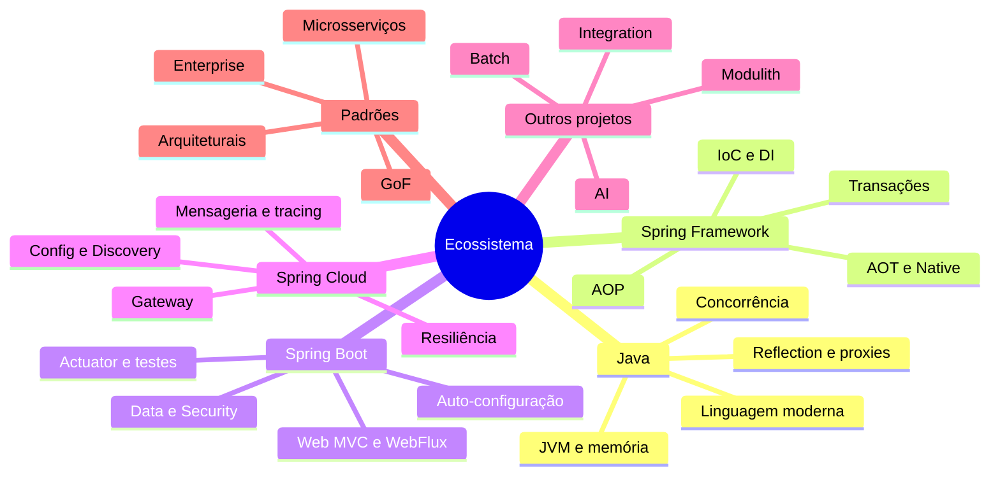

# Base de Estudo: Java, Spring e o Ecossistema Spring

> **Resumo:** base de conhecimento em português do Brasil que vai dos conceitos iniciais de Java (JVM, memória, linguagem moderna) até Spring, Spring Boot, Spring Cloud e padrões de projeto. O foco é entender **como** e **por que** as coisas funcionam.
> **Pré-requisitos:** lógica de programação (variáveis, condicionais, laços, funções).
> **Estado atual:** veja [PROGRESSO.md](PROGRESSO.md).

## Versões de referência (confirmadas em 2026-11-04)

| Tecnologia | Versão de referência | Fonte / observação |
|---|---|---|
| Java (LTS mais recente) | **25** (GA 2025-09-16) | openjdk.org/projects/jdk; Java 26 (2026-03) e 27 (2026-09-15) são releases não-LTS |
| Spring Framework | **7.0.x** (7.0.8 na página do projeto) | spring.io/projects/spring-framework |
| Spring Boot | **4.1.x** (4.1.2 na página do projeto) | spring.io/projects/spring-boot; ⚠️ VERIFICAR se 4.2 já saiu |
| Spring Cloud | **2025.1.x "Oakwood"** (2025.1.4) | Maven Central, out/2026; compatível com Boot 4.0.x e 4.1.x |

Os exemplos de código usam Java 25 como alvo e indicam "a partir do Java X" quando um recurso depende de versão. Ambiente de validação: JDKs 8, 17, 21 e 25 e Maven 3.9 (ver `PROGRESSO.md`).

## Ordem de estudo

1. `01-java/`: 00 (história) → 01 → 15, na ordem numérica.
2. `02-spring-core/`: 01 → 10. O arquivo 06 é o central.
3. `03-spring-boot/`: 01 → 13.
4. `04-spring-cloud/`: 01 → 09 (só depois de dominar Boot).
5. `05-outros-projetos-spring/`: consulta por demanda.
6. `06-padroes-de-projeto/`: pode ser lido em paralelo a partir do Spring Core.
7. `07-projeto-pratico/`: aplica tudo, com checkpoints para a teoria.

## Mapa mental

## Índice

### `01-java/` — Como o Java funciona
- `00-evolucao-do-java.md`: página histórica (formato próprio)
- `01-plataforma-java.md`: JDK/JRE/JVM, bytecode, JIT, HotSpot, GraalVM, distribuições
- `02-jvm-por-dentro.md`: ClassLoaders, memória, GCs, tuning, ferramentas
- `03-tipos-e-memoria.md`: primitivos, wrappers, String, `equals`/`hashCode`
- `04-orientacao-a-objetos.md`
- `05-recursos-modernos-da-linguagem.md`: `var`, records, sealed, pattern matching
- `06-generics.md`
- `07-colecoes.md`
- `08-excecoes.md`
- `09-programacao-funcional.md`: lambdas, Streams, Optional
- `10-anotacoes-e-reflection.md`
- `11-proxies-dinamicos-e-bytecode.md`
- `12-concorrencia.md`
- `13-io-nio-e-http.md`
- `14-modulos-e-build.md`: JPMS, Maven, Gradle
- `15-testes-em-java.md`: JUnit 5, AssertJ, Mockito

### `02-spring-core/` — Como o Spring funciona
- `01-o-que-e-spring.md`
- `02-ioc-e-injecao-de-dependencia.md`
- `03-application-context-e-beans.md`
- `04-ciclo-de-vida-e-escopos.md`
- `05-configuracao.md`
- `06-como-java-e-spring-conversam.md` (central, com mini-container de DI)
- `07-aop-e-proxies.md`
- `08-eventos-validacao-e-conversao.md`
- `09-transacoes.md`
- `10-aot-e-native.md`

### `03-spring-boot/`
- `01-o-que-e-spring-boot.md`
- `02-auto-configuracao.md`
- `03-configuracao-externalizada.md`
- `04-web-mvc.md`
- `05-webflux-e-reativo.md`
- `06-spring-data-jpa.md`
- `07-spring-data-outros.md`
- `08-spring-security.md`
- `09-actuator-e-observabilidade.md`
- `10-testes-no-spring-boot.md`
- `11-cache-agendamento-e-async.md`
- `12-migracoes-de-banco.md`
- `13-empacotamento-e-deploy.md`

### `04-spring-cloud/`
- `01-visao-geral.md`
- `02-config-server.md`
- `03-service-discovery.md`
- `04-api-gateway.md`
- `05-comunicacao-entre-servicos.md`
- `06-resiliencia.md`
- `07-mensageria.md`
- `08-tracing-distribuido.md`
- `09-spring-cloud-e-kubernetes.md`

### `05-outros-projetos-spring/`
Uma página por projeto: Spring Batch, Integration, Modulith, Authorization Server, GraphQL, AI, Session, HATEOAS, REST Docs (atividade de cada um a confirmar em spring.io/projects).

### `06-padroes-de-projeto/`
- `01-introducao.md`
- `02-criacionais.md`
- `03-estruturais.md`
- `04-comportamentais.md`
- `05-padroes-enterprise.md`
- `06-padroes-arquiteturais.md`
- `07-padroes-de-microsservicos.md`
- `08-anti-padroes.md`

### `07-projeto-pratico/`
- [README.md](07-projeto-pratico/README.md): API de pedidos incremental, com checkpoints 0 a 13

### Raiz
- [PROGRESSO.md](PROGRESSO.md) · [GLOSSARIO.md](GLOSSARIO.md)
