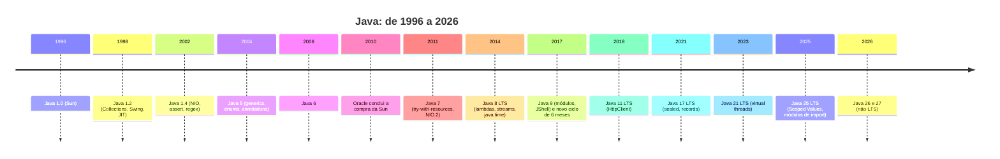
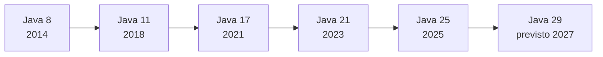
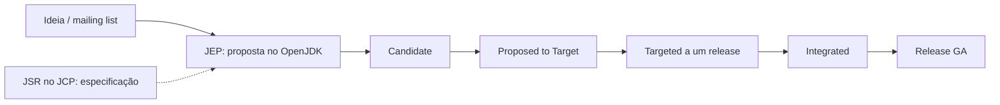

# Evolução do Java

> **Resumo:** história do Java de 1.0 (1996) até o Java 27 (2026): eras, versões, JEPs, marcos de linguagem, o processo de evolução (JCP/JEP) e as mudanças de ecossistema que afetam o Spring.
> **Pré-requisitos:** nenhum. Os demais arquivos de `01-java/` e `02-spring-core/` apontam para cá na seção "Evolução histórica".
> **Versões:** cobre 1.0 a 27. Java 25 é a LTS de referência (GA 2025-09-16). Dados de JEPs 25/26/27 conferidos em `openjdk.org/projects/jdk/<versão>` em 2026-11-04.

> Formato próprio (não segue o modelo de 10 seções), conforme especificação da base.

## 1. Linha do tempo



## 2. Eras do Java

**Era Sun (1.0 a 6, 1996–2009).** Java nasce como "write once, run anywhere": código compilado para bytecode roda em qualquer JVM. A Sun conduz a evolução; o JCP (Java Community Process) surge em 1998. Marcos: coleções e JIT (1.2), assertions e NIO (1.4), generics/anotações/enums (5), concorrência de alto nível `java.util.concurrent` (5). A numeração era "1.x" até a 1.4; a partir do 5 o "1." some do nome comercial (internamente 1.5, 1.6, 1.7, 1.8).

**Aquisição pela Oracle e Java 7 (2010–2013).** A Oracle conclui a compra da Sun em 2010. O Java 7 (2011) demorou anos e chegou enxuto (lambdas foram adiadas): try-with-resources, diamond, NIO.2, `invokedynamic`. OpenJDK passa a ser a implementação de referência.

**A virada do Java 8 (2014).** Lambdas, Streams e `java.time` mudam o estilo de escrita do código. É a versão que ficou por mais tempo como padrão de mercado, e o motivo de muitos sistemas legados ainda rodarem em 8.

**Modularização no Java 9 (2017).** O JPMS (Project Jigsaw) divide o próprio JDK em módulos e encapsula internals (`sun.misc.Unsafe` e afins). Foi uma quebra grande de compatibilidade: a adoção do 9 foi lenta e muita gente pulou direto para o 11.

**Releases a cada 6 meses (desde o Java 10, 2018).** Pelo JEP 322 (versionamento por tempo), sai uma versão em março e outra em setembro. Recursos novos chegam primeiro como *preview* ou *incubator* e amadurecem ao longo de várias versões.

**Cadência de LTS.** LTS (Long-Term Support) é uma designação dos fornecedores, não do OpenJDK em si. Java 8 e 11 (2018) e 17 (2021): uma LTS a cada 3 anos. A partir do 17, a Oracle anunciou LTS a cada 2 anos: **21 (2023) e 25 (2025)**; a próxima será a 29 (2027).



## 3. Tabela por versão

Colunas: versão, ano, LTS, novidades principais, JEPs/JSRs relevantes, impacto prático. Antes do JEP (criado em 2011), as referências são JSRs.

| Versão | Ano | LTS? | Principais novidades | JEPs/JSRs relevantes | Impacto prático |
|---|---|---|---|---|---|
| 1.0 | 1996 | – | Linguagem, applets, AWT, JVM | – | Nasce a ideia de bytecode portável |
| 1.1 | 1997 | – | Inner classes, JDBC, Reflection, JavaBeans | – | Base de reflection usada por todo framework |
| **1.2** | 1998 | – | Collections Framework, Swing, JIT, `strictfp`; "Java 2" | – | `List/Map/Set` passam a existir; divisão J2SE/J2EE/J2ME |
| 1.3 | 2000 | – | HotSpot como JVM padrão, JNDI, `java.lang.reflect.Proxy` | – | Proxies dinâmicos (base do Spring AOP com JDK proxy) |
| **1.4** | 2002 | – | `assert`, NIO (buffers/channels), regex, logging, exceções encadeadas, XML | JSR 51, 47 | NIO é a base de servidores de alto desempenho (Netty) |
| **5** | 2004 | – | Generics, enums, anotações, autoboxing, varargs, for-each, static import, `java.util.concurrent` | JSR 14, 175, 201, 166 | Habilita frameworks baseados em anotações |
| 6 | 2006 | – | Scripting API, JDBC 4, ganhos de desempenho, `ServiceLoader` | JSR 223, 221 | Versão estável de longa vida em servidores |
| **7** | 2011 | – | try-with-resources, diamond `<>`, multi-catch, strings em `switch`, NIO.2 (`Path`/`Files`), Fork/Join, `invokedynamic` | JSR 334, 203, 292 | Menos boilerplate; `invokedynamic` abre caminho às lambdas |
| **8** | 2014 | **LTS** | Lambdas, Streams, `Optional`, `java.time`, métodos default, `CompletableFuture`, Nashorn | JSR 335, 310 | Estilo funcional; padrão de mercado por quase uma década |
| **9** | 2017 | – | JPMS, JShell, `List.of/Map.of`, métodos privados em interfaces, G1 como GC padrão, `Flow` | JEP 261, 222, 248; JSR 376 | Primeira versão do ciclo novo; quebra de internals |
| 10 | 2018 | – | `var`, interface de GC, AppCDS | JEP 286, 304, 310 | Inferência local |
| **11** | 2018 | **LTS** | `HttpClient` padrão, `var` em lambdas, execução de `.java` direto, remoção de módulos Java EE/CORBA, ZGC experimental, Epsilon GC | JEP 321, 323, 330, 320, 333, 318 | Principal destino de migração do 8; Oracle JDK vira pago |
| 12 | 2019 | – | Switch expressions (preview), Shenandoah (experimental) | JEP 325, 189 | – |
| 13 | 2019 | – | Text blocks (preview) | JEP 355 | – |
| 14 | 2020 | – | Switch expressions (final), records (preview), `instanceof` com padrão (preview), NPE detalhadas | JEP 361, 359, 305, 358 | – |
| 15 | 2020 | – | Text blocks (final), sealed (preview), ZGC e Shenandoah de produção | JEP 378, 360, 377, 379 | – |
| 16 | 2021 | – | Records (final), `instanceof` com padrão (final), Vector API (incubator), encapsulamento forte por padrão (`--illegal-access=deny`) | JEP 395, 394, 338, 396 | Records viram DTOs padrão |
| **17** | 2021 | **LTS** | Sealed classes (final), encapsulamento forte dos internals, `RandomGenerator`, pattern matching em `switch` (preview) | JEP 409, 403, 356, 406 | Base mínima do Spring Framework 6 / Boot 3 |
| 18 | 2022 | – | UTF-8 padrão, `jwebserver` | JEP 400, 408 | Charset deixa de depender do SO |
| 19 | 2022 | – | Virtual threads (preview), record patterns (preview) | JEP 425, 405 | – |
| 20 | 2023 | – | Scoped Values (incubator), 2º preview das virtual threads | JEP 429, 436 | – |
| **21** | 2023 | **LTS** | Virtual threads (final), pattern matching em `switch` (final), record patterns (final), Sequenced Collections, ZGC geracional | JEP 444, 441, 440, 431, 439 | Concorrência simples e escalável; recomendação para novos projetos Spring |
| 22 | 2024 | – | FFM API (final), variáveis `_` (final), lançar fonte multi-arquivo | JEP 454, 456, 458 | Substitui JNI (Panama) |
| 23 | 2024 | – | Comentários Javadoc em Markdown, ZGC geracional por padrão; *string templates* removidos | JEP 467, 474 | – |
| 24 | 2025 | – | Class-File API (final), Stream Gatherers (final), Security Manager desativado permanentemente, cache de classes AOT, virtual threads sem *pinning* em `synchronized` | JEP 484, 485, 486, 483, 491 | Fim da era do SecurityManager |
| **25** | 2025 | **LTS** | Scoped Values (final), módulos de import, arquivos-fonte compactos e `main` de instância (final), construtores flexíveis (final), Compact Object Headers (final), Shenandoah geracional (final), JFR melhorado, KDF API; Structured Concurrency em 5º preview | JEP 506, 511, 512, 513, 519, 521, 510, 505 | **LTS de referência desta base** |
| 26 | 2026 | – | HTTP/3 no `HttpClient`, G1 com menos sincronização, AOT Object Caching com qualquer GC, remoção da Applet API, "Final means final" (avisos ao mutar `final` por reflection); previews: Lazy Constants, Structured Concurrency (6º), primitivos em padrões (4º) | JEP 517, 522, 516, 504, 500, 526, 525, 530 | Não-LTS |
| 27 | 2026 | – | G1 padrão em todos os ambientes, Compact Object Headers por padrão, TLS 1.3 híbrido pós-quântico; previews: Lazy Constants (3º), Structured Concurrency (7º), primitivos em padrões (5º) | JEP 523, 534, 527, 531, 533, 532 | Não-LTS (GA 2026-09-15) |

Observações:
- Java 28 está em desenvolvimento (não consta como lançado nesta data).
- A lista de JEPs por versão no OpenJDK traz só os JEPs "de destaque" daquele release; há muitas correções menores que não aparecem na tabela.
- Status conferido em 2026-11-04 nas páginas dos JEPs: 506 (Scoped Values), 512, 513, 519 e 521 são finais no 25; 505 (Structured Concurrency) segue preview no 25 (5º preview) e no 27 (JEP 533, 7º).

## 4. Marcos em detalhe (antes vs. depois)

Os exemplos usam o domínio comum (`Customer`, `Order`, `OrderItem`, `Product`, pacote `com.example.orders`). Trechos "novos" indicam a versão mínima.

### 4.1 Java 5: generics, enums e annotations

**Problema:** coleções guardavam `Object`, exigindo casts e falhando em tempo de execução; constantes eram `int`.

```java
// Java 1.4: sem generics, constantes inteiras
List items = new ArrayList();
items.add("pedido-1");
Integer errado = (Integer) items.get(0);        // ClassCastException em runtime
public static final int STATUS_NEW = 0;          // qualquer int é aceito

// Java 5+: o compilador verifica
List<String> ids = new ArrayList<String>();
ids.add("pedido-1");
enum OrderStatus { NEW, PAID, SHIPPED }          // tipo seguro
```

Anotações (`@Override`, `@Deprecated`) e metadados em runtime viabilizam o modelo declarativo do Spring, JPA e JUnit 4. Generics usam *type erasure* (ver [06-generics.md](06-generics.md)).

### 4.2 Java 7: try-with-resources e diamond

```java
// Antes
BufferedReader reader = null;
try {
    reader = new BufferedReader(new FileReader("orders.csv"));
    System.out.println(reader.readLine());
} finally {
    if (reader != null) { try { reader.close(); } catch (IOException ignored) {} }
}

// Java 7+
try (BufferedReader r = new BufferedReader(new FileReader("orders.csv"))) {
    System.out.println(r.readLine());           // close() automático, suprimidas ficam em getSuppressed()
}
Map<String, List<Order>> byCustomer = new HashMap<>();   // diamond
```

Ver [08-excecoes.md](08-excecoes.md).

### 4.3 Java 8: lambdas, streams e java.time

```java
// Antes
List<Order> paid = new ArrayList<>();
for (Order o : orders) {
    if (o.status() == OrderStatus.PAID) paid.add(o);
}
Collections.sort(paid, new Comparator<Order>() {
    public int compare(Order a, Order b) { return a.total().compareTo(b.total()); }
});

// Java 8+
List<Order> paid2 = orders.stream()
        .filter(o -> o.status() == OrderStatus.PAID)
        .sorted(Comparator.comparing(Order::total))
        .toList();                                // toList() é do Java 16

// Datas: java.util.Date (mutável, confuso) -> java.time (imutável)
LocalDate due = LocalDate.now().plusDays(30);
```

Lambdas são compiladas via `invokedynamic`, não como classes anônimas. Ver [09-programacao-funcional.md](09-programacao-funcional.md).

### 4.4 Java 9: módulos e JShell

```java
// module-info.java (Java 9+)
module com.example.orders {
    requires java.sql;
    exports com.example.orders.api;           // só este pacote é visível
}
```

```text
$ jshell
jshell> List.of(1, 2, 3).stream().mapToInt(i -> i).sum()
$1 ==> 6
```

Ver [14-modulos-e-build.md](14-modulos-e-build.md). A maior parte dos projetos Spring continua no classpath, mas o encapsulamento do JDK criado aqui impacta bibliotecas que usam reflection em internals (`--add-opens`).

### 4.5 Java 10: `var`

```java
var orders = new ArrayList<Order>();        // tipo inferido: ArrayList<Order>
for (var o : orders) { /* ... */ }
```

`var` é inferência local, não tipagem dinâmica: o tipo continua estático. Só vale para variáveis locais.

### 4.6 Java 11: HttpClient

```java
// Antes: HttpURLConnection, verboso e bloqueante
// Java 11+
HttpClient client = HttpClient.newHttpClient();
HttpRequest req = HttpRequest.newBuilder(URI.create("https://example.com/orders")).GET().build();
HttpResponse<String> res = client.send(req, HttpResponse.BodyHandlers.ofString());
```

Suporta HTTP/2, `sendAsync` e (a partir do Java 26) HTTP/3. Ver [13-io-nio-e-http.md](13-io-nio-e-http.md).

### 4.7 Java 14 a 21: o "Java moderno"

| Recurso | Preview | Final |
|---|---|---|
| Switch expressions | 12 | **14** |
| Text blocks | 13 | **15** |
| Records | 14 | **16** |
| `instanceof` com padrão | 14 | **16** |
| Sealed classes | 15 | **17** |
| Pattern matching em `switch` | 17 | **21** |
| Record patterns | 19 | **21** |

```java
// Antes
String label;
switch (order.status()) {
    case NEW: label = "Novo"; break;
    case PAID: label = "Pago"; break;
    default: label = "Outro";
}
if (obj instanceof Order) { Order o = (Order) obj; /* ... */ }
String sql = "SELECT *\n" + "FROM orders\n" + "WHERE id = ?";

// Java 14+ / 15+ / 16+
String label2 = switch (order.status()) {
    case NEW -> "Novo";
    case PAID -> "Pago";
    default -> "Outro";
};
if (obj instanceof Order o && o.total().signum() > 0) { /* ... */ }
String sql2 = """
        SELECT *
        FROM orders
        WHERE id = ?
        """;

// Records (16+) + sealed (17+) + pattern matching em switch (21+)
record Money(java.math.BigDecimal amount, String currency) {}
sealed interface PaymentMethod permits Card, Pix {}
record Card(String number) implements PaymentMethod {}
record Pix(String key) implements PaymentMethod {}

static String describe(PaymentMethod p) {
    return switch (p) {                       // exaustivo: sem default
        case Card(String n) -> "Cartão " + n.substring(n.length() - 4);
        case Pix(String k)  -> "Pix " + k;
    };
}
```

Detalhes em [05-recursos-modernos-da-linguagem.md](05-recursos-modernos-da-linguagem.md).

### 4.8 Java 21: virtual threads

```java
// Antes: pool limitado de threads de plataforma (1 thread de SO por tarefa)
try (var pool = Executors.newFixedThreadPool(200)) {
    for (Order o : orders) pool.submit(() -> process(o));
}

// Java 21+: uma virtual thread por tarefa; blocking I/O não prende thread de SO
try (var exec = Executors.newVirtualThreadPerTaskExecutor()) {
    for (Order o : orders) exec.submit(() -> process(o));
}
```

Virtual threads são agendadas pela JVM sobre poucas *carrier threads*; ao bloquear em I/O, desmontam da carrier. Foram o grande resultado do Project Loom. No Spring Boot, habilitam-se com `spring.threads.virtual.enabled=true` (ver [12-concorrencia.md](12-concorrencia.md) e, depois, o arquivo de WebFlux em `03-spring-boot/`). A propriedade existe no Boot 4.1.2, com padrão `false` (conferido nos metadados).

### 4.9 Java 25 (LTS de referência)

Principais itens finais:

```java
// Arquivo-fonte compacto + main de instância (JEP 512): scripts e aprendizado
void main() {
    IO.println("Olá, pedidos");               // classe java.lang.IO (JEP 512)
}

// Module import declarations (JEP 511)
import module java.base;                     // importa todos os pacotes exportados de java.base

// Flexible constructor bodies (JEP 513): código antes de super()/this()
class PositiveAmount extends Amount {
    PositiveAmount(long v) {
        if (v <= 0) throw new IllegalArgumentException("deve ser positivo");
        super(v);                              // validação antes da chamada ao super
    }
}

// Scoped Values (JEP 506): alternativa imutável e herdável a ThreadLocal
static final ScopedValue<String> USER = ScopedValue.newInstance();
ScopedValue.where(USER, "lucas").run(() -> System.out.println(USER.get()));
```

Outros itens da 25: Compact Object Headers (menor uso de heap), Shenandoah geracional, JFR com amostragem por CPU (experimental) e *method timing*, perfis AOT (JEP 514/515). Em **preview/incubator**: Structured Concurrency (5º preview), Stable Values, tipos primitivos em padrões, PEM, Vector API.

## 5. Como funciona o processo de evolução



- **JCP (Java Community Process):** órgão que padroniza a plataforma. Mudanças na especificação (linguagem, APIs) passam por **JSRs** (Java Specification Requests), com Expert Group, rascunhos e votação em comitê executivo.
- **JEP (JDK Enhancement Proposal):** documento do OpenJDK para recursos grandes de implementação (JEP 1 define o processo). Tem número, estado e release-alvo. Itens de linguagem normalmente têm tanto um JEP (implementação) quanto uma entrada na especificação (JLS/JVMS).
- **OpenJDK:** projeto open source (GPLv2 + Classpath Exception) onde o código vive; Oracle, Red Hat, Amazon, Microsoft, Azul e outros contribuem. Cada distribuição (Temurin, Corretto, Zulu etc.) é um *build* do OpenJDK. Ver [01-plataforma-java.md](01-plataforma-java.md).
- **Preview features:** recursos da *linguagem* ou da API completos, mas ainda sujeitos a mudança. Exigem `--enable-preview` na compilação e execução, e o `.class` gerado fica marcado para aquela versão exata:

```bash
javac --release 25 --enable-preview Main.java
java --enable-preview Main
```

- **Incubator modules:** APIs ainda não estáveis ficam em módulos `jdk.incubator.*`, ativados com `--add-modules jdk.incubator.vector` (exemplo: Vector API, incubadora há mais de dez ciclos).
- **Experimental:** recursos da JVM ativados com flags `-XX:+UnlockExperimentalVMOptions`.
- Um preview geralmente passa por 2 a 3 ciclos (Structured Concurrency já vai para o 7º) e pode ser alterado ou retirado (ex.: *string templates* foram removidos no Java 23).

## 6. Mudanças de ecossistema que afetam o Spring

### 6.1 Licenciamento: Oracle JDK vs OpenJDK
- Até o Java 10, o Oracle JDK era gratuito. Com o Java 11 (2018) passou a exigir assinatura para uso comercial, enquanto o OpenJDK da Oracle continuava gratuito (GPL), mas sem atualizações de longo prazo.
- Desde o Java 17, o Oracle JDK usa a licença NFTC (Oracle No-Fee Terms and Conditions), gratuita inclusive para uso comercial e em produção, por uma janela de tempo. Segundo o FAQ da Oracle (conferido em 2026-11-04): o Oracle JDK 25 recebe atualizações sob a NFTC até setembro de 2028 (um ano após o próximo LTS, o 29, previsto para setembro de 2027); depois disso, as atualizações do 25 passam à licença OTN, a mesma já usada para as atualizações de Java 8, 11, 17 e 21. Versões não-LTS (como o 27) ficam sob a NFTC durante todo o seu ciclo de seis meses. Confira o FAQ em `oracle.com/java/technologies/javase/jdk-faqs.html` antes de decidir, pois a Oracle pode mudar o plano.
- Na prática, o mercado migrou para builds comunitários do OpenJDK: Eclipse Temurin, Amazon Corretto, Azul Zulu, Microsoft Build of OpenJDK, Red Hat build. Para Spring, qualquer um serve.

### 6.2 `javax.*` → `jakarta.*`
- Java EE foi doado pela Oracle à Eclipse Foundation (2017) e renomeado **Jakarta EE**. Como a marca "Java" não podia ser usada, o *namespace* `javax.*` foi trocado por `jakarta.*` no **Jakarta EE 9** (2020). Antes, o Jakarta EE 8 manteve o `javax`.
- Impacto: `javax.servlet.*`, `javax.persistence.*`, `javax.validation.*` viraram `jakarta.*`. **Spring Framework 6 / Spring Boot 3 (nov/2022)** fizeram a migração. Dependências antigas que usam `javax` não funcionam em Boot 3+ sem recompilação ou ferramentas de migração.
- Os pacotes `javax.*` que são parte do próprio JDK (`javax.sql`, `javax.crypto`, `javax.net`) **não mudaram**.
- Boot 4 / Framework 7 usam Jakarta EE 11 (Servlet 6.1, conforme a página de requisitos do Boot 4.1.2).

### 6.3 Java mínimo por geração

| Spring Boot | Spring Framework | Java mínimo | Observação |
|---|---|---|---|
| 1.x (2014) | 4.x | **6** (o `starter-parent` do 1.0 ao 1.5 compila com `java.version` 1.6; conferido nos POMs do Central) | Era `javax` |
| 2.x (2018) | 5.x | **8** | Suporta 8 a 17+ conforme a minor; `javax` |
| 3.x (2022) | 6.x | **17** | `jakarta.*` (EE 9/10) |
| 4.x (2025) | 7.x | **17** (recomendado usar 21/25) | Jakarta EE 11; Boot 4.1.2 compatível com Java 17 a 27 (doc oficial) |

Fonte do Boot 4.1: `docs.spring.io/spring-boot/system-requirements.html` (consultado em 2026-11-04: "requires at least Java 17", compatível até Java 27, Spring Framework 7.0.10+, Servlet 6.1). As linhas de Boot 1.x/2.x/3.x vêm de conhecimento prévio e devem ser reconferidas nas páginas de release de cada geração.

## 7. Projetos em andamento no OpenJDK

| Projeto | Objetivo | O que já entregou |
|---|---|---|
| **Amber** | Produtividade da linguagem, menos boilerplate | `var`, switch expressions, text blocks, records, sealed, pattern matching, record patterns, `_`, arquivos compactos, flexible constructors, module imports. Em andamento: primitivos em padrões |
| **Loom** | Concorrência leve | Virtual threads (21), Scoped Values (25 final). Structured Concurrency ainda em preview (7º no Java 27) |
| **Panama** | Interop com código nativo | FFM API final no 22; Vector API ainda incubadora (12ª no 27) |
| **Valhalla** | Value classes e tipos primitivos unificados, melhor layout de memória | Ainda não entregue. O JEP 401 (Value Objects, preview) não está no Java 25 nem no 27; consta como alvo do JDK 28 (GA previsto para março de 2027), conforme `openjdk.org/projects/jdk/28` em 2026-11-04 |
| **Leyden** | Reduzir tempo de startup e warm-up | AOT class loading (24), AOT command-line ergonomics e method profiling (25), AOT object caching com qualquer GC (26) |
| **Lilliput** | Cabeçalhos de objeto menores | Compact Object Headers: experimental (24), final (25), padrão (27) |
| **CRaC** | Checkpoint/restore da JVM | Não faz parte do JDK principal; usado em algumas distribuições (Azul, Spring suporta) |

## 8. Referências oficiais
- Lista de JEPs: [openjdk.org/jeps](https://openjdk.org/jeps/0)
- Releases do OpenJDK: [openjdk.org/projects/jdk](https://openjdk.org/projects/jdk/) (páginas `/25/`, `/26/`, `/27/`)
- Projetos: [Amber](https://openjdk.org/projects/amber/), [Loom](https://openjdk.org/projects/loom/), [Panama](https://openjdk.org/projects/panama/), [Valhalla](https://openjdk.org/projects/valhalla/), [Leyden](https://openjdk.org/projects/leyden/)
- Notas de release e roadmap Oracle: [oracle.com/java](https://www.oracle.com/java/) e [docs.oracle.com/en/java](https://docs.oracle.com/en/java/)
- Documentação para desenvolvedores: [dev.java](https://dev.java/)
- Especificações: [JLS/JVMS](https://docs.oracle.com/javase/specs/)
- Spring Boot, requisitos: [docs.spring.io/spring-boot/system-requirements.html](https://docs.spring.io/spring-boot/system-requirements.html)
