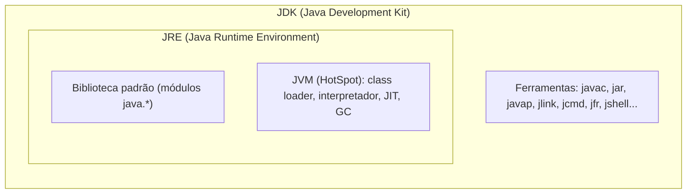
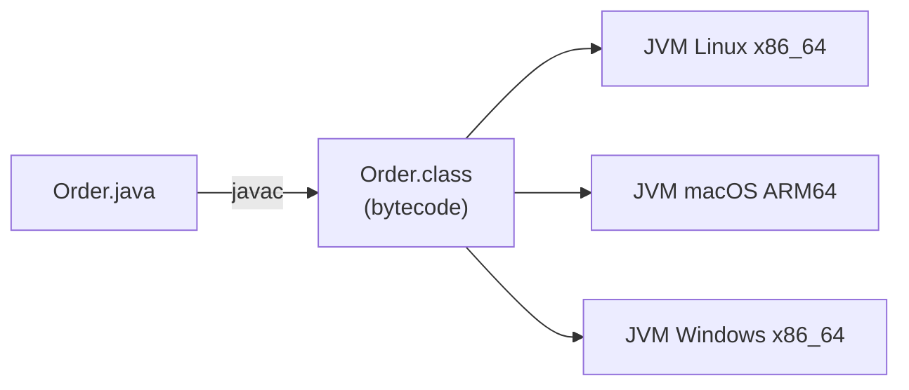
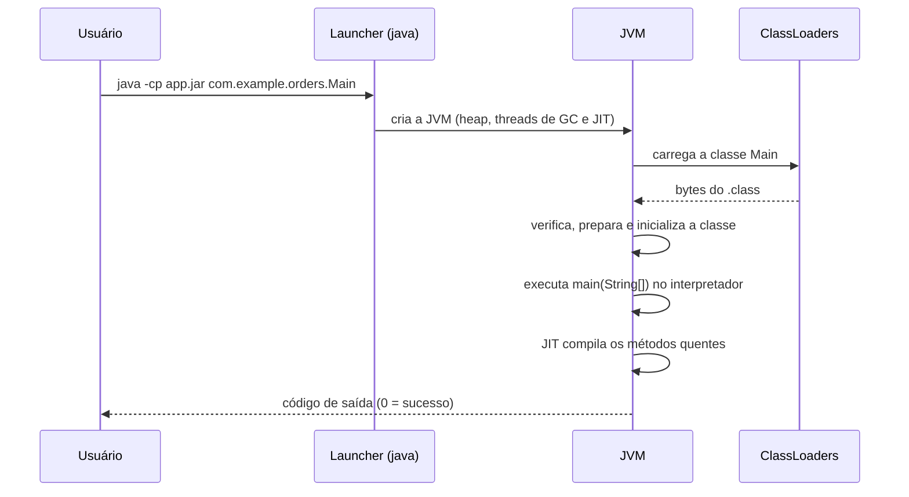

# A plataforma Java: JDK, JRE, JVM, bytecode e JIT

> **Resumo:** Java não é só uma linguagem: é uma *plataforma* composta por linguagem, compilador, formato de bytecode, máquina virtual (JVM) e biblioteca padrão. Entender essas peças explica por que o mesmo `.class` roda em qualquer sistema, por que o Java "esquenta" antes de ficar rápido e por que existem tantas distribuições do JDK.
> **Pré-requisitos:** [00-evolucao-do-java.md](00-evolucao-do-java.md) (contexto histórico).
> **Versões:** exemplos executados no OpenJDK 25 (LTS). Recursos de versão específica são indicados no texto.

## 1. Definição

Quando alguém diz "Java", pode estar falando de quatro coisas diferentes:

| Camada | O que é | Exemplo |
|---|---|---|
| **Linguagem** | Sintaxe e semântica, especificadas na JLS (*Java Language Specification*) | `record`, `switch`, generics |
| **Compilador** | Traduz código-fonte `.java` em bytecode `.class` | `javac` |
| **Máquina virtual (JVM)** | Executa bytecode; especificada na JVMS (*Java Virtual Machine Specification*) | HotSpot |
| **Biblioteca padrão** | Classes do módulo `java.base` e demais módulos do JDK | `java.util`, `java.time`, `java.net.http` |

A frase-síntese é: **Java compila para um código intermediário (bytecode), e uma JVM o executa**. A linguagem e a JVM são especificações separadas: existem linguagens que não são Java e rodam na JVM (Kotlin, Scala, Groovy, Clojure), e a JVM só enxerga bytecode, nunca código-fonte.

### JDK, JRE e JVM



- **JVM**: o motor que carrega classes, interpreta/compila bytecode e gerencia memória.
- **JRE**: JVM + biblioteca padrão, o suficiente para *rodar* aplicações.
- **JDK**: JRE + ferramentas de desenvolvimento, o necessário para *construir* aplicações.

> **Observação importante:** a partir do Java 9 (modularização) e do Java 11, a Oracle e as demais distribuições deixaram de publicar um "JRE" separado. Hoje se instala o JDK mesmo para executar, ou se gera um *runtime* sob medida com `jlink` (seção 3.6). O termo JRE continua útil conceitualmente.

## 2. Conceitos fundamentais

### 2.1 "Write once, run anywhere" na prática

O compilador não gera código de máquina de um processador específico (x86, ARM). Ele gera **bytecode**, um conjunto de instruções de uma máquina de pilha abstrata. Cada sistema operacional/arquitetura tem sua própria JVM nativa, que sabe executar o mesmo bytecode. A portabilidade vem da JVM, não do código.



### 2.2 Bytecode e o arquivo `.class`

O `.class` é um formato binário definido pela JVMS. Todo arquivo começa com o *magic number* `0xCAFEBABE` e traz a versão do formato (*major version*): o Java 8 gera 52, o 17 gera 61, o 21 gera 65 e o 25 gera 69 (regra: Java N ⇒ major N + 44). Uma JVM mais antiga recusa `.class` de versão maior com `UnsupportedClassVersionError`.

Conteúdo de um `.class`: *constant pool* (literais, nomes de classes/métodos/campos, referências), flags de acesso, superclasse e interfaces, campos, métodos (com o bytecode em si) e atributos (anotações, `Record`, `PermittedSubclasses`, números de linha etc.).

### 2.3 Execução: interpretar e compilar

A JVM combina duas formas de executar bytecode:

- **Interpretador**: lê instrução por instrução. Começa a executar imediatamente, mas é lento.
- **Compilador JIT (*Just-In-Time*)**: observa quais métodos são executados com frequência ("quentes") e os compila para código de máquina nativo *durante a execução*, usando informações de perfil reais do programa.

Por isso o Java tem **tempo de aquecimento (*warm-up*)**: o primeiro milhar de chamadas é mais lento do que as seguintes. Em compensação, o JIT pode otimizar com dados que um compilador estático (AOT) não tem.

### 2.4 Distribuições do JDK

O código-fonte do JDK é o projeto **OpenJDK** (open source, GPLv2 com *Classpath Exception*). Vários fornecedores empacotam builds a partir dele, passam pelos testes de conformidade (TCK) e dão suporte:

| Distribuição | Mantenedor | Observação |
|---|---|---|
| Oracle JDK | Oracle | Licença própria (NFTC em certas versões; ver nota abaixo) |
| Eclipse Temurin | Eclipse Foundation (Adoptium) | Build comunitário muito usado, sem custo |
| Amazon Corretto | Amazon | Usado internamente na AWS |
| Azul Zulu | Azul | Há também a versão comercial Azul Platform Prime |
| Microsoft Build of OpenJDK | Microsoft | |
| BellSoft Liberica | BellSoft | Inclui variante com JavaFX |
| SAP SapMachine | SAP | |
| Red Hat build of OpenJDK | Red Hat | Padrão em RHEL/OpenShift |

Para código, as diferenças são mínimas: todas implementam o mesmo Java SE. O que muda é **prazo de suporte (LTS), licença, patches e ferramentas extras**. O Oracle JDK 21 e posteriores usam a NFTC, que permite uso gratuito, inclusive comercial (confirmado no FAQ da Oracle em 2026-11-04); o histórico e as janelas de validade estão em [00-evolucao-do-java.md](00-evolucao-do-java.md).

## 3. Como funciona por dentro

### 3.1 Da fonte ao bytecode

Vamos olhar um programa pequeno e o bytecode que `javac` gera:

```java
public class Hello {
    static int sum(int a, int b) { return a + b; }

    public static void main(String[] args) {
        int total = 0;
        for (int i = 0; i < 200_000; i++) total = sum(total, i % 7);
        System.out.println(total);
    }
}
```

```bash
javac Hello.java
javap -c -p Hello      # -c: desassembla; -p: inclui membros privados
```

Saída (trecho, obtida com OpenJDK 25):

```text
static int sum(int, int);
  Code:
     0: iload_0
     1: iload_1
     2: iadd
     3: ireturn
```

Leia assim: a JVM é uma **máquina de pilha**. `iload_0` empilha o argumento 0 (um `int`); `iload_1` empilha o argumento 1; `iadd` desempilha dois valores e empilha a soma; `ireturn` desempilha e retorna. O prefixo `i` indica o tipo `int` (`l` = long, `d` = double, `a` = referência).

Para ver o cabeçalho do `.class`:

```bash
xxd Hello.class | head -1
# 00000000: cafe babe 0000 0045 ...   → magic 0xCAFEBABE, major 0x45 = 69 (Java 25)
```

### 3.2 As famílias de instruções de chamada

O bytecode distingue como um método é invocado, e isso é a base para entender polimorfismo, proxies e `lambda`:

| Instrução | Usada para |
|---|---|
| `invokestatic` | método estático |
| `invokespecial` | construtores, `super.metodo()`, métodos privados (antes do Java 11) |
| `invokevirtual` | método de instância de classe (despacho dinâmico pela classe real do objeto) |
| `invokeinterface` | método declarado em interface |
| `invokedynamic` | ligação adiada até a execução (lambdas, concatenação de `String`, `switch` com padrões) |

`invokedynamic` (Java 7, usado por lambdas desde o Java 8) é por que `() -> x` não gera uma classe anônima em tempo de compilação: a classe é produzida em tempo de execução. Retomamos isso em [09-programacao-funcional.md](09-programacao-funcional.md) e [11-proxies-dinamicos-e-bytecode.md](11-proxies-dinamicos-e-bytecode.md).

### 3.3 O ciclo de vida de uma execução



As etapas de **carga, ligação (verificação, preparação, resolução) e inicialização** de uma classe são detalhadas em [02-jvm-por-dentro.md](02-jvm-por-dentro.md).

### 3.4 Compilação em camadas (*tiered compilation*)

O HotSpot, a JVM de referência da OpenJDK, tem dois compiladores JIT, com objetivos diferentes:

- **C1 (*client compiler*)**: compila rápido, com otimizações leves.
- **C2 (*server compiler*)**: compila devagar, com otimizações agressivas (inlining profundo, análise de escape, desenrolar de laços, vetorização).

Desde o Java 8 a *tiered compilation* é o padrão, e usa os dois em sequência:

| Nível | Execução | Observação |
|---|---|---|
| 0 | Interpretador | Coleta contadores de invocação e de laços |
| 1 | C1 sem perfil | Para métodos triviais |
| 2 | C1 com contadores limitados | |
| 3 | C1 com perfil completo | Coleta dados para o C2 |
| 4 | C2 | Código final, o mais otimizado |

Podemos observar isso com `-XX:+PrintCompilation` no programa acima:

```bash
java -XX:+PrintCompilation Hello | grep "Hello::"
```

```text
 11    8       3       Hello::sum (4 bytes)            ← nível 3 (C1 com perfil)
 12    9       4       Hello::sum (4 bytes)            ← nível 4 (C2)
 12   10 %     3       Hello::main @ 4 (33 bytes)      ← OSR
 12   12 %     4       Hello::main @ 4 (33 bytes)
```

(Colunas: tempo em ms, id da compilação, flags, nível, método. A saída varia a cada execução.) O `%` indica **OSR (*on-stack replacement*)**: o laço de `main` ficou quente *enquanto ainda executava*, então a JVM troca o código interpretado pelo compilado no meio da execução.

Principais otimizações do C2:

- **Inlining**: copia o corpo do método chamado no chamador, eliminando a chamada. É a otimização que habilita as demais.
- **Análise de escape**: se um objeto nunca "escapa" do método, a JVM pode evitar alocá-lo no heap (substituição escalar).
- **Devirtualização**: se só uma implementação de uma interface foi carregada, a chamada vira chamada direta, protegida por uma verificação.
- **Eliminação de código morto e de verificações** (por exemplo, limites de arrays em laços).

#### Especulação e desotimização

O JIT compila com **suposições** baseadas no perfil (por exemplo, "esse `if` nunca é verdadeiro", "essa chamada só vê a classe `PixPayment`"). Se a suposição for quebrada depois (outra classe é carregada), a JVM executa uma **desotimização**: descarta o código nativo e volta ao interpretador, recompilando depois. É por isso que `made not entrant` aparece no log acima. Resultado prático: o desempenho do Java em estado estável pode igualar ou superar código AOT, mas é *menos previsível* no início.

> **Code cache:** o código nativo gerado fica numa área própria de memória (*code cache*), fora do heap. Ela é parte do consumo total de memória do processo, o que importa em contêineres.

### 3.5 Outros modos de execução: AOT e GraalVM

A "JVM clássica" faz tudo em tempo de execução. Há alternativas que movem trabalho para antes:

| Tecnologia | O que faz | Compromissos |
|---|---|---|
| **CDS / AppCDS** (*Class Data Sharing*) | Guarda classes já processadas num arquivo mapeado em memória, acelerando a inicialização e economizando memória. O CDS do JDK é padrão desde o Java 12 | Ainda é JVM; só melhora a partida |
| **Projeto Leyden** (AOT cache) | Evolui o CDS para guardar também dados de linking, e perfis. Entregou o JEP 483 (carga e linking antecipados de classes, Java 24) e os JEPs 514 (ergonomia de linha de comando) e 515 (perfis de métodos), ambos no Java 25; o JEP 516 (AOT cache com qualquer GC) veio no Java 26 | Depende de uma execução de "treino" |
| **GraalVM Native Image** | Compila a aplicação inteira **antes** da execução para um executável nativo, sem JVM tradicional | Partida em milissegundos e menos memória; mas exige "mundo fechado" (reflection, proxies e recursos precisam ser declarados), build lento e sem JIT |
| **Compilador Graal (JIT)** | JIT escrito em Java que pode substituir o C2 no GraalVM | Depende da distribuição |

Esses pontos reaparecem em [10-aot-e-native.md](../02-spring-core/10-aot-e-native.md) (Spring AOT) e em [13-empacotamento-e-deploy.md](../03-spring-boot/13-empacotamento-e-deploy.md). A regra geral: **native image troca desempenho de pico e flexibilidade dinâmica por partida rápida e baixo consumo de memória**.

### 3.6 Ferramentas do JDK

| Ferramenta | Função |
|---|---|
| `javac` | Compila `.java` para `.class` |
| `java` | Lança a JVM (também executa um `.java` único: `java Hello.java`, a partir do Java 11) |
| `javap` | Desassembla `.class` |
| `jar` | Cria/inspeciona arquivos JAR |
| `jshell` | REPL interativo (Java 9+) |
| `jlink` | Monta um runtime enxuto só com os módulos necessários |
| `jpackage` | Gera instaladores nativos (Java 14 incubator, 16 final) |
| `jdeps` | Analisa dependências entre classes/módulos |
| `jcmd`, `jfr`, `jstack`, `jmap` | Diagnóstico e perfilamento (ver [02-jvm-por-dentro.md](02-jvm-por-dentro.md)) |

Exemplo de `jlink` para criar um runtime mínimo:

```bash
jdeps --print-module-deps --ignore-missing-deps app.jar
# java.base,java.logging
jlink --add-modules java.base,java.logging --output meu-runtime --strip-debug --no-header-files --no-man-pages
meu-runtime/bin/java -jar app.jar
```

## 4. Evolução histórica

- **Java 1.0 (1996)**: interpretador puro. **1.3 (2000)**: HotSpot passa a ser a JVM padrão, com JIT adaptativo.
- **Java 8 (2014)**: *tiered compilation* ativada por padrão; remoção da PermGen (virou Metaspace).
- **Java 9 (2017)**: sistema de módulos, `jlink`, `jshell`; fim da distribuição separada do JRE na prática.
- **Java 11 (2018)**: `java Arquivo.java` executa código-fonte único.
- **Java 12 em diante**: CDS padrão e, depois, AppCDS dinâmico; **Java 24/25**: primeiros resultados do Projeto Leyden.

A linha do tempo completa está em [00-evolucao-do-java.md](00-evolucao-do-java.md).

## 5. Exemplos práticos

### 5.1 Compilar, inspecionar e executar

```bash
mkdir -p out
javac -d out src/com/example/orders/Main.java     # -d define a pasta de saída
java  -cp out com.example.orders.Main             # -cp (classpath): onde procurar .class
javap -cp out -c -p com.example.orders.Main
```

### 5.2 Executar um arquivo único (Java 11+)

```java
// Hello.java
void main() {                       // "instance main" e classe implícita: preview nos Java 21 a 24
    System.out.println("Olá, pedidos!");
}
```

```bash
java Hello.java        # compila na memória e executa; sem gerar .class
```

> **Atenção à versão:** *instance main methods* e classes não nomeadas foram *preview* nos Java 21 a 24 (exigiam `--enable-preview`) e se tornaram recurso final no Java 25 como "Compact Source Files and Instance Main Methods" (JEP 512). Em versões anteriores, use o tradicional `public static void main(String[] args)`.

### 5.3 Ver o efeito do aquecimento

```java
public class Warmup {
    static long work(int n) {
        long acc = 0;
        for (int i = 0; i < n; i++) acc += i % 7;
        return acc;
    }

    public static void main(String[] args) {
        for (int round = 1; round <= 5; round++) {
            long t0 = System.nanoTime();
            long r = work(50_000_000);
            long ms = (System.nanoTime() - t0) / 1_000_000;
            System.out.println("rodada " + round + ": " + ms + " ms (r=" + r + ")");
        }
    }
}
```

As primeiras rodadas costumam ser mais lentas, até o laço ser compilado pelo C2. **Aviso:** isso é uma demonstração, não um *benchmark* confiável. Para medir desempenho de verdade use JMH, que controla aquecimento, eliminação de código morto e variação.

### 5.4 Opções úteis de linha de comando

```bash
java -Xms512m -Xmx512m -jar app.jar         # heap inicial e máximo
java -XX:+PrintCompilation -jar app.jar      # log do JIT
java -XX:+UnlockDiagnosticVMOptions -XX:+PrintFlagsFinal -version | grep -i tiered
java -Xint -jar app.jar                      # só interpretador (para comparar)
java --show-version -jar app.jar              # imprime a versão e segue
java -XX:+AutoCreateSharedArchive -XX:SharedArchiveFile=app.jsa -jar app.jar   # AppCDS dinâmico (Java 19+)
```

## 6. Configurações e anotações relevantes

| Flag / variável | Para que serve | Exemplo |
|---|---|---|
| `JAVA_HOME` | Diretório do JDK usado por Maven, Gradle e scripts | `export JAVA_HOME=/usr/lib/jvm/java-25-openjdk-amd64` |
| `-cp` / `--class-path` | Onde buscar classes | `-cp "lib/*:out"` |
| `-Xms` / `-Xmx` | Heap inicial / máximo | `-Xmx2g` |
| `-XX:+PrintCompilation` | Mostra compilações JIT | |
| `-XX:TieredStopAtLevel=1` | Limita ao C1 (partida rápida, pico menor) | usado em ferramentas de curta duração |
| `-Xint` | Desliga o JIT | só para diagnóstico |
| `--enable-preview` | Habilita recursos em preview (também em `javac --release N`) | `javac --release 25 --enable-preview` |
| `--release N` | Compila para a API e bytecode do Java N | `javac --release 17` |
| `JAVA_TOOL_OPTIONS` | Opções injetadas em toda JVM iniciada | útil em contêineres |
| `-XX:MaxRAMPercentage` | Heap como % da memória do contêiner | `-XX:MaxRAMPercentage=75` |

`--release` é preferível a `-source`/`-target`: ele também restringe a **API** disponível (evita usar sem querer um método que só existe no Java mais novo).

## 7. Quando usar e quando NÃO usar

| Cenário | Recomendação |
|---|---|
| Serviço de longa duração (API, processamento) | **JVM tradicional**: o JIT entrega o melhor desempenho em estado estável |
| Funções *serverless*, CLIs, escala a zero | Considerar **native image** ou CDS/AppCDS/Leyden, pelo ganho na partida |
| Contêiner com pouca memória | Ajustar `MaxRAMPercentage`, limitar o code cache e Metaspace; considerar native |
| Ferramenta que roda por segundos | `-XX:TieredStopAtLevel=1` e CDS podem bastar |
| Precisa de reflection/proxies muito dinâmicos | **Evitar native image** ou aceitar configurar *hints* de reflection |

## 8. Erros comuns e boas práticas

- **Confundir `JAVA_HOME` com o `java` do PATH.** O Maven usa o `java` do ambiente; `mvn -v` mostra qual JDK ele enxerga. Divergência causa o clássico `UnsupportedClassVersionError`.
- **Compilar com um JDK novo e rodar num runtime antigo.** Use `--release` (ou `maven.compiler.release`) igual à versão mínima de execução.
- **Medir desempenho com `System.nanoTime()` e uma rodada.** Aquecimento e GC distorcem; use JMH.
- **Ajustar dezenas de `-XX` sem medir.** Os padrões do HotSpot são bons; mude uma opção por vez e meça com JFR.
- **Esquecer que a JVM em contêiner é "container-aware"** (desde o Java 10) e dimensiona CPU/memória pelos limites do cgroup; ainda assim, defina `-Xmx` ou `MaxRAMPercentage` explicitamente.
- **Achar que "interpretado" = "lento para sempre".** O JIT existe justamente para evitar isso; rodar com `-Xint` é só para comparar.
- **Usar `latest` do Oracle JDK em produção sem checar a licença.** Prefira uma distribuição com política de suporte clara.

## 9. Perguntas de revisão

1. Qual a diferença entre JDK, JRE e JVM? Por que "JRE" deixou de ser distribuído separadamente?
<details><summary>Resposta</summary>JVM executa bytecode; JRE = JVM + bibliotecas (para rodar); JDK = JRE + ferramentas de desenvolvimento (`javac`, `jar` etc.). Com a modularização (Java 9) e `jlink`, o runtime passou a ser montado sob medida, e as distribuições entregam o JDK completo.</details>

2. Por que o mesmo `.class` roda em Linux, macOS e Windows?
<details><summary>Resposta</summary>Porque o `.class` contém bytecode de uma máquina de pilha abstrata, e cada plataforma tem uma JVM nativa que o interpreta/compila para o código de máquina local.</details>

3. O que é a *tiered compilation* e o que significa o `%` na saída de `-XX:+PrintCompilation`?
<details><summary>Resposta</summary>É a estratégia de usar interpretador (nível 0), C1 (níveis 1 a 3, com coleta de perfil) e C2 (nível 4) em sequência, conforme o método esquenta. O `%` marca uma compilação OSR (*on-stack replacement*), feita para um laço quente que ainda está executando.</details>

4. O que é desotimização e por que o JIT precisa dela?
<details><summary>Resposta</summary>O JIT compila com suposições baseadas em perfil (tipos vistos, ramos tomados). Se uma suposição deixa de valer, a JVM descarta o código nativo e retorna ao interpretador, garantindo correção. Isso permite otimizações agressivas sem perder segurança.</details>

5. Quando um native image é preferível à JVM tradicional, e qual o custo?
<details><summary>Resposta</summary>Quando partida rápida e baixo consumo de memória pesam mais (serverless, CLIs, escala a zero). O custo é build lento, "mundo fechado" (reflection, proxies e recursos devem ser declarados em tempo de build) e desempenho de pico geralmente menor, por não haver JIT.</details>

## 10. Referências oficiais

- JVM Specification e Language Specification: <https://docs.oracle.com/javase/specs/>
- Documentação do JDK 25 (ferramentas `java`, `javac`, `jlink`): <https://docs.oracle.com/en/java/javase/25/>
- Tutoriais e guias: <https://dev.java>
- JEPs e releases do OpenJDK: <https://openjdk.org/jeps/0> e <https://openjdk.org/projects/jdk/>
- Projeto Leyden: <https://openjdk.org/projects/leyden/>
- Adoptium (Temurin): <https://adoptium.net>
- GraalVM: <https://www.graalvm.org>
