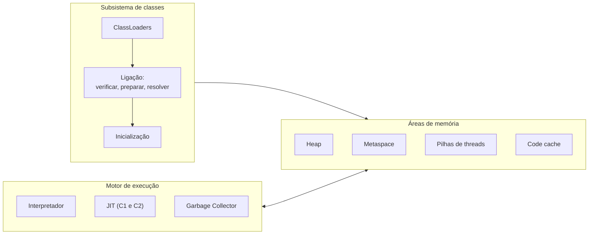
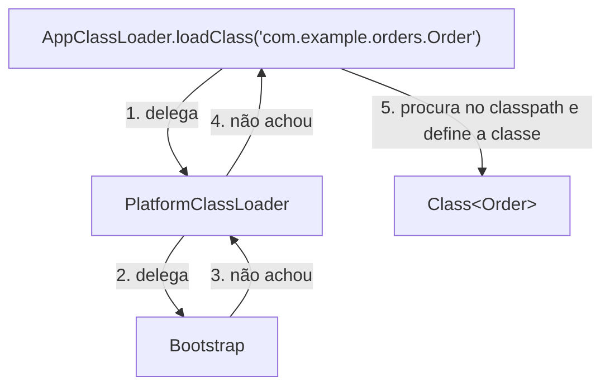
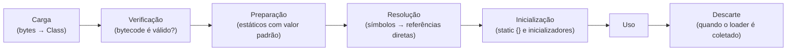
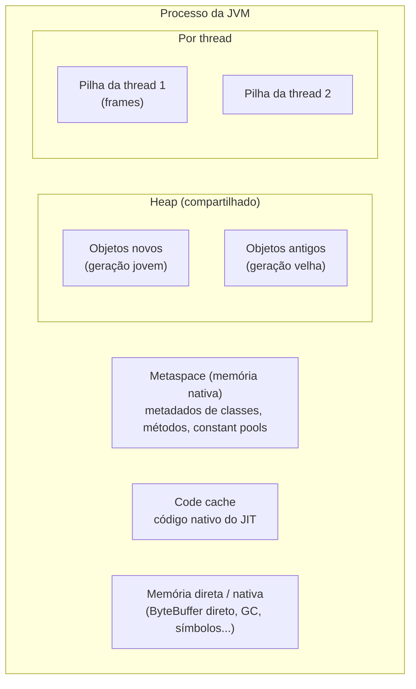
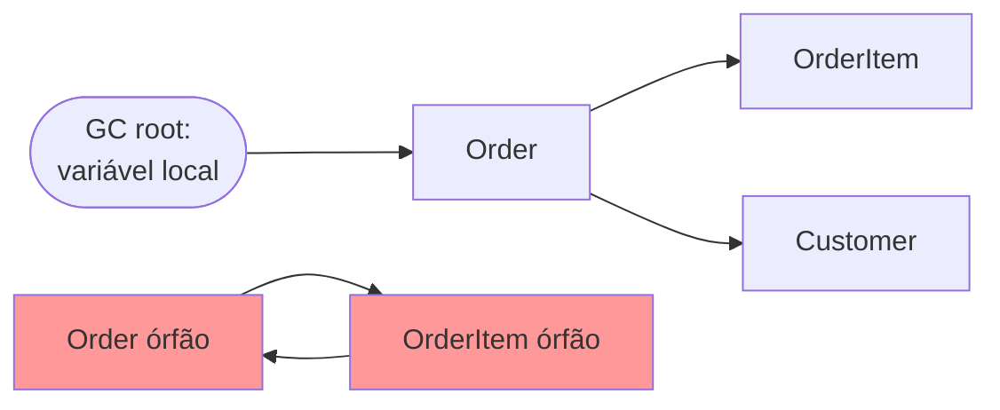
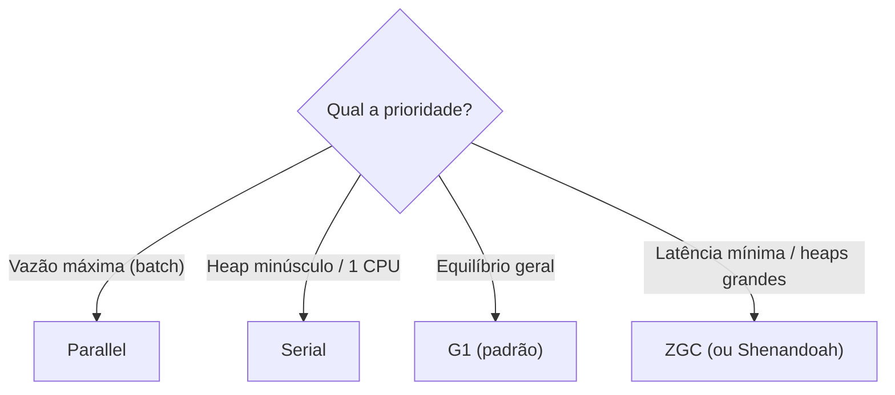

# A JVM por dentro: ClassLoaders, memória e Garbage Collectors

> **Resumo:** este arquivo abre a "caixa-preta" da JVM: como as classes são carregadas e ligadas, onde cada tipo de dado vive na memória, como o lixo é coletado e como diagnosticar problemas. É a base para entender `OutOfMemoryError`, pausas de GC, vazamentos de ClassLoader e, mais à frente, o funcionamento de contêineres de DI e proxies.
> **Pré-requisitos:** [01-plataforma-java.md](01-plataforma-java.md).
> **Versões:** exemplos executados no OpenJDK 25 (G1 como GC padrão). Diferenças por versão indicadas no texto.

## 1. Definição

A JVM é, em essência, três subsistemas cooperando:



## 2. Conceitos fundamentais

### 2.1 ClassLoaders e o modelo de delegação

Um **ClassLoader** é o objeto que, dado o nome de uma classe, encontra os bytes do `.class` e os entrega à JVM. Uma classe é identificada **pelo par (nome qualificado, ClassLoader que a definiu)**: a mesma classe carregada por dois loaders diferentes são dois tipos distintos e não são atribuíveis entre si (`ClassCastException` com nomes idênticos é o sintoma clássico).

Desde o Java 9, a hierarquia padrão tem três loaders:

| Loader | Carrega | `getClassLoader()` retorna |
|---|---|---|
| **Bootstrap** (nativo) | `java.base` e módulos centrais | `null` |
| **Platform** | demais módulos do JDK (ex.: `java.sql`) | `PlatformClassLoader` |
| **Application (System)** | classpath/module path da aplicação | `AppClassLoader` |

Resultado do programa de teste (seção 5.1), reformatado para leitura:

```text
String   -> null                                  (Bootstrap)
Connection (java.sql) -> ...PlatformClassLoader
Gc (nossa classe)     -> ...AppClassLoader
pai do AppClassLoader -> ...PlatformClassLoader
```

**Delegação ao pai:** ao receber `loadClass("X")`, o loader primeiro pergunta ao pai; só se o pai não encontrar é que tenta carregar sozinho.



Por que esse desenho? **Segurança e consistência**: ninguém consegue "substituir" `java.lang.String` colocando um `String.class` próprio no classpath, pois o Bootstrap sempre responde primeiro.

Servidores de aplicação e frameworks quebram a regra de propósito para isolar aplicações (um loader por WAR, que tenta carregar localmente *antes* de delegar), e é isso que permite duas aplicações no mesmo Tomcat usarem versões diferentes de uma mesma biblioteca. O custo: **vazamentos de ClassLoader** (um `static` ou `ThreadLocal` que referencia uma classe da aplicação impede o descarte do loader inteiro ao redeployar).

### 2.2 Ciclo de vida de uma classe



- **Verificação**: garante que o bytecode respeita as regras da JVM (tipos consistentes, pilha balanceada). É parte da segurança da plataforma.
- **Preparação**: aloca os campos `static` com valores padrão (`0`, `null`, `false`).
- **Resolução**: troca referências simbólicas do *constant pool* ("`java/lang/String.length()`") por referências diretas. Pode ser preguiçosa.
- **Inicialização**: executa os inicializadores estáticos, **uma única vez, de forma thread-safe**. Ocorre na primeira vez em que a classe é *usada ativamente* (`new`, chamada de método estático, acesso a campo estático não constante).

Consequência prática: o *idiom* do **Initialization-on-demand holder** (Singleton preguiçoso e thread-safe) se apoia exatamente nessa garantia (ver [02-criacionais.md](../06-padroes-de-projeto/02-criacionais.md)).

### 2.3 Áreas de memória



| Área | Conteúdo | Falha típica |
|---|---|---|
| **Heap** | Todos os objetos e arrays | `OutOfMemoryError: Java heap space` |
| **Pilha de thread** (*stack*) | Um *frame* por chamada de método: variáveis locais, operandos, referências. Tamanho padrão ≈ 1 MiB por thread em Linux x64 (`-Xss`) | `StackOverflowError` |
| **Metaspace** | Metadados das classes (substituiu a PermGen no Java 8). Cresce em memória nativa até o limite do SO ou de `-XX:MaxMetaspaceSize` | `OutOfMemoryError: Metaspace` |
| **Code cache** | Código gerado pelo JIT | JIT desliga ("CodeCache is full") |
| **Memória direta** | `ByteBuffer.allocateDirect`, Netty, bibliotecas nativas | `OutOfMemoryError: Direct buffer memory` |

**O que vai na pilha e o que vai no heap?** Variáveis locais *primitivas* ficam no frame; objetos ficam **sempre** no heap (a pilha guarda só a *referência*). A exceção "aparente" é a análise de escape (seção 3.1 de [01-plataforma-java.md](01-plataforma-java.md)), que pode eliminar a alocação, mas é otimização, não semântica.

```java
void process() {
    int quantity = 3;                    // frame: valor 3
    Order order = new Order(quantity);   // frame: referência; heap: objeto Order
}                                        // frame é descartado; o Order vira lixo se ninguém o referencia
```

### 2.4 Anatomia de um objeto

Todo objeto no heap tem um **cabeçalho** (*mark word* e ponteiro de classe), seguido dos campos, com alinhamento a 8 bytes. Em JVMs de 64 bits, o cabeçalho típico ocupa 12 bytes com *compressed class pointers*. O **Java 24** trouxe *Compact Object Headers* como experimental e o **Java 25** o tornou recurso de produto (JEP 519, habilitado por `-XX:+UseCompactObjectHeaders`), reduzindo o cabeçalho para 8 bytes. Isso economiza memória em aplicações com muitos objetos pequenos. Detalhes de tipos primitivos e wrappers estão em [03-tipos-e-memoria.md](03-tipos-e-memoria.md).

## 3. Como funciona por dentro

### 3.1 Garbage Collection: o que é "lixo"

Um objeto está **vivo** se for alcançável a partir das **raízes do GC** (*GC roots*): variáveis locais nas pilhas das threads, campos estáticos de classes carregadas, referências JNI e alguns objetos internos da JVM. Todo o resto é lixo. Importante: Java **não usa contagem de referências**, por isso ciclos entre objetos mortos são coletados normalmente.



(Os dois objetos em vermelho referenciam um ao outro, mas nenhum é alcançável: ambos são coletados.)

**Hipótese geracional fraca:** *a maioria dos objetos morre jovem*. Por isso os GCs clássicos dividem o heap em **geração jovem** (onde os objetos nascem e são coletados com frequência, barato) e **geração velha** (para quem sobrevive a várias coletas). Objetos sobreviventes são copiados entre regiões (*survivor*) e eventualmente **promovidos**.

Fases gerais de um coletor: **marcar** (achar os vivos), **varrer/copiar** (liberar ou mover) e, em alguns, **compactar** (eliminar fragmentação). **Stop-the-world (STW)** é uma pausa em que todas as threads da aplicação param; os coletores modernos diferem principalmente em *quanto trabalho fazem durante a pausa e quanto fazem concorrentemente*.

### 3.2 Os coletores do HotSpot

| GC | Flag | Foco | Observações |
|---|---|---|---|
| **Serial** | `-XX:+UseSerialGC` | Simplicidade, baixa sobrecarga | Uma thread; para heaps pequenos e contêineres de 1 CPU |
| **Parallel** | `-XX:+UseParallelGC` | **Throughput** (vazão) | Várias threads, pausas STW longas; bom para *batch* |
| **G1** | `-XX:+UseG1GC` | Equilíbrio, pausas previsíveis | **Padrão desde o Java 9** (em máquinas "server class") |
| **ZGC** | `-XX:+UseZGC` | Latência muito baixa, heaps enormes | Quase tudo concorrente; pausas sub-milissegundo, independentes do tamanho do heap. **Somente geracional desde o Java 24**; modo não geracional removido |
| **Shenandoah** | `-XX:+UseShenandoahGC` | Latência baixa | Compactação concorrente. Modo geracional é recurso de produto a partir do Java 25 (JEP 521). **Presença depende da distribuição** (não vem em todos os builds, ex.: Oracle JDK) |
| **Epsilon** | `-XX:+UseEpsilonGC` | Não coleta nada | Para testes de desempenho e programas curtos |

**Como o G1 funciona (resumo):** divide o heap em milhares de **regiões** de tamanho igual (1 a 32 MiB), cada uma assumindo papel de Eden, Survivor, Old ou *Humongous* (objetos ≥ metade de uma região). Ele coleta primeiro as regiões com mais lixo ("*garbage first*"), respeitando uma meta de pausa (`-XX:MaxGCPauseMillis`, padrão 200 ms). Há coletas *young* (STW, copiando sobreviventes), ciclos de marcação concorrente e coletas *mixed* (jovem + algumas regiões velhas).

**Observando o G1 de verdade**, com um heap de 64 MiB e arrays de 1 MB (que são *humongous* nesse tamanho de região):

```bash
java -Xmx64m -Xlog:gc Gc
```

```text
[0.001s][info][gc] Using G1
[0.019s][info][gc] GC(0) Pause Young (Concurrent Start) (G1 Humongous Allocation) 28M->4M(64M) 0.676ms
[0.019s][info][gc] GC(1) Concurrent Undo Cycle
```

Leitura: `28M->4M(64M)` é "heap usado antes → depois (capacidade total)", e `0.676ms` é a pausa. A alocação *humongous* disparou a coleta.

**ZGC e Shenandoah** usam *barreiras de leitura/carga* (código injetado pelo JIT em acessos a referências) para poder mover objetos *enquanto a aplicação roda*. O preço é uma pequena sobrecarga de throughput e mais uso de CPU/memória.

### 3.3 Escolhendo um coletor



Regra prática: **comece com o padrão (G1)**, meça com logs e JFR, e só troque com um problema demonstrado (pausas acima do SLA, por exemplo).

### 3.4 Referências além das fortes

O pacote `java.lang.ref` permite influenciar a coleta:

| Tipo | Coletada quando | Uso |
|---|---|---|
| Forte (padrão) | Nunca enquanto alcançável | Todo o código normal |
| `SoftReference` | Sob pressão de memória | Caches sensíveis à memória |
| `WeakReference` | Na próxima coleta, se só houver referências fracas | `WeakHashMap`, metadados associados a objetos |
| `PhantomReference` | Depois de finalizado, serve para notificação | Limpeza de recursos nativos (`Cleaner`) |

`finalize()` está **depreciado para remoção** (Java 18+) e não deve ser usado; use `try-with-resources` ou `java.lang.ref.Cleaner`.

### 3.5 Falhas de memória e como lê-las

```java
// Oom.java: provoca StackOverflowError e OutOfMemoryError
public class Oom {
    static int depth = 0;
    static void recurse() { depth++; recurse(); }

    public static void main(String[] args) {
        try { recurse(); }
        catch (StackOverflowError e) { System.out.println("profundidade > 1000: " + (depth > 1000)); }
        try {
            var list = new java.util.ArrayList<long[]>();
            while (true) list.add(new long[1_000_000]);
        } catch (OutOfMemoryError e) { System.out.println(e.getMessage()); }
    }
}
```

```bash
java -Xmx32m Oom
# profundidade > 1000: true
# Java heap space
```

Quais as causas? `StackOverflowError`: recursão sem fim (ou muito profunda) esgota a pilha da thread. `OutOfMemoryError: Java heap space`: objetos vivos não cabem no heap, seja por heap pequeno, seja por **vazamento lógico** (objetos ainda referenciados, como um `static Map` que só cresce). A JVM não "vaza" no sentido de C: o vazamento é sempre uma referência esquecida.

## 4. Evolução histórica

- **Java 1.x a 6**: Serial/Parallel/CMS (*Concurrent Mark Sweep*). Heap com PermGen.
- **Java 7**: introduz o G1. **Java 8**: PermGen vira Metaspace.
- **Java 9**: G1 vira o padrão; log unificado (`-Xlog`). **Java 14**: CMS removido.
- **Java 11**: ZGC (experimental) e Epsilon. **Java 15**: ZGC e Shenandoah como produto.
- **Java 21**: ZGC geracional (opt-in). **Java 24**: ZGC apenas geracional. **Java 25**: Compact Object Headers de produto.

Para a visão cronológica, veja [00-evolucao-do-java.md](00-evolucao-do-java.md).

## 5. Exemplos práticos

### 5.1 Descobrir quem carregou uma classe

```java
import java.util.*;

public class Gc {
    public static void main(String[] args) throws Exception {
        // Aloca arrays de 1 MB e mantém 1 a cada 10 (gera trabalho para o GC)
        List<byte[]> keep = new ArrayList<>();
        for (int i = 0; i < 300; i++) {
            byte[] b = new byte[1_000_000];
            if (i % 10 == 0) keep.add(b);
        }
        System.out.println("mantidos=" + keep.size());
        System.out.println("Gc        -> " + Gc.class.getClassLoader());
        System.out.println("String    -> " + String.class.getClassLoader());
        System.out.println("Connection-> " + java.sql.Connection.class.getClassLoader());
        System.out.println("pai do App-> " + ClassLoader.getSystemClassLoader().getParent());
    }
}
```

### 5.2 Um ClassLoader próprio (carregando de um diretório)

```java
import java.nio.file.*;

public class DirClassLoader extends ClassLoader {
    private final Path root;

    public DirClassLoader(Path root, ClassLoader parent) {
        super(parent);                       // a delegação ao pai fica no loadClass padrão
        this.root = root;
    }

    @Override
    protected Class<?> findClass(String name) throws ClassNotFoundException {
        // só é chamado se o pai não achou a classe
        try {
            Path file = root.resolve(name.replace('.', '/') + ".class");
            byte[] bytes = Files.readAllBytes(file);
            return defineClass(name, bytes, 0, bytes.length);   // bytes → Class
        } catch (java.io.IOException e) {
            throw new ClassNotFoundException(name, e);
        }
    }
}
```

Regra: **sobrescreva `findClass`, não `loadClass`**, para manter a delegação. Duas instâncias de `DirClassLoader` carregando o mesmo arquivo geram `Class` diferentes: é o mecanismo por trás do *hot reload* (o `DevTools` do Spring Boot usa um loader "restart" e outro "base").

### 5.3 Logs de GC e JFR

```bash
# Log de GC em arquivo, com rotação
java -Xlog:gc*:file=gc.log:time,uptime:filecount=5,filesize=10m -jar app.jar

# Gravação do Java Flight Recorder (baixa sobrecarga, usável em produção)
java -XX:StartFlightRecording=duration=60s,filename=app.jfr -jar app.jar
jfr print --events jdk.GarbageCollection app.jfr | head
jfr summary app.jfr
```

### 5.4 Diagnóstico de um processo em execução

```bash
jcmd                                  # lista JVMs
jcmd <pid> VM.flags                   # flags efetivas
jcmd <pid> GC.heap_info               # situação do heap
jcmd <pid> GC.class_histogram | head  # classes que mais ocupam heap
jcmd <pid> Thread.print               # thread dump (equivale a jstack)
jcmd <pid> GC.heap_dump /tmp/heap.hprof
jcmd <pid> VM.native_memory summary   # requer -XX:NativeMemoryTracking=summary
```

Um *heap dump* (`.hprof`) pode ser aberto no Eclipse MAT ou VisualVM para achar o caminho de referência que mantém um objeto vivo ("*path to GC roots*"), o jeito certo de investigar vazamentos. Ele pode conter dados sensíveis (senhas, tokens em memória), então trate-o como segredo.

### 5.5 Dimensionamento em contêiner

```bash
# 2 GiB no limite do contêiner; heap ocupa 70% e o resto fica para Metaspace, threads, code cache, buffers diretos
java -XX:MaxRAMPercentage=70 -XX:+ExitOnOutOfMemoryError -jar app.jar
```

`-XX:+ExitOnOutOfMemoryError` (ou `CrashOnOutOfMemoryError`) faz o processo morrer em vez de ficar num estado degradado, e o orquestrador (Kubernetes) o reinicia.

## 6. Configurações e anotações relevantes

| Flag | Para que serve | Exemplo |
|---|---|---|
| `-Xms` / `-Xmx` | Heap inicial/máximo | `-Xms1g -Xmx1g` (iguais evitam redimensionar) |
| `-XX:MaxRAMPercentage` | Heap relativo à memória disponível | `75` |
| `-Xss` | Tamanho da pilha por thread | `-Xss512k` |
| `-XX:MaxMetaspaceSize` | Limite do Metaspace (padrão: ilimitado) | `256m` |
| `-XX:+UseG1GC` / `UseZGC` / `UseParallelGC` / `UseSerialGC` | Escolhe o coletor | |
| `-XX:MaxGCPauseMillis` | Meta de pausa do G1 | `100` |
| `-Xlog:gc*` | Log unificado de GC | `-Xlog:gc*:file=gc.log` |
| `-XX:+HeapDumpOnOutOfMemoryError` | Gera heap dump ao estourar memória | `-XX:HeapDumpPath=/dumps` |
| `-XX:+UseStringDeduplication` | Deduplica `String` no G1/ZGC/Shenandoah | |
| `-XX:NativeMemoryTracking=summary` | Contabiliza memória nativa | usar com `jcmd VM.native_memory` |
| `-XX:+UseCompactObjectHeaders` | Cabeçalhos de 8 bytes (produto no Java 25) | |

Dica: `java -XX:+PrintFlagsFinal -version` lista todos os valores efetivos (neste ambiente, `MaxHeapSize` padrão = 1/4 da RAM física e `ThreadStackSize` = 1024 KiB).

## 7. Quando usar e quando NÃO usar

| Situação | Conduta |
|---|---|
| API web comum | G1 padrão; não mexa sem evidência |
| Pausas p99 intoleráveis, heaps de dezenas/centenas de GiB | ZGC (ou Shenandoah) |
| Processamento *batch* onde só importa o tempo total | Parallel |
| Contêiner pequeno (< 1–2 CPU, < 1 GiB) | Serial pode ser melhor (a JVM já o escolhe sozinha em "non-server-class") |
| Tentar "forçar" GC com `System.gc()` | **Evite**; o coletor decide melhor; pode causar pausas completas |
| `-Xmx` maior que a memória do contêiner | Nunca: o *OOM killer* do kernel mata o processo (código 137) |

## 8. Erros comuns e boas práticas

- **Confundir limite do contêiner com tamanho do heap.** O processo usa heap **mais** Metaspace, code cache, pilhas, buffers diretos e memória do GC. Deixe folga (por isso 70–75%, não 100%).
- **`static` coleções que só crescem** (caches sem limite, listeners nunca removidos): a maior fonte de `OutOfMemoryError` real. Use caches com política de remoção (Caffeine) ou `WeakReference`.
- **`ThreadLocal` em pools de threads** sem `remove()`: retém objetos e, em servidores, ClassLoaders inteiros.
- **Criar threads sem controle**: cada thread de plataforma reserva pilha e recursos do SO (alternativa moderna: virtual threads, em [12-concorrencia.md](12-concorrencia.md)).
- **Otimizar GC antes de reduzir alocação.** Muitas vezes o ganho está em alocar menos (evitar `String` concatenada em laço, boxing desnecessário).
- **Ler `OutOfMemoryError` sem olhar a mensagem.** "Java heap space", "Metaspace", "Direct buffer memory", "unable to create native thread" e "GC overhead limit exceeded" têm causas distintas.
- **Ignorar a unidade `M`/`G` nos logs** e comparar heap usado com capacidade: o que importa é o heap *após* a coleta completa (o "live set").
- Habilite `-XX:+HeapDumpOnOutOfMemoryError` em produção: é barato e salva horas de investigação.

## 9. Perguntas de revisão

1. Por que `String.class.getClassLoader()` retorna `null`?
<details><summary>Resposta</summary>Porque `String` é carregada pelo Bootstrap ClassLoader, implementado nativamente na JVM e sem objeto `ClassLoader` correspondente; a API representa isso com `null`.</details>

2. O que garante que ninguém consiga substituir `java.lang.String` colocando uma classe com o mesmo nome no classpath?
<details><summary>Resposta</summary>A delegação ao pai: o AppClassLoader pergunta primeiro ao Platform e ao Bootstrap, que já têm `java.lang.String`. Além disso, o pacote `java.*` é protegido e módulos não permitem split de pacotes.</details>

3. Diferencie `StackOverflowError`, `OutOfMemoryError: Java heap space` e `OutOfMemoryError: Metaspace`.
<details><summary>Resposta</summary>O primeiro vem da pilha de uma thread (recursão profunda). O segundo, do heap (objetos vivos não cabem). O terceiro, da memória de metadados de classes (excesso de classes carregadas/geradas ou vazamento de ClassLoader).</details>

4. Quando um objeto é elegível à coleta e por que ciclos não impedem isso?
<details><summary>Resposta</summary>Quando não é alcançável a partir de nenhuma GC root. Java usa rastreamento de alcançabilidade, não contagem de referências, então um ciclo de objetos inalcançáveis é coletado.</details>

5. Qual coletor escolher para minimizar latência em um heap muito grande, e qual o custo?
<details><summary>Resposta</summary>ZGC (ou Shenandoah), com pausas curtas quase independentes do tamanho do heap. O custo é maior uso de CPU/memória por causa das barreiras e do trabalho concorrente, e possível queda pequena de throughput.</details>

## 10. Referências oficiais

- Guia de ajuste de GC do JDK 25: <https://docs.oracle.com/en/java/javase/25/gctuning/>
- JVM Specification (carga, ligação e inicialização, cap. 5): <https://docs.oracle.com/javase/specs/jvms/se25/html/>
- JEP 519 (Compact Object Headers), JEP 439/474/490 (ZGC geracional): <https://openjdk.org/jeps/0>
- JDK Flight Recorder e `jcmd`: <https://docs.oracle.com/en/java/javase/25/>
- Tutoriais: <https://dev.java>
- Eclipse Memory Analyzer (MAT): <https://eclipse.dev/mat/>
