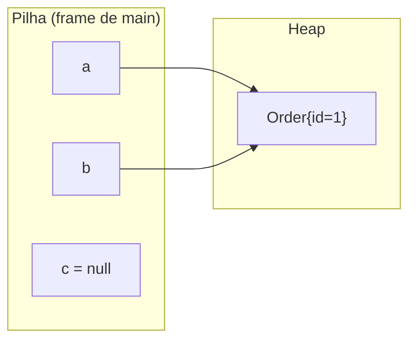
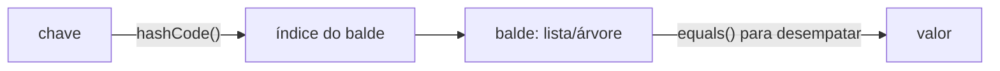

# Tipos, memória e identidade: primitivos, referências, `String`, `equals` e `hashCode`

> **Resumo:** Java tem dois mundos de tipos, primitivos (valores) e referências (objetos), e quase todo bug "estranho" de iniciação vem de confundir os dois: `==` vs `equals`, `Integer` em cache, `String` imutável, passagem "por referência" que na verdade não existe. Este arquivo constrói o modelo mental correto, que depois sustenta coleções, records, JPA e proxies.
> **Pré-requisitos:** [02-jvm-por-dentro.md](02-jvm-por-dentro.md) (stack vs heap).
> **Versões:** exemplos executados no Java 25. Valhalla (tipos de valor) é tratado como recurso futuro, ver seção 4.

## 1. Definição

Java é **estaticamente tipado** (o tipo de cada variável é verificado na compilação) e **fortemente tipado** (não existe conversão implícita arbitrária entre tipos incompatíveis). Há exatamente dois grupos:

- **Tipos primitivos**: 8 tipos embutidos que guardam o *valor* diretamente (`int`, `double`...).
- **Tipos de referência**: classes, interfaces, enums, records, arrays. A variável guarda uma *referência* (ponteiro gerenciado) para um objeto no heap, ou `null`.

## 2. Conceitos fundamentais

### 2.1 Os oito primitivos

| Tipo | Tamanho | Faixa / observação | Padrão em campo |
|---|---|---|---|
| `byte` | 8 bits | −128 a 127 | `0` |
| `short` | 16 bits | −32.768 a 32.767 | `0` |
| `int` | 32 bits | ≈ ±2,1 bilhões | `0` |
| `long` | 64 bits | ≈ ±9,2 × 10¹⁸ | `0L` |
| `float` | 32 bits | IEEE 754, ≈ 7 dígitos | `0.0f` |
| `double` | 64 bits | IEEE 754, ≈ 15–16 dígitos | `0.0` |
| `char` | 16 bits | unidade UTF-16, 0 a 65.535 (sem sinal) | `'\u0000'` |
| `boolean` | (não especificado) | `true`/`false` | `false` |

Variáveis **locais** não têm valor padrão (o compilador exige atribuição antes do uso); **campos** têm.

Armadilhas numéricas, todas verificadas no Java 25:

```java
System.out.println(0.1 + 0.2);                 // 0.30000000000000004  (binário não representa 0,1 exatamente)
System.out.println(Integer.MAX_VALUE + 1);     // -2147483648          (overflow silencioso, "dá a volta")
System.out.println(5 / 2);                     // 2                    (divisão inteira)
System.out.println(-5 % 3);                    // -2                   (% mantém o sinal do dividendo)
System.out.println(Math.floorMod(-5, 3));      // 1
System.out.println((byte) 200);                // -56                  (cast estreitante trunca bits)
System.out.println(Double.NaN == Double.NaN);  // false                (NaN nunca é igual a nada)
```

**Para dinheiro, nunca use `double`/`float`.** Use `BigDecimal` (construído a partir de `String`, não de `double`) ou guarde centavos em `long`:

```java
new BigDecimal("0.1").add(new BigDecimal("0.2"));   // 0.3
```

Detecção de overflow: `Math.addExact`, `multiplyExact`, `toIntExact` lançam `ArithmeticException` em vez de errar em silêncio.

### 2.2 Tipos de referência e `null`

```java
Order a = new Order(1);
Order b = a;          // b e a apontam para o MESMO objeto
Order c = null;       // referência que não aponta para nada
```



`==` compara **referências** (a identidade: "é o mesmo objeto?"). `equals` compara **conteúdo**, se a classe implementar isso (seção 2.6). Chamar método em `null` lança `NullPointerException`; a mensagem diz exatamente qual expressão era nula (*helpful NPE messages*; opcional no Java 14, ativada por padrão desde o Java 15).

### 2.3 Passagem de parâmetros: sempre por valor

Java **sempre** passa por valor. Quando o argumento é uma referência, o que se copia é a *referência* (o ponteiro), não o objeto:

```java
static void change(StringBuilder sb, int x, String s) {
    sb.append("!");              // altera o objeto apontado: visível ao chamador
    x = 99;                      // altera a cópia local do int: invisível
    s = s + "!";                 // cria NOVA String e muda só a cópia local da referência
    sb = new StringBuilder("novo"); // reaponta a cópia local: invisível
}

StringBuilder sb = new StringBuilder("a"); int x = 1; String s = "s";
change(sb, x, s);
System.out.println(sb + " " + x + " " + s);    // a! 1 s
```

Resumo: dá para *mutar* o objeto recebido, mas não dá para *trocar* a variável do chamador. Quem diz "Java passa objetos por referência" está errado: a referência é passada por valor.

### 2.4 Wrappers, autoboxing e o cache de `Integer`

Cada primitivo tem uma classe *wrapper* (`Integer`, `Long`, `Double`, `Boolean`, `Character`...). Eles existem porque **generics e coleções só aceitam referências** (`List<int>` não compila), e porque permitem `null`.

**Autoboxing** (primitivo → wrapper) e **unboxing** (wrapper → primitivo) são conversões automáticas inseridas pelo compilador (desde o Java 5):

```java
Integer boxed = 10;          // compilado como Integer.valueOf(10)
int value = boxed;           // compilado como boxed.intValue()
```

Efeitos colaterais importantes:

```java
Integer i1 = 127, i2 = 127, j1 = 128, j2 = 128;
System.out.println(i1 == i2);        // true   (cache de -128..127 em Integer.valueOf)
System.out.println(j1 == j2);        // false  (objetos diferentes!)
System.out.println(j1.equals(j2));   // true

Integer n = null;
int z = n;                           // NullPointerException (unboxing de null)
```

`Integer.valueOf` reutiliza instâncias para o intervalo −128 a 127 (e `Boolean`, `Byte`, `Character` até 127 também). **Conclusão: nunca compare wrappers com `==`; use `equals`** (ou desembrulhe antes). E em laços quentes, evite boxing involuntário (`Long sum = 0L; sum += i;` aloca um objeto por iteração).

### 2.5 `String`: imutável, com pool

`String` é imutável: nenhum método altera o objeto, todos devolvem um novo. Isso permite:

- **Segurança** (chaves de `Map`, nomes de classes, caminhos de arquivo não mudam por baixo de você);
- **Cache de `hashCode`** (calculado uma vez);
- **Compartilhamento** pelo **string pool**: literais iguais viram o mesmo objeto.

```java
String s1 = "java", s2 = "java", s3 = new String("java");
System.out.println(s1 == s2);            // true   (mesmo literal, pool)
System.out.println(s1 == s3);            // false  (new cria outro objeto)
System.out.println(s1.equals(s3));       // true
System.out.println(s1 == s3.intern());   // true   (intern() devolve a instância do pool)
```

**Concatenação em laço é quadrática**, pois cada `+=` copia a string inteira:

```java
String r = "";
for (int k = 0; k < 20_000; k++) r += "x";           // O(n²) em cópias
// melhor:
var sb = new StringBuilder();
for (int k = 0; k < 20_000; k++) sb.append('x');     // O(n)
```

(O compilador moderno otimiza concatenações *dentro de uma expressão* com `invokedynamic`; ele não consegue transformar o laço acima em `StringBuilder`.) `StringBuffer` é a versão sincronizada, quase sempre desnecessária hoje.

Internamente, desde o Java 9 a `String` guarda `byte[]` com *compact strings*: 1 byte por caractere se todos couberem em Latin-1, 2 bytes (UTF-16) caso contrário. `char` e `String.length()` contam **unidades UTF-16**, não caracteres Unicode visíveis: um emoji ocupa dois `char`; use `codePoints()` quando isso importa.

### 2.6 Identidade, igualdade e o contrato `equals`/`hashCode`

`Object.equals` por padrão é `==`. Sobrescreva quando objetos devam ser iguais **por valor**. O contrato (Javadoc de `Object`):

1. **Reflexivo**: `x.equals(x)`.
2. **Simétrico**: `x.equals(y)` ⇔ `y.equals(x)`.
3. **Transitivo**.
4. **Consistente**: resultados estáveis se nada mudar.
5. `x.equals(null)` é `false`.
6. **Se `a.equals(b)`, então `a.hashCode() == b.hashCode()`**. A recíproca não é exigida (colisões são válidas).

Quebrar a regra 6 é o erro clássico: o objeto "some" de `HashSet`/`HashMap`.

```java
static class Bad {
    int id;
    Bad(int id) { this.id = id; }
    @Override public boolean equals(Object o) { return o instanceof Bad b && b.id == id; }
    // esqueceu o hashCode!
}

Set<Bad> set = new HashSet<>();
set.add(new Bad(1));
System.out.println(set.contains(new Bad(1)));    // false (!)  hashCodes diferentes → outro "balde"
```

Correção moderna: use um **record**, que gera `equals`, `hashCode` e `toString` corretos a partir dos componentes ([05-recursos-modernos-da-linguagem.md](05-recursos-modernos-da-linguagem.md)); ou, à mão, `Objects.equals` e `Objects.hash`:

```java
record Product(String sku, String name) {}            // equals/hashCode automáticos

@Override public int hashCode() { return Objects.hash(sku); }
```

Como o `HashMap` usa isso (visão geral; detalhes em [07-colecoes.md](07-colecoes.md)):



**Cuidados:**
- Campos usados no `hashCode` devem ser **imutáveis** enquanto o objeto estiver num `HashMap`/`HashSet`; mutar a chave a "perde" na tabela.
- **Entidades JPA** exigem decisão cuidadosa (id gerado pelo banco é `null` antes de persistir); veja [06-spring-data-jpa.md](../03-spring-boot/06-spring-data-jpa.md).
- Com herança, `instanceof` vs `getClass()` muda a simetria; prefira classes `final` ou records.
- `compareTo` (de `Comparable`) deve ser **consistente com `equals`** quando o objeto for usado em `TreeSet`/`TreeMap`.

### 2.7 Imutabilidade como estratégia

Objeto imutável: estado fixado na construção, sem setters, campos `final`, sem expor coleções mutáveis. Vantagens: seguro entre threads sem sincronização, seguro como chave de `Map`, fácil de raciocinar. Exemplos no JDK: `String`, wrappers, `BigDecimal`, `LocalDate`, `List.of(...)`, records (se seus componentes também forem imutáveis).

```java
public record OrderItem(String sku, int quantity) {
    public OrderItem {                                   // construtor compacto: validação
        if (quantity <= 0) throw new IllegalArgumentException("quantity must be > 0");
    }
}
```

Atenção: `final` numa **variável** impede reatribuir a variável, não torna o objeto imutável (`final List<String> l` ainda aceita `l.add(...)`).

## 3. Como funciona por dentro

### 3.1 Onde vive cada coisa

```java
class Order {
    private final long id;                       // campo: dentro do objeto Order, no heap
    private final List<OrderItem> items = new ArrayList<>();   // campo: referência no objeto; ArrayList em outro objeto no heap
    private static int created;                  // campo estático: associado à Class (Metaspace/heap)

    void add(OrderItem item) {                   // 'item' (referência) e 'tmp' vivem no frame da pilha
        int tmp = items.size();
        items.add(item);
    }
}
```

- **Variável local**: no *frame* da pilha da thread, descartada ao final do método.
- **Campo de instância**: dentro do próprio objeto, no heap (primitivos *inline*, referências como ponteiros).
- **Campo estático**: um por classe; as referências dele são GC roots (por isso `static` retém memória).
- Um `int[]` é um **objeto**, com cabeçalho, `length` e os valores contíguos. Já um `Integer[]` é um array de ponteiros para objetos `Integer` espalhados: bem mais memória e pior localidade de cache.

### 3.2 O que o compilador faz com boxing e `String`

```bash
javap -c -p T3 | grep -E "Integer.valueOf|intValue"
```

mostra que `Integer j1 = 128;` vira `invokestatic Integer.valueOf` e `int z = n;` vira `invokevirtual Integer.intValue`. Os "milagres" do autoboxing são chamadas de método comuns: dá para ver o custo.

### 3.3 `hashCode` na prática

`String.hashCode()` é `s[0]*31^(n-1) + ... + s[n-1]` (fórmula documentada no Javadoc); `"hello".hashCode()` vale `99162322`. Para listas, `List.of(1, 2).hashCode()` é `994`, o mesmo de `Objects.hash(1, 2)` (porque `Objects.hash` delega a `Arrays.hashCode` com a mesma fórmula de 31). **O valor exato de `hashCode` de objetos sem implementação própria varia entre execuções**; nunca dependa dele para ordenação ou persistência.

## 4. Evolução histórica

- **Java 5 (2004)**: autoboxing/unboxing e generics (a razão de existir dos wrappers genéricos).
- **Java 7**: `String` em `switch`; o string pool sai da PermGen para o heap.
- **Java 9**: *compact strings*. **Java 14/15**: *helpful NullPointerExceptions* (padrão no 15). **Java 16**: records.
- **Projeto Valhalla** (em andamento): *value classes* (JEP 401, em preview) buscam objetos sem identidade, com layout "achatado" e sem boxing, e unificar primitivos e wrappers. O JEP 401 não está disponível no Java 25 nem no 27; está proposto como preview para o JDK 28 (março de 2027, conferido em 2026-11-04). Até lá, o modelo desta página é o vigente.

Veja o contexto geral em [00-evolucao-do-java.md](00-evolucao-do-java.md).

## 5. Exemplos práticos

### 5.1 Domínio de pedidos com identidade e valor

```java
package com.example.orders;

import java.math.BigDecimal;
import java.util.*;

// Valor: igualdade por conteúdo → record
public record Money(BigDecimal amount, String currency) {
    public Money {
        Objects.requireNonNull(amount);
        Objects.requireNonNull(currency);
    }
    public Money plus(Money other) {
        if (!currency.equals(other.currency)) throw new IllegalArgumentException("moedas diferentes");
        return new Money(amount.add(other.amount), currency);
    }
}

// Entidade: igualdade pela identidade de negócio (id), não por todos os campos
public final class Customer {
    private final UUID id;
    private String name;                       // mutável, mas fora de equals/hashCode

    public Customer(UUID id, String name) { this.id = id; this.name = name; }

    @Override public boolean equals(Object o) { return o instanceof Customer c && id.equals(c.id); }
    @Override public int hashCode()           { return id.hashCode(); }
}
```

Duas ideias: **objeto de valor** (igualdade por todos os componentes, imutável) vs **entidade** (igualdade por identidade). Essa distinção reaparece no DDD tático ([06-padroes-arquiteturais.md](../06-padroes-de-projeto/06-padroes-arquiteturais.md)).

### 5.2 Cópia defensiva

```java
public final class Order {
    private final List<OrderItem> items;

    public Order(List<OrderItem> items) {
        this.items = List.copyOf(items);            // cópia imutável: o chamador não consegue mutar nosso estado
    }
    public List<OrderItem> items() { return items; }   // já imutável: seguro devolver
}
```

### 5.3 Armadilhas de uma só vez (programa de teste)

```java
Integer a = 127, b = 127, c = 128, d = 128;
System.out.println((a == b) + " " + (c == d) + " " + c.equals(d));   // true false true
Integer n = null;
try { int z = n; } catch (NullPointerException e) { System.out.println("NPE no unboxing"); }
System.out.println(new Money(new BigDecimal("1"), "BRL").equals(new Money(new BigDecimal("1"), "BRL")));  // true
System.out.println(new BigDecimal("2.0").equals(new BigDecimal("2.00")));   // false! (escala diferente)
System.out.println(new BigDecimal("2.0").compareTo(new BigDecimal("2.00"))); // 0
```

Repare no último ponto: `BigDecimal.equals` considera a **escala**; para valor numérico use `compareTo`.

## 6. Configurações e anotações relevantes

| Elemento | Para que serve | Exemplo |
|---|---|---|
| `Objects.equals(a, b)` | Igualdade segura com `null` | `Objects.equals(name, o.name)` |
| `Objects.hash(...)` | `hashCode` combinando campos | `Objects.hash(sku, name)` |
| `Objects.requireNonNull(x, msg)` | Falha cedo em argumento nulo | validação em construtores |
| `Integer.valueOf` / `parseInt` | Wrapper em cache / parse para primitivo | `Integer.parseInt("42")` |
| `-Xshare`, `-XX:+UseStringDeduplication` | Economia de memória de strings | ver [02-jvm-por-dentro.md](02-jvm-por-dentro.md) |
| `-XX:AutoBoxCacheMax=N` | Ajusta o limite superior do cache de `Integer` | raramente útil |
| `@Override` | Garante que o método realmente sobrescreve | `@Override public boolean equals(Object o)` |
| `record` | `equals`/`hashCode`/`toString` automáticos | `record Money(...)` |

## 7. Quando usar e quando NÃO usar

| Situação | Use | Evite |
|---|---|---|
| Contadores, índices, cálculos | primitivos (`int`, `long`) | wrappers em laços (boxing) |
| Valor ausente em campo/retorno | `Optional<T>` no retorno; `null` com cuidado | `Optional` como campo, parâmetro ou em entidade JPA |
| Dinheiro | `BigDecimal` (ou `long` em centavos) | `double`/`float` |
| Concatenar em laço | `StringBuilder` / `String.join` / `Collectors.joining` | `+=` |
| Comparação de texto | `equals`, `equalsIgnoreCase`, `Objects.equals` | `==` |
| Chave de `HashMap` | tipos imutáveis (`String`, record, `UUID`) | objetos mutáveis |
| Identificar entidades | `equals` por id | `equals` por todos os campos mutáveis |

## 8. Erros comuns e boas práticas

- **`==` em `String` e wrappers.** Funciona "às vezes" por causa do pool/cache, o que é pior do que sempre falhar.
- **Sobrescrever `equals` sem `hashCode`** (e vice-versa). IDEs e records resolvem; revise sempre.
- **Mutar um campo que participa do `hashCode`** de um objeto já inserido em `HashSet`.
- **Unboxing de `null`** (`Map.get` devolvendo `null` para `int`): `NullPointerException` ao atribuir. Use `getOrDefault` ou `Integer`.
- **`new Double(...)`/`new Integer(...)`**: construtores de wrappers estão depreciados para remoção; use `valueOf`.
- **`BigDecimal(double)`**: herda o erro binário (`new BigDecimal(0.1)` não é 0.1). Use `BigDecimal.valueOf(0.1)` ou a `String`.
- **Ignorar overflow.** Em somas de valores de negócio use `Math.addExact` ou `long`.
- **Retornar a coleção interna mutável** de um objeto: quebra encapsulamento. Devolva `List.copyOf`/`Collections.unmodifiableList`.
- **Achar que `final` = imutável.** `final` só fixa a referência.
- Prefira `var` quando o tipo é evidente, mas não para esconder tipos primitivos/wrappers (`var x = 1L` é `long`; `var y = Long.valueOf(1)` é `Long`).

## 9. Perguntas de revisão

1. Por que `Integer a = 128, b = 128; a == b` é `false`, mas com `127` é `true`?
<details><summary>Resposta</summary>O autoboxing chama `Integer.valueOf`, que mantém um cache de instâncias para −128..127. Dentro do intervalo, ambas variáveis apontam para o mesmo objeto; fora, são objetos distintos e `==` compara referências. Use `equals`.</details>

2. Java passa objetos por referência? Justifique com o exemplo de reatribuir o parâmetro.
<details><summary>Resposta</summary>Não: passa tudo por valor. Para objetos, o valor copiado é a referência. Mutar o objeto apontado é visível ao chamador, mas reatribuir o parâmetro só muda a cópia local.</details>

3. Qual regra o contrato entre `equals` e `hashCode` impõe, e que sintoma aparece ao violá-la?
<details><summary>Resposta</summary>Objetos `equals` devem ter o mesmo `hashCode`. Violando, o objeto cai em outro balde do `HashMap`/`HashSet` e `contains`/`get` retornam `false`/`null` para uma chave "igual".</details>

4. Por que `String` é imutável e quais benefícios isso traz?
<details><summary>Resposta</summary>Permite compartilhar instâncias (string pool), cachear o `hashCode`, usar como chave com segurança, ser thread-safe sem sincronização e evitar adulteração de dados sensíveis como caminhos e nomes de classes.</details>

5. Por que `new BigDecimal("2.0").equals(new BigDecimal("2.00"))` é `false` e como comparar valores?
<details><summary>Resposta</summary>`equals` de `BigDecimal` considera valor **e escala** (2.0 tem escala 1, 2.00 tem 2). Para comparar numericamente use `compareTo(...) == 0`.</details>

## 10. Referências oficiais

- Java Language Specification (tipos, conversões, boxing): <https://docs.oracle.com/javase/specs/jls/se25/html/>
- Javadoc de `Object.equals/hashCode`, `String`, `Integer`, `BigDecimal`: <https://docs.oracle.com/en/java/javase/25/docs/api/>
- Tutoriais: <https://dev.java>
- Projeto Valhalla: <https://openjdk.org/projects/valhalla/>
- "Effective Java" (Bloch), itens sobre `equals`/`hashCode` e imutabilidade: livro de referência (GoF/Bloch), sem link oficial.
