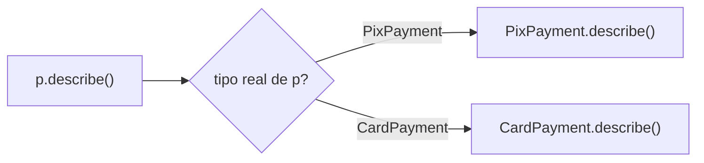
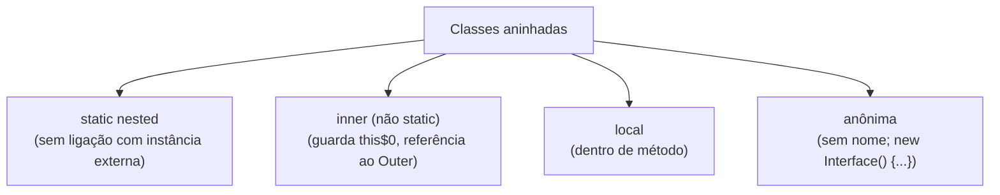

# Orientação a objetos em Java

> **Resumo:** classes, objetos, encapsulamento, herança, polimorfismo e abstração, mais o que é específico de Java: interfaces com métodos `default`, classes abstratas, classes internas e despacho dinâmico. O foco é entender **como a JVM decide qual método executar** e **quando preferir composição**, porque Spring, proxies e padrões de projeto dependem disso.
> **Pré-requisitos:** [03-tipos-e-memoria.md](03-tipos-e-memoria.md).
> **Versões:** interfaces com `default`/`static` desde o Java 8, métodos `private` em interface desde o Java 9, `record` desde o 16, `sealed` desde o 17 (tratados em [05-recursos-modernos-da-linguagem.md](05-recursos-modernos-da-linguagem.md)).

## 1. Definição

Orientação a objetos (OO) organiza o programa em **objetos** que combinam **estado** (campos) e **comportamento** (métodos), criados a partir de **classes**. Java é OO "por padrão": todo código vive dentro de um tipo, exceto os 8 primitivos. Os quatro pilares:

| Pilar | Ideia | Mecanismo em Java |
|---|---|---|
| **Encapsulamento** | Esconder o estado e expor um contrato | modificadores de acesso, métodos |
| **Abstração** | Expor *o quê*, ocultar *como* | interfaces, classes abstratas |
| **Herança** | Reutilizar e especializar um tipo | `extends`, `implements` |
| **Polimorfismo** | Mesma chamada, comportamento conforme o tipo real | sobrescrita + despacho dinâmico |

## 2. Conceitos fundamentais

### 2.1 Classe, objeto e construtor

Uma **classe** é o molde (tipo); um **objeto** (instância) é a coisa criada com `new`, no heap. O **construtor** inicializa o objeto e tem o nome da classe, sem tipo de retorno.

```java
public class Product {
    private final String sku;
    private final String name;

    public Product(String sku, String name) {        // construtor
        this.sku  = Objects.requireNonNull(sku);
        this.name = Objects.requireNonNull(name);
    }
    public String sku()  { return sku; }
    public String name() { return name; }
}
```

Ordem de inicialização ao fazer `new Product(...)`: memória zerada → construtor da superclasse → inicializadores de campo e blocos de instância (na ordem textual) → corpo do construtor. Se não houver construtor, o compilador cria um padrão sem argumentos; se houver qualquer um, ele **não** cria mais.

Um construtor pode delegar a outro com `this(...)`, ou à superclasse com `super(...)` (obrigatoriamente a primeira instrução, nas versões anteriores ao Java 25; o JEP 513, final no 25, permite código que não use `this` *antes* de `super(...)`; esteve em preview nos Java 22 a 24).

### 2.2 Encapsulamento e modificadores de acesso

| Modificador | Mesma classe | Mesmo pacote | Subclasse (outro pacote) | Qualquer lugar |
|---|---|---|---|---|
| `private` | ✔ | ✘ | ✘ | ✘ |
| *(padrão, sem palavra)* | ✔ | ✔ | ✘ | ✘ |
| `protected` | ✔ | ✔ | ✔ | ✘ |
| `public` | ✔ | ✔ | ✔ | ✔ |

Princípio: **o menor acesso possível**. Encapsular não é "gerar getters e setters para tudo" (isso é só expor campos com mais cerimônia); é proteger as *invariantes* do objeto: um `Order` não deveria permitir `setStatus(SHIPPED)` sem passar por `pay()`. Prefira métodos com significado de negócio (`order.pay()`) a setters.

Desde o Java 9, o sistema de módulos acrescenta outra camada: um pacote só é acessível fora do módulo se for `exports` ([14-modulos-e-build.md](14-modulos-e-build.md)).

### 2.3 Herança

```java
public class Payment {
    protected final String id;
    public Payment(String id) { this.id = id; }
    public String describe() { return "Payment " + id; }
}

public class PixPayment extends Payment {
    public PixPayment(String id) { super(id); }          // chama o construtor do pai
    @Override public String describe() { return super.describe() + " via Pix"; }
}
```

- Java tem **herança simples de classes** (uma só superclasse), mas **múltipla de tipos** via interfaces. Toda classe herda, no final, de `java.lang.Object`.
- `@Override` pede ao compilador para checar que o método realmente sobrescreve (pega erros de digitação e mudanças na superclasse).
- `final` em classe impede herança; `final` em método impede sobrescrita.
- A herança é um relacionamento **"é-um"** forte e estático. Por isso tem custo: acopla filho a detalhes do pai (seção 2.8).

### 2.4 Polimorfismo e despacho dinâmico

**Polimorfismo** significa tratar objetos de tipos diferentes pelo mesmo tipo comum:

```java
Payment p = new PixPayment("42");        // tipo estático: Payment; tipo dinâmico: PixPayment
System.out.println(p.describe());        // "Payment 42 via Pix"  ← escolhido em tempo de execução
```

A JVM resolve a chamada com **despacho dinâmico** (`invokevirtual`): olha a classe *real* do objeto e usa a tabela de métodos virtuais (*vtable*) dela. Mas isso vale **só para métodos de instância**. Campos e métodos estáticos usam o *tipo declarado* (resolução estática):

```java
static class Animal { static String s(){return "Animal";} String f="animal"; String who(){return "animal";} }
static class Dog extends Animal { static String s(){return "Dog";}     String f="dog";    String who(){return "dog";} }

Animal an = new Dog();
System.out.println(an.who() + " " + an.f + " " + an.s());   // dog animal Animal
```

Leitura: o método de instância é despachado por `Dog`; o campo `f` e o método estático `s()` seguem o tipo declarado (`Animal`). Isso é **ocultação** (*hiding*), não sobrescrita; não use.

**Sobrecarga (*overload*) × sobrescrita (*override*):** sobrecarga é escolhida em **compilação** pelos tipos *declarados* dos argumentos; sobrescrita é escolhida em **execução** pelo tipo *real* do receptor.



### 2.5 Abstração: classes abstratas e interfaces

**Classe abstrata** (`abstract`): não pode ser instanciada; pode ter estado, construtores e métodos concretos, além de métodos abstratos que as filhas implementam.

**Interface**: um contrato de comportamento. Uma classe pode implementar várias.

| | Classe abstrata | Interface |
|---|---|---|
| Herança | uma só (`extends`) | várias (`implements`) |
| Estado (campos de instância) | sim | não (só constantes `static final`) |
| Construtor | sim | não |
| Métodos concretos | sim | `default`, `static`, `private` |
| Quando | compartilhar código/estado entre filhas "da mesma família" | definir um *papel* ou capacidade |

Evolução das interfaces (importante para a evolução do JDK):

```java
public interface Discount {
    BigDecimal apply(BigDecimal total);                     // método abstrato (único = interface funcional)

    default String name() { return getClass().getSimpleName(); }   // Java 8: implementação padrão
    static Discount none() { return total -> total; }              // Java 8: método estático
    private BigDecimal round(BigDecimal v) { return v.setScale(2, java.math.RoundingMode.HALF_UP); }   // Java 9
}
```

Os métodos `default` surgiram para **evoluir interfaces sem quebrar implementações existentes** (foi assim que `List.sort`, `Collection.stream` e `Map.forEach` foram adicionados no Java 8). Se duas interfaces fornecem o mesmo `default`, a classe é obrigada a resolver explicitamente (**problema do diamante**):

```java
interface A { default String hi() { return "A"; } }
interface B { default String hi() { return "B"; } }
class C implements A, B {
    public String hi() { return A.super.hi() + B.super.hi(); }   // "AB"
}
```

**Regras de resolução:** (1) método da classe vence sempre; (2) senão, vence a interface *mais específica*; (3) senão, conflito → o compilador exige resolução manual.

### 2.6 Classes internas, aninhadas, locais e anônimas



```java
class Outer {
    int x = 1;
    class Inner { int y = x + 1; }              // inner: acessa membros de Outer
    static class Nested {}                      // nested: independente da instância

    Runnable r() {
        int local = 5;                          // efetivamente final: capturada pela anônima
        return new Runnable() { public void run() { System.out.println("anon " + local + x); } };
    }
}

Outer o = new Outer();
Outer.Inner in = o.new Inner();                 // inner precisa de instância de Outer
```

Por dentro: o compilador adiciona ao `Inner` um campo sintético `this$0` com a referência ao `Outer` (visível com `javap -p 'Outer$Inner'`: `final Outer this$0;`). **Consequência**: uma classe interna não-estática **mantém o objeto externo vivo**, vazamento clássico em callbacks e `Adapter`s de Android/Swing. Regra: se a classe interna não usa o `Outer`, declare-a `static`.

Variáveis locais capturadas por classes locais/anônimas e lambdas precisam ser **efetivamente finais** (não reatribuídas), porque o valor é *copiado* para a instância. **Lambdas** não são classes anônimas: `this` dentro de um lambda é o objeto envolvente, e a classe é gerada via `invokedynamic` (ver [09-programacao-funcional.md](09-programacao-funcional.md)).

### 2.7 Enums, records e tipos especiais

- **`enum`**: conjunto fixo de instâncias únicas (*singletons* por constante), que pode ter campos, construtor e métodos; ideal para status e estratégias simples.
- **`record`** (Java 16): classe de dados imutável com `equals`/`hashCode`/`toString`.
- **`sealed`** (Java 17): restringe quem pode estender.
- **`Object`**: raiz da hierarquia, com `equals`, `hashCode`, `toString`, `getClass`. `toString` útil ajuda em logs.

```java
public enum OrderStatus {
    CREATED, PAID, SHIPPED, CANCELLED;

    public boolean canCancel() { return this == CREATED || this == PAID; }
}
```

### 2.8 Composição vs herança

> "Favoreça composição sobre herança" (GoF; Bloch, *Effective Java*).

Problemas da herança: acopla ao *como* o pai funciona (**fragile base class**), expõe toda a API do pai e é fixa em tempo de compilação. Exemplo clássico do problema:

```java
class CountingList<E> extends ArrayList<E> {
    int adds;
    @Override public boolean add(E e)               { adds++; return super.add(e); }
    @Override public boolean addAll(Collection<? extends E> c) { adds += c.size(); return super.addAll(c); }
    // BUG: ArrayList.addAll pode chamar add() internamente → adds conta em dobro, dependendo da implementação
}
```

Composição resolve isso: o objeto **tem-um** colaborador e delega, e ele pode ser trocado em tempo de execução, por injeção:

```java
public class OrderService {
    private final PaymentGateway gateway;                 // composição: depende do contrato (interface)
    public OrderService(PaymentGateway gateway) { this.gateway = gateway; }   // injeção por construtor
    public void checkout(Order order) { gateway.charge(order.total()); }
}
```

Isso é a base da **Inversão de Controle e Injeção de Dependência** ([02-ioc-e-injecao-de-dependencia.md](../02-spring-core/02-ioc-e-injecao-de-dependencia.md)) e dos padrões Strategy, Decorator e Adapter ([06-padroes-de-projeto](../06-padroes-de-projeto/01-introducao.md)). Use herança quando houver relação "é-um" genuína, a classe-pai foi **projetada para extensão** (documentada) e o ganho for real; caso contrário, marque classes como `final` ou use `sealed`.

## 3. Como funciona por dentro

### 3.1 vtable e despacho

Cada classe carregada tem uma tabela de métodos virtuais. Chamar `p.describe()` (via `invokevirtual`) significa: ler a classe do objeto (no cabeçalho), indexar a tabela, saltar. Para interfaces (`invokeinterface`) há uma busca ligeiramente mais cara (*itable*). O JIT reduz isso com **inline caches** e devirtualização: se só uma classe aparece no ponto de chamada ("monomórfico"), a chamada vira direta com guarda; com 2 ("bimórfico") ainda é rápido; muitas classes ("megamórfico") perdem essa otimização. É um motivo prático para evitar hierarquias gigantes em caminhos quentes.

### 3.2 Ordem de inicialização e o perigo de chamar método sobrescrevível no construtor

```java
static abstract class Payment {
    final String id;
    Payment(String id) { this.id = id; init(); }      // chama método sobrescrevível!
    void init() {}
    abstract String pay();
}
static class Pix extends Payment {
    String key = "k";
    Pix(String id) { super(id); }
    @Override void init() { System.out.println("init key=" + key); }   // imprime "init key=null"
    @Override String pay() { return "pix"; }
}
new Pix("1");   // saída: init key=null
```

Saída real: `init key=null`. O construtor do pai roda **antes** dos inicializadores de campo da filha, então `init()` (versão da filha) enxerga `key` ainda `null`. Regra: **nunca chame métodos sobrescrevíveis em construtores.**

### 3.3 Identidade de classe e `getClass()` vs `instanceof`

`instanceof` aceita subtipos; `getClass() == o.getClass()` exige a classe exata. Isso importa para `equals` com herança e para **proxies** (um proxy CGLIB do Spring é uma *subclasse* gerada: `getClass()` não retorna a sua classe). Veja [07-aop-e-proxies.md](../02-spring-core/07-aop-e-proxies.md).

## 4. Evolução histórica

- **Java 1.0**: classes, interfaces, herança simples, classes internas (1.1), `strictfp`.
- **Java 5**: enums, anotações, generics, `@Override` em implementações de interface (a partir do 6).
- **Java 8**: métodos `default` e `static` em interfaces; lambdas como alternativa a classes anônimas.
- **Java 9**: métodos `private` em interfaces; módulos.
- **Java 16/17**: records e classes seladas; **Java 21**: pattern matching em `switch` torna hierarquias seladas verificáveis pelo compilador.

Detalhes e datas em [00-evolucao-do-java.md](00-evolucao-do-java.md).

## 5. Exemplos práticos

### 5.1 Domínio de pedidos com polimorfismo via interface

```java
package com.example.orders;

import java.math.BigDecimal;
import java.util.List;

public interface Discount {
    BigDecimal apply(BigDecimal total);
}

public class PercentageDiscount implements Discount {
    private final BigDecimal percent;                       // ex.: 10 para 10%
    public PercentageDiscount(BigDecimal percent) { this.percent = percent; }
    @Override public BigDecimal apply(BigDecimal total) {
        return total.subtract(total.multiply(percent).divide(BigDecimal.valueOf(100)));
    }
}

public class Order {
    private final List<OrderItemLine> lines;
    private OrderStatus status = OrderStatus.CREATED;

    public Order(List<OrderItemLine> lines) { this.lines = List.copyOf(lines); }

    public BigDecimal total(Discount discount) {            // depende do contrato, não da implementação
        BigDecimal sum = lines.stream().map(OrderItemLine::subtotal).reduce(BigDecimal.ZERO, BigDecimal::add);
        return discount.apply(sum);
    }

    public void pay() {                                     // transição controlada: invariante preservada
        if (status != OrderStatus.CREATED) throw new IllegalStateException("só pedidos CREATED podem ser pagos");
        status = OrderStatus.PAID;
    }
}

record OrderItemLine(String sku, int quantity, BigDecimal unitPrice) {
    BigDecimal subtotal() { return unitPrice.multiply(BigDecimal.valueOf(quantity)); }
}
```

Trocar `PercentageDiscount` por outro `Discount` (lambda inclusive: `total -> total`) não exige mexer em `Order`. Esse é o **Princípio Aberto/Fechado** em ação ([01-introducao.md](../06-padroes-de-projeto/01-introducao.md)).

### 5.2 Template Method com classe abstrata

```java
public abstract class ReportGenerator {
    public final String generate() {                        // esqueleto fixo (final)
        return header() + body() + footer();
    }
    protected String header() { return "== Relatório ==\n"; }
    protected abstract String body();                       // passo variável
    protected String footer() { return "\n== fim =="; }
}
```

Este é o padrão *Template Method* (ver [04-comportamentais.md](../06-padroes-de-projeto/04-comportamentais.md)); `JdbcTemplate` e `AbstractRoutingDataSource` do Spring usam essa ideia.

### 5.3 Interface `default` evoluindo um contrato sem quebrar implementações

```java
public interface PaymentGateway {
    void charge(BigDecimal amount);
    default void refund(BigDecimal amount) {                // adicionado depois: classes antigas continuam compilando
        throw new UnsupportedOperationException("refund não suportado");
    }
}
```

## 6. Configurações e anotações relevantes

| Elemento | Para que serve | Exemplo |
|---|---|---|
| `@Override` | Verifica sobrescrita em compilação | `@Override public String toString()` |
| `@FunctionalInterface` | Garante que a interface tem um único método abstrato | `@FunctionalInterface interface Discount {...}` |
| `final` (classe/método/campo) | Bloqueia herança/sobrescrita/reatribuição | `public final class Money` |
| `abstract` | Classe/método sem implementação completa | `abstract String pay();` |
| `sealed` / `permits` | Hierarquia fechada (Java 17) | `sealed interface Payment permits Pix, Card {}` |
| `static` (nested) | Classe aninhada sem referência ao externo | `static class Builder` |
| `@Deprecated(since, forRemoval)` | Marca API em descontinuação | `@Deprecated(forRemoval = true)` |
| `@SafeVarargs`, `@SuppressWarnings` | Controle de avisos do compilador | `@SuppressWarnings("unchecked")` |

## 7. Quando usar e quando NÃO usar

| Decisão | Use | Evite |
|---|---|---|
| Reaproveitar comportamento entre classes irmãs que compartilham estado | Classe abstrata (com `final` no esqueleto) | Hierarquias profundas (> 2–3 níveis) |
| Definir um papel/capacidade | Interface | Interface "marcadora" sem significado |
| Variar comportamento em tempo de execução | Composição + interface (Strategy) | `if/else` por tipo espalhado |
| Dados puros imutáveis | `record` | Classe com getters/setters manuais |
| Conjunto fechado de variantes | `enum` ou `sealed` | Herança aberta sem controle |
| Classe interna usada só pelo externo | `static nested` | Inner não estática "sem querer" |
| Estender classe de biblioteca | Só se for documentada para isso | Herdar de `ArrayList`, `HashMap` etc. |

## 8. Erros comuns e boas práticas

- **Getters/setters para tudo** ("modelo anêmico" sem comportamento): veja [08-anti-padroes.md](../06-padroes-de-projeto/08-anti-padroes.md).
- **Esquecer `@Override`** e criar sobrecarga sem querer (`equals(Product p)` em vez de `equals(Object o)`: método diferente que nunca é chamado por coleções).
- **Chamar método sobrescrevível no construtor** (seção 3.2).
- **Herdar só para reaproveitar código**, sem relação "é-um". Prefira composição.
- **Violar o Princípio de Substituição de Liskov**: uma subclasse que lança `UnsupportedOperationException` ou fortalece pré-condições não pode substituir o pai com segurança.
- **Expor tipos concretos** em assinaturas (`ArrayList<X>` em vez de `List<X>`).
- **Inner class não-estática vazando o objeto externo.**
- **Campos `protected` mutáveis**: quebram o encapsulamento para todas as subclasses, em qualquer pacote.
- **Interface "God"** com dezenas de métodos: divida (Princípio da Segregação de Interfaces).
- Documente classes projetadas para herança; caso contrário, torne-as `final`.

## 9. Perguntas de revisão

1. Qual a diferença entre sobrecarga e sobrescrita, e quando cada uma é resolvida?
<details><summary>Resposta</summary>Sobrecarga: mesmos nome, assinaturas diferentes; escolhida em compilação pelos tipos declarados. Sobrescrita: subclasse redefine método do pai; escolhida em execução (despacho dinâmico) pelo tipo real do objeto.</details>

2. Por que `Animal a = new Dog(); a.f` devolve o campo de `Animal`, mas `a.who()` executa o de `Dog`?
<details><summary>Resposta</summary>Métodos de instância usam despacho dinâmico (`invokevirtual`, pela classe real). Campos e métodos estáticos são resolvidos pelo tipo declarado da variável; campo da subclasse com mesmo nome apenas *oculta*, não sobrescreve.</details>

3. Como o Java resolve dois métodos `default` conflitantes em interfaces?
<details><summary>Resposta</summary>A classe vence; depois a interface mais específica; se continuar ambíguo, o compilador exige que a classe sobrescreva o método e escolha com `Interface.super.metodo()`.</details>

4. Por que uma classe interna não estática pode causar vazamento de memória?
<details><summary>Resposta</summary>O compilador adiciona o campo sintético `this$0` com referência ao objeto externo; enquanto a interna estiver viva (ex.: registrada como callback), o externo não pode ser coletado. Se não precisa do externo, use `static nested`.</details>

5. Por que não se deve chamar métodos sobrescrevíveis em construtores?
<details><summary>Resposta</summary>O construtor do pai roda antes de os campos da subclasse serem inicializados, e o método da subclasse enxerga estado parcial (`null`/`0`). Isso gera bugs sutis.</details>

## 10. Referências oficiais

- JLS, cap. 8 (Classes), 9 (Interfaces), 12 (Execução/inicialização): <https://docs.oracle.com/javase/specs/jls/se25/html/>
- The Java Tutorials, *Classes and Objects* e *Interfaces and Inheritance*: <https://dev.java/learn/>
- Javadoc de `java.lang.Object`: <https://docs.oracle.com/en/java/javase/25/docs/api/>
- JEP 513 (*Flexible Constructor Bodies*): <https://openjdk.org/jeps/513>
- GoF, *Design Patterns*; Bloch, *Effective Java* (livros de referência).
