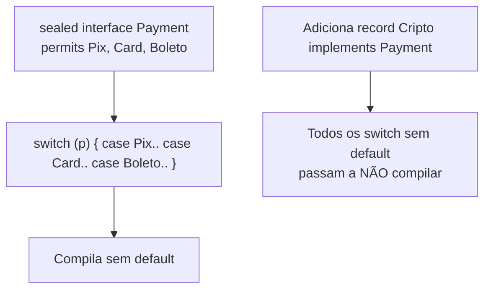

# Recursos modernos da linguagem: `var`, records, sealed, pattern matching e mais

> **Resumo:** entre o Java 10 e o 25, a linguagem ganhou um conjunto coerente de recursos para escrever **dados como dados** (records), **hierarquias fechadas** (sealed) e **ramificação por forma** (pattern matching). Juntos, eles substituem muito código burocrático (getters, `equals`, `instanceof` + cast, visitors) por código curto que o compilador verifica.
> **Pré-requisitos:** [03-tipos-e-memoria.md](03-tipos-e-memoria.md) e [04-orientacao-a-objetos.md](04-orientacao-a-objetos.md).
> **Versões:** exemplos compilados e executados no Java 25. Cada recurso indica a versão em que se tornou final (não preview).

## 1. Definição

| Recurso | O que resolve | Final desde |
|---|---|---|
| `var` (inferência de tipo local) | Repetição do tipo no lado esquerdo | Java 10 |
| Text blocks (`"""`) | Strings multilinha com escape | Java 15 |
| Switch expressions (`->`, `yield`) | `switch` como expressão, sem *fall-through* | Java 14 |
| Records | Classes de dados imutáveis concisas | Java 16 |
| Pattern matching para `instanceof` | `instanceof` + cast manual | Java 16 |
| Sealed classes/interfaces | Hierarquias fechadas e exaustivas | Java 17 |
| Pattern matching em `switch` | Ramificar por tipo, com guardas | Java 21 |
| Record patterns (desestruturação) | Extrair componentes de records | Java 21 |
| Variáveis/padrões sem nome (`_`) | Ignorar valores não usados | Java 22 |
| Flexible constructor bodies | Código antes de `super(...)`/`this(...)` | Java 25 (JEP 513) |

Em *preview* no Java 25 (exigem `--enable-preview`): **padrões primitivos** em `instanceof`/`switch` (JEP 507, 3ª preview). Confirmado nos testes deste arquivo: sem a flag, `i instanceof int j` falha com *"primitive patterns are a preview feature and are disabled by default"*.

## 2. Conceitos fundamentais

### 2.1 `var`: inferência de tipo local

```java
var orders = new ArrayList<Order>();                  // ArrayList<Order>
var byCustomer = new HashMap<String, List<Order>>();  // evita repetir tipos genéricos longos
for (var entry : byCustomer.entrySet()) { ... }
```

O compilador **infere** o tipo estático a partir do inicializador; `var` **não é tipagem dinâmica** nem uma palavra reservada (é um *nome de tipo reservado*, então `var var = 1;` é legal). Restrições: só em variáveis **locais** (e `for`, `try-with-resources`, parâmetros de lambda), sempre com inicializador; não vale para campos, parâmetros de método ou retornos; `var x = null;` e `var f = () -> 1;` não compilam (sem tipo para inferir).

Quando melhora a leitura: tipo óbvio pelo lado direito (`new`, construtor, método factory com nome claro). Quando piora: `var result = service.process();` (qual é o tipo?). Cuidado com o **diamante**: `var list = new ArrayList<>();` infere `ArrayList<Object>`.

### 2.2 Text blocks

```java
String json = """
        {
          "id": 1,
          "name": "Café \
        grande"
        }
        """;
```

Regras: abre com `"""` + quebra de linha; a **indentação comum** é removida (a posição do `"""` de fechamento conta); `\` no fim da linha suprime a quebra; aspas simples não precisam de escape; `\s` preserva um espaço final; `.formatted(...)` ou `String.format` interpolam (o *String Templates* chegou a ser *preview* nos Java 21–22 e foi **retirado** no Java 23; não existe interpolação nativa). Útil para SQL, JSON, HTML em testes.

### 2.3 Switch expressions

```java
OrderStatus status = OrderStatus.PAID;

int days = switch (status) {                       // switch é EXPRESSÃO: produz valor
    case CREATED -> 1;                              // seta: sem fall-through, sem break
    case PAID    -> { int t = 2; yield t * 2; }     // bloco devolve valor com yield
    case SHIPPED -> 0;
};                                                  // sem default: exaustivo sobre o enum
```

Diferenças do `switch` antigo: sem *fall-through* acidental, pode ser usado em atribuição/`return`, aceita múltiplos rótulos (`case A, B ->`) e é **exaustivo** (o compilador exige cobrir todos os casos; se um novo valor de `enum` for adicionado, o código deixa de compilar, o que é ótimo).

### 2.4 Records

```java
public record Customer(UUID id, String name, String email) { }
```

Um `record` declara um **portador transparente de dados**. O compilador gera: campos `private final`, construtor canônico, *accessors* (`id()`, não `getId()`), `equals`, `hashCode` e `toString` (`Customer[id=..., name=...]`). O record é implicitamente `final` e estende `java.lang.Record`; **não pode** estender outra classe nem declarar campos de instância extras, mas pode implementar interfaces, ter métodos, campos `static`, construtores adicionais e ser genérico.

```java
public record Range(int lo, int hi) {
    public Range {                                    // construtor COMPACTO: validação/normalização
        if (lo > hi) throw new IllegalArgumentException("lo>hi");
    }
    public static Range of(int hi) { return new Range(0, hi); }   // factory
    public int length() { return hi - lo; }                       // método comum
}
```

Por dentro (`javap -c -p`): os métodos `toString`, `hashCode` e `equals` de um record são implementados com `invokedynamic` via `ObjectMethods` (bootstrap), em vez de bytecode gerado. Os componentes ficam disponíveis por reflection (`Class.getRecordComponents()`: `[java.lang.String last4, int installments]`), o que bibliotecas (Jackson 2.12+, Spring Data) usam para construir records.

Limites importantes:
- **Imutabilidade rasa**: um componente `List<String>` continua mutável; faça cópia defensiva no construtor compacto (`items = List.copyOf(items)`).
- **Não use como entidade JPA** (precisa de construtor sem argumentos, campos não finais e proxies); serve bem como DTO, projeção e *value object*.
- Serialização, `equals` e `hashCode` são sempre por **todos** os componentes.

### 2.5 Pattern matching para `instanceof`

```java
// Antes
if (obj instanceof String) {
    String s = (String) obj;
    if (s.length() > 3) { ... }
}
// Depois (Java 16)
if (obj instanceof String s && s.length() > 3) { ... }
if (!(obj instanceof Integer n)) { return; }   // 'n' continua no escopo depois do if
```

O nome `s` é uma **variável de padrão** com escopo controlado pelo fluxo (*flow scoping*): existe onde o compilador consegue provar que o teste foi verdadeiro.

### 2.6 Sealed classes e interfaces

```java
public sealed interface Payment permits Pix, Card, Boleto { }
public record Pix(String key) implements Payment { }
public record Card(String last4, int installments) implements Payment { }
public record Boleto(String barcode) implements Payment { }
```

`sealed` restringe **quais tipos podem implementar/estender** (lista `permits`; se estiverem no mesmo arquivo, o `permits` pode ser omitido). Cada subtipo deve ser `final`, `sealed` ou `non-sealed` (reabre a hierarquia). Records são `final`, então se encaixam. O ganho central: o compilador **conhece todos os casos**, tornando o `switch` exaustivo. Isso modela *tipos soma* (união discriminada) como `Result = Success | Failure`. Reflection: `Payment.class.isSealed()` → `true` e `getPermittedSubclasses()` → `[Pix, Card, Boleto]`.

### 2.7 Pattern matching em `switch` e record patterns

```java
static String fee(Payment p) {
    return switch (p) {                                              // sem default: sealed garante exaustividade
        case Pix x                             -> "0";
        case Card(var last4, var n) when n > 1 -> "parcelado " + n;   // record pattern + guarda (when)
        case Card c                            -> "à vista " + c.last4();
        case Boleto b                          -> "3.50";
    };
}
```

- **Padrão de tipo** (`case Pix x`): testa e vincula.
- **Guarda** (`when`): condição adicional. A ordem importa: padrões mais específicos antes dos genéricos; o compilador rejeita casos "dominados".
- **Record pattern** (`Card(var last4, var n)`): desestrutura o record e pode **aninhar**: `case Line(Point(var x1, _), Point p2)`.
- **`null`**: `switch` lança NPE se o seletor for `null`, a menos que haja `case null`.
- **`_`** (Java 22): variável/padrão sem nome, para o que não será usado (`catch (Exception _)`, `(a, _) -> a`).

Saída do teste com `desc(Object)`:

```text
nulo  grande 42  int 5  str 3  linha 1 Point[x=3, y=4]  outro
```

Esse conjunto (sealed + records + switch com padrões) é o **modelo de dados algébrico** do Java e substitui, em muitos casos, o padrão Visitor ([04-comportamentais.md](../06-padroes-de-projeto/04-comportamentais.md)).

### 2.8 Inferência no diamante, `instanceof` genérico e outros pequenos ganhos

- Diamante `<>` em classes anônimas (Java 9).
- Métodos fábrica imutáveis `List.of`, `Set.of`, `Map.of` (Java 9) e `Stream.toList()` (Java 16).
- `String`: `isBlank`, `strip`, `lines`, `repeat` (11), `formatted`, `stripIndent` (15).
- Métodos `private` em interfaces (9), `try-with-resources` com variável existente (9).

## 3. Como funciona por dentro

### 3.1 O que o compilador faz

| Recurso | Implementação |
|---|---|
| `var` | Só açúcar do compilador: o `.class` tem o tipo inferido; **sem custo** em execução |
| Text block | Vira um literal `String` comum, já com indentação normalizada |
| Switch em `enum`/`String` | `tableswitch`/`lookupswitch`; `String` usa `hashCode` + `equals` |
| Switch com padrões | `invokedynamic` com bootstrap `SwitchBootstraps.typeSwitch` (escolhe o caso em execução) |
| Record | Classe `final` estendendo `java.lang.Record` + atributo `Record`; `equals/hashCode/toString` via `ObjectMethods` |
| Sealed | Atributo `PermittedSubclasses` no `.class`; **verificado também pela JVM** na carga |
| Pattern `instanceof` | Compila para `instanceof` + `checkcast` + variável local |

Dá para conferir: `javap -c -p 'Mod$Point'` mostra `invokedynamic ... toString`, `hashCode`, `equals`.

### 3.2 Exaustividade



Consequência de projeto: **evite `default`** em `switch` sobre `sealed`/`enum` quando quiser que o compilador avise ao surgir um novo caso. O `default` "esconde" casos esquecidos.

## 4. Evolução histórica

Os recursos vieram de forma incremental, pelo Projeto Amber:

| Versão | Entrega |
|---|---|
| 10 | `var` |
| 12–13 (preview) → 14 | Switch expressions |
| 13 (preview) → 15 | Text blocks |
| 14 (preview) → 16 | Records, pattern matching para `instanceof` |
| 15 (preview) → 17 | Sealed classes |
| 17 (preview) → 21 | Pattern matching em `switch`, record patterns |
| 21 (preview) → 22 | `_` sem nome |
| 22 (preview) → 25 | Flexible constructor bodies |
| 21–22 → retirado no 23 | String Templates (removido; não existe no Java 25) |

Mais contexto em [00-evolucao-do-java.md](00-evolucao-do-java.md).

## 5. Exemplos práticos

### 5.1 Antes e depois: modelagem de pagamento

```java
// ANTES (Java 8): classe de dados + hierarquia aberta + cadeia de instanceof
class Pix { private final String key; /* construtor, getter, equals, hashCode, toString... */ }
double fee(Object p) {
    if (p instanceof Pix) return 0;
    else if (p instanceof Card) { Card c = (Card) p; return c.getInstallments() > 1 ? 2.5 : 1.0; }
    else if (p instanceof Boleto) return 3.5;
    throw new IllegalArgumentException();           // esquecer um caso só falha em execução
}
```

```java
// DEPOIS (Java 21+): records + sealed + switch exaustivo
sealed interface Payment permits Pix, Card, Boleto { }
record Pix(String key) implements Payment { }
record Card(String last4, int installments) implements Payment { }
record Boleto(String barcode) implements Payment { }

static BigDecimal fee(Payment p) {
    return switch (p) {
        case Pix _                              -> BigDecimal.ZERO;
        case Card(_, var n) when n > 1          -> new BigDecimal("2.5");
        case Card _                             -> new BigDecimal("1.0");
        case Boleto _                           -> new BigDecimal("3.5");
    };
}
```

### 5.2 Resultado tipado (tipo soma) sem exceções para fluxo de negócio

```java
sealed interface Result<T> permits Result.Ok, Result.Err {
    record Ok<T>(T value) implements Result<T> { }
    record Err<T>(String reason) implements Result<T> { }
}

static Result<Order> place(Cart cart) {
    return cart.isEmpty() ? new Result.Err<>("carrinho vazio") : new Result.Ok<>(Order.from(cart));
}

String msg = switch (place(cart)) {
    case Result.Ok<Order>(var order) -> "pedido " + order;
    case Result.Err<Order>(var why)  -> "falhou: " + why;
};
```

Use com moderação: para erros *inesperados* continue usando exceções ([08-excecoes.md](08-excecoes.md)).

### 5.3 DTO com validação e cópia defensiva

```java
public record CreateOrderRequest(UUID customerId, List<OrderItem> items) {
    public CreateOrderRequest {
        Objects.requireNonNull(customerId);
        items = List.copyOf(items);                    // atribui ao parâmetro: o campo recebe a cópia
        if (items.isEmpty()) throw new IllegalArgumentException("pedido sem itens");
    }
}
record OrderItem(String sku, int quantity) { }
```

### 5.4 Desestruturação aninhada

```java
record Point(int x, int y) { }
record Box<T>(T value) { }

Object bx = new Box<>(new Point(7, 8));
if (bx instanceof Box<?>(Point(var x, var y))) {
    System.out.println(x + y);                        // 15
}
```

### 5.5 Padrões primitivos (PREVIEW no Java 25)

```java
// exige: javac --release 25 --enable-preview  e  java --enable-preview
int i = 3;
if (i instanceof int j) { System.out.println(j); }   // padrões primitivos: JEP 507 (preview)
```

Não use em código de produção: a sintaxe e a semântica ainda podem mudar. Os demais exemplos deste arquivo usam só recursos finais.

## 6. Configurações e anotações relevantes

| Elemento | Para que serve | Exemplo |
|---|---|---|
| `var` | Inferência local | `var items = new ArrayList<OrderItem>();` |
| `record` | Classe de dados imutável | `record Money(BigDecimal amount, String currency)` |
| Construtor compacto | Validar/normalizar componentes | `public Money { requireNonNull(amount); }` |
| `sealed` / `permits` / `non-sealed` | Hierarquia fechada | `sealed interface Payment permits Pix, Card` |
| `case X x when cond ->` | Guarda em padrão de `switch` | `case Card c when c.installments() > 1 ->` |
| `_` | Sem nome (Java 22) | `case Pix _ ->`, `catch (IOException _)` |
| `yield` | Valor de bloco em switch expression | `yield t * 2;` |
| `"""` | Text block | SQL/JSON multilinha |
| `--enable-preview` / `--release N` | Habilita preview (javac **e** java) | `javac --release 25 --enable-preview X.java` |
| `@Override` em record | Permite sobrescrever *accessor*/`toString` | `@Override public String toString()` |

## 7. Quando usar e quando NÃO usar

| Recurso | Use | Evite |
|---|---|---|
| `var` | Tipo evidente; tipos genéricos longos | Quando esconde o tipo (`var x = svc.call();`); em API pública (não é possível) |
| Records | DTOs, *value objects*, chaves compostas de `Map`, eventos, retorno múltiplo | Entidades JPA; objetos com estado mutável; herança |
| Sealed | Domínios com variantes conhecidas e estáveis | Pontos de extensão de plugins/bibliotecas (usuários precisam estender) |
| Pattern matching em `switch` | Tratar variantes de um sealed; ramificar por forma | Substituir polimorfismo quando o comportamento *pertence* ao tipo (prefira método na interface) |
| Text blocks | SQL, JSON, HTML | Strings curtas de uma linha |
| `default` em switch sealed | Raramente | Quando quer que o compilador acuse casos novos |

**Polimorfismo × switch sobre sealed:** se a lógica é *do objeto* e variantes crescem com frequência, use métodos em interface. Se a lógica é *sobre* os dados (várias operações sobre poucas variantes estáveis), `switch` + sealed é melhor, pois a operação nova não toca nas classes (é o "problema da expressão").

## 8. Erros comuns e boas práticas

- **Achar que record é imutável profundo**: copie coleções (`List.copyOf`) no construtor compacto.
- **Record como entidade JPA** ou com herança: não funciona bem; use classe.
- **Esquecer que o *accessor* é `x()`**, não `getX()`: frameworks antigos (JavaBeans) esperam `getX`.
- **`default` em switch sobre sealed**: remove a verificação de exaustividade.
- **Ordem errada dos `case`**: o compilador reporta "dominated case label"; coloque guardas e subtipos antes do tipo geral.
- **`var` com literais numéricos**: `var n = 1;` é `int`; `var d = 1.0f` é `float`. Seja explícito quando o tipo importa.
- **Chamar `toString()` de record com dados sensíveis** (senha, token): ele imprime todos os componentes. Sobrescreva-o.
- **`switch` sem `case null`**: NPE se o seletor puder ser `null`.
- **Sealed demais**: se terceiros precisam implementar o contrato, não sele.
- **Usar preview em produção**: classes compiladas com `--enable-preview` só rodam na mesma versão exata do Java.

## 9. Perguntas de revisão

1. O que o compilador gera automaticamente para um `record` e o que ele **não** permite?
<details><summary>Resposta</summary>Gera campos finais, construtor canônico, accessors, `equals`, `hashCode` e `toString`. Não permite herdar de outra classe, declarar campos de instância além dos componentes, nem ser abstrato; é implicitamente `final`.</details>

2. Por que um `switch` sobre uma interface `sealed` pode dispensar `default`?
<details><summary>Resposta</summary>Porque o compilador conhece todos os subtipos permitidos (atributo `PermittedSubclasses`) e verifica a exaustividade; se um subtipo novo surgir, o `switch` deixa de compilar.</details>

3. Qual a diferença entre `var` e tipagem dinâmica?
<details><summary>Resposta</summary>`var` só infere o tipo estático em compilação, a partir do inicializador. O tipo é fixo e verificado; o `.class` resultante é idêntico ao de declarar o tipo explicitamente.</details>

4. Para que serve o `when` em um `case` e por que a ordem dos `case` importa?
<details><summary>Resposta</summary>É uma guarda: condição extra além do padrão de tipo. A ordem importa porque `case`s são avaliados de cima para baixo e o compilador proíbe casos "dominados" por padrões anteriores mais gerais.</details>

5. O que são recursos *preview* e como usar um com segurança?
<details><summary>Resposta</summary>São recursos completos mas ainda sujeitos a mudança, desabilitados por padrão. Exigem `--enable-preview` no `javac` e no `java`, e o bytecode só roda na mesma versão do Java. Servem para experimentar e dar feedback, não para produção.</details>

## 10. Referências oficiais

- JEP 361 (switch expressions), 378 (text blocks), 395 (records), 394 (pattern matching `instanceof`), 409 (sealed), 441 (pattern matching em `switch`), 440 (record patterns), 456 (variáveis sem nome), 513 (flexible constructor bodies), 507 (padrões primitivos, preview): <https://openjdk.org/jeps/0>
- Guia da linguagem Java 25 (JLS): <https://docs.oracle.com/javase/specs/jls/se25/html/>
- Aprenda no dev.java (records, sealed, pattern matching): <https://dev.java/learn/>
- Projeto Amber: <https://openjdk.org/projects/amber/>
