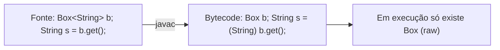

# Generics: tipos parametrizados, wildcards, PECS e type erasure

> **Resumo:** generics permitem escrever classes e métodos que funcionam com vários tipos mantendo a **verificação em tempo de compilação**. Em Java eles são implementados por *type erasure*: o tipo some do bytecode, o que explica quase todas as restrições e surpresas da feature.
> **Pré-requisitos:** [03-tipos-e-memoria.md](03-tipos-e-memoria.md) e [04-orientacao-a-objetos.md](04-orientacao-a-objetos.md).
> **Versões:** generics existem desde o Java 5; o diamante `<>` desde o Java 7; diamante com classes anônimas desde o Java 9. Exemplos compilados e executados no Java 25.

## 1. Definição

**Generics** (tipos parametrizados) permitem declarar classes, interfaces e métodos com **parâmetros de tipo**: `List<Order>`, `Map<String, Customer>`, `<T> T first(List<T> list)`.

Problema que resolve: antes do Java 5, coleções guardavam `Object`, exigindo *cast* manual e deixando o erro de tipo estourar só em execução (`ClassCastException`). Com generics, o erro vira **erro de compilação** e o cast desaparece do código-fonte.

```java
// Antes do Java 5: sem verificação
List orders = new ArrayList();
orders.add("não sou um pedido");
Order o = (Order) orders.get(0);          // ClassCastException em execução

// Com generics: não compila
List<Order> typed = new ArrayList<>();
typed.add("não sou um pedido");           // erro de compilação
```

## 2. Conceitos fundamentais

### 2.1 Classes, interfaces e métodos genéricos

```java
// Classe genérica: T é o parâmetro de tipo
public class Box<T> {
    private final T value;
    public Box(T value) { this.value = value; }
    public T get() { return value; }
}

// Método genérico: o parâmetro de tipo é do MÉTODO, vem antes do retorno
public static <T> T firstOrNull(List<T> list) {
    return list.isEmpty() ? null : list.get(0);
}

var b = new Box<>(new Customer("Ana"));    // inferência: Box<Customer>
Customer c = firstOrNull(List.of(new Customer("Ana")));
```

Convenção de nomes: `T` (type), `E` (element), `K`/`V` (key/value), `R` (result), `N` (number).

### 2.2 Limites (*bounds*)

`<T extends Comparable<T>>` restringe `T` a tipos comparáveis a si mesmos, permitindo chamar `compareTo` dentro do método:

```java
public static <T extends Comparable<T>> T max(List<T> list) {
    T best = list.get(0);
    for (T t : list) if (t.compareTo(best) > 0) best = t;
    return best;
}
```

Limites múltiplos usam `&`: `<T extends Number & Comparable<T>>` (a classe, se houver, vem primeiro).

### 2.3 Invariância: `List<Integer>` não é `List<Number>`

Arrays são **covariantes** (`Integer[]` é um `Number[]`), generics são **invariantes**. Se `List<Integer>` fosse `List<Number>`, daria para inserir um `Double` numa lista de inteiros. Arrays "permitem" e falham em execução (`ArrayStoreException`); generics proíbem na compilação.

```java
Number[] arr = new Integer[1];
arr[0] = 1.5;                                 // compila; ArrayStoreException em execução

List<Number> nums = new ArrayList<Integer>(); // NÃO compila
```

### 2.4 Wildcards: `?`, `? extends`, `? super`

Wildcards expressam **variância no ponto de uso**:

| Forma | Significado | Pode ler como | Pode escrever |
|---|---|---|---|
| `List<?>` | lista de algo desconhecido | `Object` | só `null` |
| `List<? extends Number>` | lista de `Number` ou subtipo (**produtor**) | `Number` | só `null` |
| `List<? super Integer>` | lista de `Integer` ou supertipo (**consumidor**) | `Object` | `Integer` |

### 2.5 PECS: *Producer Extends, Consumer Super*

Regra prática de Joshua Bloch: se o parâmetro **produz** valores que você lê, use `extends`; se **consome** valores que você grava, use `super`. O caso clássico é `Collections.copy(List<? super T> dest, List<? extends T> src)`.

```java
// src produz T (extends); dest consome T (super)
public static <T> void copyAll(List<? extends T> src, List<? super T> dest) {
    for (T t : src) dest.add(t);
}

List<Integer> ints = List.of(1, 2, 3);
List<Number> nums = new ArrayList<>();
copyAll(ints, nums);                          // Integer produzido, Number consome
```

Um exemplo da própria API: `Comparator<? super T>` em `list.sort(...)`: um `Comparator<Object>` serve para ordenar `List<String>`.

## 3. Como funciona por dentro

### 3.1 Type erasure

O compilador **apaga** os parâmetros de tipo: `List<String>` e `List<Integer>` viram `List` no bytecode. Onde necessário, ele insere **casts** automáticos e **métodos ponte** (*bridge methods*). Isso foi escolhido no Java 5 para manter **compatibilidade binária** com código pré-generics (*migration compatibility*).



Regras do apagamento: `T` sem limite vira `Object`; `T extends Comparable<T>` vira `Comparable`; `T extends Number & Comparable` vira o primeiro limite (`Number`). Você pode ver o resultado com `javap -c -p Box`: o campo `value` aparece como `Ljava/lang/Object;` e o `get()` devolve `Object`.

### 3.2 Consequências do apagamento

| Restrição | Motivo |
|---|---|
| `new T()`, `new T[10]` não compilam | `T` não existe em execução |
| `obj instanceof List<String>` não compila (só `List<?>`) | o argumento de tipo foi apagado |
| Não há `static` com `T` da classe | `T` pertence à instância, não à classe |
| Não se pode usar primitivos: `List<int>` | `T` vira `Object`; use `List<Integer>` (autoboxing, ver [03](03-tipos-e-memoria.md)) |
| `class A implements Comparable<X>, Comparable<Y>` proibido | ambos apagam para `Comparable` |
| Sobrecarga `void f(List<String>)` e `void f(List<Integer>)` colidem | mesma assinatura após apagamento |
| Genéricos não podem estender `Throwable`; `catch (T e)` proibido | o `catch` precisa do tipo real |

### 3.3 Reificação e arrays genéricos

Um tipo é **reificado** quando está disponível em execução. Arrays são reificados (`new String[1]` sabe que é `String[]`); `List<String>` não. Por isso `new List<String>[10]` é proibido: arrays checam o tipo do elemento em execução, o que não é possível com tipos apagados, e a combinação abriria uma brecha de tipo (*heap pollution*).

Quando precisa de um array do tipo `T`, receba um `Class<T>` ou um `IntFunction<T[]>` (é o que `stream.toArray(String[]::new)` faz):

```java
@SuppressWarnings("unchecked")
static <T> T[] newArray(Class<T> type, int n) {
    return (T[]) java.lang.reflect.Array.newInstance(type, n);
}
```

### 3.4 Métodos ponte

```java
class Name implements Comparable<Name> {
    public int compareTo(Name o) { ... }
}
```

Após o apagamento, `Comparable.compareTo(Object)` é o método da interface. O compilador gera em `Name` um **método sintético** `compareTo(Object)` que faz cast para `Name` e delega ao método real. Sem ele, o despacho dinâmico ([04](04-orientacao-a-objetos.md)) não funcionaria. `javap -p Name` mostra os dois.

### 3.5 O que sobrevive ao apagamento: metadados

O apagamento remove o tipo do **objeto**, mas não das **declarações**: o atributo `Signature` do `.class` guarda `List<String>` em campos, parâmetros e superclasses. Por isso reflection lê `Field.getGenericType()`, e é como Spring e Jackson descobrem `List<Order>` (ver [10](10-anotacoes-e-reflection.md)). O truque do *super type token* explora isso:

```java
// Captura Map<String, Integer> via superclasse anônima (a declaração é preservada)
abstract class TypeRef<T> {
    final java.lang.reflect.Type type =
        ((java.lang.reflect.ParameterizedType) getClass().getGenericSuperclass())
            .getActualTypeArguments()[0];
}
var ref = new TypeRef<Map<String, Integer>>() {};
System.out.println(ref.type);   // java.util.Map<java.lang.String, java.lang.Integer>
```

É o mecanismo por trás de `ParameterizedTypeReference` (Spring) e `TypeReference` (Jackson).

### 3.6 Heap pollution e raw types

*Raw type* é usar a classe genérica sem argumentos (`List` em vez de `List<String>`). Desliga as checagens e gera *unchecked warning*. Pode "poluir o heap": uma `List<String>` contendo `Integer`, e o erro só aparece, longe da causa, no cast inserido pelo compilador.

```java
List<String> strings = new ArrayList<>();
List raw = strings;                 // aviso unchecked
raw.add(42);                        // compila; polui o heap
String s = strings.get(0);          // ClassCastException aqui, bem depois
```

Varargs genéricos (`T...`) criam arrays de tipo apagado e também geram aviso; `@SafeVarargs` (em métodos `static`, `final` ou `private`) afirma que o método não faz nada inseguro com o array. `List.of(E...)` e `Arrays.asList` usam isso.

## 4. Evolução histórica

Generics chegaram no **Java 5 (2004)** (JSR 14), a maior mudança de linguagem até lambdas. O diamante `<>` veio no Java 7, a inferência de tipos foi aprimorada no Java 8 (alvo de tipagem para lambdas) e `var` no Java 10 reduziu a verbosidade. O projeto **Valhalla** busca generics sobre tipos primitivos/valores (`List<int>`) e especialização; está em andamento: o JEP 401 (value classes, preview) não está no Java 25 nem no 27 e é alvo do JDK 28; `List<int>` ainda não existe. Veja a linha do tempo em [00-evolucao-do-java.md](00-evolucao-do-java.md).

## 5. Exemplos práticos

### 5.1 Repositório genérico no domínio de pedidos

```java
package com.example.orders;

import java.util.*;

public interface Repository<T, ID> {
    Optional<T> findById(ID id);
    List<T> findAll();
    T save(T entity);
}

public class InMemoryRepository<T, ID> implements Repository<T, ID> {
    private final Map<ID, T> store = new LinkedHashMap<>();
    private final java.util.function.Function<? super T, ? extends ID> idOf;

    public InMemoryRepository(java.util.function.Function<? super T, ? extends ID> idOf) {
        this.idOf = idOf;
    }
    public Optional<T> findById(ID id) { return Optional.ofNullable(store.get(id)); }
    public List<T> findAll() { return List.copyOf(store.values()); }
    public T save(T e) { store.put(idOf.apply(e), e); return e; }
}

record Customer(Long id, String name) {}
var customers = new InMemoryRepository<Customer, Long>(Customer::id);
customers.save(new Customer(1L, "Ana"));
```

Esse formato (`Repository<T, ID>`) é o mesmo de `CrudRepository<T, ID>` do Spring Data (ver [06-spring-data-jpa.md](../03-spring-boot/06-spring-data-jpa.md)).

### 5.2 Soma com wildcard de produtor

```java
static double total(Collection<? extends Number> values) {
    double sum = 0;
    for (Number n : values) sum += n.doubleValue();
    return sum;
}
total(List.of(1, 2, 3));            // List<Integer>
total(List.of(1.5, 2.5));           // List<Double>
```

### 5.3 Resultado tipado com sealed e generics

```java
sealed interface Result<T> {
    record Ok<T>(T value) implements Result<T> {}
    record Err<T>(String message) implements Result<T> {}

    default <R> Result<R> map(java.util.function.Function<? super T, ? extends R> f) {
        return switch (this) {
            case Ok<T> ok -> new Ok<>(f.apply(ok.value()));
            case Err<T> err -> new Err<>(err.message());
        };
    }
}
```

### 5.4 Captura de wildcard

Um método com `List<?>` não consegue gravar, mas pode delegar a um método genérico auxiliar que "captura" o `?` num `T`:

```java
static void swapFirstTwo(List<?> list) { swapHelper(list); }
private static <T> void swapHelper(List<T> list) {
    T tmp = list.get(0); list.set(0, list.get(1)); list.set(1, tmp);
}
```

### 5.5 Inferência de tipos

O compilador infere a partir dos argumentos e do **tipo-alvo**: `List<String> l = Collections.emptyList();` infere `T = String`. Quando não consegue, use *type witness*: `Collections.<String>emptyList()`.

## 6. Configurações e anotações relevantes

| Elemento | Para que serve | Exemplo |
|---|---|---|
| `<T extends X>` | Limite superior | `<T extends Comparable<T>>` |
| `<T extends A & B>` | Limites múltiplos | `<T extends Number & Comparable<T>>` |
| `? extends T` / `? super T` | Wildcards (PECS) | `List<? super Integer>` |
| `@SuppressWarnings("unchecked")` | Silencia aviso de cast não verificado (comente o motivo) | cast em `newArray` |
| `@SafeVarargs` | Garante varargs genérico seguro | `@SafeVarargs static <T> List<T> listOf(T... xs)` |
| `javac -Xlint:unchecked` | Mostra detalhes dos avisos unchecked | `javac -Xlint:unchecked X.java` |
| `Class<T>` / `Type` | Token de tipo em execução | `Field.getGenericType()` |

## 7. Quando usar e quando NÃO usar

- **Use** em APIs de coleções, repositórios, *callbacks*, containers e utilitários que operam sobre vários tipos.
- **Use wildcards** nos **parâmetros** de métodos de biblioteca para dar flexibilidade (PECS).
- **Evite wildcards no retorno**: obriga o chamador a lidar com `List<? extends X>`; devolva tipo concreto.
- **Não use** generics quando só há um tipo possível (complexidade sem ganho) ou quando as assinaturas viram ilegíveis (`Map<String, List<Function<? super T, ? extends Map<K, V>>>>`): crie um tipo com nome (`record`).
- **Não use raw types** em código novo.

## 8. Erros comuns e boas práticas

- **Ignorar *unchecked warnings***: cada um é um possível `ClassCastException` tardio. Trate ou isole com `@SuppressWarnings` no menor escopo.
- **Esperar `List<Dog>` ser `List<Animal>`**: use `List<? extends Animal>` para leitura.
- **Tentar `instanceof List<String>`**: use `List<?>` e valide os elementos.
- **Misturar arrays e generics** (`List<String>[]`): prefira `List<List<String>>`.
- **Sobrecarga que colide após apagamento**: renomeie os métodos.
- **Esquecer que `T` não é `Class<T>`**: se precisa do tipo em execução, receba um `Class<T>`.
- **Bounded demais**: `<T extends Comparable<T>>` falha para tipos cujo `compareTo` aceita um supertipo; o mais permissivo é `<T extends Comparable<? super T>>`.

## 9. Perguntas de revisão

1. O que é *type erasure* e por que o Java o adotou?
<details><summary>Resposta</summary>É a remoção dos argumentos de tipo na compilação: `List<String>` vira `List`, com casts inseridos pelo compilador. Foi adotado para manter compatibilidade binária com código anterior ao Java 5.</details>

2. Por que `List<Integer>` não é subtipo de `List<Number>`, e como aceitar ambas num método de leitura?
<details><summary>Resposta</summary>Porque generics são invariantes: caso contrário seria possível inserir um `Double` numa lista de `Integer`. Para ler, use `List<? extends Number>`.</details>

3. Explique PECS com um exemplo.
<details><summary>Resposta</summary>*Producer Extends, Consumer Super*: o que fornece elementos usa `? extends T`; o que os recebe usa `? super T`. Em `copyAll(List<? extends T> src, List<? super T> dest)`, `src` produz e `dest` consome.</details>

4. Por que `new T[10]` e `obj instanceof List<String>` não compilam?
<details><summary>Resposta</summary>Porque `T` e `String` (como argumento) não existem em execução devido ao apagamento; o array precisaria checar o tipo do elemento e o `instanceof` precisaria comparar o argumento de tipo.</details>

5. Como bibliotecas como Jackson e Spring conseguem saber que algo é `List<Order>` se há apagamento?
<details><summary>Resposta</summary>Os tipos das **declarações** (campos, parâmetros, superclasses) permanecem no atributo `Signature` do `.class` e são lidos por reflection (`getGenericType`, `getGenericSuperclass`). O *super type token* usa uma subclasse anônima para capturar o tipo.</details>

## 10. Referências oficiais

- Tutorial de generics no dev.java: <https://dev.java/learn/generics/>
- JLS, capítulo 4.5 (tipos parametrizados) e 4.6 (type erasure): <https://docs.oracle.com/javase/specs/jls/se25/html/>
- JSR 14 (Generics): <https://jcp.org/en/jsr/detail?id=14>
- Projeto Valhalla: <https://openjdk.org/projects/valhalla/>
