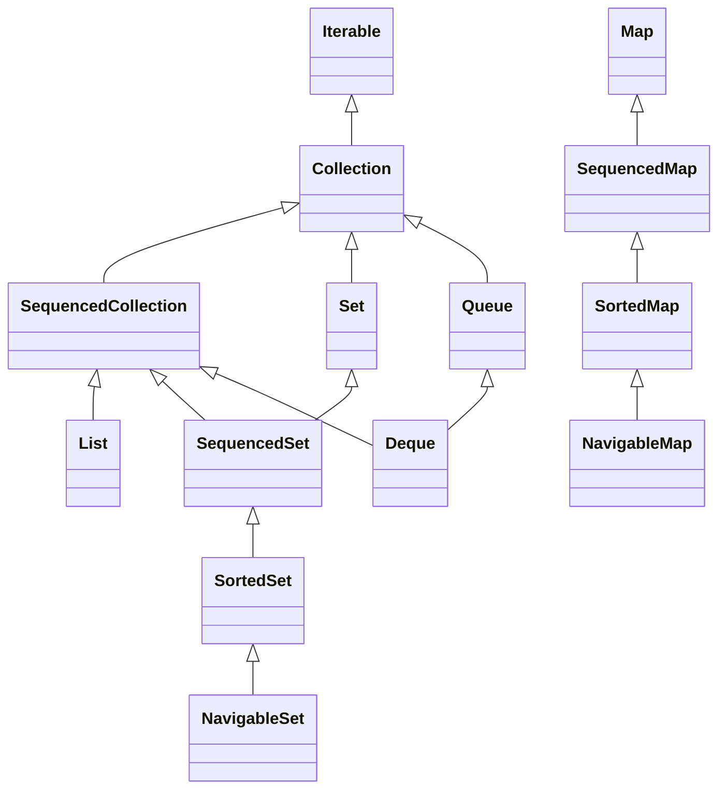
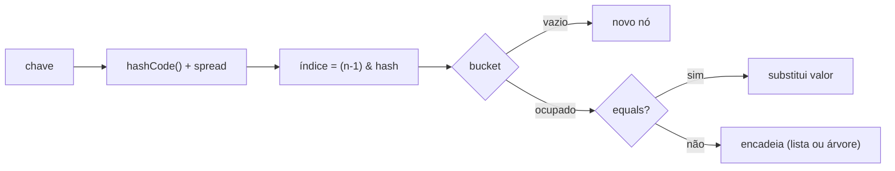

# Coleções: hierarquia, implementações, complexidade e Sequenced Collections

> **Resumo:** o *Java Collections Framework* oferece interfaces (`List`, `Set`, `Map`, `Queue`/`Deque`) e implementações com custos diferentes. Escolher a estrutura certa, e entender `equals`/`hashCode`, ordenação e imutabilidade, evita bugs sutis e gargalos.
> **Pré-requisitos:** [03-tipos-e-memoria.md](03-tipos-e-memoria.md) (contrato `equals`/`hashCode`) e [06-generics.md](06-generics.md).
> **Versões:** framework desde o Java 1.2; `List.of`/`Set.of`/`Map.of` desde o Java 9; **Sequenced Collections** (`SequencedCollection`, `SequencedSet`, `SequencedMap`) desde o **Java 21** (JEP 431). Exemplos executados no Java 25.

## 1. Definição

Uma **coleção** é um objeto que agrupa outros objetos. O framework separa **contrato** (interfaces) de **implementação** (classes), de modo que o código dependa de `List<Order>` e não de `ArrayList<Order>`.

Problema que resolve: antes do Java 1.2 existiam só arrays, `Vector`, `Hashtable` e `Enumeration`, sem API comum. O framework unificou algoritmos (`Collections.sort`, `binarySearch`) e a troca de implementação sem alterar o chamador.

## 2. Conceitos fundamentais

### 2.1 Hierarquia



`Map` **não** estende `Collection` (um mapa é um conjunto de associações chave→valor, não uma sequência de elementos).

### 2.2 Escolhendo a implementação

| Interface | Implementação | Estrutura | Ordem | `null` | Observação |
|---|---|---|---|---|---|
| `List` | `ArrayList` | array dinâmico | inserção | sim | padrão para listas |
| `List` | `LinkedList` | lista duplamente ligada | inserção | sim | quase nunca vale a pena (ver 2.4) |
| `Set` | `HashSet` | tabela hash | nenhuma | 1 `null` | O(1) médio |
| `Set` | `LinkedHashSet` | hash + lista ligada | inserção | sim | previsível |
| `Set` | `TreeSet` | árvore rubro-negra | ordenada | não* | O(log n); `NavigableSet` |
| `Map` | `HashMap` | tabela hash | nenhuma | sim | padrão para mapas |
| `Map` | `LinkedHashMap` | hash + lista ligada | inserção (ou acesso) | sim | base de caches LRU |
| `Map` | `TreeMap` | árvore rubro-negra | por chave | chave não* | `floorKey`, `headMap`... |
| `Map` | `EnumMap`/`EnumSet` | array indexado por ordinal | ordem do enum | — | mais rápido para enums |
| `Queue`/`Deque` | `ArrayDeque` | array circular | FIFO/LIFO | **não** | substitui `Stack` e `LinkedList` como pilha/fila |
| `Queue` | `PriorityQueue` | heap binário | por prioridade | não | `poll()` devolve o menor |

\* Com comparador natural; `null` lança `NullPointerException`.

### 2.3 Complexidade

| Operação | `ArrayList` | `LinkedList` | `HashSet`/`HashMap` | `TreeSet`/`TreeMap` | `ArrayDeque` |
|---|---|---|---|---|---|
| acesso por índice | O(1) | O(n) | — | — | — |
| `add` no fim | O(1) amortizado | O(1) | O(1) médio | O(log n) | O(1) |
| inserir/remover no meio | O(n) | O(1) *após localizar* (O(n) para achar) | — | — | — |
| inserir/remover nas pontas | início O(n), fim O(1) | O(1) | — | — | O(1) |
| `contains`/`get` por chave | O(n) | O(n) | O(1) médio | O(log n) | O(n) |
| iteração ordenada | — | — | não garantida | sim | — |

### 2.4 Por que `LinkedList` raramente ganha

Em teoria insere no meio em O(1), mas é preciso **percorrer** até a posição (O(n)), e cada nó é um objeto separado no heap (cabeçalho + 2 ponteiros), com péssima **localidade de cache**. `ArrayList` e `ArrayDeque` usam arrays contíguos e, na prática, vencem em quase todo cenário.

### 2.5 Sequenced Collections (Java 21)

Antes do Java 21 não havia um tipo comum para "coleção com ordem de encontro definida": pegar o último de um `LinkedHashSet` exigia iterar tudo, e o primeiro/último de `List`, `Deque` e `SortedSet` tinham nomes diferentes. A JEP 431 adicionou:

| Interface | Métodos novos | Implementada por |
|---|---|---|
| `SequencedCollection<E>` | `reversed()`, `addFirst`, `addLast`, `getFirst`, `getLast`, `removeFirst`, `removeLast` | `List`, `Deque`, `LinkedHashSet`, `SortedSet` |
| `SequencedSet<E>` | `reversed()` covariante | `LinkedHashSet`, `SortedSet` |
| `SequencedMap<K,V>` | `firstEntry`, `lastEntry`, `pollFirstEntry`, `pollLastEntry`, `putFirst`, `putLast`, `reversed`, `sequencedKeySet/Values/EntrySet` | `LinkedHashMap`, `SortedMap` |

`reversed()` devolve uma **visão** (não cópia): mudanças aparecem nos dois lados.

```java
var list = new ArrayList<>(List.of(1, 2, 3));
list.getFirst();      // 1   (antes: list.get(0))
list.getLast();       // 3   (antes: list.get(list.size() - 1))
list.reversed();      // [3, 2, 1]  (visão)

var set = new LinkedHashSet<>(List.of("b", "a", "c"));
set.reversed();       // [c, a, b]

var map = new LinkedHashMap<String, Integer>();
map.put("x", 1); map.put("y", 2);
map.lastEntry();      // y=2
map.putFirst("z", 9); // {z=9, x=1, y=2}
```

`HashSet` e `HashMap` **não** são sequenciados. Em `List.of(...)` os métodos de modificação (`addFirst` etc.) lançam `UnsupportedOperationException`.

## 3. Como funciona por dentro

### 3.1 `HashMap`

- Uma **tabela** (array de *buckets*) com capacidade potência de 2 (padrão 16) e *load factor* 0,75.
- `put(k, v)`: calcula `hash = k.hashCode()` com *spread* (`h ^ (h >>> 16)`), índice `(n-1) & hash`. Se o bucket estiver vazio, cria o nó; senão compara com `hashCode` e `equals` e encadeia.
- Quando `size > capacidade × 0,75`, a tabela **dobra** (*resize*) e os nós são redistribuídos.
- Desde o **Java 8**, um bucket com 8 ou mais nós vira **árvore rubro-negra** (se a tabela tiver ≥ 64 posições; senão, redimensiona), reduzindo o pior caso de colisões de O(n) para O(log n). Volta a lista quando cai para 6 nós.



Consequência direta do contrato `equals`/`hashCode` ([03](03-tipos-e-memoria.md)): se dois objetos iguais têm *hashes* diferentes, caem em buckets distintos e o `contains` falha.

`HashSet` é, internamente, um `HashMap` cujas chaves são os elementos. `LinkedHashMap` acrescenta uma lista duplamente ligada pelos nós (e, com `accessOrder=true` mais `removeEldestEntry`, vira cache LRU). `TreeMap` usa árvore rubro-negra balanceada: usa `compareTo`/`Comparator`, **não** `equals`/`hashCode` (dois elementos que "comparam 0" são considerados o mesmo).

### 3.2 `ArrayList`

Mantém um `Object[]` e um `size`. Ao encher, cresce ~50% (`newCapacity ≈ old + old/2`) copiando o array (`Arrays.copyOf`); por isso `add` é O(1) *amortizado*. `new ArrayList<>(n)` evita redimensionamentos. `remove(int)` desloca os elementos à direita.

### 3.3 *Fail-fast* e `ConcurrentModificationException`

Iteradores de `ArrayList`/`HashMap` guardam um contador `modCount`. Se a coleção for modificada fora do iterador durante a iteração, o próximo `next()` lança `ConcurrentModificationException` (CME). É um *melhor esforço* para detectar bugs, **não** uma garantia de segurança entre threads. Um caso curioso: remover o **penúltimo** elemento num `for-each` não lança CME (o `hasNext()` já devolve `false`), o que mascara o bug.

```java
for (Order o : orders) {
    if (o.isCancelled()) orders.remove(o);   // CME (na maioria dos casos)
}
orders.removeIf(Order::isCancelled);         // correto
```

### 3.4 Imutabilidade: três coisas diferentes

| Mecanismo | O que é | Pode mudar? |
|---|---|---|
| `List.of(...)`, `Set.of`, `Map.of`, `List.copyOf` (Java 9/10) | coleção **realmente imutável**; rejeita `null`; `Set.of`/`Map.of` lançam exceção em duplicatas e têm ordem de iteração **não especificada** (varia a cada execução) | não |
| `Collections.unmodifiableList(l)` | **visão** somente leitura sobre `l` | `l` muda, a visão acompanha |
| `Arrays.asList(arr)` | lista de **tamanho fixo** apoiada no array | `set` sim; `add`/`remove` não |
| `stream.toList()` (Java 16) | lista não modificável (permite `null`) | não |

`List.copyOf(x)` devolve a própria `x` se ela já for imutável (sem copiar).

### 3.5 `Comparable` e `Comparator`

`Comparable<T>` define a **ordem natural** (`compareTo`) na classe; `Comparator<T>` define uma ordem externa, composta com `comparing`, `thenComparing`, `reversed`, `nullsFirst`. O contrato exige consistência com `equals` para `TreeSet`/`TreeMap` (ver erro comum abaixo).

## 4. Evolução histórica

`Vector`/`Hashtable` (1.0, sincronizados) → framework unificado (1.2) → generics (5) → `ArrayDeque`/`NavigableMap` (6) → árvore em buckets de `HashMap` e `default` methods como `computeIfAbsent`/`merge`/`removeIf` (8) → fábricas imutáveis (9) → `toList()` (16) → Sequenced Collections (21). Ver [00-evolucao-do-java.md](00-evolucao-do-java.md).

## 5. Exemplos práticos

### 5.1 Agrupando pedidos por cliente (Java moderno)

```java
package com.example.orders;

import java.util.*;

record OrderItem(String sku, int quantity) {}

Map<String, List<OrderItem>> itemsByOrder = new HashMap<>();

// antigo
List<OrderItem> list = itemsByOrder.get("A1");
if (list == null) { list = new ArrayList<>(); itemsByOrder.put("A1", list); }
list.add(new OrderItem("P1", 2));

// moderno
itemsByOrder.computeIfAbsent("A1", k -> new ArrayList<>()).add(new OrderItem("P1", 2));
itemsByOrder.getOrDefault("Z9", List.of());      // lista vazia imutável como padrão
```

`merge(k, v, fn)` é ideal para contadores: `counts.merge(sku, 1, Integer::sum)`.

### 5.2 Navegação com `TreeMap`

```java
var tm = new TreeMap<>(Map.of(1, "a", 5, "e", 9, "i"));
tm.floorKey(6);      // 5   (maior chave <= 6)
tm.ceilingKey(6);    // 9   (menor chave >= 6)
tm.headMap(5);       // {1=a}
tm.tailMap(5, true); // {5=e, 9=i}
```

Útil para faixas (tabelas de frete por peso, preço por data de vigência).

### 5.3 Fila, pilha e prioridade

```java
Deque<Integer> stack = new ArrayDeque<>();
stack.push(1); stack.push(2);
stack.pop();                          // 2  (LIFO)

PriorityQueue<Integer> pq = new PriorityQueue<>(Comparator.reverseOrder());
pq.addAll(List.of(3, 9, 1));
pq.poll();                            // 9
```

Para pilha use `ArrayDeque`, não `Stack` (herda de `Vector`, sincronizada e legada).

### 5.4 Cache LRU com `LinkedHashMap`

```java
class LruCache<K, V> extends LinkedHashMap<K, V> {
    private final int max;
    LruCache(int max) { super(16, 0.75f, true); this.max = max; }   // true = ordem de acesso
    @Override protected boolean removeEldestEntry(Map.Entry<K, V> eldest) {
        return size() > max;
    }
}
```

Não é seguro entre threads; para produção prefira Caffeine (ver [11-cache-agendamento-e-async.md](../03-spring-boot/11-cache-agendamento-e-async.md)).

### 5.5 Chave mutável quebra o `HashMap`

```java
var key = new ArrayList<>(List.of(1));
var map = new HashMap<List<Integer>, String>();
map.put(key, "v");
key.add(2);                          // muda o hashCode da chave
map.get(key);                        // null: procura em outro bucket
map.containsKey(List.of(1));         // false: está no bucket antigo, mas equals falha
```

Use chaves **imutáveis** (`String`, `record`, `Long`, enum).

## 6. Configurações e anotações relevantes

| API | Para que serve | Exemplo |
|---|---|---|
| `new ArrayList<>(n)` / `new HashMap<>(n)` | Capacidade inicial (HashMap: `n/0.75 + 1`; ou `HashMap.newHashMap(n)` no Java 19+) | `HashMap.newHashMap(100)` |
| `Collections.unmodifiableX` | Visão somente leitura | retorno defensivo de getters |
| `List.copyOf` / `Map.copyOf` | Cópia imutável | construtor compacto de record |
| `computeIfAbsent`, `merge`, `compute` | Atualização atômica por chave (em `ConcurrentHashMap` é atômica) | `counts.merge(k, 1, Integer::sum)` |
| `removeIf`, `replaceAll` | Operação em massa segura | `orders.removeIf(Order::isCancelled)` |
| `Comparator.comparing(...).thenComparing(...)` | Ordenação composta | `comparing(Order::date).reversed()` |
| `Collections.synchronizedList` | Envolve com `synchronized` (grosseiro) | prefira `java.util.concurrent` ([12-concorrencia.md](12-concorrencia.md)) |

## 7. Quando usar e quando NÃO usar

- **`ArrayList`** por padrão. **`HashMap`/`HashSet`** quando a ordem não importa e as chaves têm bom `hashCode`.
- **`LinkedHashMap`/`LinkedHashSet`** quando a ordem de inserção deve ser estável (respostas de API, testes determinísticos).
- **`TreeMap`/`TreeSet`** quando precisa de busca por faixa ou ordenação contínua; custa O(log n).
- **`EnumMap`/`EnumSet`** para chaves enum.
- **Não use** `LinkedList`, `Vector`, `Stack`, `Hashtable` em código novo.
- **Não use** `HashMap` compartilhado entre threads com escrita: use `ConcurrentHashMap` ([12](12-concorrencia.md)).
- **Não** exponha a coleção interna de uma classe; devolva `List.copyOf(items)` ou `Collections.unmodifiableList(items)`.

## 8. Erros comuns e boas práticas

- **Modificar a coleção dentro de um `for-each`**: use `removeIf` ou `Iterator.remove()`.
- **`equals` sem `hashCode`** (ou o inverso): elementos "desaparecem" em `HashSet`/`HashMap`.
- **Confundir visão com cópia**: `unmodifiableList` e `subList` refletem mudanças no original.
- **`TreeSet` com comparador inconsistente com `equals`**: dois produtos com mesmo SKU e nomes diferentes colapsam num só (`comparing(Product::sku)` → tamanho 1).
- **Esperar ordem de `HashMap`/`Set.of`/`Map.of`**: não é especificada e pode variar entre execuções.
- **`Arrays.asList(int[])`**: gera `List<int[]>` com 1 elemento; use `Arrays.stream(arr).boxed().toList()`.
- **`List.of(...)` com `null`**: lança `NullPointerException`.
- **Remover por valor em `List<Integer>`**: `list.remove(1)` remove o índice 1; use `list.remove(Integer.valueOf(1))`.
- **`var x = new PriorityQueue<>(...)` com diamante**: pode inferir tipos errados; declare o tipo (`PriorityQueue<Integer>`).

## 9. Perguntas de revisão

1. Por que `ArrayList` costuma ser mais rápido que `LinkedList` mesmo para inserções no meio?
<details><summary>Resposta</summary>Porque achar a posição na lista ligada é O(n) e cada nó é um objeto separado (pior localidade de cache). O deslocamento em array contíguo, feito por `System.arraycopy`, é muito rápido na prática.</details>

2. Como um `HashMap` encontra o valor de uma chave, e o que acontece em colisões?
<details><summary>Resposta</summary>Calcula `hashCode`, aplica *spread* e acha o bucket por `(n-1) & hash`; dentro do bucket compara com `equals`. Colisões são encadeadas em lista, e a partir de 8 nós (tabela ≥ 64) viram árvore rubro-negra.</details>

3. Qual a diferença entre `List.of`, `Collections.unmodifiableList` e `Arrays.asList`?
<details><summary>Resposta</summary>`List.of` é imutável de verdade (sem `null`); `unmodifiableList` é uma visão que acompanha mudanças no original; `Arrays.asList` tem tamanho fixo mas permite `set`, e escreve de volta no array.</details>

4. O que a JEP 431 trouxe e como `reversed()` se comporta?
<details><summary>Resposta</summary>Interfaces `SequencedCollection`, `SequencedSet` e `SequencedMap`, com `getFirst/getLast`, `addFirst/addLast`, `reversed` etc. `reversed()` devolve uma visão, não uma cópia.</details>

5. Por que usar um `List` mutável como chave de `HashMap` é perigoso?
<details><summary>Resposta</summary>Alterar a chave muda seu `hashCode`; a entrada permanece no bucket antigo e não é mais localizada por `get`/`containsKey`.</details>

## 10. Referências oficiais

- Tutorial de coleções no dev.java: <https://dev.java/learn/api/collections-framework/>
- Javadoc `java.util` (Java 25): <https://docs.oracle.com/en/java/javase/25/docs/api/java.base/java/util/package-summary.html>
- JEP 431 (Sequenced Collections): <https://openjdk.org/jeps/431>
- JEP 269 (fábricas de coleções convenientes): <https://openjdk.org/jeps/269>
