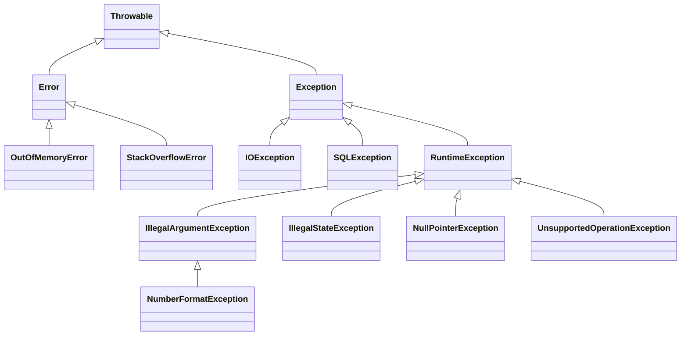

# Exceções: checked vs unchecked, try-with-resources e boas práticas

> **Resumo:** exceções são o mecanismo do Java para sinalizar e propagar falhas sem poluir o fluxo normal. Entender a hierarquia `Throwable`, o custo do *stack trace*, a diferença entre *checked* e *unchecked* e o `try-with-resources` é essencial, porque o Spring converte e trata exceções o tempo todo (`@ControllerAdvice`, rollback de `@Transactional`).
> **Pré-requisitos:** [04-orientacao-a-objetos.md](04-orientacao-a-objetos.md) (herança) e [03-tipos-e-memoria.md](03-tipos-e-memoria.md).
> **Versões:** `try-with-resources` desde o Java 7; *multi-catch* desde o Java 7; variável efetivamente final em `try-with-resources` desde o Java 9; mensagens de NPE "úteis" (*helpful NPE*) padrão desde o Java 15. Exemplos executados no Java 25.

## 1. Definição

Uma **exceção** é um objeto (`Throwable`) lançado com `throw` quando uma operação não pode continuar normalmente. A execução abandona o bloco atual e **desenrola a pilha** (*stack unwinding*) até encontrar um `catch` compatível; se nenhum existir, a thread termina e o `UncaughtExceptionHandler` é chamado.

Problema que resolve: em C, funções devolviam códigos de erro que o chamador podia ignorar. Em Java, a falha **não pode ser silenciosamente ignorada**: ou é tratada, ou propaga.

## 2. Conceitos fundamentais

### 2.1 Hierarquia



| Categoria | Subclasses de | O compilador exige tratar? | Típico para |
|---|---|---|---|
| **Checked** | `Exception` (exceto `RuntimeException`) | **Sim**: `catch` ou `throws` | falhas externas recuperáveis (I/O, rede, SQL) |
| **Unchecked** | `RuntimeException` | Não | bugs de programação e violação de contrato |
| **Error** | `Error` | Não | falhas da JVM (OOM, SOE); em geral **não** capturar |

Regra de bolso: **checked** se o chamador razoavelmente consegue se recuperar; **unchecked** se for bug ou se nada sensato pode ser feito naquele ponto.

### 2.2 `try` / `catch` / `finally`

```java
try {
    process(order);
} catch (PaymentException | InventoryException e) {   // multi-catch: tipos sem relação de herança
    log.warn("falha de negócio", e);
} catch (RuntimeException e) {                         // mais específico primeiro
    throw e;
} finally {
    metrics.increment("orders.processed");             // sempre executa (salvo System.exit/queda da JVM)
}
```

O compilador rejeita `catch` de um tipo já coberto por um `catch` anterior mais geral.

### 2.3 `try-with-resources`

Qualquer objeto `AutoCloseable` declarado no cabeçalho é fechado automaticamente, na **ordem inversa** da abertura, mesmo com exceção.

```java
// Antes do Java 7: verboso e propenso a perder a exceção original
BufferedReader r = null;
try {
    r = Files.newBufferedReader(path);
    return r.readLine();
} finally {
    if (r != null) try { r.close(); } catch (IOException ignored) {}   // esconde falhas
}

// Java 7+
try (BufferedReader r = Files.newBufferedReader(path)) {
    return r.readLine();
}

// Java 9+: pode usar variável efetivamente final já declarada
var in = Files.newInputStream(path);
try (in) { ... }
```

Se o corpo **e** o `close()` lançam, a exceção do corpo é a principal e as de `close()` ficam **suprimidas** (`e.getSuppressed()`). No exemplo validado, com recursos `A` e `B`: corpo lança `body`; saem `close B`, `close A`; o resultado é `body` com duas suprimidas (`close B` e `close A`).

### 2.4 Criando exceções próprias

```java
package com.example.orders;

// unchecked: erro de negócio que o chamador direto não trata
public class OrderNotFoundException extends RuntimeException {
    private final long orderId;
    public OrderNotFoundException(long orderId) {
        super("Order %d not found".formatted(orderId));
        this.orderId = orderId;
    }
    public OrderNotFoundException(long orderId, Throwable cause) {
        super("Order %d not found".formatted(orderId), cause);   // preserva a causa!
        this.orderId = orderId;
    }
    public long orderId() { return orderId; }
}

// checked: falha esperada e recuperável de integração
public class PaymentException extends Exception {
    public PaymentException(String message, Throwable cause) { super(message, cause); }
}
```

Dê contexto útil na mensagem (ids, valores), **sempre** passe a causa original, e evite herança profunda.

### 2.5 `throws`, sobrescrita e `Throwable.getCause()`

Um método sobrescrito não pode lançar *checked* novas ou mais amplas que a original; pode lançar menos ou nenhuma (ver [04](04-orientacao-a-objetos.md)). *Chaining* (`new X("msg", cause)`) mantém a cadeia, impressa como `Caused by:` no *stack trace*. Para envolver um *checked* em *unchecked*: `throw new UncheckedIOException(e)` ou `new RuntimeException(e)`.

## 3. Como funciona por dentro

### 3.1 Custo: o *stack trace*

O custo de criar uma exceção está em `Throwable.fillInStackTrace()`, que percorre a pilha e grava cada quadro. É caro (microssegundos) quando a pilha é funda. **Lançar e capturar** em si é barato quando o JIT pode otimizar; o que pesa é a construção. Por isso exceções não devem ser usadas como controle de fluxo em *loops* quentes. Truque de bibliotecas: o construtor protegido `Throwable(message, cause, enableSuppression, writableStackTrace)` com `writableStackTrace=false` cria exceções "leves".

### 3.2 Tabela de exceções no bytecode

O `javac` não gera código de "try" em tempo de execução: cada método tem uma **tabela de exceções** (`Exception table` no `javap -c -v`) com intervalos de bytecode `from–to`, `target` do handler e tipo capturado. Ao lançar, a JVM procura no método atual um intervalo que contenha o ponto do `athrow` e cujo tipo seja compatível; se não achar, desenrola o quadro e repete no método chamador. Por isso um `try` sem exceções tem **custo zero** no caminho feliz.

`finally` é compilado **duplicando** o bloco em cada saída (normal, `return`, exceção); um `return` dentro de `finally` **descarta** a exceção em voo e o `return` anterior. No teste, `try { return 1; } finally { return 2; }` devolve `2`.

### 3.3 `try-with-resources` desaçucarado

O compilador expande para algo equivalente a:

```java
Res r = new Res();
Throwable primary = null;
try { body } catch (Throwable t) { primary = t; throw t; }
finally {
    if (r != null) {
        if (primary != null) { try { r.close(); } catch (Throwable s) { primary.addSuppressed(s); } }
        else r.close();
    }
}
```

### 3.4 Mensagens úteis de NPE (Java 14+, padrão no 15)

Desde o Java 15, `NullPointerException` descreve **o que** era nulo: `Cannot invoke "String.length()" because "customer.name" is null`. Se a classe for compilada sem `-g` (informações de variáveis locais), nomes de locais aparecem como `"<local1>"`; com `-g` (padrão do Maven/Gradle) aparecem os nomes reais.

### 3.5 `Error` e estados irrecuperáveis

`OutOfMemoryError` e `StackOverflowError` ([02-jvm-por-dentro.md](02-jvm-por-dentro.md)) indicam que a JVM pode estar instável. Capturá-los só vale para registrar e encerrar de forma controlada; tentar "continuar" é arriscado (invariantes violadas no meio de uma operação).

## 4. Evolução histórica

Exceções existem desde o Java 1.0; o *chaining* chegou no 1.4 (`getCause`); `try-with-resources`, *multi-catch* e `addSuppressed` no Java 7; refinamento no 9; mensagens de NPE úteis no 14/15. As *checked exceptions* continuam sendo uma escolha controversa: linguagens posteriores (Kotlin, Scala) não as têm, e o próprio ecossistema (Spring, JPA) prefere *unchecked*. Veja [00-evolucao-do-java.md](00-evolucao-do-java.md).

## 5. Exemplos práticos

### 5.1 Traduzindo exceções entre camadas

```java
public Order findOrder(long id) {
    try {
        return jdbc.queryForObject(SQL, mapper, id);
    } catch (SQLException e) {                       // detalhe de infraestrutura
        throw new OrderNotFoundException(id, e);     // vira conceito do domínio, com causa preservada
    }
}
```

Spring faz exatamente isso: converte exceções do JDBC/JPA na hierarquia `DataAccessException` (*unchecked*), ver [09-transacoes.md](../02-spring-core/09-transacoes.md).

### 5.2 Validar argumentos na entrada

```java
public Customer(String name, String email) {
    this.name = Objects.requireNonNull(name, "name must not be null");
    if (email == null || !email.contains("@"))
        throw new IllegalArgumentException("invalid email: " + email);
}
```

`IllegalArgumentException` para argumento inválido; `IllegalStateException` para objeto no estado errado; `UnsupportedOperationException` para operação não suportada; `NullPointerException` (via `requireNonNull`) para `null` indevido.

### 5.3 Lambdas e *checked exceptions*

Interfaces funcionais padrão (`Function`, `Consumer`) não declaram *checked*. Opções: tratar dentro da lambda, ou envolver:

```java
List<String> lines = paths.stream()
    .map(p -> {
        try { return Files.readString(p); }
        catch (IOException e) { throw new UncheckedIOException(e); }
    })
    .toList();
```

Ver [09-programacao-funcional.md](09-programacao-funcional.md).

### 5.4 Exceção em outra thread

Exceção não tratada numa `Thread` **não** sobe para quem a criou. Use `Thread.setDefaultUncaughtExceptionHandler`, ou, em `ExecutorService`/`CompletableFuture`, trate a falha no `Future.get()` (`ExecutionException`) ou em `.exceptionally(...)` ([12-concorrencia.md](12-concorrencia.md)).

### 5.5 Resultado explícito como alternativa

Para falhas **esperadas** de negócio, um tipo `Result` (ver [05-recursos-modernos-da-linguagem.md](05-recursos-modernos-da-linguagem.md) e [06](06-generics.md)) torna o erro parte da assinatura sem *checked exceptions*:

```java
sealed interface Result<T> { record Ok<T>(T v) implements Result<T> {} record Err<T>(String msg) implements Result<T> {} }
```

## 6. Configurações e anotações relevantes

| Elemento | Para que serve | Exemplo |
|---|---|---|
| `throws` | Declara *checked* que o método pode lançar | `void save() throws IOException` |
| `Throwable.getCause()` / `initCause` | Cadeia de causas | `new X("msg", cause)` |
| `addSuppressed` / `getSuppressed` | Exceções secundárias do `try-with-resources` | `e.getSuppressed()` |
| `Thread.setDefaultUncaughtExceptionHandler` | Última linha de defesa por thread | log centralizado |
| `-XX:+ShowCodeDetailsInExceptionMessages` | Mensagens úteis de NPE (padrão ligado desde o 15) | desligue com `-XX:-Show...` |
| `-XX:MaxJavaStackTraceDepth` | Limita profundidade do *stack trace* (padrão 1024) | tuning raro |
| `@ExceptionHandler`, `@ControllerAdvice` (Spring) | Mapear exceção → resposta HTTP | ver [04-web-mvc.md](../03-spring-boot/04-web-mvc.md) |
| `@Transactional(rollbackFor=...)` (Spring) | Por padrão só faz rollback em *unchecked* | ver [09-transacoes.md](../02-spring-core/09-transacoes.md) |

## 7. Quando usar e quando NÃO usar

- **Checked**: APIs de biblioteca em que o chamador deve escolher entre tentar de novo, usar um padrão ou desistir (ex.: I/O). Evite em camadas de aplicação, onde força `throws` por toda a pilha.
- **Unchecked**: bugs, violações de contrato e erros de domínio tratados por um ponto central (ex.: `@ControllerAdvice`).
- **Não use exceções para fluxo normal** (ex.: tentar `Integer.parseInt` para descobrir se é número em um *loop* de milhões). Valide antes ou use `Optional`/`Result`.
- **Não capture** `Throwable`/`Error` sem motivo; **não capture** `Exception` genérica no meio do código só para "garantir".

## 8. Erros comuns e boas práticas

- **`catch` vazio** ou só `e.printStackTrace()`: o erro some ou vai para stderr sem contexto. Registre com *logger* **uma vez** e relance ou trate.
- **Logar e relançar**: gera o mesmo erro duplicado em vários logs; escolha um lugar (normalmente a borda).
- **Perder a causa**: `throw new X(e.getMessage())` descarta o *stack trace* original; use `new X("msg", e)`.
- **`return` em `finally`**: engole exceções.
- **`finally` que lança**: mascara a exceção original (por isso `try-with-resources`).
- **Mensagens inúteis** (`"erro"`): inclua ids e valores relevantes (sem dados sensíveis).
- **Exceções muito genéricas** (`throws Exception`): esconde o contrato.
- **Capturar `Exception` e ignorar `InterruptedException`**: ao capturar, restaure o *flag*: `Thread.currentThread().interrupt();` ([12](12-concorrencia.md)).
- **Esquecer que `@Transactional` só faz rollback em *unchecked* por padrão** quando lançar uma *checked*.

## 9. Perguntas de revisão

1. Qual a diferença entre exceção *checked* e *unchecked*, e quando escolher cada uma?
<details><summary>Resposta</summary>*Checked* (subclasses de `Exception` fora de `RuntimeException`) obrigam o compilador a exigir `catch` ou `throws`; servem para falhas recuperáveis. *Unchecked* (`RuntimeException`) não exigem tratamento; servem para bugs, violações de contrato e erros tratados centralmente.</details>

2. Como o `try-with-resources` lida com exceções do corpo e do `close()`?
<details><summary>Resposta</summary>Fecha os recursos na ordem inversa. A exceção do corpo é a principal; as do `close()` são anexadas como *suprimidas* (`getSuppressed()`), sem mascarar a original.</details>

3. Por que um `try` sem exceção não custa nada em tempo de execução?
<details><summary>Resposta</summary>Porque o compilador gera uma **tabela de exceções** por método, consultada só quando uma exceção é lançada; o caminho normal não executa código extra.</details>

4. Qual o principal custo de uma exceção e como evitá-lo?
<details><summary>Resposta</summary>`fillInStackTrace()`, que captura a pilha. Evita-se não usando exceções como controle de fluxo em *loops* quentes, ou criando exceções sem *stack trace* em casos especiais.</details>

5. O que acontece com `try { return 1; } finally { return 2; }`?
<details><summary>Resposta</summary>Retorna `2`: o `return` do `finally` substitui o valor e descarta qualquer exceção em andamento. É uma má prática.</details>

## 10. Referências oficiais

- Tutorial de exceções (dev.java): <https://dev.java/learn/exceptions/>
- JLS cap. 11 (Exceptions): <https://docs.oracle.com/javase/specs/jls/se25/html/>
- JVMS 2.10 (exceções) e 3.12 (lançando e tratando): <https://docs.oracle.com/javase/specs/jvms/se25/html/>
- JEP 358 (mensagens úteis de NPE): <https://openjdk.org/jeps/358>
