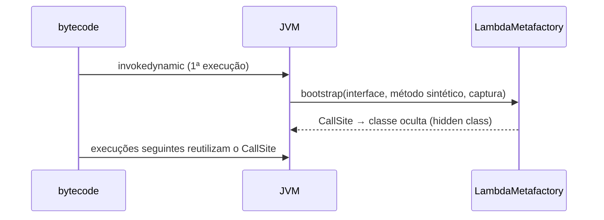

# Programação funcional em Java: lambdas, Streams e Optional

> **Resumo:** desde o Java 8, funções podem ser passadas como valores (lambdas e *method references*) e coleções podem ser processadas de forma declarativa com a Streams API. Isso muda como se escreve código Java e é a base de APIs do Spring (`RestClient`, `Customizer`, DSL de segurança, Reactor).
> **Pré-requisitos:** [06-generics.md](06-generics.md), [07-colecoes.md](07-colecoes.md) e [08-excecoes.md](08-excecoes.md).
> **Versões:** lambdas, `Stream`, `Optional` desde o Java 8; `takeWhile`/`dropWhile`/`Optional.or` no 9; `Stream.toList()` e `mapMulti` no 16; `Gatherers` (operações intermediárias customizadas) **final no Java 24** (JEP 485), portanto disponíveis no 25. Exemplos executados no Java 25.

## 1. Definição

- **Lambda**: uma função anônima, escrita `(parâmetros) -> expressão` ou `-> { bloco }`, usada onde se espera uma **interface funcional**.
- **Interface funcional**: interface com **um único método abstrato** (SAM, *single abstract method*); pode ter `default` e `static`. `@FunctionalInterface` é opcional, mas faz o compilador verificar.
- **Stream**: sequência de elementos sobre uma fonte, processada por um **pipeline** de operações (`filter`, `map`, `collect`...). **Não armazena dados** e não os modifica.
- **Optional**: contêiner que representa "valor presente ou ausente", para evitar `null` em retornos.

Problema que resolve: antes do Java 8, passar comportamento exigia classes anônimas verbosas (ver [04](04-orientacao-a-objetos.md)), e transformar coleções exigia *loops* com variáveis temporárias.

```java
// Antes (Java 7)
Collections.sort(orders, new Comparator<Order>() {
    @Override public int compare(Order a, Order b) { return a.total().compareTo(b.total()); }
});
// Depois
orders.sort(Comparator.comparing(Order::total));
```

## 2. Conceitos fundamentais

### 2.1 Interfaces funcionais do `java.util.function`

| Interface | Assinatura | Uso típico |
|---|---|---|
| `Function<T,R>` | `R apply(T)` | transformar (`map`) |
| `BiFunction<T,U,R>` | `R apply(T,U)` | combinar dois valores |
| `UnaryOperator<T>` / `BinaryOperator<T>` | `T apply(T)` / `T apply(T,T)` | `replaceAll`, `reduce`, `merge` |
| `Predicate<T>` | `boolean test(T)` | filtrar (`filter`, `removeIf`) |
| `Consumer<T>` | `void accept(T)` | efeito colateral (`forEach`) |
| `Supplier<T>` | `T get()` | produzir/adiar (`orElseGet`, `computeIfAbsent`) |
| `Runnable` / `Callable<V>` | `void run()` / `V call() throws Exception` | tarefas ([12](12-concorrencia.md)) |
| `IntFunction`, `ToIntFunction`, `IntPredicate`... | versões primitivas | evitam *boxing* |

Composição: `f.andThen(g)` = `g(f(x))`; `f.compose(g)` = `f(g(x))`; `p.and(q)`, `p.or(q)`, `p.negate()`; `Comparator.comparing(...).thenComparing(...)`. No teste: `inc.andThen(dbl).apply(3)` dá 8, `inc.compose(dbl).apply(3)` dá 7.

### 2.2 Method references

Quatro formas, todas atalhos para lambdas:

| Forma | Exemplo | Equivale a |
|---|---|---|
| Método estático | `Integer::parseInt` | `s -> Integer.parseInt(s)` |
| Método de instância de objeto específico | `logger::info` | `m -> logger.info(m)` |
| Método de instância de tipo (1º argumento é o receptor) | `String::toUpperCase` | `s -> s.toUpperCase()` |
| Construtor | `ArrayList::new` | `() -> new ArrayList<>()` |

### 2.3 Captura de variáveis e *closures*

Lambdas podem usar variáveis locais do escopo externo apenas se forem **final ou efetivamente final**. Isso evita problemas de visibilidade entre threads, pois o valor é **copiado** para a lambda.

```java
int base = 10;
Function<Integer,Integer> addBase = x -> x + base;   // OK: base não muda
// base++;  // quebraria a compilação da linha acima
```

Campos de instância (via `this`) e arrays/objetos mutáveis podem ser modificados (`cnt[0]++`), mas isso é um sinal de que um `reduce`/`collect` seria mais adequado. Dentro de uma lambda, `this` refere-se à **classe envolvente** (diferente de classe anônima, onde `this` é a própria instância anônima).

### 2.4 Pipeline de Stream

Três partes: **fonte** → **operações intermediárias** (preguiçosas, devolvem `Stream`) → **operação terminal** (dispara a execução).

```java
BigDecimal paid = orders.stream()                       // fonte
    .filter(o -> o.status() == OrderStatus.PAID)        // intermediária
    .map(Order::total)                                  // intermediária
    .reduce(BigDecimal.ZERO, BigDecimal::add);          // terminal
```

| Tipo | Operações |
|---|---|
| Fontes | `collection.stream()`, `Stream.of`, `Arrays.stream`, `IntStream.range`, `Files.lines`, `Stream.iterate/generate` |
| Intermediárias *stateless* | `filter`, `map`, `flatMap`, `peek`, `mapMulti`, `takeWhile`, `dropWhile`, `limit`, `skip` |
| Intermediárias *stateful* | `sorted`, `distinct` (precisam ver mais de um elemento) |
| Terminais | `collect`, `toList`, `reduce`, `forEach`, `count`, `anyMatch/allMatch/noneMatch`, `findFirst/findAny`, `min/max`, `toArray` |

Streams primitivos (`IntStream`, `LongStream`, `DoubleStream`) evitam *boxing* e trazem `sum`, `average`, `summaryStatistics`.

### 2.5 Collectors

```java
// agrupar e contar
Map<String, Long> countByCustomer = orders.stream()
    .collect(Collectors.groupingBy(o -> o.customer().name(), Collectors.counting()));

// agrupar e extrair ids
Map<String, List<Long>> idsByCustomer = orders.stream()
    .collect(Collectors.groupingBy(o -> o.customer().name(), TreeMap::new,
             Collectors.mapping(Order::id, Collectors.toList())));

// particionar em dois grupos
Map<Boolean, Long> paidVsOthers = orders.stream()
    .collect(Collectors.partitioningBy(o -> o.status() == OrderStatus.PAID, Collectors.counting()));

// toMap com resolução de chaves duplicadas
Map<String, BigDecimal> totalByCustomer = orders.stream()
    .collect(Collectors.toMap(o -> o.customer().name(), Order::total, BigDecimal::add));

// duas agregações numa passada
var avg = orders.stream().collect(Collectors.teeing(
    Collectors.counting(), Collectors.summingInt(o -> o.total().intValue()), (n, sum) -> sum / n));
```

`toMap` sem *merge function* lança `IllegalStateException` se houver chave duplicada. Em `println` com `collect` genérico a inferência pode falhar por ambiguidade de sobrecarga: atribua o resultado a uma variável tipada.

### 2.6 `Optional`

```java
Optional<Customer> found = repository.findById(id);
String city = found.map(Customer::city)
                   .filter(c -> !c.isBlank())
                   .orElse("desconhecida");
found.ifPresentOrElse(c -> log.info("achou {}", c), () -> log.warn("não achou"));
Customer c = found.orElseThrow(() -> new OrderNotFoundException(id));
```

| Método | Observação |
|---|---|
| `orElse(x)` | `x` é **sempre avaliado**; use só para valores baratos/constantes |
| `orElseGet(supplier)` | avalia só se vazio |
| `orElseThrow()` | sem argumento, lança `NoSuchElementException` (Java 10) |
| `or(supplier)` | alternativa que também é `Optional` (Java 9) |
| `stream()` | 0 ou 1 elemento, bom com `flatMap` (Java 9) |
| `get()` | evite; é a causa de `NoSuchElementException` |

Use `Optional` como **tipo de retorno**; evite em campos, parâmetros, coleções e DTOs/entidades (não é `Serializable` e adiciona alocação).

## 3. Como funciona por dentro

### 3.1 Lambdas e `invokedynamic`

Ao contrário de classes anônimas (que geram um `.class` por uso), o `javac` compila uma lambda para:
1. um **método sintético privado** (`lambda$main$0`) com o corpo; e
2. uma instrução `invokedynamic` que, na primeira execução, chama o *bootstrap* `LambdaMetafactory.metafactory`, que gera em tempo de execução uma classe **oculta** (*hidden class*) implementando a interface funcional e delegando ao método sintético.



Lambdas **sem captura** são reaproveitadas (instância única); com captura, cada avaliação cria uma instância com os valores capturados. Como a classe é gerada em tempo de execução, o `.class` não contém uma classe por lambda (menor *footprint*), e a estratégia pode evoluir sem recompilar (ver `javap -c -p` e `-Djdk.internal.lambda.dumpProxyClasses`). `r.getClass().isHidden()` e `isSynthetic()` devolvem `true` na prática.

### 3.2 Streams: preguiça e *fusão*

Operações intermediárias apenas **encadeiam estágios**. Quando a operação terminal executa, os elementos passam **um a um** por todos os estágios (*pipelining*), sem coleções intermediárias, e há **curto-circuito** (`findFirst`, `limit`, `anyMatch`).

```java
Stream.of(1, 2, 3)
      .peek(i -> System.out.println("peek " + i))
      .filter(i -> i > 1)
      .findFirst();
// peek 1, peek 2  → para no 2; o 3 nunca é visitado
```

Um `Stream` é **de uso único**: reutilizar lança `IllegalStateException: stream has already been operated upon or closed`.

### 3.3 Streams paralelos

`.parallel()` divide a fonte com um `Spliterator` e executa em `ForkJoinPool.commonPool()` ([12-concorrencia.md](12-concorrencia.md)). Só compensa quando: a fonte é **grande** e **divisível** (`ArrayList`, arrays, `IntStream.range`, não `LinkedList`/`Stream.iterate`); a operação por elemento é **cara e CPU-bound**; as funções são **stateless, sem efeito colateral e associativas**. Evite com I/O bloqueante (esgota o pool comum e prejudica toda a JVM). Medir (JMH) antes de usar.

```java
// Errado: ArrayList não é thread-safe → perde elementos / lança exceção
List<Integer> out = new ArrayList<>();
IntStream.range(0, 1000).parallel().forEach(out::add);
// Certo
List<Integer> ok = IntStream.range(0, 1000).parallel().boxed().toList();
```

### 3.4 `Gatherers` (Java 24+)

Permitem definir **operações intermediárias personalizadas** (janelas, *scan*, agrupamentos em lotes):

```java
Stream.of(1, 2, 3, 4, 5, 6)
      .gather(Gatherers.windowFixed(2))
      .toList();                       // [[1, 2], [3, 4], [5, 6]]
```

`Gatherers` está em `java.util.stream`. Final desde o Java 24 (JEP 485), com `windowFixed`, `windowSliding`, `fold`, `scan`, `mapConcurrent`.

## 4. Evolução histórica

Java 8 (2014) introduziu lambdas, `Stream`, `Optional` e `java.time` (a maior mudança desde os generics). O Java 9 acrescentou `takeWhile`, `dropWhile`, `iterate` com predicado; o 10 `toUnmodifiableList` e `orElseThrow()`; o 16 `Stream.toList()` e `mapMulti`; o 24 `Gatherers`. O Spring passou a usar o estilo funcional em DSLs (`http.authorizeHttpRequests(auth -> ...)`) e em APIs reativas ([05-webflux-e-reativo.md](../03-spring-boot/05-webflux-e-reativo.md)). Linha do tempo em [00-evolucao-do-java.md](00-evolucao-do-java.md).

## 5. Exemplos práticos

### 5.1 Relatório de pedidos

```java
package com.example.orders;

import java.math.BigDecimal;
import java.util.*;
import java.util.stream.*;

enum OrderStatus { CREATED, PAID, SHIPPED }
record Customer(String name, String city) {}
record Order(long id, Customer customer, OrderStatus status, BigDecimal total) {}

List<Order> ranking = orders.stream()
    .filter(o -> o.status() != OrderStatus.CREATED)
    .sorted(Comparator.comparing(Order::total).reversed())
    .limit(10)
    .toList();                                           // imutável (Java 16+)

IntSummaryStatistics stats = orders.stream()
    .mapToInt(o -> o.total().intValue()).summaryStatistics();   // count, sum, min, avg, max

String customers = orders.stream().map(o -> o.customer().name())
    .distinct().collect(Collectors.joining(", ", "[", "]"));
```

### 5.2 `flatMap`

```java
List<OrderItem> allItems = orders.stream()
    .flatMap(o -> o.items().stream())        // Stream<Order> → Stream<OrderItem>
    .toList();
```

### 5.3 Funções de ordem superior e *currying*

```java
Function<Integer, Function<Integer, Integer>> add = x -> y -> x + y;
add.apply(2).apply(3);   // 5

Predicate<Order> expensive = o -> o.total().compareTo(new BigDecimal("100")) > 0;
orders.removeIf(expensive.negate().and(o -> o.status() == OrderStatus.CREATED));
```

### 5.4 Estratégia como lambda

O padrão *Strategy* ([06-padroes-de-projeto](../06-padroes-de-projeto/)) fica trivial com interfaces funcionais:

```java
@FunctionalInterface
interface DiscountPolicy { BigDecimal apply(Order order); }

DiscountPolicy none = o -> o.total();
DiscountPolicy tenOff = o -> o.total().multiply(new BigDecimal("0.90"));
```

### 5.5 Tratando *checked exceptions* em streams

Veja [08-excecoes.md §5.3](08-excecoes.md): envolva em `UncheckedIOException` ou crie um `@FunctionalInterface` que declare `throws` e um adaptador.

## 6. Configurações e anotações relevantes

| Elemento | Para que serve | Exemplo |
|---|---|---|
| `@FunctionalInterface` | Verifica em compilação que há 1 método abstrato | `@FunctionalInterface interface DiscountPolicy {...}` |
| `Collectors.toUnmodifiableList/Map` | Coleta imutável | `collect(Collectors.toUnmodifiableList())` |
| `stream.toList()` | Lista não modificável (Java 16) | `.toList()` |
| `Stream.mapMulti` | Emitir 0..n elementos sem criar sub-streams | `mapMulti((o, sink) -> ...)` |
| `parallel()` / `sequential()` | Liga/desliga paralelismo | `list.parallelStream()` |
| `-Djava.util.concurrent.ForkJoinPool.common.parallelism=N` | Tamanho do pool comum | tuning raro |
| `Gatherers.*` | Operações intermediárias (Java 24+) | `windowFixed(n)` |

## 7. Quando usar e quando NÃO usar

- **Use Streams** para transformações, filtros, agrupamentos e agregações **sem efeito colateral**.
- **Use um laço `for`** quando precisa de índice, `break`/`continue`, exceções *checked*, mutar variáveis locais ou o pipeline fica ilegível (ruído cognitivo > ganho).
- **Streams paralelos**: só após medir. Nunca com I/O bloqueante nem estado compartilhado.
- **`Optional`**: retorno de métodos "pode não existir". **Não** para parâmetros, campos, listas (use lista vazia) nem para `null` em DTOs.
- **Lambdas longas** (mais de ~3 linhas): extraia para um método e use *method reference*.

## 8. Erros comuns e boas práticas

- **Efeitos colaterais em `map`/`filter`/`peek`**: a execução é preguiçosa e pode ser omitida, reordenada ou paralelizada; `peek` serve para depuração, não para lógica.
- **Esquecer a operação terminal**: sem ela nada executa.
- **Reusar o `Stream`** → `IllegalStateException`.
- **`Optional.get()` sem `isPresent()`**: prefira `orElseThrow`, `map`, `ifPresentOrElse`.
- **`orElse(compute())`**: sempre computa; use `orElseGet`.
- **`Collectors.toMap` com chaves duplicadas** sem `merge`.
- **Modificar a fonte durante o stream** (comportamento indefinido / CME).
- **`Optional<Optional<T>>` / `Optional<List<T>>`**: sinal de modelagem ruim.
- **Boxing em *loops* quentes**: use `IntStream`/`mapToInt`.
- **Capturar variável não efetivamente final**: erro "local variables referenced from a lambda expression must be final or effectively final".
- **`parallel()` com `forEach` e coleção não *thread-safe*.**

## 9. Perguntas de revisão

1. Como o Java implementa lambdas e por que não gera uma classe anônima por lambda?
<details><summary>Resposta</summary>O `javac` gera um método sintético e uma instrução `invokedynamic`; na primeira execução, o `LambdaMetafactory` cria uma classe oculta que implementa a interface funcional. Isso reduz o número de `.class` e permite otimizar a estratégia sem recompilar.</details>

2. O que significa dizer que streams são preguiçosos?
<details><summary>Resposta</summary>Operações intermediárias só montam o pipeline; nada é processado até uma operação terminal. Os elementos fluem um a um por todos os estágios, com curto-circuito quando possível.</details>

3. Qual a diferença entre `orElse` e `orElseGet`?
<details><summary>Resposta</summary>`orElse(x)` avalia `x` sempre; `orElseGet(supplier)` só chama o `supplier` se o `Optional` estiver vazio.</details>

4. Quando um stream paralelo é uma boa ideia?
<details><summary>Resposta</summary>Com fontes grandes e facilmente divisíveis, operações CPU-bound caras, sem estado compartilhado e sem I/O bloqueante, e depois de medir o ganho.</details>

5. Por que lambdas só capturam variáveis finais ou efetivamente finais?
<details><summary>Resposta</summary>Porque o valor é copiado para a lambda e esta pode executar depois ou em outra thread; permitir mutação geraria inconsistência e problemas de visibilidade.</details>

## 10. Referências oficiais

- Tutorial de lambdas e streams (dev.java): <https://dev.java/learn/lambdas/> e <https://dev.java/learn/api/streams/>
- Javadoc `java.util.stream` e `java.util.function` (Java 25): <https://docs.oracle.com/en/java/javase/25/docs/api/java.base/java/util/stream/package-summary.html>
- JEP 485 (Stream Gatherers): <https://openjdk.org/jeps/485>
- JLS cap. 15.27 (expressões lambda): <https://docs.oracle.com/javase/specs/jls/se25/html/>
- `LambdaMetafactory`: <https://docs.oracle.com/en/java/javase/25/docs/api/java.base/java/lang/invoke/LambdaMetafactory.html>
