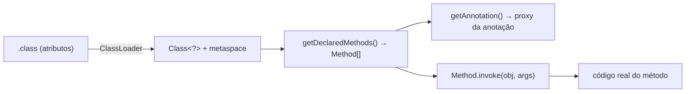

# Anotações e Reflection: por que os frameworks dependem disso

> **Resumo:** anotações são **metadados** em código; Reflection é a API que **inspeciona e manipula classes em execução**. Juntas, são a base de quase toda a "mágica" do Spring (`@Component`, `@Autowired`, `@Transactional`), do JPA, do Jackson e do JUnit: o framework **lê** as anotações por reflection e age sobre o seu código sem que você o chame.
> **Pré-requisitos:** [02-jvm-por-dentro.md](02-jvm-por-dentro.md) (ClassLoader, metaspace), [04-orientacao-a-objetos.md](04-orientacao-a-objetos.md) e [06-generics.md](06-generics.md).
> **Versões:** anotações e Reflection desde o Java 5/1.1; `MethodHandle`/`invokedynamic` desde o Java 7; `VarHandle` no 9; *record components* via reflection no 16; reimplementação de `Method.invoke` sobre method handles no **Java 18** (JEP 416). Exemplos executados no Java 25 (`javac -parameters` quando indicado).

## 1. Definição

- **Anotação**: um tipo especial (`@interface`) usado como marca com elementos nomeados: `@Audited(value = "greet", level = 2)`. Por si só **não faz nada**: é dado.
- **Reflection** (`java.lang.reflect`): API para, em execução, descobrir a estrutura de classes (`Class`, `Field`, `Method`, `Constructor`, `Parameter`, `RecordComponent`), ler anotações, criar objetos e invocar métodos **sem conhecer os tipos em tempo de compilação**.

Problema que resolve: código de infraestrutura (container de DI, serializador JSON, ORM, framework de testes) precisa operar sobre classes **que ainda não existiam quando ele foi compilado**. Sem reflection, cada uma exigiria código de cola escrito à mão.

## 2. Conceitos fundamentais

### 2.1 Declarando uma anotação

```java
import java.lang.annotation.*;

@Retention(RetentionPolicy.RUNTIME)       // visível por reflection em execução
@Target(ElementType.FIELD)                // onde pode ser aplicada
public @interface NotBlank {
    String message() default "must not be blank";   // elementos: tipos primitivos, String, Class, enum, anotação, arrays
}

@Retention(RetentionPolicy.RUNTIME) @Target(ElementType.METHOD)
@interface Audited { String value() default ""; int level() default 1; }
```

| Meta-anotação | Valores | Efeito |
|---|---|---|
| `@Retention` | `SOURCE`, `CLASS` (padrão), `RUNTIME` | `SOURCE`: só no fonte (ex.: `@Override`); `CLASS`: no `.class`, mas não visível por reflection; `RUNTIME`: visível em execução |
| `@Target` | `TYPE`, `FIELD`, `METHOD`, `PARAMETER`, `CONSTRUCTOR`, `TYPE_USE`, `RECORD_COMPONENT`... | restringe onde se aplica |
| `@Inherited` | — | subclasses herdam anotação **de classe** |
| `@Repeatable` | contêiner | permite repetir a anotação |
| `@Documented` | — | aparece no Javadoc |

**Meta-anotação**: uma anotação sobre anotação. O Spring compõe: `@RestController` = `@Controller` + `@ResponseBody`; `@SpringBootApplication` agrega três outras (ver [01-o-que-e-spring-boot.md](../03-spring-boot/01-o-que-e-spring-boot.md)).

### 2.2 Lendo anotações

```java
Class<?> c = Customer.class;
c.isAnnotationPresent(Component.class);                          // true
Audited a = c.getMethod("greet", String.class).getAnnotation(Audited.class);
a.level();                                                       // 2
```

Só anotações `RUNTIME` aparecem. `@Inherited` vale só para classes (não métodos). Para anotações **meta**, **compostas** e **herdadas por interface**, o Spring usa `MergedAnnotations` / `AnnotatedElementUtils`, porque o `getAnnotation` do JDK não procura em meta-anotações.

### 2.3 Reflection básica

```java
Class<?> c = Class.forName("com.example.orders.Customer");      // por nome (carrega via ClassLoader)
Class<?> c2 = Customer.class;  Class<?> c3 = obj.getClass();    // três formas de obter Class

Object o = c.getDeclaredConstructor(String.class).newInstance("Ana");   // instanciar
Method m = c.getMethod("greet", String.class);                          // métodos públicos (inclui herdados)
Object r = m.invoke(o, "Bob");                                          // "hi Bob from Ana"

Field f = c.getDeclaredField("name");                                   // qualquer campo da classe (inclui privado)
f.setAccessible(true);                                                  // quebra o encapsulamento (sujeito a módulos)
f.set(o, "Carla");
```

| API | Retorna | Observação |
|---|---|---|
| `getMethods()` / `getFields()` | **públicos**, incluindo herdados | |
| `getDeclaredMethods()` / `getDeclaredFields()` | **todos** da própria classe, não herdados | |
| `getDeclaredConstructor(...)` | construtor específico | `getConstructor()` só público |
| `getRecordComponents()` | componentes de um `record` | `rc.getAccessor().invoke(rec)` |
| `getParameters()` | `Parameter` (nome só se `-parameters`) | Spring compila com `-parameters` (starter parent) |
| `getGenericType()`, `getGenericSuperclass()` | tipos genéricos preservados ([06 §3.5](06-generics.md)) | |
| `Proxy.newProxyInstance` | proxy dinâmico | ver [11-proxies-dinamicos-e-bytecode.md](11-proxies-dinamicos-e-bytecode.md) |

### 2.4 Exceções típicas

- `ClassNotFoundException`, `NoSuchMethodException`, `NoSuchFieldException`: nome errado.
- `IllegalAccessException`: sem acesso (campo/método privado sem `setAccessible`, módulo fechado).
- `InvocationTargetException`: **a exceção real do método invocado está em `getCause()`**. É o erro mais mal interpretado: `m.invoke(null)` de um método que lança `IllegalStateException` vira `InvocationTargetException` com causa `IllegalStateException`.
- `IllegalArgumentException`: argumentos/tipos não conferem.

## 3. Como funciona por dentro

### 3.1 O que é uma `Class` e de onde vêm os metadados

Cada classe carregada ([02-jvm-por-dentro.md](02-jvm-por-dentro.md)) tem um objeto `Class` no heap e uma estrutura interna no **metaspace**. O arquivo `.class` guarda os metadados em **atributos**: `RuntimeVisibleAnnotations`, `RuntimeVisibleParameterAnnotations`, `Signature` (generics), `Record`, `MethodParameters` (nomes de parâmetros) e `PermittedSubclasses` (sealed). Você pode vê-los com `javap -v`. Reflection **materializa** esses atributos em objetos Java sob demanda; anotações são devolvidas como **proxies dinâmicos** que implementam a interface da anotação e leem os valores do atributo.



### 3.2 Como `Method.invoke` funciona

Historicamente havia um **acessor nativo** (lento) nas primeiras chamadas e, depois de ~15 invocações, a JVM gerava bytecode de um acessor. Desde o **Java 18 (JEP 416)**, `Method.invoke`, `Constructor.newInstance` e `Field.get/set` são implementados sobre **method handles** (`java.lang.invoke`), simplificando a base de código e permitindo que o JIT inline chamadas bem aquecidas. Mesmo assim, reflection ainda tem custo: verificação de acesso, *boxing* de argumentos/retorno e `Object[]` para varargs, e é difícil de otimizar quando o alvo é variável. No teste de 2 milhões de chamadas, a reflexiva foi mais lenta que a direta. Frameworks **cacheiam** `Method`/`Field` em vez de procurá-los a cada uso (`getDeclaredMethod` é caro porque copia e varre arrays).

### 3.3 `setAccessible` e módulos

`setAccessible(true)` desliga a verificação de `private`. Desde o Java 9 (JPMS, [14-modulos-e-build.md](14-modulos-e-build.md)) isso só funciona se o módulo da classe alvo **abrir** o pacote (`opens`) ao chamador; no classpath tradicional (módulo sem nome) tudo é aberto. Para classes internas do JDK, o acesso é bloqueado desde o Java 17 (`InaccessibleObjectException`), a menos que se use `--add-opens`. Também vale: classes do mesmo **ninho** (*nestmates*, Java 11+) acessam membros privados umas das outras por reflection sem `setAccessible`.

### 3.4 `MethodHandle` e `VarHandle`

Alternativas modernas e mais rápidas de reflection (`java.lang.invoke`): o acesso é verificado **na criação** do handle (via `Lookup`), e a invocação é tipada, podendo ser inlinada pelo JIT se o handle for `static final`.

```java
var lookup = MethodHandles.lookup();
MethodHandle mh = lookup.findVirtual(Customer.class, "greet",
        MethodType.methodType(String.class, String.class));
String s = (String) mh.invokeExact(customer, "Cid");     // assinatura exata

VarHandle vh = MethodHandles.privateLookupIn(Customer.class, lookup)
        .findVarHandle(Customer.class, "age", int.class);
vh.set(customer, 7);                                     // acesso a campo com semântica de memória (volatile, CAS)
```

`MethodHandle` é a base do `invokedynamic` (lambdas, concatenação de `String`, switch com padrões). `VarHandle` (Java 9) substituiu `sun.misc.Unsafe` para operações atômicas em campos ([12-concorrencia.md](12-concorrencia.md)).

### 3.5 Processamento de anotações em compilação

Anotações também podem ser processadas **durante a compilação** por *annotation processors* (`javax.annotation.processing`), sem reflection em execução. Exemplos: Lombok, MapStruct, Dagger, o gerador de metadados do Spring (`spring-boot-configuration-processor`) e o **AOT do Spring** ([10-aot-e-native.md](../02-spring-core/10-aot-e-native.md)), que troca reflection em runtime por código gerado, o que é essencial para **GraalVM native image**, onde reflection precisa ser declarada previamente (`reflect-config.json`).

## 4. Evolução histórica

Reflection existe desde o JDK 1.1. Anotações vieram no Java 5 (JSR 175), substituindo XML e *marker interfaces* (`Serializable`) como forma de configurar frameworks, e levaram o Spring das configurações XML às anotações (Spring 2.5 em diante). Java 7 trouxe `MethodHandle`/`invokedynamic`, 8 as anotações repetidas e de tipo, 9 `VarHandle` e encapsulamento forte (módulos), 16 `RecordComponent`, 17 o bloqueio das APIs internas, e 18 o novo `Method.invoke`. Ver [00-evolucao-do-java.md](00-evolucao-do-java.md).

## 5. Exemplos práticos

### 5.1 Um validador mínimo (como Bean Validation funciona)

```java
package com.example.orders;

import java.lang.reflect.Field;
import java.util.*;

public final class Validator {
    public static List<String> validate(Object target) throws IllegalAccessException {
        var errors = new ArrayList<String>();
        for (Field f : target.getClass().getDeclaredFields()) {
            NotBlank nb = f.getAnnotation(NotBlank.class);
            if (nb == null) continue;
            f.setAccessible(true);
            Object v = f.get(target);
            if (v == null || v.toString().isBlank()) errors.add(f.getName() + ": " + nb.message());
        }
        return errors;
    }
}

class Customer { @NotBlank private String name; Customer(String n) { name = n; } }
Validator.validate(new Customer(" "));    // [name: must not be blank]
```

É exatamente o que `jakarta.validation` faz, com muito mais cache e regras (ver [08-eventos-validacao-e-conversao.md](../02-spring-core/08-eventos-validacao-e-conversao.md)).

### 5.2 Mini "container" que injeta por construtor

```java
static <T> T create(Class<T> type, Map<Class<?>, Object> beans) throws Exception {
    var ctor = type.getDeclaredConstructors()[0];                 // escolhe o construtor
    Object[] args = Arrays.stream(ctor.getParameterTypes()).map(beans::get).toArray();
    return type.cast(ctor.newInstance(args));
}
```

O arquivo [06-como-java-e-spring-conversam.md](../02-spring-core/06-como-java-e-spring-conversam.md) expande essa ideia num mini-container completo.

### 5.3 Anotação de auditoria com *proxy*

`@Audited` sozinha não audita nada. Quem executa a ação é um *proxy* ou *aspecto* (ver [11-proxies-dinamicos-e-bytecode.md](11-proxies-dinamicos-e-bytecode.md) e [07-aop-e-proxies.md](../02-spring-core/07-aop-e-proxies.md)) que lê a anotação por reflection e envolve a chamada. `@Transactional` funciona assim.

### 5.4 Inspecionando um `record`

```java
record Point(int x, int y) {}
for (var rc : Point.class.getRecordComponents())
    System.out.println(rc.getName() + "=" + rc.getAccessor().invoke(new Point(3, 4)));
// x=3  y=4   (como Jackson serializa records)
```

### 5.5 Desembrulhando `InvocationTargetException`

```java
try {
    method.invoke(target, args);
} catch (InvocationTargetException e) {
    throw (e.getCause() instanceof RuntimeException re) ? re : new RuntimeException(e.getCause());
}
```

## 6. Configurações e anotações relevantes

| Elemento | Para que serve | Exemplo |
|---|---|---|
| `@Retention(RUNTIME)` | Torna a anotação visível por reflection | em toda anotação de framework |
| `@Target` | Restringe onde aplicar | `@Target({METHOD, TYPE})` |
| `@Inherited` | Herança de anotação de classe | marcadores de tipo |
| `@Repeatable` | Anotação repetida | `@Repeatable(Roles.class)` |
| `@Override`, `@Deprecated`, `@SuppressWarnings`, `@SafeVarargs`, `@FunctionalInterface` | Anotações do próprio JDK | ver seções anteriores |
| `javac -parameters` | Grava nomes de parâmetros no `.class` | `Parameter.getName()` |
| `--add-opens java.base/java.lang=ALL-UNNAMED` | Abre pacote do JDK para reflection | testes/legado |
| `--illegal-access` | Removida no Java 17 | use `--add-opens` |
| `-Xlint:processing` | Avisos de annotation processors | build |

## 7. Quando usar e quando NÃO usar

- **Use reflection** em código de infraestrutura/framework: DI, serialização, mapeamento, testes. Em código de aplicação do dia a dia, quase nunca.
- **Prefira alternativas**: interfaces e polimorfismo; *method references* e lambdas; geração em compilação (annotation processors, AOT) quando precisar de desempenho ou de *native image*; `MethodHandle` para chamadas repetidas e quentes.
- **Evite `setAccessible` para driblar encapsulamento** de código que você controla; ele quebra com módulos e *native image*.
- **Cuidado com anotações demais**: lógica "escondida" em anotações dificulta depuração; use-as para **declarar**, não para programar.

## 8. Erros comuns e boas práticas

- **Esquecer `@Retention(RUNTIME)`**: padrão é `CLASS`; `getAnnotation` devolve `null` em execução.
- **Confundir `getMethods` com `getDeclaredMethods`.**
- **Ignorar `InvocationTargetException.getCause()`.**
- **Não cachear `Method`/`Field`** dentro de um *loop* quente.
- **Depender de nomes de parâmetros sem `-parameters`** (`arg0`, `arg1`).
- **Assumir que anotação em interface chega à implementação**: não chega por padrão (`@Inherited` só funciona em classes).
- **Reflection em *native image* sem declarar** (`reflect-config.json` / `RuntimeHints` do Spring).
- **Usar reflection para testar privados**: sinal de design a rever.
- **`Class.forName` com entrada do usuário**: risco de segurança (carrega/instancia classes arbitrárias).

## 9. Perguntas de revisão

1. O que uma anotação faz sozinha, e quem lhe dá efeito?
<details><summary>Resposta</summary>Nada; é só metadado. Quem lhe dá efeito é um processador em compilação (annotation processor) ou um framework em execução que a lê por reflection (ou via proxy/aspecto).</details>

2. Qual a diferença entre `RetentionPolicy.SOURCE`, `CLASS` e `RUNTIME`?
<details><summary>Resposta</summary>`SOURCE` é descartada pelo compilador; `CLASS` fica no `.class` mas não é visível por reflection; `RUNTIME` fica no `.class` e é lida por reflection em execução.</details>

3. Por que `getDeclaredMethods()` e `getMethods()` retornam coisas diferentes?
<details><summary>Resposta</summary>`getDeclaredMethods` lista todos os métodos declarados na própria classe (qualquer visibilidade), sem herdados; `getMethods` lista os públicos, inclusive herdados.</details>

4. O que é `InvocationTargetException` e como tratá-la?
<details><summary>Resposta</summary>É o wrapper lançado por `Method.invoke` quando o método chamado lança uma exceção; a exceção real está em `getCause()` e deve ser desembrulhada.</details>

5. Por que frameworks modernos migram de reflection em runtime para geração em tempo de build?
<details><summary>Resposta</summary>Para reduzir o tempo de inicialização e o consumo de memória, e porque o GraalVM *native image* exige conhecer em compilação o que será acessado por reflection. O Spring AOT gera código e *hints* para isso.</details>

## 10. Referências oficiais

- Tutorial de anotações e reflection (dev.java): <https://dev.java/learn/annotations/> e <https://dev.java/learn/reflection/>
- Javadoc `java.lang.reflect` e `java.lang.invoke` (Java 25): <https://docs.oracle.com/en/java/javase/25/docs/api/java.base/java/lang/reflect/package-summary.html>
- JEP 416 (reimplementar reflection com method handles): <https://openjdk.org/jeps/416>
- JEP 396 / 403 (encapsulamento forte do JDK): <https://openjdk.org/jeps/403>
- JLS cap. 9.6 (tipos de anotação): <https://docs.oracle.com/javase/specs/jls/se25/html/>
