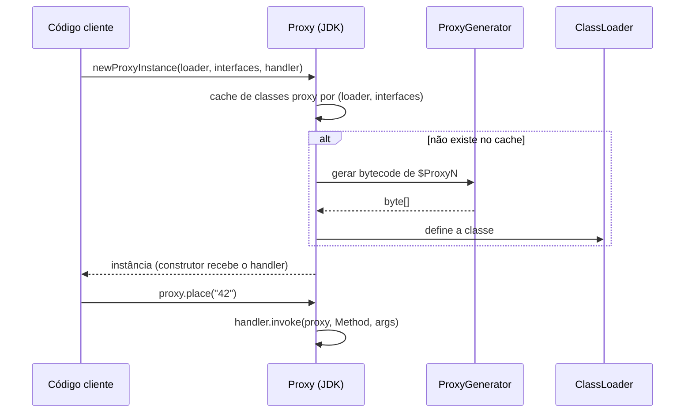
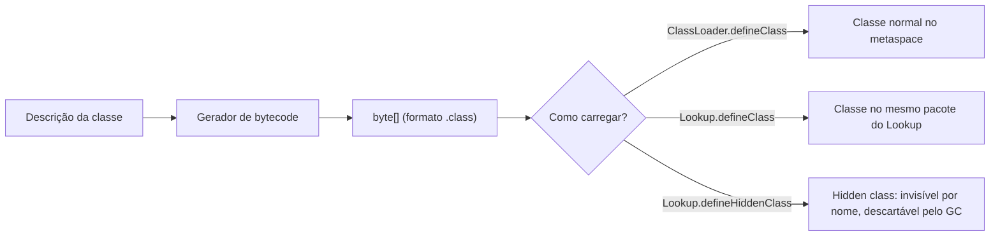

# Proxies Dinâmicos e Geração de Bytecode

> **Resumo:** um *proxy* é um objeto que se coloca na frente de outro e intercepta as chamadas. Em Java há duas famílias: proxies de **interface** (`java.lang.reflect.Proxy`, no JDK) e proxies de **classe** (subclasses geradas em bytecode por CGLIB/ByteBuddy). É assim que `@Transactional`, `@Async`, `@Cacheable` e o lazy loading do JPA funcionam sem você escrever código de cola.
> **Pré-requisitos:** [10-anotacoes-e-reflection.md](10-anotacoes-e-reflection.md), [02-jvm-por-dentro.md](02-jvm-por-dentro.md) (ClassLoader), [04-orientacao-a-objetos.md](04-orientacao-a-objetos.md).
> **Versões:** `Proxy` desde o Java 1.3; `InvocationHandler.invokeDefault` desde o 16; **Class-File API** (`java.lang.classfile`) *final* no **Java 24** (JEP 484), portanto disponível no 25. Exemplos executados no Java 25.

## 1. Definição

- **Proxy dinâmico do JDK**: classe criada **em tempo de execução** que implementa as interfaces que você informar e delega cada chamada a um `InvocationHandler`.
- **Proxy por subclasse (CGLIB, ByteBuddy)**: classe gerada que **estende** a classe-alvo e sobrescreve seus métodos para interceptá-los.
- **Geração de bytecode**: produzir o conteúdo de um `.class` (bytes) em memória e carregá-lo via ClassLoader.

Problema que resolve: adicionar comportamento transversal (transação, log, segurança, cache) a **classes que você não vai editar** e que o framework só conhece em tempo de execução. A alternativa seria um decorator escrito à mão por classe (ver [Proxy e Decorator](../06-padroes-de-projeto/03-estruturais.md)).

## 2. Conceitos fundamentais

### 2.1 `java.lang.reflect.Proxy`

```java
import java.lang.reflect.*;

interface OrderService { String place(String id); default String hi() { return "hi"; } }

OrderService real = id -> "placed " + id;

OrderService proxy = (OrderService) Proxy.newProxyInstance(
    OrderService.class.getClassLoader(),       // onde a classe gerada será definida
    new Class<?>[] { OrderService.class },     // interfaces implementadas
    (p, method, args) -> {                     // InvocationHandler
        if (method.isDefault())                // Java 16+: chama o default sem cair em recursão
            return InvocationHandler.invokeDefault(p, method, args);
        long t = System.nanoTime();
        try {
            return method.invoke(real, args);
        } catch (InvocationTargetException e) {
            throw e.getCause();                // devolve a exceção ORIGINAL ao chamador
        } finally {
            System.out.println(method.getName() + " took " + (System.nanoTime() - t) / 1000 + "us");
        }
    });

proxy.place("42");   // imprime "place took ...us"
```

Pontos centrais:

- só funciona com **interfaces**; o proxy **não é** uma instância da classe concreta (cast para `OrderServiceImpl` falha com `ClassCastException`);
- `Proxy.isProxyClass(proxy.getClass())` retorna `true`; o nome costuma ser `jdk.proxy1.$Proxy0` (ou `$Proxy0`);
- `equals`, `hashCode` e `toString` também passam pelo handler (os de `Object` são despachados a ele);
- exceção *checked* não declarada na interface, lançada pelo handler, vira `UndeclaredThrowableException`.

### 2.2 Proxy de classe: subclasse gerada

Para classes sem interface, a ferramenta gera algo equivalente a:

```java
// o que o gerador produz (conceitualmente)
class OrderService$$Proxy extends OrderService {
    private final MethodInterceptor interceptor;
    @Override public String place(String id) {
        return (String) interceptor.intercept(this, PLACE_METHOD, new Object[]{id}, superInvoker);
    }
}
```

Consequências diretas da herança:

| Limite | Motivo |
|---|---|
| Classe `final` não pode ser proxied | não pode ser estendida |
| Método `final` / `private` / `static` **não é interceptado** | não pode ser sobrescrito |
| Precisa de um construtor acessível | a subclasse chama `super(...)` |
| Métodos não-`public` dependem de estar no mesmo pacote e ClassLoader | visibilidade de pacote |

Hoje o Spring usa seu **CGLIB reempacotado** (`org.springframework.cglib`) e o **Objenesis** para instanciar o proxy **sem chamar o construtor** (ver [06-como-java-e-spring-conversam.md](../02-spring-core/06-como-java-e-spring-conversam.md)).

### 2.3 JDK Proxy vs CGLIB/ByteBuddy

| Aspecto | `java.lang.reflect.Proxy` | Subclasse (CGLIB/ByteBuddy) |
|---|---|---|
| Alvo | interface(s) | classe |
| Mecanismo | implementa interface | herda e sobrescreve |
| Tipo do proxy | irmão da implementação | subtipo da classe |
| `final` | irrelevante | bloqueia |
| Dependência | nenhuma (JDK) | biblioteca (ou embutida no Spring) |
| Padrão no Spring Boot | — | **CGLIB** (`spring.aop.proxy-target-class=true`) |

## 3. Como funciona por dentro

### 3.1 O que `Proxy.newProxyInstance` faz



1. O JDK procura no cache uma classe já gerada para aquele par *(ClassLoader, lista de interfaces)*; se não houver, gera o bytecode de uma classe `final` que implementa todas as interfaces.
2. Cada método da interface vira um corpo que chama `handler.invoke(this, <Method estático>, new Object[]{args})`. Os objetos `Method` são resolvidos uma vez, num inicializador estático.
3. Interfaces **não públicas** forçam o proxy ao mesmo pacote/módulo da interface; interfaces em módulos distintos têm regras de acesso próprias (ver [14-modulos-e-build.md](14-modulos-e-build.md)).

### 3.2 O ciclo de uma classe gerada

Qualquer gerador segue o mesmo caminho: **montar bytes → carregar → instanciar**.



- **Hidden classes** (Java 15, JEP 371): classes que não podem ser referenciadas pelo nome por outras classes e podem ser descarregadas junto com o *lookup*. São usadas pelo JDK para lambdas e por geradores modernos.
- Cada classe gerada ocupa **metaspace** e fica viva enquanto seu ClassLoader viver: gerar classes em loop é um vazamento clássico (`OutOfMemoryError: Metaspace`, ver [02-jvm-por-dentro.md](02-jvm-por-dentro.md)).

### 3.3 Bibliotecas de bytecode

| Biblioteca | Nível | Observação |
|---|---|---|
| **ASM** | baixo (instruções) | base de CGLIB, ByteBuddy e do próprio JDK por anos; o JDK usava uma cópia interna |
| **CGLIB** | proxy por subclasse | maduro, mas com manutenção reduzida; o Spring mantém uma cópia própria |
| **ByteBuddy** | API fluente | usado por Hibernate (proxies de entidade) e Mockito |
| **Javassist** | fonte em string ou API | usado em versões antigas do Hibernate |
| **Class-File API** (`java.lang.classfile`) | oficial do JDK | final no **Java 24**; substitui a dependência de ASM dentro do JDK |

Por que a Class-File API existe: o bytecode muda a cada release do Java e o ASM externo precisava ser atualizado antes. Com uma API padrão **no próprio JDK**, o formato e o leitor evoluem juntos, e frameworks podem ler/gerar classes de qualquer versão sem esperar uma biblioteca de terceiros.

## 4. Evolução histórica

`Proxy` nasceu no Java 1.3. O CGLIB e o ASM dominaram a geração de bytecode nos anos 2000; Hibernate, Spring e Mockito dependiam deles. A partir do Java 9 o encapsulamento de módulos e o `Lookup.defineClass` passaram a limitar o `ClassLoader.defineClass` por reflection (hoje bloqueado em muitos casos). O JDK 15 trouxe *hidden classes* (JEP 371), o 16 o `invokeDefault`, e a Class-File API passou por preview nos Java 22 e 23 antes de ficar final no 24. Visão ampla em [00-evolucao-do-java.md](00-evolucao-do-java.md).

## 5. Exemplos práticos

### 5.1 Um proxy genérico de log reutilizável

```java
import java.lang.reflect.*;

public final class LoggingProxy {
    private LoggingProxy() {}

    @SuppressWarnings("unchecked")
    public static <T> T wrap(T target, Class<T> iface) {
        InvocationHandler h = (proxy, m, args) -> {
            System.out.println(">> " + m.getName());
            try {
                return m.invoke(target, args);
            } catch (InvocationTargetException e) {
                throw e.getCause();
            }
        };
        return (T) Proxy.newProxyInstance(iface.getClassLoader(), new Class<?>[]{iface}, h);
    }
}
// uso: OrderService s = LoggingProxy.wrap(new OrderServiceImpl(), OrderService.class);
```

### 5.2 Proxy guiado por anotação (o esqueleto do `@Transactional`)

```java
import java.lang.reflect.*;

@Retention(java.lang.annotation.RetentionPolicy.RUNTIME)
@interface Tx {}

InvocationHandler handler = (proxy, m, args) -> {
    // a anotação fica na CLASSE concreta, não na interface
    Method concrete = target.getClass().getMethod(m.getName(), m.getParameterTypes());
    if (!concrete.isAnnotationPresent(Tx.class)) return concrete.invoke(target, args);
    System.out.println("BEGIN");
    try {
        Object r = concrete.invoke(target, args);
        System.out.println("COMMIT");
        return r;
    } catch (InvocationTargetException e) {
        System.out.println("ROLLBACK");
        throw e.getCause();
    }
};
```

É exatamente o desenho do interceptor transacional do Spring, que acrescenta *gerenciador de transações*, regras de rollback e propagação (ver [09-transacoes.md](../02-spring-core/09-transacoes.md)).

### 5.3 Lendo e gerando bytecode com a Class-File API (Java 24+)

```java
import java.lang.classfile.*;
import java.lang.constant.*;
import java.nio.file.Path;

// LER: lista os métodos de uma classe já compilada
ClassModel cm = ClassFile.of().parse(Path.of("P.class"));
cm.methods().forEach(m -> System.out.println(m.methodName().stringValue()));

// GERAR: public static String greet() { return "ola gerado"; }
byte[] bytes = ClassFile.of().build(ClassDesc.of("gen.Hello"), cb -> cb
    .withMethodBody("greet",
        MethodTypeDesc.of(ConstantDescs.CD_String),
        ClassFile.ACC_PUBLIC | ClassFile.ACC_STATIC,
        code -> code.ldc("ola gerado").areturn()));

// CARREGAR: um ClassLoader próprio, definindo a classe a partir dos bytes
class Loader extends ClassLoader {
    Class<?> define(byte[] b) { return defineClass("gen.Hello", b, 0, b.length); }
}
Class<?> c = new Loader().define(bytes);
System.out.println(c.getMethod("greet").invoke(null));   // ola gerado
```

Saída real: `ola gerado`. O `ClassModel` é imutável; para *transformar* uma classe existente use `ClassFile.of().transformClass(...)`.

### 5.4 Realista: ver o proxy do Spring de fora

```java
@Service
class OrderService { @Transactional public void place() {} }

// dentro de um teste com o contexto carregado:
System.out.println(service.getClass());  // class ...OrderService$$SpringCGLIB$$0
System.out.println(AopUtils.isCglibProxy(service));   // true
```

O sufixo `$$SpringCGLIB$$0` denuncia a subclasse gerada. Por isso `service.getClass()` **não é** `OrderService.class` (ver armadilhas na seção 8).

## 6. Configurações e anotações relevantes

| Item | Para que serve | Exemplo |
|---|---|---|
| `Proxy.newProxyInstance` | cria proxy de interface | `Proxy.newProxyInstance(cl, ifaces, h)` |
| `InvocationHandler.invokeDefault` | chama método `default` do proxy (Java 16+) | `InvocationHandler.invokeDefault(p, m, args)` |
| `spring.aop.proxy-target-class` | força CGLIB (padrão `true` no Boot) ou JDK Proxy | `spring.aop.proxy-target-class=false` |
| `@EnableAspectJAutoProxy(proxyTargetClass = true)` | idem, em Java Config | ver [07-aop-e-proxies.md](../02-spring-core/07-aop-e-proxies.md) |
| `-Djdk.proxy.ProxyGenerator.saveGeneratedFiles=true` | salvar em disco as classes proxy geradas (a propriedade existe no JDK 25: o nome aparece no `ProxyGenerator`) | — |
| `--add-opens` | liberar reflection profunda em módulos | `--add-opens java.base/java.lang=ALL-UNNAMED` |
| `Lookup.defineHiddenClass` | define classe oculta e descartável | `lookup.defineHiddenClass(bytes, true)` |

## 7. Quando usar e quando NÃO usar

**Use** proxies para comportamento transversal repetitivo que não pertence à regra de negócio: transação, cache, retry, métricas, segurança, cliente HTTP declarativo (interface → implementação gerada).

**Não use** quando:
- um simples *decorator* explícito é suficiente e mais legível (poucas classes);
- precisa interceptar `final`/`private`/`static`/chamadas internas (`this.método()`): o proxy não vê essas chamadas;
- o alvo vai rodar em **native image**: proxies e geração em runtime exigem configuração prévia (ver [10-aot-e-native.md](../02-spring-core/10-aot-e-native.md));
- escreve bytecode à mão sem necessidade: prefira ByteBuddy/Class-File API a manipular bytes.

## 8. Erros comuns e boas práticas

- **Self-invocation**: dentro da classe, `this.outro()` chama o objeto real, não o proxy; a anotação do `outro()` é ignorada. Solução: separar em outro bean ou injetar o próprio proxy (ver [07-aop-e-proxies.md](../02-spring-core/07-aop-e-proxies.md)).
- **Engolir `InvocationTargetException`**: lance `e.getCause()`, senão o chamador recebe uma exceção embrulhada.
- **Comparar `getClass()`**: use `AopUtils.getTargetClass`/`ClassUtils.getUserClass` no Spring, ou `instanceof`.
- **Método `final` em bean proxied por CGLIB**: não é interceptado e, pior, o estado fica no proxy sem inicializar (campos `null`).
- **Gerar classes em loop** sem reutilizar: vazamento de metaspace. Cache a classe gerada.
- **Capturar o `ClassLoader` errado** em `newProxyInstance`: gera `IllegalArgumentException: interface X is not visible from class loader`.
- Boa prática: handler **sem estado** e *thread-safe*; ele é compartilhado por todas as chamadas.

## 9. Perguntas de revisão

1. Por que `Proxy.newProxyInstance` não consegue proxiar uma classe sem interface?
<details><summary>Resposta</summary>A classe gerada já precisa estender <code>java.lang.reflect.Proxy</code>, e Java não tem herança múltipla de classes; por isso só implementa interfaces. Para classes, usa-se subclasse (CGLIB/ByteBuddy).</details>

2. Por que um método `final` anotado com `@Transactional` não abre transação num bean CGLIB?
<details><summary>Resposta</summary>O proxy é uma subclasse e não pode sobrescrever método <code>final</code>; a chamada vai direto ao código da superclasse, sem passar pelo interceptor.</details>

3. O que acontece se o `InvocationHandler` lançar uma exceção checked não declarada na interface?
<details><summary>Resposta</summary>O JDK a embrulha em <code>UndeclaredThrowableException</code> (unchecked). Exceções unchecked e as declaradas passam como são.</details>

4. Qual a vantagem da Class-File API sobre depender do ASM?
<details><summary>Resposta</summary>É parte do JDK e evolui junto com o formato <code>.class</code>, evitando esperar uma versão do ASM compatível a cada release do Java (final no Java 24).</details>

5. Como o Spring cria o proxy CGLIB sem executar o construtor do bean?
<details><summary>Resposta</summary>Usa o Objenesis, que instancia a classe gerada sem chamar construtor; as dependências são injetadas no bean-alvo real, e o proxy só delega.</details>

## 10. Referências oficiais

- Javadoc de `java.lang.reflect.Proxy`: <https://docs.oracle.com/en/java/javase/25/docs/api/java.base/java/lang/reflect/Proxy.html>
- JEP 484 (Class-File API): <https://openjdk.org/jeps/484>
- JEP 371 (Hidden Classes): <https://openjdk.org/jeps/371>
- Spring AOP, mecanismos de proxy: <https://docs.spring.io/spring-framework/reference/core/aop.html>
- Byte Buddy: <https://bytebuddy.net>
- Índice de JEPs: <https://openjdk.org/jeps/0>
