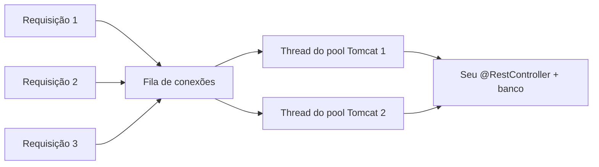
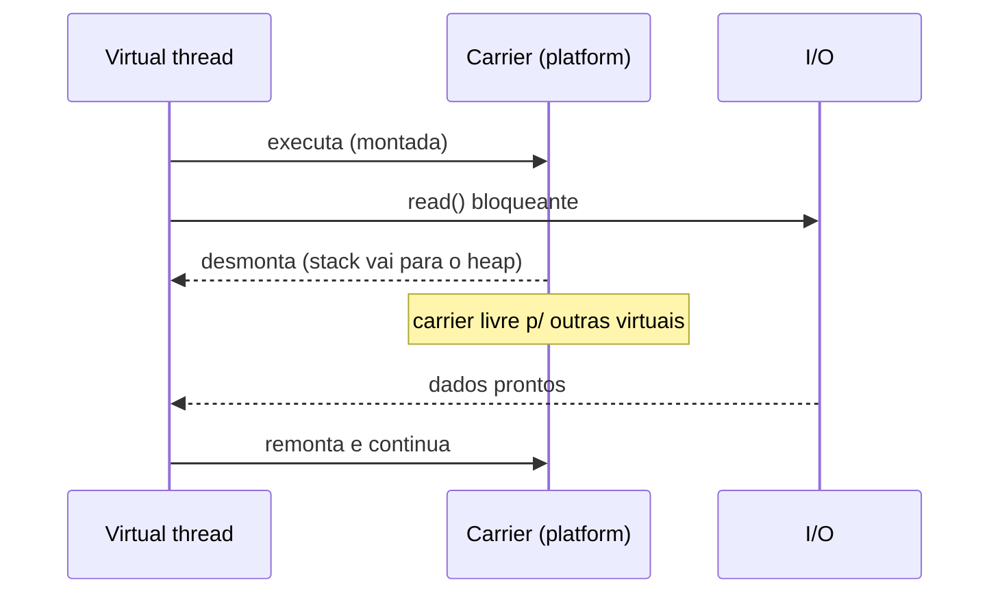

# Concorrência em Java

> **Resumo:** concorrência é fazer várias coisas "ao mesmo tempo" sobre dados compartilhados sem corromper o estado. Esta página cobre threads, executores, `CompletableFuture`, sincronização, o Java Memory Model, coleções concorrentes e o modelo moderno (virtual threads, scoped values, structured concurrency). Servidores web Spring são, no fundo, um pool de threads: entender isso evita bugs que só aparecem em produção.
> **Pré-requisitos:** [02-jvm-por-dentro.md](02-jvm-por-dentro.md) (stack por thread, heap compartilhado), [08-excecoes.md](08-excecoes.md), [09-programacao-funcional.md](09-programacao-funcional.md).
> **Versões:** `java.util.concurrent` desde o Java 5; `CompletableFuture` no 8; **virtual threads finais no Java 21** (JEP 444); **Scoped Values finais no Java 25** (JEP 506); **Structured Concurrency ainda em preview** (5º preview no 25, JEP 505; 7º no 27, JEP 533). Exemplos executados no Java 25 (os de structured concurrency exigem `--enable-preview`).

## 1. Definição

- **Concorrência**: várias tarefas progredindo em intervalos sobrepostos. **Paralelismo**: execução realmente simultânea em vários núcleos. Concorrência é sobre *estrutura*; paralelismo é sobre *execução*.
- **Thread**: fluxo de execução com sua própria pilha, compartilhando o **heap** com as demais.
- **Condição de corrida (*race condition*)**: o resultado depende da ordem de intercalação das threads.

Problema que resolve: aproveitar vários núcleos e **não bloquear** o programa enquanto espera I/O. O preço é lidar com estado compartilhado mutável, a maior fonte de bugs sutis da plataforma.

## 2. Conceitos fundamentais

### 2.1 Threads

```java
Thread t = Thread.ofPlatform().name("worker-1").start(() -> System.out.println("oi"));
t.join();                                   // espera terminar
Thread v = Thread.ofVirtual().start(() -> {});   // virtual thread (Java 21+)
```

Estados: `NEW → RUNNABLE → (BLOCKED | WAITING | TIMED_WAITING) → TERMINATED`. Uma *platform thread* mapeia 1:1 para uma thread do SO (≈ 1 MB de pilha reservada por padrão; criar milhares é caro).

**Interrupção** é cooperativa: `t.interrupt()` só liga um *flag* (ou acorda `sleep/wait/join` com `InterruptedException`, que **limpa** o flag). Regra: nunca engolir.

```java
try { Thread.sleep(1000); }
catch (InterruptedException e) {
    Thread.currentThread().interrupt();   // restaura o flag para quem está acima
    return;                               // e encerra a tarefa
}
```

### 2.2 Executores: separe "o que" de "quem executa"

```java
try (ExecutorService pool = Executors.newFixedThreadPool(4)) {   // ExecutorService é AutoCloseable (Java 19+)
    Future<Integer> f = pool.submit(() -> 21 * 2);
    System.out.println(f.get());              // bloqueia até o resultado; ExecutionException embrulha falhas
}   // close(): espera as tarefas terminarem
```

| Fábrica | Comportamento | Cuidado |
|---|---|---|
| `newFixedThreadPool(n)` | n threads, **fila ilimitada** | fila cresce sem limite → OOM |
| `newCachedThreadPool()` | cria thread sob demanda | sem limite de threads |
| `newSingleThreadExecutor()` | 1 thread, ordem garantida | gargalo |
| `newScheduledThreadPool(n)` | atrasos e periodicidade | tarefa que lança exceção cancela as próximas execuções periódicas |
| `newVirtualThreadPerTaskExecutor()` | **uma virtual thread por tarefa** | não faça pool de virtual threads |
| `ForkJoinPool` | *work-stealing* para tarefas recursivas | o `commonPool` é compartilhado (usado por `parallelStream` e `supplyAsync` sem executor) |

Em produção prefira `ThreadPoolExecutor` com fila **limitada** e política de rejeição explícita, e dê nome às threads (`ThreadFactory`) para ler *thread dumps*.

### 2.3 `CompletableFuture`: composição assíncrona

```java
CompletableFuture<Integer> a = CompletableFuture.supplyAsync(() -> 20);
CompletableFuture<Integer> b = CompletableFuture.supplyAsync(() -> 22);

int total = a.thenCombine(b, Integer::sum)          // junta dois resultados
             .exceptionally(t -> -1)                 // recupera de falha
             .get();                                 // 42
```

| Método | Uso |
|---|---|
| `thenApply` / `thenCompose` | transformação síncrona / encadear outro futuro (como `map` / `flatMap`) |
| `thenCombine`, `allOf`, `anyOf` | combinar vários |
| `handle`, `exceptionally`, `whenComplete` | tratar sucesso/erro |
| `*Async(..., executor)` | roda a etapa em outro executor |
| `orTimeout`, `completeOnTimeout` (Java 9+) | prazo |

Sem informar executor, `supplyAsync` usa o `ForkJoinPool.commonPool()`: **não coloque I/O bloqueante nele**; passe um executor próprio.

### 2.4 Exclusão mútua: `synchronized` e locks

```java
class Counter {
    private int n;
    synchronized void inc() { n++; }          // monitor do próprio objeto (this)
    synchronized int get() { return n; }
}
```

- `synchronized` é **reentrante** e dá exclusão mútua **e** visibilidade (ver 3.1).
- `ReentrantLock` oferece `tryLock(timeout)`, lock interrompível, `Condition` e justiça opcional. Sempre libere em `finally`:

```java
Lock lock = new ReentrantLock();
lock.lock();
try { /* seção crítica */ } finally { lock.unlock(); }
```

- `ReadWriteLock`/`StampedLock`: muitos leitores, poucos escritores.
- **Atômicos** (`AtomicInteger`, `AtomicReference`, `LongAdder`): operações *lock-free* via instrução CAS (*compare-and-set*) do processador. `LongAdder` escala melhor que `AtomicLong` sob alta contenção.

### 2.5 Coleções concorrentes

| Tipo | Quando |
|---|---|
| `ConcurrentHashMap` | mapa compartilhado; use `computeIfAbsent`, `merge` (atômicos) em vez de `get`+`put` |
| `CopyOnWriteArrayList` | leitura frequente, escrita rara (copia o array a cada escrita) |
| `BlockingQueue` (`ArrayBlockingQueue`, `LinkedBlockingQueue`) | produtor/consumidor com *backpressure* |
| `ConcurrentLinkedQueue` | fila sem bloqueio |
| `Collections.synchronizedList` | embrulho com lock único: itere sob `synchronized` |

`ConcurrentHashMap` **não aceita** chave nem valor `null`. Operações compostas fora dos métodos atômicos (ex.: `if (!m.containsKey(k)) m.put(k, v)`) continuam sendo corrida.

## 3. Como funciona por dentro

### 3.1 O Java Memory Model (JMM)

Sem regras, o compilador, a JVM e a CPU podem **reordenar** instruções e manter valores em registradores/cache por núcleo. O JMM define a relação ***happens-before***: se A *happens-before* B, as escritas de A são visíveis a B.

Principais arestas de *happens-before*:

| Ação | Garante |
|---|---|
| `unlock` de um monitor → `lock` seguinte do mesmo monitor | tudo escrito antes do unlock é visível depois do lock |
| escrita em campo `volatile` → leitura seguinte do mesmo campo | idem, sem exclusão mútua |
| `Thread.start()` → ações da thread iniciada | a thread vê o estado do criador |
| fim da thread → retorno de `join()` | quem faz `join` vê tudo o que a thread fez |
| `Future.get()` / conclusão de tarefa → quem lê o resultado | publicação segura |
| escrita em campo `final` no construtor → leitura após publicar a referência | objetos imutáveis são seguros |

```java
class Flag {
    private volatile boolean stop;            // SEM volatile, o laço pode nunca terminar
    void run()  { while (!stop) { /* trabalho */ } }
    void halt() { stop = true; }
}
```

`volatile` garante **visibilidade e ordem**, **não atomicidade**: `count++` em `volatile int` continua sendo corrida (leitura + soma + escrita). Para isso use `AtomicInteger` ou lock.

Armadilha clássica: *double-checked locking* só é correto com o campo `volatile` (ou use *holder idiom*/`enum`).

### 3.2 Monitores e custo

Cada objeto Java tem um monitor associado (no cabeçalho do objeto, ver [03-tipos-e-memoria.md](03-tipos-e-memoria.md)). A HotSpot usa lock leve com CAS quando não há contenção e infla para um monitor "pesado" (com bloqueio do SO) sob contenção. Desde o Java 24 o *pinning* de virtual threads em `synchronized` foi eliminado (JEP 491), ver 3.4.

### 3.3 Pools e como o servidor web usa threads



No modelo "thread por requisição" (Spring MVC), o número de threads limita a concorrência, e cada uma fica **bloqueada** durante o I/O. É esse limite que virtual threads e o modelo reativo atacam (ver [05-webflux-e-reativo.md](../03-spring-boot/05-webflux-e-reativo.md)).

### 3.4 Virtual threads (Java 21+)

Uma virtual thread é gerenciada pela JVM, não pelo SO. Quando ela chama uma operação bloqueante (I/O, `sleep`, `LockSupport.park`), a JVM **desmonta** (*unmount*) a continuação do *carrier thread* (uma platform thread de um `ForkJoinPool`) e o libera para outra virtual thread; ao concluir o I/O, ela é remontada.



```java
try (var ex = Executors.newVirtualThreadPerTaskExecutor()) {
    List<Future<Integer>> fs = new ArrayList<>();
    for (int i = 0; i < 1000; i++) {
        int n = i;
        fs.add(ex.submit(() -> { Thread.sleep(10); return n; }));   // 1000 tarefas bloqueantes
    }
    long sum = 0; for (var f : fs) sum += f.get();
    System.out.println(sum);   // 499500, em ~dezenas de ms
}
```

Regras:
- **uma virtual thread por tarefa, nunca em pool**; são baratas (alguns KB);
- ajudam em carga **limitada por I/O**, não em CPU intensiva;
- **limite recursos** com `Semaphore`, não com tamanho de pool (conexões de banco continuam finitas);
- *pinning*: antes do Java 24, bloqueio dentro de `synchronized` (ou de código nativo) prendia o carrier. O **Java 24 eliminou o pinning por `synchronized`** (JEP 491, entregue no 24); ainda prendem o carrier as chamadas nativas e as chamadas de foreign function (a JEP descreve esses casos restantes);
- `ThreadLocal` funciona, mas com milhões de threads custa memória; prefira Scoped Values.

No Spring Boot 3.2+, a propriedade `spring.threads.virtual.enabled=true` liga virtual threads em Tomcat/Jetty e nos executores (propriedade confirmada no Boot 4.1.2, padrão `false`; ver [01-o-que-e-spring-boot.md](../03-spring-boot/01-o-que-e-spring-boot.md)).

### 3.5 Scoped Values (final no Java 25)

Compartilham dados **imutáveis** com chamadas abaixo na pilha (e com threads filhas de um escopo estruturado), sem os problemas do `ThreadLocal` (mutável, herdado sem controle, difícil de limpar).

```java
static final ScopedValue<String> USER = ScopedValue.newInstance();

ScopedValue.where(USER, "ana").run(() -> {
    System.out.println(USER.get());          // ana, visível em toda a cadeia de chamadas
});
System.out.println(USER.isBound());          // false: fora do escopo
```

### 3.6 Structured Concurrency (**preview** no 25)

Trata um grupo de subtarefas como **uma unidade**: o escopo só termina quando todas terminam ou são canceladas, e as threads não "vazam" do bloco. API em preview, **mudou entre previews** (no 25 usa-se `StructuredTaskScope.open()`):

```java
// precisa de --enable-preview (Java 25)
try (var scope = StructuredTaskScope.open()) {
    var user  = scope.fork(() -> "ana");
    var count = scope.fork(() -> 7);
    scope.join();                            // espera todas; falha de uma cancela as outras (política padrão)
    System.out.println(user.get() + count.get());
}
```

Por ser preview, não use em código de produção sem aceitar mudanças de API; existem Joiners alternativos no 25 (conferido com `javap`): `Joiner.allSuccessfulOrThrow()`, `anySuccessfulResultOrThrow()`, `awaitAllSuccessfulOrThrow()`, `awaitAll()` e `allUntil(predicado)`.

## 4. Evolução histórica

Java 1.0: `Thread`/`synchronized`. Java 5 (2004): `java.util.concurrent`, executores, atômicos, JMM reescrito (JSR 133). Java 7: `ForkJoinPool`. Java 8: `CompletableFuture` e streams paralelos. Java 19–21: virtual threads (preview, depois final no 21). Java 24: fim do pinning em `synchronized`. Java 25: Scoped Values finais. Detalhes na [linha do tempo](00-evolucao-do-java.md).

## 5. Exemplos práticos

### 5.1 O bug: contador sem sincronização

```java
class Racy { static int n; }                       // n++ NÃO é atômico
Thread[] ts = new Thread[4];
for (int i = 0; i < 4; i++) {
    ts[i] = Thread.ofPlatform().start(() -> { for (int k = 0; k < 100_000; k++) Racy.n++; });
}
for (Thread t : ts) t.join();
System.out.println(Racy.n);   // quase sempre < 400000
```

Correção com `AtomicInteger` ou `synchronized`: ambas imprimem `400000` (validado).

### 5.2 Produtor/consumidor com `BlockingQueue`

```java
BlockingQueue<String> q = new ArrayBlockingQueue<>(10);   // limite = backpressure
Thread producer = Thread.ofPlatform().start(() -> {
    try { for (int i = 0; i < 5; i++) q.put("order-" + i); q.put("END"); }
    catch (InterruptedException e) { Thread.currentThread().interrupt(); }
});
Thread consumer = Thread.ofPlatform().start(() -> {
    try { for (String m; !(m = q.take()).equals("END"); ) System.out.println("processando " + m); }
    catch (InterruptedException e) { Thread.currentThread().interrupt(); }
});
```

### 5.3 Realista: chamadas independentes em paralelo (pedido + cliente)

```java
record OrderView(Order order, Customer customer) {}

OrderView load(long orderId, long customerId, ExecutorService io) {
    var o = CompletableFuture.supplyAsync(() -> orderRepo.find(orderId), io);
    var c = CompletableFuture.supplyAsync(() -> customerRepo.find(customerId), io);
    return o.thenCombine(c, OrderView::new)
            .orTimeout(2, TimeUnit.SECONDS)
            .join();                       // CompletionException em falha
}
```

Com virtual threads o mesmo resultado sai de código **síncrono** (duas subtarefas `fork` num escopo estruturado), sem encadear callbacks.

### 5.4 Cache simples e seguro

```java
ConcurrentHashMap<String, LongAdder> hits = new ConcurrentHashMap<>();
hits.computeIfAbsent("/orders", k -> new LongAdder()).increment();   // atômico
```

## 6. Configurações e anotações relevantes

| Item | Para que serve | Exemplo |
|---|---|---|
| `@Async` | executa método em outro executor (via proxy) | ver [11-cache-agendamento-e-async.md](../03-spring-boot/11-cache-agendamento-e-async.md) |
| `spring.threads.virtual.enabled` | virtual threads no Boot (existe no 4.1.2) | `spring.threads.virtual.enabled=true` |
| `-Djdk.virtualThreadScheduler.parallelism` | nº de carriers | `-Djdk.virtualThreadScheduler.parallelism=8` (a propriedade existe no JDK 25, junto com `maxPoolSize` e `minRunnable`) |
| `-Djdk.tracePinnedThreads` | diagnóstico de pinning (removida em versões novas; prefira o evento JFR `jdk.VirtualThreadPinned`) | — |
| `-Djava.util.concurrent.ForkJoinPool.common.parallelism` | tamanho do `commonPool` | `=4` |
| `--enable-preview` | habilita Structured Concurrency | `java --enable-preview App` |
| `jcmd <pid> Thread.dump_to_file -format=json arquivo` | *thread dump* que inclui virtual threads | ver [02-jvm-por-dentro.md](02-jvm-por-dentro.md) |

## 7. Quando usar e quando NÃO usar

- **Virtual threads**: serviços com muito I/O bloqueante (HTTP, banco). **Não** para CPU-bound; para isso, um pool com ~nº de núcleos.
- **`CompletableFuture`**: composição de chamadas assíncronas independentes. Para fluxos de eventos/backpressure, considere Reactor.
- **`synchronized`/`ReentrantLock`**: invariantes entre vários campos. Para um único contador, atômicos.
- **Streams paralelos**: só com grande volume, operações sem estado e CPU-bound (ver [09-programacao-funcional.md](09-programacao-funcional.md)); nunca com I/O.
- **Evite concorrência**: a melhor sincronização é não ter estado mutável compartilhado: use imutabilidade (records), confinamento a uma thread ou mensagens.

## 8. Erros comuns e boas práticas

- Engolir `InterruptedException` (ver 2.1).
- `volatile` achando que torna `i++` atômico.
- Bean singleton Spring com **estado mutável** (todo bean padrão é compartilhado entre requisições).
- `SimpleDateFormat`/`HashMap` compartilhados entre threads (não são *thread-safe*; use `java.time` e `ConcurrentHashMap`).
- Lock em objeto público ou em `String`/`Integer` interned (outro código pode travar no mesmo monitor).
- **Deadlock**: duas threads adquirindo locks em ordens opostas. Defina ordem global de aquisição ou use `tryLock` com timeout; diagnostique com `jcmd Thread.print`.
- Chamar código desconhecido (callbacks) **segurando um lock**.
- Pool de tamanho fixo + tarefas que esperam outras tarefas do mesmo pool: *starvation deadlock*.
- Esquecer de dar `shutdown`/`close` no executor: a JVM não encerra (threads não-daemon).
- `ThreadLocal` não limpo em pool de threads: vaza dados entre requisições.

## 9. Perguntas de revisão

1. Por que `volatile int count; count++` não é seguro?
<details><summary>Resposta</summary><code>count++</code> são três passos (ler, somar, escrever). <code>volatile</code> garante visibilidade e ordem de cada leitura/escrita, mas não torna o conjunto atômico. Use <code>AtomicInteger</code> ou lock.</details>

2. O que significa *happens-before* e cite duas formas de estabelecê-lo.
<details><summary>Resposta</summary>É a garantia de que as escritas de uma ação são visíveis a outra. Exemplos: <code>unlock</code>→<code>lock</code> no mesmo monitor; escrita→leitura de <code>volatile</code>; <code>start()</code>; <code>join()</code>.</details>

3. Por que não se faz pool de virtual threads?
<details><summary>Resposta</summary>São baratas e feitas para serem descartáveis (uma por tarefa). Pool serve para limitar recursos caros; para limitar concorrência sobre um recurso use <code>Semaphore</code>.</details>

4. Qual a diferença de status entre Scoped Values e Structured Concurrency no Java 25?
<details><summary>Resposta</summary>Scoped Values são finais (JEP 506). Structured Concurrency continua em preview (JEP 505, 5º preview) e exige <code>--enable-preview</code>.</details>

5. Qual o risco de usar `supplyAsync` sem executor para chamar um banco?
<details><summary>Resposta</summary>Roda no <code>ForkJoinPool.commonPool()</code>, pequeno e compartilhado; I/O bloqueante o esgota e atrasa todo o resto (inclusive streams paralelos). Passe um executor dedicado ou use virtual threads.</details>

## 10. Referências oficiais

- Tutorial de concorrência: <https://dev.java/learn/concurrency/>
- Pacote `java.util.concurrent`: <https://docs.oracle.com/en/java/javase/25/docs/api/java.base/java/util/concurrent/package-summary.html>
- JLS cap. 17 (Threads e locks, JMM): <https://docs.oracle.com/javase/specs/jls/se25/html/jls-17.html>
- JEP 444 (Virtual Threads): <https://openjdk.org/jeps/444>
- JEP 491 (sincronização sem pinning): <https://openjdk.org/jeps/491>
- JEP 506 (Scoped Values): <https://openjdk.org/jeps/506>
- JEP 505 (Structured Concurrency, 5º preview): <https://openjdk.org/jeps/505>
- Spring, task execution: <https://docs.spring.io/spring-framework/reference/integration/scheduling.html>
