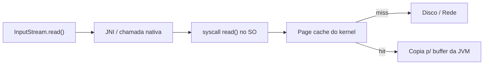
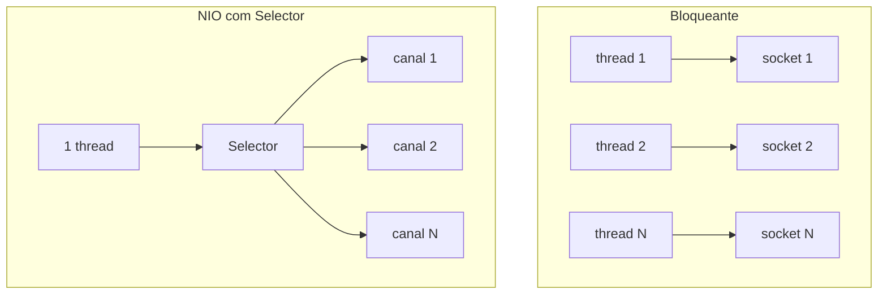

# I/O, NIO.2 e HttpClient

> **Resumo:** como o Java lê e escreve bytes e texto (streams clássicos), como a API moderna de arquivos (`java.nio.file`) e os canais/buffers funcionam, e como fazer chamadas HTTP com o `HttpClient` do JDK. É a base sobre a qual Tomcat, `RestClient` e `WebClient` do Spring operam.
> **Pré-requisitos:** [08-excecoes.md](08-excecoes.md) (try-with-resources, `IOException`), [09-programacao-funcional.md](09-programacao-funcional.md) (Streams), [12-concorrencia.md](12-concorrencia.md).
> **Versões:** `java.io` desde o 1.0; NIO no 1.4; **NIO.2 (`Path`/`Files`) no Java 7**; `Files.readString/writeString` no 11; `HttpClient` incubado no 9 e **final no Java 11**; `Charset` padrão **UTF-8 no Java 18** (JEP 400). Exemplos executados no Java 25.

## 1. Definição

- **I/O clássico (`java.io`)**: modelo de **streams** (`InputStream`/`OutputStream` para bytes, `Reader`/`Writer` para caracteres), sequencial e **bloqueante**.
- **NIO (`java.nio`)**: **buffers** + **canais** (`Channel`) + **seletores** (`Selector`) para I/O de maior desempenho e não bloqueante.
- **NIO.2 (`java.nio.file`)**: API de sistema de arquivos (`Path`, `Files`, `WatchService`) que substituiu `java.io.File`.
- **`java.net.http.HttpClient`**: cliente HTTP/1.1 e HTTP/2 moderno, síncrono e assíncrono.

Problema que resolve: toda aplicação precisa trocar dados com disco e rede. A evolução da API reflete três dores: `File` era limitada e sem erros claros, streams bloqueantes não escalam para muitas conexões, e `HttpURLConnection` era desajeitada.

## 2. Conceitos fundamentais

### 2.1 Bytes vs caracteres

| Família | Unidade | Classes típicas |
|---|---|---|
| `InputStream` / `OutputStream` | byte | `FileInputStream`, `BufferedInputStream`, `ByteArrayInputStream` |
| `Reader` / `Writer` | `char` (UTF-16) | `InputStreamReader`, `BufferedReader`, `PrintWriter` |

A ponte entre eles é o ***charset***: `new InputStreamReader(in, StandardCharsets.UTF_8)`. Antes do Java 18 o padrão dependia do sistema operacional (`file.encoding`), fonte clássica de "acentos quebrados" em produção. **Desde o Java 18 o padrão é UTF-8**, mas informar o charset explicitamente continua sendo boa prática.

**Decorator**: streams se compõem encadeando (`new BufferedReader(new InputStreamReader(new FileInputStream(f)))`); é o exemplo didático do padrão (ver [03-estruturais.md](../06-padroes-de-projeto/03-estruturais.md)). O *buffer* reduz chamadas de sistema (cada `read()` sem buffer pode ser uma chamada ao SO).

### 2.2 `Path` e `Files` (NIO.2)

```java
import java.nio.file.*;
import java.util.stream.Stream;

Path dir = Files.createTempDirectory("orders");
Path f = dir.resolve("orders.txt");                       // resolve: concatena segmentos
Files.writeString(f, "o1;10\no2;20\n");                   // Java 11+, UTF-8 por padrão

String all = Files.readString(f);
try (Stream<String> lines = Files.lines(f)) {              // LAZY: feche o stream!
    int total = lines.map(l -> l.split(";")[1]).mapToInt(Integer::parseInt).sum();   // 30
}

try (var r = Files.newBufferedReader(f)) { System.out.println(r.readLine()); }      // o1;10
Files.copy(f, dir.resolve("copy.txt"));
try (Stream<Path> walk = Files.walk(dir)) { System.out.println(walk.count()); }     // 3 (dir + 2 arquivos)
```

| Operação | Método |
|---|---|
| ler tudo / escrever tudo | `readString`, `readAllBytes`, `writeString`, `write` |
| ler linha a linha (grande) | `Files.lines`, `newBufferedReader` |
| copiar/mover/apagar | `copy`, `move`, `delete`, `deleteIfExists` |
| percorrer árvore | `walk`, `walkFileTree`, `list` (um nível), `find` |
| metadados | `size`, `getLastModifiedTime`, `isDirectory`, `getPosixFilePermissions` |
| arquivo temporário | `createTempFile`, `createTempDirectory` |

`Files.lines`, `walk`, `list` e `find` mantêm **recurso aberto**: use sempre try-with-resources. `Files.readString/readAllBytes` carregam **tudo na memória**: não use em arquivos grandes.

### 2.3 Buffers, canais e seletores (NIO)

- **`ByteBuffer`**: bloco de memória com `position`, `limit`, `capacity`. Fluxo clássico: escrever → `flip()` → ler → `clear()`/`compact()`.
- **`Channel`**: conexão bidirecional com arquivo ou socket (`FileChannel`, `SocketChannel`).
- **`Selector`**: uma thread observa **muitos** canais não bloqueantes e é avisada dos prontos para ler/escrever. É a base de Netty, e portanto do WebFlux.
- **Buffer direto** (`allocateDirect`): fora do heap, evita uma cópia na leitura/escrita de sockets, mas é caro de alocar.

```java
try (var ch = FileChannel.open(f, StandardOpenOption.READ)) {
    ByteBuffer b = ByteBuffer.allocate(5);
    ch.read(b);          // escreve no buffer: position = 5
    b.flip();            // limit = 5, position = 0 → pronto para ler
    System.out.println(StandardCharsets.UTF_8.decode(b));   // o1;10
}
```

### 2.4 Serialização Java (`ObjectOutputStream`)

Mecanismo nativo de converter objetos em bytes (`Serializable`). **Evite**: acopla o formato à classe, é fonte histórica de vulnerabilidades de desserialização (execução de código) e frágil a mudanças. Prefira JSON (Jackson) ou formatos explícitos. Se precisar, use `ObjectInputFilter` (JEP 290) e records, nunca desserialize dados não confiáveis.

## 3. Como funciona por dentro

### 3.1 Do `read()` ao disco



O SO mantém um *page cache*; ler o mesmo arquivo duas vezes costuma ser rápido na segunda. O I/O clássico **bloqueia a thread** até o dado chegar. Com threads de plataforma isso limita a escala (1 thread por conexão); com **virtual threads** (ver [12-concorrencia.md](12-concorrencia.md)) o bloqueio é barato, pois a JVM desmonta a thread, e por isso as APIs clássicas de socket/arquivo foram adaptadas no Java 21 para cooperar com elas.

### 3.2 I/O bloqueante vs não bloqueante



O `Selector` usa `epoll` (Linux), `kqueue` (macOS) ou `IOCP` (Windows). Servidores reativos (Netty/Reactor) usam esse modelo; Tomcat tem um conector NIO que lê com seletor mas **processa em thread de pool**.

### 3.3 `HttpClient` por dentro

- Objeto **imutável e thread-safe**, feito para ser **criado uma vez e reutilizado** (mantém pool de conexões, negociação HTTP/2 e `Executor` interno).
- Negocia **HTTP/2** quando o servidor suporta (via ALPN em HTTPS; em HTTP puro tenta upgrade); caso contrário cai para HTTP/1.1. `res.version()` informa o usado.
- `send` bloqueia a thread; `sendAsync` devolve `CompletableFuture` e usa threads internas.
- O corpo da resposta é processado por um `BodyHandler` (string, arquivo, stream de linhas, bytes, descartar).

Desde o Java 21 o `HttpClient` implementa `AutoCloseable` (`close()`, `shutdown()`, `awaitTermination()`).

## 4. Evolução histórica

Java 1.0: `java.io`. Java 1.4 (2002): NIO (buffers, canais, seletores). Java 7 (2011): NIO.2 com `Path`/`Files` e try-with-resources. Java 8: `Files.lines` e `BufferedReader.lines`. Java 11 (2018): `Files.readString/writeString` e `HttpClient` final, substituindo `HttpURLConnection` na prática. Java 18: UTF-8 padrão. Java 21: `HttpClient` fechável. Ver [00-evolucao-do-java.md](00-evolucao-do-java.md).

## 5. Exemplos práticos

### 5.1 Antigo vs moderno: ler um arquivo de texto

```java
// Antes (Java 6): verboso, charset implícito, risco de vazamento
BufferedReader br = null;
try {
    br = new BufferedReader(new FileReader("orders.txt"));
    String line; while ((line = br.readLine()) != null) System.out.println(line);
} finally { if (br != null) br.close(); }

// Moderno
for (String line : Files.readAllLines(Path.of("orders.txt"))) System.out.println(line);   // arquivo pequeno
try (var lines = Files.lines(Path.of("orders.txt"))) { lines.forEach(System.out::println); }   // arquivo grande
```

### 5.2 `HttpClient`: GET síncrono e assíncrono

Validado contra um `com.sun.net.httpserver.HttpServer` local:

```java
import java.net.URI;
import java.net.http.*;
import java.time.Duration;

try (HttpClient client = HttpClient.newBuilder()
        .connectTimeout(Duration.ofSeconds(2))
        .build()) {

    HttpRequest req = HttpRequest.newBuilder(URI.create("http://localhost:8080/orders/1"))
        .timeout(Duration.ofSeconds(2))               // timeout da requisição inteira
        .header("Accept", "application/json")
        .GET()
        .build();

    HttpResponse<String> res = client.send(req, HttpResponse.BodyHandlers.ofString());
    System.out.println(res.statusCode() + " " + res.body());      // 200 {"id":1}

    String body = client.sendAsync(req, HttpResponse.BodyHandlers.ofString())
                        .thenApply(HttpResponse::body)
                        .get();
}
```

### 5.3 POST com JSON e tratamento de erro

```java
HttpRequest post = HttpRequest.newBuilder(URI.create("http://localhost:8080/orders"))
    .header("Content-Type", "application/json")
    .POST(HttpRequest.BodyPublishers.ofString("""
        {"customerId": 7, "items": [{"productId": 1, "qty": 2}]}
        """))
    .build();

HttpResponse<String> r = client.send(post, HttpResponse.BodyHandlers.ofString());
if (r.statusCode() / 100 != 2) {
    throw new IllegalStateException("Falha " + r.statusCode() + ": " + r.body());
}
```

Importante: o `HttpClient` **não lança exceção para 4xx/5xx**; só para falha de rede (`IOException`, `HttpTimeoutException`). Você decide o que fazer com o status. Já o `RestClient` do Spring mapeia 4xx/5xx para exceções (ver [04-web-mvc.md](../03-spring-boot/04-web-mvc.md)).

### 5.4 Realista: importar pedidos de CSV grande sem estourar a memória

```java
record OrderLine(String id, int total) {}

try (Stream<String> lines = Files.lines(Path.of("orders.csv"))) {
    lines.skip(1)                                  // cabeçalho
         .map(l -> l.split(";"))
         .map(p -> new OrderLine(p[0], Integer.parseInt(p[1])))
         .filter(o -> o.total() > 0)
         .forEach(orderService::importLine);       // processa linha a linha
}
```

### 5.5 Observando mudanças: `WatchService`

```java
try (WatchService ws = FileSystems.getDefault().newWatchService()) {
    dir.register(ws, StandardWatchEventKinds.ENTRY_CREATE);
    WatchKey key = ws.take();                      // bloqueia até haver evento
    key.pollEvents().forEach(e -> System.out.println(e.kind() + " " + e.context()));
    key.reset();
}
```

⚠️ Comportamento varia por SO (no Linux usa `inotify`; em macOS pode ser por *polling*).

## 6. Configurações e anotações relevantes

| Item | Para que serve | Exemplo |
|---|---|---|
| `-Dfile.encoding` / `-Dstdout.encoding` | charset padrão / do console | `-Dfile.encoding=UTF-8` |
| `-Djdk.httpclient.*` | tuning do HttpClient (ex.: `connectionPoolSize`) | nomes presentes no JDK 25: `connectionPoolSize`, `keepalive.timeout`, `bufsize`, `sendBufferSize`, `receiveBufferSize`, `allowRestrictedHeaders` |
| `HttpClient.Version` | forçar versão | `.version(HttpClient.Version.HTTP_2)` |
| `redirectFollow` | seguir redirects | `.followRedirects(HttpClient.Redirect.NORMAL)` |
| `StandardOpenOption` | modo de abertura | `CREATE`, `APPEND`, `TRUNCATE_EXISTING` |
| `StandardCopyOption` | cópia/movimento | `REPLACE_EXISTING`, `ATOMIC_MOVE` |
| `spring.servlet.multipart.max-file-size` | limite de upload no Boot | `10MB` (ver [04-web-mvc.md](../03-spring-boot/04-web-mvc.md)) |

## 7. Quando usar e quando NÃO usar

- **`Files`/`Path`**: sempre, no lugar de `java.io.File`, em código novo.
- **Streams `java.io`**: quando recebe um `InputStream` de fora (upload, classpath via `getResourceAsStream`).
- **NIO com `Selector` direto**: raramente; use Netty/Reactor. Escrever o seu é terreno de especialistas.
- **`HttpClient` do JDK**: scripts, ferramentas, bibliotecas sem dependência. Em aplicação Spring, prefira `RestClient`/HTTP Interfaces (retries, interceptors, serialização, observabilidade; ver [05-comunicacao-entre-servicos.md](../04-spring-cloud/05-comunicacao-entre-servicos.md)).
- **Serialização Java**: evite.

## 8. Erros comuns e boas práticas

- Esquecer de fechar `Files.lines/walk/list`: vaza *file descriptors* (`Too many open files`).
- `readAllBytes/readString` em arquivo gigante: `OutOfMemoryError`.
- Concatenar caminhos com `"/"`: use `Path.resolve` (portável e seguro).
- **Path traversal**: `base.resolve(userInput)` com `../../etc/passwd`. Normalize e confira: `Path p = base.resolve(in).normalize(); if (!p.startsWith(base)) throw ...`.
- Criar um `HttpClient` por requisição: perde pool de conexões e cria threads. Reutilize.
- Esquecer de **timeouts** (sem eles o padrão é esperar indefinidamente).
- Ignorar o status HTTP: `send` retorna normalmente num 500.
- Confiar no charset padrão em Java < 18; declare `StandardCharsets.UTF_8`.
- Não tratar `InterruptedException` em `send` (ver [12-concorrencia.md](12-concorrencia.md)).
- Ler/escrever `ByteBuffer` sem `flip()`: lê zero bytes ou lixo.

## 9. Perguntas de revisão

1. Por que `Files.lines()` deve estar em um try-with-resources?
<details><summary>Resposta</summary>O stream é preguiçoso e mantém o arquivo aberto até o <code>close()</code>. Sem fechar, vazam descritores de arquivo.</details>

2. O que o `flip()` faz num `ByteBuffer`?
<details><summary>Resposta</summary>Troca do modo escrita para leitura: define <code>limit = position</code> e <code>position = 0</code>.</details>

3. Qual a vantagem do `Selector` sobre uma thread por conexão?
<details><summary>Resposta</summary>Uma thread monitora milhares de canais não bloqueantes e só trabalha nos que estão prontos, reduzindo memória e trocas de contexto. É o modelo do Netty/WebFlux.</details>

4. `HttpClient.send` devolveu normalmente para uma resposta 503. É um bug?
<details><summary>Resposta</summary>Não. O cliente do JDK só lança exceção para falhas de transporte/timeout; status 4xx/5xx são respostas válidas e o código deve checar <code>statusCode()</code>.</details>

5. O que mudou em charset no Java 18 e por que ainda se declara UTF-8?
<details><summary>Resposta</summary>O padrão passou a ser UTF-8 em todas as plataformas (JEP 400). Declarar explicitamente deixa o código correto em versões antigas e deixa a intenção clara.</details>

## 10. Referências oficiais

- Tutorial de I/O e arquivos: <https://dev.java/learn/java-io/>
- `java.nio.file`: <https://docs.oracle.com/en/java/javase/25/docs/api/java.base/java/nio/file/package-summary.html>
- `java.net.http`: <https://docs.oracle.com/en/java/javase/25/docs/api/java.net.http/java/net/http/package-summary.html>
- JEP 400 (UTF-8 por padrão): <https://openjdk.org/jeps/400>
- JEP 321 (HTTP Client): <https://openjdk.org/jeps/321>
- Spring `RestClient`: <https://docs.spring.io/spring-framework/reference/integration/rest-clients.html>
