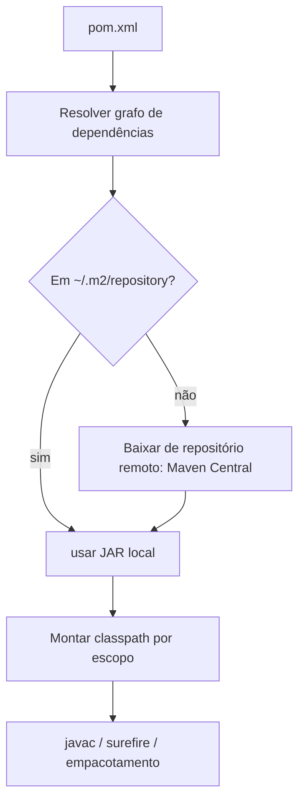

# Módulos (JPMS), Classpath e Ferramentas de Build

> **Resumo:** como o Java empacota e localiza código: **classpath** (o modelo clássico), **module path** (JPMS, desde o Java 9) e as ferramentas **Maven** e **Gradle**, que resolvem dependências e produzem o artefato. Todo projeto Spring Boot é, na prática, um projeto Maven ou Gradle: entender escopos, BOMs e o ciclo de vida evita boa parte dos erros de "classe não encontrada" e conflitos de versão.
> **Pré-requisitos:** [01-plataforma-java.md](01-plataforma-java.md) (JDK, `jar`, `jlink`), [02-jvm-por-dentro.md](02-jvm-por-dentro.md) (ClassLoaders), [10-anotacoes-e-reflection.md](10-anotacoes-e-reflection.md).
> **Versões:** JPMS no **Java 9** (JEP 261); encapsulamento forte do JDK interno no **Java 17** (JEP 403). Maven 3.9.x (validado: 3.9.12). Gradle não está instalado no ambiente de validação, portanto os trechos Gradle estão marcados como `<!-- não compilado -->`.

## 1. Definição

- **Classpath**: lista plana de diretórios/JARs onde o ClassLoader da aplicação procura classes. Sem noção de "dependência" nem de "o que é público".
- **Módulo (JPMS)**: unidade nomeada, descrita por `module-info.java`, que declara o que **exporta** e o que **requer**. O **module path** é a lista de módulos.
- **Maven / Gradle**: ferramentas de build que declaram dependências, resolvem versões (incluindo transitivas), compilam, testam e empacotam.

Problemas que resolve:
- *Classpath hell*: duas versões da mesma classe, a primeira no caminho vence silenciosamente.
- Falta de encapsulamento: qualquer `public` de qualquer JAR é acessível, inclusive o interior do JDK (`sun.misc.Unsafe`, `jdk.internal.*`).
- Reprodutibilidade: "funciona na minha máquina" sem um descritor declarativo.

## 2. Conceitos fundamentais

### 2.1 Classpath vs module path

| Aspecto | Classpath | Module path |
|---|---|---|
| Unidade | JAR/diretório | módulo nomeado |
| Dependências | implícitas | explícitas (`requires`) |
| Encapsulamento | `public` é visível a todos | só pacotes `exports` |
| Pacotes duplicados | permitido (o primeiro vence) | erro (split package) |
| Detecção de falta | em runtime (`NoClassDefFoundError`) | na inicialização |
| Uso real hoje | **a maioria das aplicações, incluindo Spring Boot** | bibliotecas e JDK |

Na prática, o JDK em si é modular (`java.base`, `java.sql`, `java.net.http`...), mas **a maioria das aplicações Spring continua no classpath** (o fat jar do Boot é um classpath aninhado). Os módulos importam, então, sobretudo para: (a) entender os erros de acesso do JDK 17+, (b) `jlink` e (c) bibliotecas que publicam `module-info`.

### 2.2 `module-info.java`

```java
module com.example.orders {
    requires java.logging;                       // dependência
    requires transitive java.sql;                // quem requer este módulo lê java.sql também
    exports com.example.orders.api;              // API pública
    exports com.example.orders.spi to com.example.plugins;   // export qualificado
    opens com.example.orders.model to com.fasterxml.jackson.databind;   // reflection profunda
    uses com.example.orders.spi.PaymentProvider;                // consome serviço (ServiceLoader)
    provides com.example.orders.spi.PaymentProvider with com.example.orders.pay.CardProvider;
}
```

| Diretiva | Efeito |
|---|---|
| `exports p` | tipos `public` de `p` acessíveis a outros módulos em compilação **e** runtime |
| `opens p` | além disso, permite **reflection profunda** (acessar `private` via `setAccessible`) |
| `requires` / `requires transitive` | dependência / dependência propagada |
| `uses` / `provides ... with` | `ServiceLoader` desacoplado |
| `open module` | abre todos os pacotes (comum em apps com JPA/Jackson) |

Distinção chave, ligada a [10-anotacoes-e-reflection.md](10-anotacoes-e-reflection.md): `exports` permite **usar** tipos públicos; só `opens` permite **reflection em membros privados**. Frameworks (Jackson, Hibernate, Spring) precisam de `opens`.

Módulos especiais:
- **Módulo automático**: um JAR sem `module-info` colocado no module path. Ganha nome derivado do arquivo (ou `Automatic-Module-Name` do manifesto), exporta e abre tudo, e lê todos os módulos.
- **Módulo sem nome (*unnamed*)**: tudo no classpath; lê todos os módulos, mas módulos nomeados **não** conseguem requerê-lo.

### 2.3 Validação rápida

Código executado no Java 25 (`javac --module-source-path`):

```java
// src/com.example.orders/com/example/orders/api/Main.java
package com.example.orders.api;
import com.example.orders.internal.Secret;     // mesmo módulo: OK
public class Main {
    public static void main(String[] a) {
        System.out.println(Secret.v() + " " + Main.class.getModule().getName());   // ok com.example.orders
    }
}
```

```bash
javac -d out --module-source-path src --module com.example.orders
java  -p out -m com.example.orders/com.example.orders.api.Main
jar --create --file o.jar -C out/com.example.orders .
jar -d --file o.jar          # mostra: exports com.example.orders.api; contains ...internal (não exportado)
jdeps --module-path out --print-module-deps -m com.example.orders   # java.base
```

Um outro módulo que tentasse importar `com.example.orders.internal.Secret` falharia na compilação com *package ... is declared in module ..., which does not export it*.

### 2.4 Maven

Descritor `pom.xml` com **coordenadas** `groupId:artifactId:version` (GAV) e **herança** (`<parent>`).

```xml
<project xmlns="http://maven.apache.org/POM/4.0.0">
  <modelVersion>4.0.0</modelVersion>
  <parent>                                             <!-- herda BOM + plugins configurados -->
    <groupId>org.springframework.boot</groupId>
    <artifactId>spring-boot-starter-parent</artifactId>
    <version>4.1.2</version>
  </parent>
  <groupId>com.example</groupId>
  <artifactId>orders</artifactId>
  <version>0.0.1-SNAPSHOT</version>
  <properties><java.version>25</java.version></properties>
  <dependencies>
    <dependency>
      <groupId>org.springframework.boot</groupId>
      <artifactId>spring-boot-starter-web</artifactId>   <!-- sem <version>: vem do BOM -->
    </dependency>
    <dependency>
      <groupId>org.springframework.boot</groupId>
      <artifactId>spring-boot-starter-test</artifactId>
      <scope>test</scope>
    </dependency>
  </dependencies>
</project>
```

(No Boot 4.1.2, `spring-boot-starter-web` aparece como deprecado no POM, em favor de `spring-boot-starter-webmvc`; veja [01-o-que-e-spring-boot.md](../03-spring-boot/01-o-que-e-spring-boot.md).)

**Ciclo de vida (*lifecycle*) padrão** e fases principais, em ordem:


Executar uma fase executa **todas as anteriores**: `mvn package` compila e testa antes de empacotar. Cada fase tem *goals* de plugins ligados a ela (ex.: `compiler:compile` em `compile`, `surefire:test` em `test`). Outros ciclos: `clean` (apaga `target/`) e `site`.

**Escopos de dependência:**

| Escopo | Compilação | Testes | Runtime | Empacotado | Exemplo |
|---|---|---|---|---|---|
| `compile` (padrão) | sim | sim | sim | sim | `spring-boot-starter-web` |
| `provided` | sim | sim | **não** | não | API Servlet em contêiner externo |
| `runtime` | não | sim | sim | sim | driver JDBC |
| `test` | não | sim | não | não | JUnit, Mockito |
| `import` (só em `dependencyManagement`, `type=pom`) | — | — | — | — | importar um BOM |

**BOM (*Bill of Materials*)**: POM que apenas fixa versões compatíveis (`dependencyManagement`). O Boot oferece o `spring-boot-dependencies`; você importa em vez de herdar quando já tem outro `parent`:

```xml
<dependencyManagement>
  <dependencies>
    <dependency>
      <groupId>org.springframework.boot</groupId>
      <artifactId>spring-boot-dependencies</artifactId>
      <version>4.1.2</version>
      <type>pom</type>
      <scope>import</scope>
    </dependency>
  </dependencies>
</dependencyManagement>
```

**Mediação de versões (transitivas):** Maven usa "**caminho mais curto** até a dependência; em empate, a primeira declarada". Diagnóstico: `mvn dependency:tree` (use `-Dverbose` para ver conflitos omitidos). Corrija com `dependencyManagement`, `<exclusions>` ou declarando a dependência direta.

### 2.5 Gradle

<!-- não compilado -->
```kotlin
// build.gradle.kts
plugins {
    java
    id("org.springframework.boot") version "4.1.2"
    id("io.spring.dependency-management") version "1.1.7"
}
java { toolchain { languageVersion = JavaLanguageVersion.of(25) } }
repositories { mavenCentral() }
dependencies {
    implementation("org.springframework.boot:spring-boot-starter-web")
    runtimeOnly("org.postgresql:postgresql")
    testImplementation("org.springframework.boot:spring-boot-starter-test")
}
tasks.test { useJUnitPlatform() }
```

| Configuração Gradle | Equivalente aproximado no Maven |
|---|---|
| `implementation` | `compile` (não vaza para consumidores no classpath de compilação) |
| `api` (plugin `java-library`) | `compile` expondo ao consumidor |
| `compileOnly` | `provided` |
| `runtimeOnly` | `runtime` |
| `testImplementation` | `test` |

(Conferido no Maven Central em 2026-11-04: `dependency-management-plugin` 1.1.7 é a última; confira de novo no momento do uso.)

## 3. Como funciona por dentro

### 3.1 Resolução de dependências (Maven)



- O **repositório local** (`~/.m2/repository`) é um cache; versões `-SNAPSHOT` são rebaixadas periodicamente, versões fixas, nunca.
- O resolvedor lê o `.pom` de cada dependência para descobrir as transitivas (por isso `.pom` ruins quebram builds).
- O plugin `javac` decide entre classpath e module path conforme exista `module-info.java` no projeto.

### 3.2 Como o JPMS aplica as regras

Na inicialização, a JVM monta o **grafo de módulos** a partir do módulo raiz (`-m`), resolvendo `requires`. Falta de módulo, ciclo ou *split package* abortam a partida (*fail fast*). Em tempo de execução, o acesso entre módulos é checado nas ligações de classe/reflection (`IllegalAccessException`/`InaccessibleObjectException`). O JDK 17 passou a **negar por padrão** reflection profunda em `java.*` (JEP 403); o escape é a flag `--add-opens`.

### 3.3 `jlink`: runtime sob medida

`jdeps` descobre os módulos do JDK que a aplicação usa e `jlink` gera uma imagem de runtime mínima:

```bash
jdeps --print-module-deps --ignore-missing-deps app.jar        # ex.: java.base,java.logging
jlink --add-modules java.base,java.logging --output runtime --strip-debug --compress zip-6
```

Útil em contêineres (ver [13-empacotamento-e-deploy.md](../03-spring-boot/13-empacotamento-e-deploy.md)).

## 4. Evolução histórica

Ant (2000) → Maven (2004), que introduziu convenção sobre configuração e o repositório central → Gradle (2012), com DSL programável e *build cache*. O projeto Jigsaw/JPMS levou anos e chegou no Java 9 (2017); a adoção em aplicações foi baixa por causa do custo de migração, mas o JDK modular permitiu `jlink` e o encapsulamento forte (Java 16 e 17). Ver [00-evolucao-do-java.md](00-evolucao-do-java.md), seção sobre o Java 9.

## 5. Exemplos práticos

### 5.1 Sintoma clássico: `InaccessibleObjectException`

```
java.lang.reflect.InaccessibleObjectException: Unable to make field private ... accessible:
module java.base does not "opens java.lang" to unnamed module
```

Causa: uma biblioteca antiga faz `setAccessible(true)` num tipo interno do JDK. Solução temporária: `--add-opens java.base/java.lang=ALL-UNNAMED`; definitiva: atualizar a biblioteca.

### 5.2 Descobrir de onde vem uma classe/versão

```bash
mvn dependency:tree -Dincludes=com.fasterxml.jackson.core
mvn help:effective-pom        # POM final, após herança e BOM
```

```java
System.out.println(SomeClass.class.getProtectionDomain().getCodeSource().getLocation());   // qual JAR foi carregado
```

### 5.3 Build multi-módulo (Maven)

```
orders-parent/ (packaging=pom)
├── orders-domain/
├── orders-service/     → depende de orders-domain
└── orders-api/         → depende de orders-service (Spring Boot app)
```

O `pom` pai lista `<modules>` e centraliza versões em `dependencyManagement`. `mvn -pl orders-api -am package` compila só a API e o que ela precisa (`-am` = *also make*). Boa base para o [monólito modular](../06-padroes-de-projeto/06-padroes-arquiteturais.md).

### 5.4 Comandos do dia a dia

| Objetivo | Maven | Gradle |
|---|---|---|
| compilar e testar | `mvn verify` | `./gradlew build` |
| pular testes | `mvn package -DskipTests` | `./gradlew build -x test` |
| árvore de dependências | `mvn dependency:tree` | `./gradlew dependencies` |
| rodar app Boot | `mvn spring-boot:run` | `./gradlew bootRun` |
| gerar imagem OCI | `mvn spring-boot:build-image` | `./gradlew bootBuildImage` |

Prefira o **wrapper** (`mvnw` / `gradlew`) versionado no repositório: fixa a versão da ferramenta para todos.

## 6. Configurações e anotações relevantes

| Item | Para que serve | Exemplo |
|---|---|---|
| `--module-path` / `-p` | module path | `java -p out -m mod/Main` |
| `--add-modules` | adicionar módulo à raiz | `--add-modules java.sql` |
| `--add-opens` / `--add-exports` | abrir/exportar pacote do JDK | `--add-opens java.base/java.lang=ALL-UNNAMED` |
| `Automatic-Module-Name` | nome estável no `MANIFEST.MF` | `Automatic-Module-Name: com.example.orders` |
| `<maven.compiler.release>` | compila para versão-alvo, valida API | `<maven.compiler.release>25</maven.compiler.release>` |
| `<dependencyManagement>` | fixa versões sem adicionar dependência | ver 2.4 |
| `<exclusions>` | corta transitiva | `<exclusion><groupId>commons-logging</groupId>...` |
| Toolchains (Gradle `java.toolchain`) | exige certo JDK | `JavaLanguageVersion.of(25)` |
| Perfis (`<profiles>`, `-P`) | configurações por ambiente (build, não a mesma coisa que *profiles* do Spring) | `mvn -Pprod package` |

## 7. Quando usar e quando NÃO usar

- **JPMS**: bibliotecas reutilizáveis, aplicações com `jlink`, quando quer encapsulamento imposto pelo compilador. **Não** necessário em app Spring Boot típica, pois adiciona atrito com reflection (precisa de `opens`) e com libs sem `module-info`.
- **Maven**: padrão do mercado, convenção forte, ótimo para builds previsíveis.
- **Gradle**: builds grandes/monorepo, DSL flexível, cache incremental; custa curva de aprendizado e builds menos uniformes.
- **BOM/parent**: sempre em Spring, para não escolher versões à mão.
- Evite `LATEST`/`RELEASE` e intervalos de versão `[1.0,)`: tornam o build não reproduzível.

## 8. Erros comuns e boas práticas

- Declarar versão manual de uma biblioteca já gerenciada pelo BOM e criar conflito silencioso.
- `NoSuchMethodError`/`ClassNotFoundException` após atualizar: versões transitivas divergentes; use `dependency:tree`.
- Misturar `javax.*` e `jakarta.*` no classpath (ver [00-evolucao-do-java.md](00-evolucao-do-java.md)).
- Esquecer `runtime` para driver JDBC e tentar usá-lo em compilação, ou o contrário.
- Usar `compile`/`implementation` para tudo; prefira `test`, `runtime` e `provided` onde couberem.
- Commitar `target/`/`build/` e não commitar o wrapper.
- Confiar no `-SNAPSHOT` em produção.
- **Segurança de supply chain**: fixe versões, revise dependências novas, verifique com `mvn dependency:tree`/SBOM; typosquatting existe.
- Um único `module-info` + testes: o plugin de testes precisa de `--patch-module`; teste no classpath é mais simples.

## 9. Perguntas de revisão

1. Qual a diferença entre `exports` e `opens`?
<details><summary>Resposta</summary><code>exports</code> libera o uso dos tipos públicos do pacote; <code>opens</code> libera também reflection profunda sobre membros privados (necessário para Jackson, Hibernate, Spring).</details>

2. Em que ordem o Maven resolve duas versões transitivas conflitantes?
<details><summary>Resposta</summary>Pelo caminho mais curto na árvore; em empate, vence a primeira declarada. Declarar a versão diretamente (ou no <code>dependencyManagement</code>) força a escolha.</details>

3. Por que `mvn package` também roda os testes?
<details><summary>Resposta</summary>Executar uma fase do ciclo de vida executa todas as anteriores; <code>test</code> vem antes de <code>package</code>. Pula-se com <code>-DskipTests</code>.</details>

4. O que é um BOM e qual problema resolve?
<details><summary>Resposta</summary>Um POM que só fixa versões compatíveis de várias bibliotecas (<code>dependencyManagement</code>). Evita escolher e alinhar versões à mão, como faz o <code>spring-boot-dependencies</code>.</details>

5. Por que aplicações Spring Boot geralmente ficam no classpath e não no module path?
<details><summary>Resposta</summary>O fat jar do Boot usa um classpath aninhado e o ecossistema (reflection, proxies, libs sem <code>module-info</code>) funciona melhor sem o rigor do JPMS, que exigiria <code>opens</code> e módulos automáticos.</details>

## 10. Referências oficiais

- Tutorial de módulos: <https://dev.java/learn/modules/>
- JEP 261 (Module System): <https://openjdk.org/jeps/261>
- JEP 403 (Strongly Encapsulate JDK Internals): <https://openjdk.org/jeps/403>
- Maven, introdução ao ciclo de vida: <https://maven.apache.org/guides/introduction/introduction-to-the-lifecycle.html>
- Maven, mecanismo de dependências: <https://maven.apache.org/guides/introduction/introduction-to-dependency-mechanism.html>
- Gradle: <https://docs.gradle.org>
- Spring Boot, build systems: <https://docs.spring.io/spring-boot/reference/using/build-systems.html>
