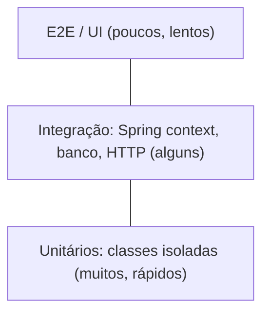
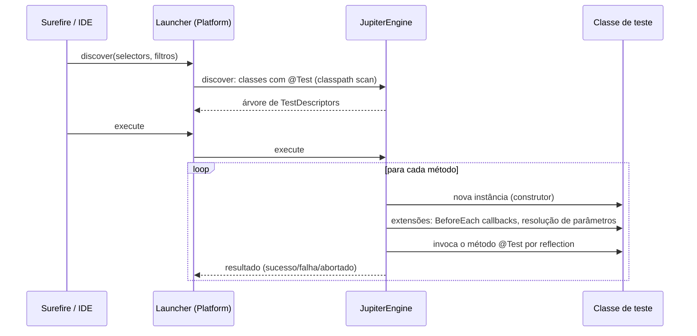

# Testes em Java: JUnit 5, AssertJ e Mockito

> **Resumo:** como escrever testes automatizados em Java com o trio padrão do mercado: **JUnit 5** (estrutura e execução), **AssertJ** (asserções legíveis) e **Mockito** (dublês de dependências). Entender como eles funcionam por dentro (reflection, extensões, proxies de bytecode) explica o comportamento dos testes do Spring Boot, que se apoiam nas mesmas peças.
> **Pré-requisitos:** [10-anotacoes-e-reflection.md](10-anotacoes-e-reflection.md), [11-proxies-dinamicos-e-bytecode.md](11-proxies-dinamicos-e-bytecode.md), [14-modulos-e-build.md](14-modulos-e-build.md) (Maven, escopo `test`).
> **Versões:** JUnit 5 (Jupiter) desde 2017; JUnit 6 já existe (a última é a 6.1.3 no Central e o BOM do Boot 4.1.2 usa a 6.0.3), mas os exemplos ficaram na linha 5.x; leia as notas de migração antes de trocar; os exemplos foram **executados** com JUnit Jupiter 5.13.4, AssertJ 3.27.3, Mockito 5.24.0 e Surefire 3.5.3 no **Java 25**.

## 1. Definição

- **Teste unitário**: verifica uma unidade de comportamento (classe/método) **isolada** de I/O e de outras unidades, rápido e determinístico.
- **JUnit**: framework que **descobre**, **executa** e **reporta** testes.
- **AssertJ**: biblioteca de asserções fluentes (`assertThat(x).isEqualTo(y)`).
- **Mockito**: cria **dublês** (*mocks*, *spies*) para substituir colaboradores e verificar interações.

Problema que resolve: detectar regressões automaticamente e documentar o comportamento esperado. Sem testes, toda refatoração (e toda atualização de versão do Java/Spring) é um risco manual.

## 2. Conceitos fundamentais

### 2.1 Pirâmide de testes



Quanto mais acima, mais lento e frágil. Testes de integração com Spring ficam em [10-testes-no-spring-boot.md](../03-spring-boot/10-testes-no-spring-boot.md).

### 2.2 A arquitetura do JUnit 5

JUnit 5 = **Platform** + **Jupiter** + **Vintage**:

| Parte | Papel |
|---|---|
| **JUnit Platform** | lança testes e expõe a API `TestEngine` (usada por IDEs, Maven, Gradle) |
| **Jupiter** | o modelo de programação (`@Test`, extensões) + o engine que o executa |
| **Vintage** | engine para rodar testes JUnit 3/4 |

Qualquer ferramenta fala com a Platform; cada biblioteca de teste fornece um `TestEngine` (Jupiter, Cucumber, ...).

### 2.3 Ciclo de vida e anotações principais

```java
import org.junit.jupiter.api.*;

class LifecycleTest {
    @BeforeAll  static void once()  { /* uma vez, antes de todos (static por padrão) */ }
    @BeforeEach void setUp()        { /* antes de cada teste */ }
    @Test       void a()            { }
    @Test       void b()            { }
    @AfterEach  void tearDown()     { }
    @AfterAll   static void end()   { }
}
```

**Importante:** por padrão o JUnit cria **uma nova instância da classe de teste para cada método** (isolamento). Por isso campos de instância não vazam estado entre testes. `@TestInstance(PER_CLASS)` muda isso (aí `@BeforeAll` pode ser não estático).

| Anotação | Função |
|---|---|
| `@Test` | marca um teste |
| `@DisplayName` | nome legível no relatório |
| `@Disabled` | desliga (com motivo) |
| `@Nested` | agrupa testes em classe interna (contexto "dado que...") |
| `@Tag` | categoriza para filtros (`-Dgroups=slow`) |
| `@RepeatedTest(n)` | repete |
| `@Timeout` | falha se passar do tempo |
| `@TempDir` | injeta diretório temporário |
| `@ParameterizedTest` + fonte | mesmo teste com vários dados |
| `@ExtendWith` | registra extensão (Mockito, Spring) |

### 2.4 Testes parametrizados

```java
@ParameterizedTest
@CsvSource({"1,2,3", "10,5,15"})
void sum(int a, int b, int expected) {
    assertThat(new Money(BigDecimal.valueOf(a)).plus(new Money(BigDecimal.valueOf(b))).amount())
        .isEqualByComparingTo(BigDecimal.valueOf(expected));
}

@ParameterizedTest
@ValueSource(strings = {"-1", "-0.01"})
void rejectsNegative(String v) {
    assertThatIllegalArgumentException().isThrownBy(() -> new Money(new BigDecimal(v)));
}
```

Fontes: `@ValueSource`, `@CsvSource`, `@CsvFileSource`, `@EnumSource`, `@MethodSource` (método estático que devolve `Stream<Arguments>`). Requer o artefato `junit-jupiter-params` (já incluso no agregador `junit-jupiter`).

### 2.5 AssertJ

```java
import static org.assertj.core.api.Assertions.*;

assertThat(order.total()).isEqualByComparingTo("11.00");       // BigDecimal: compara valor, ignora escala
assertThat(orders).hasSize(2).extracting(Order::id).containsExactly("o1", "o2");
assertThat(name).startsWith("An").endsWith("a").isNotBlank();
assertThatThrownBy(() -> service.place("dup"))
    .isInstanceOf(IllegalStateException.class)
    .hasMessageContaining("dup");
assertThat(map).containsEntry("k", 1);
```

Por que preferir ao `Assertions` do JUnit: mensagens de falha ricas, API descobrível por autocompletar e encadeamento. Use `assertThat(...).as("descrição")` e `SoftAssertions` para coletar várias falhas de uma vez.

> `assertEquals(1.1, 1.0 + 0.1)` com `double` e `BigDecimal.equals("1.0", "1.00")` são armadilhas conhecidas (ver [03-tipos-e-memoria.md](03-tipos-e-memoria.md)); prefira `isEqualByComparingTo` e `isCloseTo`.

### 2.6 Mockito

```java
import static org.mockito.Mockito.*;

@ExtendWith(MockitoExtension.class)               // inicializa @Mock/@InjectMocks e valida uso (strict stubs)
class OrderServiceTest {
    @Mock OrderService.Repo repo;
    @Mock OrderService.Notifier notifier;
    @InjectMocks OrderService service;            // injeta os mocks no construtor
    @Captor ArgumentCaptor<String> captor;

    @Test void placesAndNotifies() {
        when(repo.exists("o1")).thenReturn(false);        // stubbing: ensina o dublê
        service.place("o1");
        verify(repo).save("o1");                           // verificação de interação
        verify(notifier).notify(captor.capture());
        assertThat(captor.getValue()).isEqualTo("o1");
    }

    @Test void rejectsDuplicate() {
        when(repo.exists("o1")).thenReturn(true);
        assertThatThrownBy(() -> service.place("o1")).isInstanceOf(IllegalStateException.class);
        verify(repo, never()).save(any());
        verifyNoInteractions(notifier);
    }
}
```

| Conceito | Significado |
|---|---|
| **Mock** | dublê que devolve valores padrão (`null`, `0`, vazio) e registra chamadas |
| **Stub** | mock programado: `when(x.m()).thenReturn(v)` / `doThrow` |
| **Spy** | objeto **real** parcialmente interceptado (`spy(obj)`, `@Spy`) |
| **Fake** | implementação simples funcional (ex.: repositório em memória) |
| **Argument matchers** | `any()`, `eq()`, `argThat(...)`; **se usar um, todos os argumentos devem ser matchers** |
| **Strict stubs** | `MockitoExtension` falha com `UnnecessaryStubbingException` se um stub não for usado |

## 3. Como funciona por dentro

### 3.1 Descoberta e execução no JUnit



Tudo é **reflection**: o engine lê as anotações, instancia a classe (construtor com parâmetros pode ser resolvido por extensões, como o Spring faz) e invoca os métodos, inclusive os de visibilidade de pacote (por isso testes JUnit 5 não precisam ser `public`). Ver [10-anotacoes-e-reflection.md](10-anotacoes-e-reflection.md).

### 3.2 Modelo de extensões

Extensões (`Extension`) se encaixam em pontos do ciclo de vida: `BeforeEachCallback`, `ParameterResolver`, `TestInstancePostProcessor`, `ExecutionCondition`, `TestExecutionExceptionHandler`... É assim que:
- `MockitoExtension` cria os mocks antes de cada teste e valida o uso depois;
- `SpringExtension` (via `@SpringBootTest`/`@ExtendWith`) sobe o `ApplicationContext` e injeta beans no teste (ver [10-testes-no-spring-boot.md](../03-spring-boot/10-testes-no-spring-boot.md));
- `@TempDir` e `@ParameterizedTest` são extensões internas.

### 3.3 Como o Mockito cria mocks

O Mockito gera **em tempo de execução** uma subclasse (ou implementação, no caso de interface) do tipo, usando ByteBuddy, e instala um interceptor que registra chamadas e devolve os stubs, o mesmo princípio de [proxy por subclasse](11-proxies-dinamicos-e-bytecode.md). Desde o Mockito 5, o *mock maker* padrão é o **inline**, que usa um *agent* (Instrumentation) para **reescrever a própria classe carregada**, o que permite mockar classes `final` e métodos `final`/`static` (`mockStatic`) sem subclasse.

Consequências:
- o JDK exige que agentes sejam **autorizados** dinamicamente (aviso `Mockito is currently self-attaching...` em JDKs novos; configure `-javaagent` no Surefire para eliminá-lo);
- ByteBuddy precisa suportar a versão do bytecode do JDK. Ao validar este arquivo no **Java 25**, o Mockito 5.18 e o 5.24 falharam com `Java 25 (69) is not supported by the current version of Byte Buddy`; os testes só passaram ao **declarar `net.bytebuddy:byte-buddy` em versão mais nova** (1.18.x) no `pom.xml`. Moral: ao subir a versão do Java, **atualize junto Mockito/ByteBuddy**.

### 3.4 Surefire e execução no Maven

`maven-surefire-plugin` (fase `test`) inicia uma JVM filha, coloca as classes no classpath e chama o Launcher da Platform. Convenção de nomes: `*Test`, `Test*`, `*Tests`, `*TestCase`. Testes de integração (`*IT`) rodam pelo `maven-failsafe-plugin` na fase `verify`.

## 4. Evolução histórica

JUnit 3 (herança de `TestCase`, métodos `testXxx`) → JUnit 4 (2006, anotações `@Test`, runners e rules) → JUnit 5 (2017, modular, extensões, Java 8+). Mockito passou do mock por subclasse (CGLIB, depois ByteBuddy) para o *inline* por padrão no 5.0. AssertJ tomou o lugar do Hamcrest como preferência da comunidade Spring. Ver [00-evolucao-do-java.md](00-evolucao-do-java.md) para o contexto de linguagem (lambdas tornaram `assertThatThrownBy` natural).

## 5. Exemplos práticos

Todos executados: `Tests run: 8, Failures: 0, Errors: 0`.

### 5.1 Teste de um record com validação

```java
public record Money(BigDecimal amount) {
    public Money {
        if (amount.signum() < 0) throw new IllegalArgumentException("negative");
    }
    public Money plus(Money o) { return new Money(amount.add(o.amount)); }
}

class MoneyTest {
    @Test @DisplayName("soma valores")
    void sums() {
        assertThat(new Money(BigDecimal.ONE).plus(new Money(BigDecimal.TEN)).amount())
            .isEqualByComparingTo("11");
    }
    @Test
    void rejectsNegative() {
        assertThatThrownBy(() -> new Money(new BigDecimal("-1")))
            .isInstanceOf(IllegalArgumentException.class).hasMessage("negative");
    }
}
```

### 5.2 Padrão Given/When/Then com `@Nested`

```java
@Nested
@DisplayName("quando o pedido já existe")
class WhenDuplicate {
    @BeforeEach void given() { when(repo.exists("o1")).thenReturn(true); }
    @Test void thenFails()   { assertThatThrownBy(() -> service.place("o1")).isInstanceOf(IllegalStateException.class); }
    @Test void thenNoSave()  { try { service.place("o1"); } catch (RuntimeException ignored) {} verify(repo, never()).save(any()); }
}
```

### 5.3 Fake em vez de mock

```java
class InMemoryRepo implements OrderService.Repo {
    private final Set<String> ids = new HashSet<>();
    public void save(String id) { ids.add(id); }
    public boolean exists(String id) { return ids.contains(id); }
}

@Test void secondPlaceFails() {
    var svc = new OrderService(new InMemoryRepo(), id -> {});
    svc.place("o1");
    assertThatThrownBy(() -> svc.place("o1")).isInstanceOf(IllegalStateException.class);
}
```

Testa **estado** (resultado observável) em vez de **interação**: menos acoplado à implementação, sobrevive a refatorações.

### 5.4 Dependências no Maven (sem Spring)

```xml
<dependencyManagement><dependencies>
  <dependency><groupId>org.junit</groupId><artifactId>junit-bom</artifactId>
    <version>5.13.4</version><type>pom</type><scope>import</scope></dependency>
</dependencies></dependencyManagement>
<dependencies>
  <dependency><groupId>org.junit.jupiter</groupId><artifactId>junit-jupiter</artifactId><scope>test</scope></dependency>
  <dependency><groupId>org.assertj</groupId><artifactId>assertj-core</artifactId><version>3.27.3</version><scope>test</scope></dependency>
  <dependency><groupId>org.mockito</groupId><artifactId>mockito-junit-jupiter</artifactId><version>5.24.0</version><scope>test</scope></dependency>
  <!-- necessário no Java 25 enquanto o Mockito trouxer um ByteBuddy mais antigo -->
  <dependency><groupId>net.bytebuddy</groupId><artifactId>byte-buddy</artifactId><version>1.18.17-jdk5</version><scope>test</scope></dependency>
</dependencies>
```

(A `1.18.17-jdk5` é a release atual no Central em 2026-11-04; o BOM do Boot 4.1.2 fixa a 1.18.15.) Com **Spring Boot**, o `spring-boot-starter-test` já traz JUnit, AssertJ, Mockito e o alinhamento de versões pelo BOM, então não declare nada disso à mão.

## 6. Configurações e anotações relevantes

| Item | Para que serve | Exemplo |
|---|---|---|
| `@Test`, `@ParameterizedTest` | declaram testes | ver 2.3, 2.4 |
| `@ExtendWith(MockitoExtension.class)` | habilita mocks por anotação | acima |
| `@Mock`, `@InjectMocks`, `@Spy`, `@Captor` | criação/injeção de dublês | acima |
| `@MockitoBean` (Spring Boot) | substitui bean do contexto por mock; sucessor de `@MockBean` | ver [10-testes-no-spring-boot.md](../03-spring-boot/10-testes-no-spring-boot.md) |
| `@Tag("slow")` + `-Dgroups=slow` | filtrar execução | `mvn test -Dgroups=slow` |
| `junit-platform.properties` | configurações globais (ex.: paralelismo) | `junit.jupiter.execution.parallel.enabled=true` |
| `@TestInstance(Lifecycle.PER_CLASS)` | uma instância por classe | `@BeforeAll` não estático |
| `-DskipTests` / `-Dtest=Classe#metodo` | pular / rodar um | `mvn test -Dtest=MoneyTest#sums` |
| Testcontainers | dependências reais (banco) em contêiner | ver [10-testes-no-spring-boot.md](../03-spring-boot/10-testes-no-spring-boot.md) |

## 7. Quando usar e quando NÃO usar

- **Mock**: para fronteiras (e-mail, gateway de pagamento, relógio). **Prefira fake** quando a colaboração tem regras próprias (repositório em memória).
- **Não mocke** tipos que você não controla e que têm comportamento rico (`List`, `String`, `BigDecimal`), nem o próprio objeto sob teste.
- **Não use `@SpringBootTest`** para testar uma regra de negócio simples: é lento (sobe o contexto). Teste a classe diretamente.
- **Evite `verify` em excesso**: acopla o teste à implementação; verifique o resultado observável sempre que possível.
- `mockStatic`/spy em código de domínio costuma indicar acoplamento excessivo: injete a dependência (ex.: `Clock`).

## 8. Erros comuns e boas práticas

- **Testes dependentes de ordem** ou de estado compartilhado (campos `static` mutáveis): não confie na ordem de execução.
- **Relógio e aleatoriedade reais**: injete `java.time.Clock` e use `Clock.fixed(...)`.
- **Dormir** (`Thread.sleep`) para esperar assíncrono: use `Awaitility` ou sincronização explícita.
- **Um teste = um motivo para falhar**: asserções demais mascaram a causa.
- **Misturar matchers e valores crus** no Mockito: `verify(r).save(eq("a"), any())`.
- **Stub desnecessário** com strict stubs: remova (o erro é útil).
- Nome do teste que descreve implementação (`testMethod1`); descreva o comportamento (`rejectsNegativeAmount`).
- **Ignorar testes que falham** com `@Disabled` sem prazo.
- Confundir `assertEquals(esperado, atual)` (ordem esperada→atual): a mensagem sai invertida. AssertJ evita isso.
- Cobertura como meta: 100% de linhas não prova ausência de bugs; teste **comportamento** e bordas (nulos, vazios, limites).

## 9. Perguntas de revisão

1. Por que o JUnit 5 cria uma instância nova da classe de teste por método?
<details><summary>Resposta</summary>Para isolar os testes: campos de instância não vazam estado entre eles. Dá para mudar com <code>@TestInstance(PER_CLASS)</code>.</details>

2. Qual a diferença entre mock, stub, spy e fake?
<details><summary>Resposta</summary>Mock: dublê que registra interações; stub: dublê com respostas programadas; spy: objeto real parcialmente interceptado; fake: implementação simples e funcional (ex.: repositório em memória).</details>

3. Como o Mockito consegue mockar uma classe `final`?
<details><summary>Resposta</summary>Com o mock maker <em>inline</em> (padrão desde o Mockito 5), que usa um agent de Instrumentation e ByteBuddy para reescrever a própria classe, em vez de criar uma subclasse.</details>

4. Por que, ao subir para um Java novo, os testes com Mockito podem falhar com `Java N is not supported by the current version of Byte Buddy`?
<details><summary>Resposta</summary>O ByteBuddy precisa conhecer a versão do bytecode (class file) do JDK. É preciso usar uma versão do ByteBuddy (e, em geral, do Mockito) que a suporte, o que foi necessário neste material para o Java 25.</details>

5. Quando é melhor um fake do que um mock?
<details><summary>Resposta</summary>Quando o colaborador tem comportamento com regras próprias (um repositório): o fake permite testar o estado final e é menos acoplado à implementação do que verificar chamadas.</details>

## 10. Referências oficiais

- JUnit 5 User Guide: <https://docs.junit.org/>
- AssertJ: <https://assertj.github.io/doc/>
- Mockito (Javadoc e documentação): <https://site.mockito.org>
- Maven Surefire: <https://maven.apache.org/surefire/maven-surefire-plugin/>
- Spring Boot, testing: <https://docs.spring.io/spring-boot/reference/testing/index.html>
- Tutorial de testes (dev.java): <https://dev.java>
