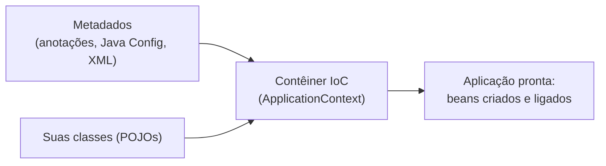
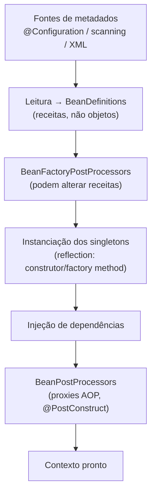
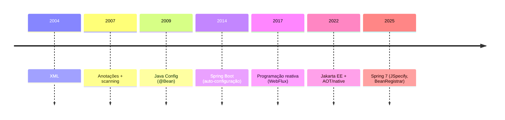

# O que é o Spring

> **Resumo:** o Spring Framework é um **contêiner de objetos** (IoC) mais um conjunto de módulos que cuidam de aspectos recorrentes de aplicações Java corporativas: transações, acesso a dados, web, testes, mensageria. Entender o que é "Spring" (e o que são Boot e Cloud) evita confusão em todo o resto da base.
> **Pré-requisitos:** [01-java/10-anotacoes-e-reflection.md](../01-java/10-anotacoes-e-reflection.md), [01-java/00-evolucao-do-java.md](../01-java/00-evolucao-do-java.md).
> **Versões:** referência **Spring Framework 7.0.x** (exemplos executados com 7.0.8, Java 25). Baseline: Java 17 mínimo, Java 25 recomendado, Jakarta EE 11.

## 1. Definição

**Spring Framework** é um framework de infraestrutura para aplicações Java. Seu núcleo é o **contêiner IoC** (*Inversion of Control*): em vez de cada classe criar e localizar as suas dependências, um contêiner **cria, conecta e gerencia** os objetos (chamados *beans*).

Problema que resolve (contexto de ~2002, J2EE/EJB 2): aplicações corporativas exigiam servidores pesados, componentes que só rodavam dentro do servidor e muito código de infraestrutura (JNDI, `try/finally` de conexões, transações manuais). O Spring propôs **POJOs** (classes Java comuns) que ganham serviços corporativos por **configuração**, não por herdar de classes do framework, e que podem ser testados sem servidor.

Os três nomes que se confundem:

| Nome | O que é | Foco |
|---|---|---|
| **Spring Framework** | biblioteca base: contêiner, AOP, transações, Web MVC, etc. | *funcionar* (este capítulo e `02-spring-core/`) |
| **Spring Boot** | camada em cima do Framework: auto-configuração, starters, servidor embutido | *começar rápido, convenção sobre configuração* ([03-spring-boot/](../03-spring-boot/01-o-que-e-spring-boot.md)) |
| **Spring Cloud** | conjunto de projetos para sistemas distribuídos, construído sobre Boot | *microsserviços* ([04-spring-cloud/](../04-spring-cloud/01-visao-geral.md)) |

Boot **não substitui** o Framework: ele o configura para você. Tudo que o Boot faz usa as peças deste capítulo.

## 2. Conceitos fundamentais

### 2.1 POJO, bean e contêiner

- **POJO**: classe Java comum, sem herdar de tipos do framework.
- **Bean**: objeto instanciado, montado e gerenciado pelo contêiner. Objetos criados com `new` no seu código **não** são beans.
- **Contêiner** (`ApplicationContext`): lê metadados de configuração (classes anotadas, `@Bean`, XML), cria os beans na ordem certa de dependência e controla o ciclo de vida.



### 2.2 Módulos do Spring Framework

O Framework é distribuído em JARs separados (`spring-*`); você usa só o que precisa.

| Grupo | Módulos (artefatos) | Para que serve |
|---|---|---|
| **Core container** | `spring-core`, `spring-beans`, `spring-context`, `spring-expression` | IoC/DI, `ApplicationContext`, eventos, SpEL |
| **AOP** | `spring-aop`, `spring-aspects` | proxies, aspectos ([07](07-aop-e-proxies.md)) |
| **Dados** | `spring-tx`, `spring-jdbc`, `spring-orm`, `spring-r2dbc` | transações, JDBC, integração com JPA ([09](09-transacoes.md)) |
| **Web** | `spring-web`, `spring-webmvc`, `spring-webflux` | MVC (servlet) e reativo |
| **Mensageria** | `spring-messaging`, `spring-jms` | abstrações de mensagens |
| **Teste** | `spring-test` | contexto em testes, MockMvc |

Ao incluir `spring-context`, o Maven traz transitivamente `spring-beans`, `spring-core`, `spring-aop` e `spring-expression`. Um programa mínimo:

```java
import org.springframework.context.annotation.*;

@Configuration
@ComponentScan
class AppConfig {}

public class Main {
    public static void main(String[] args) {
        try (var ctx = new AnnotationConfigApplicationContext(AppConfig.class)) {
            // ctx.getBean(OrderService.class).place(...)
        }
    }
}
```

### 2.3 O que o Spring dá "de graça"

Tudo se resume a três mecanismos, detalhados nos próximos arquivos:

1. **IoC/DI**: quem monta o grafo de objetos é o contêiner ([02](02-ioc-e-injecao-de-dependencia.md)).
2. **Proxies/AOP**: comportamento transversal (transação, cache, segurança, async) é injetado **em volta** dos seus beans sem você alterar a classe ([07](07-aop-e-proxies.md), [01-java/11](../01-java/11-proxies-dinamicos-e-bytecode.md)).
3. **Abstrações de serviço**: `PlatformTransactionManager`, `Resource`, `Environment`, `ApplicationEventPublisher`, `TaskExecutor` escondem detalhes de implementação.

## 3. Como funciona por dentro

Em uma frase: o contêiner **lê metadados, transforma-os em `BeanDefinition`s, e usa reflection para instanciar e ligar os objetos**; opcionalmente envolve alguns deles em proxies.



Cada etapa é aprofundada em [03](03-application-context-e-beans.md), [04](04-ciclo-de-vida-e-escopos.md) e, passo a passo com um contêiner didático, em [06](06-como-java-e-spring-conversam.md). A base técnica em Java é vista em [01-java/10-anotacoes-e-reflection.md](../01-java/10-anotacoes-e-reflection.md): o Spring lê anotações por reflection (ou, no modo AOT, em tempo de build) e chama construtores com `Constructor.newInstance`.

## 4. Evolução histórica

Datas conferidas contra o Maven Central (4.0 em dez/2013, 5.0 em set/2017, 6.0 em nov/2022, 6.1 em nov/2023, 6.2 em nov/2024, 7.0 em nov/2025; 2.0 em out/2006); 1.0 (2004) e 3.0/3.1 (2009/2011) seguem a história do projeto, pois o Central só tem republicações antigas. Os fatos de 7.0 foram conferidos nas release notes oficiais.

| Versão | Ano | Marcos | Java mínimo |
|---|---|---|---|
| 1.0 | 2004 | contêiner IoC, **XML** como configuração, AOP, JDBC/transações | 1.3 |
| 2.0 / 2.5 | 2006 / 2007 | namespaces XML; **anotações** (`@Autowired`, `@Component`, `@Service`), scanning | 1.4 / 1.5 |
| 3.0 / 3.1 | 2009 / 2011 | **Java Config** (`@Configuration`, `@Bean`), SpEL, REST no MVC; **profiles**, `@Cacheable`, `Environment` | 5 |
| 4.x | 2013–2016 | Java 8 (lambdas, `Optional`), WebSocket, `@Conditional` (base da auto-configuração do Boot); Java 6+ até 4.3 | 6 → (8 recomendado) |
| 5.0 | 2017 | **WebFlux** (reativo), Kotlin, Java 8 mínimo | 8 |
| 6.0 | 2022 | **Jakarta EE 9+** (`javax.*` → `jakarta.*`), **AOT** e GraalVM native, Java 17 mínimo | 17 |
| 6.1 / 6.2 | 2023 / 2024 | virtual threads, `RestClient`, `JdbcClient`, Checkpoint/Restore (CRaC) | 17 |
| **7.0** | 2025 | Jakarta EE 11, **JSpecify** para null-safety, `BeanRegistrar`, retry/`@Retryable` no core, API versioning no MVC, Jackson 3, remoção de `javax.annotation`/`javax.inject` | 17 (25 recomendado) |

Linha do tempo de configuração, o fio condutor da evolução:



O mesmo bean, nas três gerações (ver [05-configuracao.md](05-configuracao.md)):

```xml
<!-- 2004: XML -->
<bean id="orderService" class="com.example.orders.OrderService">
    <constructor-arg ref="orderRepository"/>
</bean>
```

```java
// 2009: Java Config
@Configuration
class AppConfig {
    @Bean OrderService orderService(OrderRepository repo) { return new OrderService(repo); }
}

// 2007+ (moderno): anotação de estereótipo + scanning
@Service
class OrderService {
    OrderService(OrderRepository repo) { /* ... */ }
}
```

O **Java mínimo** acompanha o Spring Boot: Boot 3 exige Java 17+, Boot 4.1 também 17+ (compatível até 27). Veja a tabela em [01-java/00-evolucao-do-java.md](../01-java/00-evolucao-do-java.md) §6.3.

Mudança importante em 7.0: a remoção do suporte a `javax.annotation` e `javax.inject`. Use `jakarta.annotation.PostConstruct` e `jakarta.inject.Inject`.

## 5. Exemplos práticos

O domínio comum dos exemplos é o **sistema de pedidos** (`com.example.orders`).

### 5.1 Sem Spring: o acoplamento manual

```java
public class Main {
    public static void main(String[] args) {
        var dataSource = new SimpleDataSource("jdbc:...");
        var repo = new JdbcOrderRepository(dataSource);
        var gateway = new CardPaymentGateway();
        var service = new OrderService(repo, gateway);   // quem monta é você
        service.place(new Order(/* ... */));
    }
}
```

Funciona, mas a "composição" cresce, fica espalhada e trocar `CardPaymentGateway` em testes exige editar código.

### 5.2 Com Spring: o contêiner monta

```java
@Repository class JdbcOrderRepository implements OrderRepository { /* ... */ }
@Component  class CardPaymentGateway implements PaymentGateway { /* ... */ }

@Service
class OrderService {
    private final OrderRepository repo;
    private final PaymentGateway gateway;

    OrderService(OrderRepository repo, PaymentGateway gateway) { // injetado
        this.repo = repo; this.gateway = gateway;
    }
}

@Configuration @ComponentScan
class AppConfig {}
```

`new AnnotationConfigApplicationContext(AppConfig.class)` varre o pacote, registra três `BeanDefinition`s, resolve o construtor de `OrderService` pelos **tipos** dos parâmetros e injeta as instâncias corretas. Nenhuma linha de "ligação" foi escrita.

### 5.3 O serviço enriquecido por proxy

```java
@Service
class OrderService {
    @Transactional                      // comportamento adicionado por proxy
    public void place(Order o) { /* ... */ }
}
```

O bean que você recebe do contêiner é, na prática, um **proxy** que abre a transação, delega ao seu código e faz commit/rollback ([09](09-transacoes.md)).

## 6. Configurações e anotações relevantes

| Item | Para que serve | Exemplo |
|---|---|---|
| `@Configuration` | classe que declara beans | `@Configuration class AppConfig {}` |
| `@ComponentScan` | varre pacotes atrás de estereótipos | `@ComponentScan("com.example.orders")` |
| `@Component`, `@Service`, `@Repository` | marca classe como bean | `@Service class OrderService {}` |
| `@Bean` | método que produz um bean | `@Bean Clock clock() { return Clock.systemUTC(); }` |
| `AnnotationConfigApplicationContext` | contêiner baseado em classes | `new AnnotationConfigApplicationContext(AppConfig.class)` |
| `spring-framework-bom` | alinha as versões de todos os `spring-*` | `import` no `dependencyManagement` |

Maven mínimo (BOM, ver [01-java/14-modulos-e-build.md](../01-java/14-modulos-e-build.md)):

```xml
<dependencyManagement>
  <dependencies>
    <dependency>
      <groupId>org.springframework</groupId>
      <artifactId>spring-framework-bom</artifactId>
      <version>7.0.8</version>
      <type>pom</type><scope>import</scope>
    </dependency>
  </dependencies>
</dependencyManagement>
<dependencies>
  <dependency>
    <groupId>org.springframework</groupId>
    <artifactId>spring-context</artifactId>
  </dependency>
</dependencies>
```

## 7. Quando usar e quando NÃO usar

**Use** quando a aplicação tem muitos componentes colaborando, precisa de transações, segurança, integração com bancos/mensageria ou de testabilidade com troca de dependências. Em projetos reais, quase sempre via **Spring Boot**.

**Não use** (ou reconsidere) para: scripts e CLIs pequenos (o custo de startup e de conceitos não compensa); funções serverless com *cold start* crítico (considere native image, ver [10](10-aot-e-native.md), ou frameworks mais leves); bibliotecas reutilizáveis que não precisam impor o Spring aos consumidores (mantenha a lógica em POJOs e deixe a integração em um módulo à parte).

## 8. Erros comuns e boas práticas

- **Confundir Spring, Boot e Cloud**: problema de Boot não se resolve lendo só o Framework e vice-versa.
- **Misturar versões de módulos** `spring-*`: use o BOM.
- **Achar que `new` dentro de um bean também é gerenciado**: objeto criado com `new` não recebe injeção nem proxies.
- **Acoplar o domínio ao framework**: mantenha regras de negócio em POJOs; anotações do Spring ficam na borda e na composição.
- **Usar exemplos antigos** (`javax.*`, `WebMvcConfigurerAdapter`, XML por padrão) em versão atual.

## 9. Perguntas de revisão

1. **Qual a diferença entre Spring Framework e Spring Boot?**
   <details><summary>Resposta</summary>O Framework é a base (contêiner, AOP, transações, MVC). O Boot configura o Framework automaticamente (auto-configuração, starters, servidor embutido), sem substituí-lo.</details>
2. **O que é um bean?**
   <details><summary>Resposta</summary>Um objeto instanciado, montado e gerenciado pelo contêiner. Objetos criados com `new` fora dele não são beans.</details>
3. **Que problema o Spring propôs resolver em relação ao J2EE/EJB 2?**
   <details><summary>Resposta</summary>A dependência de servidores pesados e de componentes que herdavam de tipos do framework. O Spring usa POJOs testáveis e entrega serviços corporativos por configuração.</details>
4. **Qual foi a mudança de pacotes do Spring 6 e o que o 7 removeu nessa linha?**
   <details><summary>Resposta</summary>O 6 migrou `javax.*` para `jakarta.*` (Jakarta EE 9+) e exigiu Java 17. O 7 removeu o suporte a `javax.annotation` e `javax.inject`.</details>
5. **O que o contêiner faz, em linhas gerais, ao inicializar?**
   <details><summary>Resposta</summary>Lê metadados e cria `BeanDefinition`s, permite que post-processors as alterem, instancia os singletons por reflection, injeta dependências e aplica `BeanPostProcessor`s (como os que criam proxies).</details>

## 10. Referências oficiais

- Spring Framework (projeto): <https://spring.io/projects/spring-framework>
- Reference docs: <https://docs.spring.io/spring-framework/reference/>
- Introdução ao contêiner IoC: <https://docs.spring.io/spring-framework/reference/core/beans/introduction.html>
- Release notes do 7.0: <https://github.com/spring-projects/spring-framework/wiki/Spring-Framework-7.0-Release-Notes>
