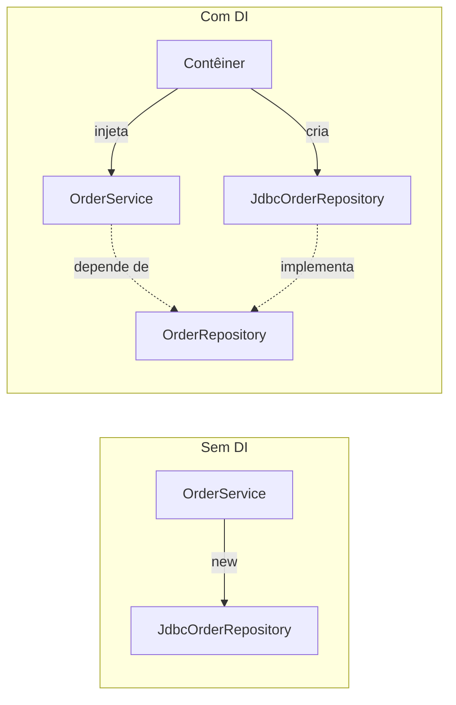
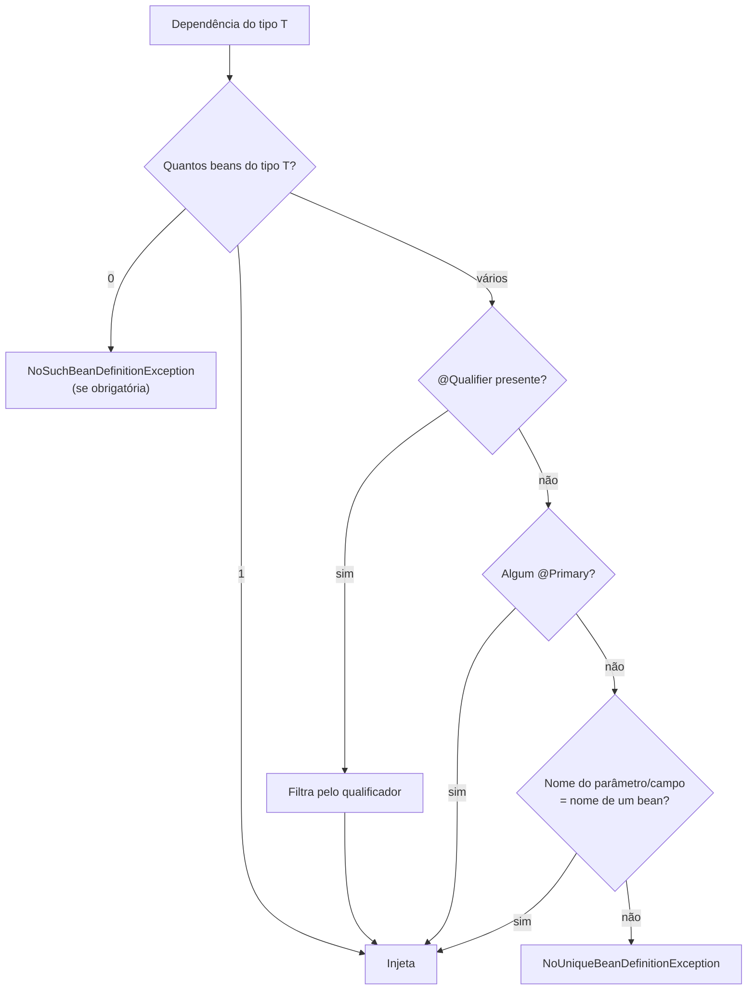
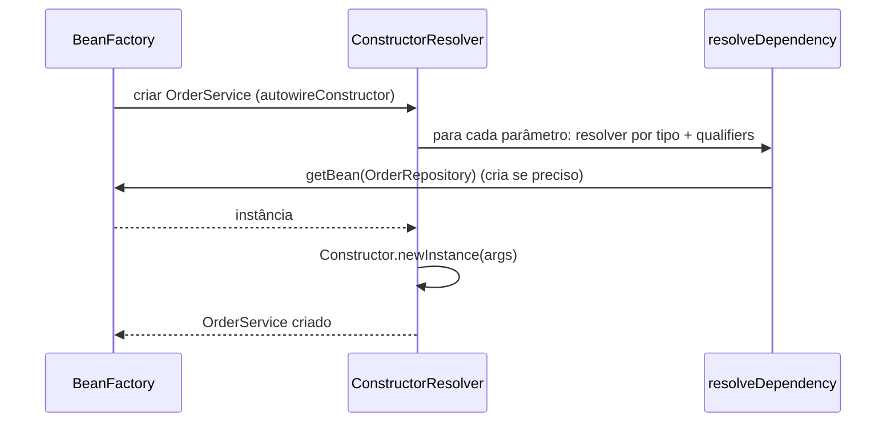

# IoC e Injeção de Dependência

> **Resumo:** Inversão de Controle (IoC) é o princípio; Injeção de Dependência (DI) é a técnica pela qual o Spring entrega a cada objeto os colaboradores de que ele precisa. Dominar os três estilos de injeção, a resolução por tipo/nome e os desempates (`@Qualifier`, `@Primary`) elimina a maioria dos erros de inicialização.
> **Pré-requisitos:** [01-o-que-e-spring.md](01-o-que-e-spring.md), [01-java/04-orientacao-a-objetos.md](../01-java/04-orientacao-a-objetos.md) (interfaces), [01-java/06-generics.md](../01-java/06-generics.md).
> **Versões:** Spring Framework 7.0.8, Java 25. Exemplos executados.

## 1. Definição

- **IoC (Inversion of Control)**: o fluxo de criação e ligação dos objetos deixa de ser responsabilidade do próprio código e passa a um agente externo (o contêiner).
- **DI (Dependency Injection)**: forma de IoC em que o objeto **declara** o que precisa (via construtor, setter ou campo) e o contêiner **fornece**.
- **Dependência**: qualquer objeto de que uma classe precisa para funcionar (`OrderService` depende de `OrderRepository`).

Problema que resolve: sem DI, a classe faz `new JdbcOrderRepository()` e fica presa a uma implementação concreta, difícil de testar e de trocar. Com DI, ela depende de uma **interface** e quem decide a implementação é a configuração.



## 2. Conceitos fundamentais

### 2.1 Os três estilos de injeção

```java
@Service
class OrderService {

    // 1) Construtor (recomendado): dependências obrigatórias e imutáveis
    private final OrderRepository repo;
    OrderService(OrderRepository repo) { this.repo = repo; }

    // 2) Setter: dependência opcional, reconfigurável
    private Notifier notifier;
    @Autowired(required = false)
    void setNotifier(Notifier notifier) { this.notifier = notifier; }

    // 3) Campo (evite): reflection grava direto no campo
    @Autowired private AuditLog audit;
}
```

| Estilo | Vantagens | Desvantagens |
|---|---|---|
| **Construtor** | campos `final`; objeto nunca existe pela metade; testável com `new`; dependência faltando falha cedo; muitos parâmetros denunciam classe com responsabilidade demais | construtor longo (que é, na verdade, um sinal útil) |
| **Setter** | bom para dependências opcionais ou trocáveis | objeto pode ser usado antes da injeção; campo não pode ser `final` |
| **Campo** | pouco código | esconde dependências; impossível usar `final`; teste unitário exige reflection ou o contêiner; facilita classes inchadas |

A equipe do Spring recomenda construtor para obrigatórias e setter para opcionais. Campo só aparece em código de teste e legado.

**`@Autowired` em construtor é opcional** quando a classe tem **um único construtor** (vale desde o Spring 4.3). Com vários, o Spring usa o anotado com `@Autowired`; sem nenhuma anotação, tenta o construtor padrão. Em um record, o construtor canônico também é injetável.

### 2.2 Como o Spring escolhe o bean: tipo primeiro

A resolução padrão do `@Autowired`/construtor é **por tipo**. Se existirem vários candidatos, o Spring tenta desempatar nesta ordem:



Observação: o fallback pelo **nome do parâmetro** depende de o nome estar disponível (compilar com `-parameters`; o Maven com `spring-boot-starter-parent` e Kotlin já faz isso). Não conte com ele: prefira `@Qualifier` explícito.

### 2.3 `@Qualifier` e `@Primary`

```java
interface PaymentGateway { String name(); }

@Component class PixGateway implements PaymentGateway { public String name() { return "pix"; } }

@Component @Primary                       // padrão quando ninguém especifica
class CardGateway implements PaymentGateway { public String name() { return "card"; } }

@Component("boleto")                      // nome explícito do bean
class BoletoGateway implements PaymentGateway { public String name() { return "boleto"; } }

@Service
class CheckoutService {
    CheckoutService(PaymentGateway padrao,                     // → CardGateway (@Primary)
                    @Qualifier("boleto") PaymentGateway alt) { // → BoletoGateway
        /* ... */
    }
}
```

- `@Primary` define o **padrão do sistema**; `@Qualifier` é a **escolha pontual** e vence o `@Primary`.
- O valor do `@Qualifier` casa com o **nome do bean** (ou com um qualificador customizado colocado na declaração do bean).
- O nome padrão de um bean escaneado é o nome simples da classe com a inicial minúscula (`CardGateway` → `cardGateway`).

### 2.4 Injetar coleções: o Strategy "do jeito Spring"

Pedir `List<T>` ou `Map<String, T>` injeta **todos** os beans do tipo `T`:

```java
@Service
class CheckoutService {
    private final Map<String, PaymentGateway> gateways;   // chave = nome do bean

    CheckoutService(Map<String, PaymentGateway> gateways) { this.gateways = gateways; }

    String pay(String method) { return gateways.get(method).name(); }
}
```

Para `List<T>`, a ordem segue `@Order`/`Ordered` (ou ordem de registro). Isso permite adicionar uma nova implementação **sem editar** o serviço, o princípio aberto/fechado (ver [06-padroes-de-projeto/01-introducao.md](../06-padroes-de-projeto/01-introducao.md)).

### 2.5 Dependências opcionais

```java
OrderService(Optional<AuditLog> audit,            // Optional vazio se não houver
             ObjectProvider<Notifier> notifier,   // resolução tardia e segura
             @Nullable Cache cache) { }           // null se não houver
```

| Forma | Quando |
|---|---|
| `Optional<T>` | ausência é normal; decisão no ponto de uso |
| `ObjectProvider<T>` | resolução **tardia** (a cada uso), `getIfAvailable()`, `getIfUnique()`, `stream()`, `orderedStream()`; também evita ciclos |
| `@Autowired(required = false)` | campo/setter opcional (no construtor prefira `Optional`/`@Nullable`) |
| `@Nullable` | com JSpecify no Spring 7 (`org.jspecify.annotations.Nullable`); a anotação JSR-305 está depreciada |

## 3. Como funciona por dentro

### 3.1 Quem injeta: `AutowiredAnnotationBeanPostProcessor`

`@Autowired`, `@Value` e `@Inject` não têm "mágica": são lidas pelo `AutowiredAnnotationBeanPostProcessor`, um `BeanPostProcessor` registrado automaticamente em contextos baseados em anotações. Para **campos e setters**, ele atua depois da instanciação (`postProcessProperties`), usando reflection (`Field.set`, `Method.invoke`, ver [01-java/10](../01-java/10-anotacoes-e-reflection.md)). Para **construtores**, ele indica quais construtores são candidatos (`determineCandidateConstructors`) e o contêiner chama `autowireConstructor`.



O ponto central é `DefaultListableBeanFactory.resolveDependency`: ele lê o tipo (inclusive **genérico**, ver [01-java/06-generics.md](../01-java/06-generics.md)), encontra candidatos, aplica `@Qualifier`/`@Primary`/nome e, se for coleção, agrega todos os candidatos.

### 3.2 Genéricos como qualificador

Por usar o tipo genérico completo, `Repository<Order, Long>` e `Repository<Customer, Long>` são tipos **distintos** para o Spring:

```java
OrderService(Repository<Order, Long> orders) { }   // só candidatos com esse genérico
```

Isso funciona porque o Spring lê a assinatura genérica preservada nos metadados da classe (atributo `Signature`), mesmo com *type erasure*.

### 3.3 Dependência circular

Se `A` precisa de `B` e `B` precisa de `A` **por construtor**, não há como criar nenhum primeiro: o contêiner lança `BeanCurrentlyInCreationException`.

```java
@Component class A { A(B b) {} }
@Component class B { B(A a) {} }
// BeanCurrentlyInCreationException: Requested bean is currently in creation:
// Is there an unresolvable circular reference or an asynchronous initialization dependency?
```

Com injeção por **campo/setter**, o Spring consegue resolver (expondo uma referência antecipada ao singleton ainda incompleto), mas isso é um sintoma de design ruim. Detalhes e a opção `setAllowCircularReferences(false)` em [04-ciclo-de-vida-e-escopos.md](04-ciclo-de-vida-e-escopos.md). Soluções reais: extrair uma terceira classe, inverter uma dependência por evento ([08](08-eventos-validacao-e-conversao.md)) ou, como remendo, `ObjectProvider`/`@Lazy`.

## 4. Evolução histórica

- **Spring 1.x/2.x**: DI declarada em XML (`<constructor-arg>`, `<property>`); `@Autowired` chegou no 2.5.
- **3.0**: suporte às anotações `@Inject`/`@Named` (JSR-330).
- **4.3**: construtor único dispensa `@Autowired`.
- **5.0**: `@Nullable` e injeção de `Optional`/`ObjectProvider` mais usadas.
- **6.0**: `jakarta.inject`; **7.0**: removido o suporte a `javax.inject`; JSpecify para nulabilidade.

A visão geral está em [01-o-que-e-spring.md](01-o-que-e-spring.md) §4.

## 5. Exemplos práticos

Código executado (Spring 7.0.8, Java 25). Domínio: pagamentos do pedido.

### 5.1 Resolução com `@Primary`, `@Qualifier`, `List` e `Map`

```java
@Component static class PixGateway implements PaymentGateway { /* name() = "pix" */ }
@Component @Primary static class CardGateway implements PaymentGateway { /* "card" */ }
@Component("boleto") static class BoletoGateway implements PaymentGateway { /* "boleto" */ }

@Service static class OrderService {
    final PaymentGateway primary, chosen;
    final List<PaymentGateway> all;
    final Map<String, PaymentGateway> byName;
    OrderService(PaymentGateway primary,
                 @Qualifier("boleto") PaymentGateway chosen,
                 List<PaymentGateway> all,
                 Map<String, PaymentGateway> byName) { /* atribuições */ }
}
```

Saída observada:

```
card boleto
[boleto, card, pix]
[boleto, di.CardGateway, di.PixGateway]
```

Note a última linha: como as classes são **aninhadas**, o nome padrão do bean sai como `di.CardGateway` (classe `Di.CardGateway`). Em classes de topo seria `cardGateway`. Para um `Map` estável, dê nomes explícitos (`@Component("card")`).

### 5.2 Dependências opcionais

```java
@Component static class Optionals {
    Optionals(Optional<Runnable> opt, ObjectProvider<Runnable> provider) { /* ... */ }
}
```

Sem nenhum bean `Runnable`: `opt.isPresent()` é `false`, `provider.getIfAvailable()` é `null` e o contexto sobe normalmente.

### 5.3 Ciclo por construtor (falha)

Registrar `A(B)` e `B(A)` produz `BeanCurrentlyInCreationException` (ver §3.3).

### 5.4 Testar sem Spring: a vantagem do construtor

```java
@Test
void placesOrder() {
    var repo = new InMemoryOrderRepository();
    var service = new OrderService(repo);        // sem contêiner, sem reflection
    service.place(order);
    assertThat(repo.findAll()).hasSize(1);
}
```

Com injeção por campo, esse teste precisaria de `ReflectionTestUtils.setField` ou do contexto inteiro.

## 6. Configurações e anotações relevantes

| Anotação/API | Para que serve | Exemplo |
|---|---|---|
| `@Autowired` | pede injeção (opcional em construtor único) | `@Autowired(required = false)` |
| `@Qualifier` | escolhe bean pelo nome/qualificador | `@Qualifier("boleto") PaymentGateway g` |
| `@Primary` | bean padrão entre candidatos | `@Primary @Component class CardGateway` |
| `@Fallback` | bean usado só se não houver outro (desde o 6.2) | `@Fallback @Bean Notifier noop()` |
| `@Order` / `Ordered` | ordena `List<T>` injetada | `@Order(1)` |
| `@Lazy` | injeta proxy tardio / adia criação | `Foo(@Lazy Bar bar)` |
| `@Inject`, `@Named` | JSR-330 (`jakarta.inject`) | equivalentes de `@Autowired`/`@Qualifier` |
| `@Resource` | por **nome** primeiro (`jakarta.annotation`) | `@Resource(name = "boleto")` |
| `ObjectProvider<T>` | resolução tardia e opcional | `provider.getIfAvailable()` |
| `@DependsOn` | força ordem de criação sem dependência direta | `@DependsOn("flywayInitializer")` |

## 7. Quando usar e quando NÃO usar

**Construtor**: sempre que a dependência é obrigatória (a regra). **Setter**: dependência opcional com valor padrão sensato. **`List`/`Map`**: plugins/estratégias. **`ObjectProvider`**: dependência pesada, usada raramente, ou para quebrar ciclo.

**Evite** injeção em campo (exceto em classes de teste), `@Autowired` em construtores com muitos parâmetros (refatore), e `@Primary` espalhado: se tudo tem `@Primary`, nada tem. Evite também usar o contêiner como *Service Locator* (`ctx.getBean(...)` dentro da lógica de negócio).

## 8. Erros comuns e boas práticas

- **`NoUniqueBeanDefinitionException`**: duas implementações da mesma interface sem desempate. Use `@Primary`/`@Qualifier` ou injete `Map`.
- **`NoSuchBeanDefinitionException`**: o bean não existe, geralmente porque a classe está **fora do pacote escaneado** ([05](05-configuracao.md)) ou falta a anotação.
- **Depender do nome do parâmetro** sem `-parameters`.
- **Injeção em campo `static`**: não funciona (o Spring ignora).
- **Dependência circular "resolvida" por setter** em vez de corrigir o design.
- **Injetar a implementação** (`JdbcOrderRepository`) em vez da interface: perde-se a troca e o proxy JDK (ver [07](07-aop-e-proxies.md)).
- **Boa prática**: `final` + construtor, dependências por interface, um único construtor (sem `@Autowired`), nomes de beans explícitos quando injetar `Map`.

## 9. Perguntas de revisão

1. **Qual a diferença entre IoC e DI?**
   <details><summary>Resposta</summary>IoC é o princípio de entregar o controle da criação/ligação ao contêiner. DI é a técnica concreta: o objeto declara dependências e o contêiner as injeta.</details>
2. **Por que a injeção por construtor é preferida?**
   <details><summary>Resposta</summary>Permite campos `final`, garante objeto totalmente inicializado, falha cedo, é testável com `new` e expõe classes com dependências demais.</details>
3. **O que acontece com dois beans do mesmo tipo e nenhum desempate?**
   <details><summary>Resposta</summary>O Spring tenta `@Qualifier`, depois `@Primary`, depois o nome do parâmetro. Se nada resolver, lança `NoUniqueBeanDefinitionException`.</details>
4. **Como injetar todas as implementações de uma interface?**
   <details><summary>Resposta</summary>Pedindo `List<T>` (ordenada por `@Order`) ou `Map<String, T>` (chave = nome do bean).</details>
5. **Por que ciclo por construtor falha e por campo "funciona"?**
   <details><summary>Resposta</summary>Por construtor, nenhum objeto pode ser criado sem o outro. Por campo/setter, o Spring instancia primeiro e injeta depois, expondo uma referência antecipada do singleton incompleto. Funciona, mas esconde um problema de design.</details>

## 10. Referências oficiais

- Dependency Injection: <https://docs.spring.io/spring-framework/reference/core/beans/dependencies/factory-collaborators.html>
- Autowiring e anotações: <https://docs.spring.io/spring-framework/reference/core/beans/annotation-config.html>
- Javadoc do Spring Framework: <https://docs.spring.io/spring-framework/docs/current/javadoc-api/>
