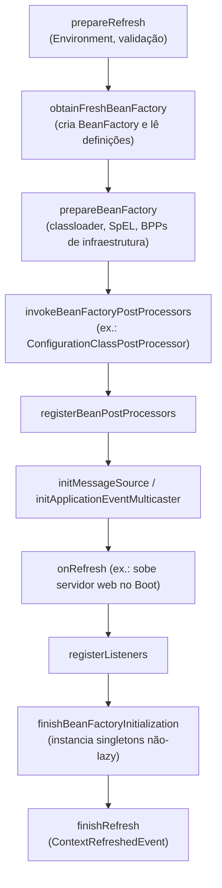

# ApplicationContext e Beans

> **Resumo:** o `ApplicationContext` é o contêiner que você usa de fato; por baixo, ele delega a um `BeanFactory` que guarda `BeanDefinition`s (as "receitas" dos beans). Entender a diferença entre **definição** e **instância**, os estereótipos, `@Bean` e os modos *full*/*lite* de `@Configuration` explica boa parte do comportamento do Spring.
> **Pré-requisitos:** [01-o-que-e-spring.md](01-o-que-e-spring.md), [02-ioc-e-injecao-de-dependencia.md](02-ioc-e-injecao-de-dependencia.md), [01-java/11-proxies-dinamicos-e-bytecode.md](../01-java/11-proxies-dinamicos-e-bytecode.md).
> **Versões:** Spring Framework 7.0.8, Java 25. Exemplos executados.

## 1. Definição

- **`BeanFactory`**: interface raiz do contêiner. Sabe registrar `BeanDefinition`s e entregar beans (`getBean`), com DI.
- **`ApplicationContext`**: sub-interface que **acrescenta** à `BeanFactory`: registro automático de `BeanPostProcessor`s, publicação de eventos, internacionalização (`MessageSource`), acesso a recursos, `Environment` (propriedades/profiles) e integração com AOP.
- **`BeanDefinition`**: metadado que descreve **como criar** um bean (classe, escopo, construtor/factory method, dependências, init/destroy, lazy). Não é o objeto.
- **Bean**: instância criada a partir de uma definição.

Problema que resolve: separar **o quê** (receita) de **quando e como** (instanciação), o que permite alterar receitas antes de criar objetos (base de `@Profile`, `@Value`, proxies e do AOT).

## 2. Conceitos fundamentais

### 2.1 `BeanFactory` vs `ApplicationContext`

| Aspecto | `BeanFactory` (ex.: `DefaultListableBeanFactory`) | `ApplicationContext` |
|---|---|---|
| Registro de definições | sim | sim |
| `BeanPostProcessor`/`BeanFactoryPostProcessor` | só se **você** registrar manualmente | detectados e aplicados automaticamente |
| Singletons | criados **sob demanda** (`getBean`) | pré-instanciados no `refresh()` (exceto `@Lazy`) |
| Eventos, `MessageSource`, `Environment` | não | sim |
| Uso típico | internals, código de infraestrutura | aplicações |

O experimento abaixo (executado) mostra a diferença de momento de criação:

```java
var bf = new DefaultListableBeanFactory();
bf.registerBeanDefinition("product", new RootBeanDefinition(Product.class));
System.out.println(bf.containsSingleton("product"));   // false: só a receita existe
bf.getBean("product");                                 // "Product criado"
System.out.println(bf.containsSingleton("product"));   // true

try (var ctx = new GenericApplicationContext()) {
    ctx.registerBeanDefinition("product", new RootBeanDefinition(Product.class));
    System.out.println("antes do refresh");            // nada criado ainda
    ctx.refresh();                                     // "Product criado" aqui
    System.out.println("depois do refresh");
}
```

Saída: `false`, `Product criado`, `true`, `antes do refresh`, `Product criado`, `depois do refresh`. A pré-instanciação no `refresh()` é intencional: **erros de configuração aparecem na subida**, não no primeiro uso.

### 2.2 Implementações de contexto

| Classe | Fonte da configuração |
|---|---|
| `AnnotationConfigApplicationContext` | classes `@Configuration`/estereótipos (a mais usada fora do Boot) |
| `ClassPathXmlApplicationContext` | XML no classpath (legado) |
| `GenericApplicationContext` | flexível, registro programático |
| `AnnotationConfigServletWebServerApplicationContext` | contexto web criado pelo Spring Boot |

Todos são `Closeable`: use `try-with-resources` ou `ctx.close()` para disparar os callbacks de destruição ([04](04-ciclo-de-vida-e-escopos.md)). Em aplicações com Boot, quem cria e fecha o contexto é o `SpringApplication`.

### 2.3 Três formas de declarar um bean

```java
// 1) Estereótipo + scanning: o código é seu
@Service class OrderService { /* ... */ }

// 2) @Bean em @Configuration: o código NÃO é seu (biblioteca) ou exige montagem
@Configuration
class InfraConfig {
    @Bean Clock clock() { return Clock.systemUTC(); }
}

// 3) Registro programático (BeanRegistrar no 7.0, ou GenericApplicationContext)
```

**Estereótipos** (todos são `@Component` por meta-anotação):

| Anotação | Camada | Comportamento extra |
|---|---|---|
| `@Component` | genérico | nenhum |
| `@Service` | regra de negócio | semântico (nenhum) |
| `@Repository` | acesso a dados | **tradução de exceções** de persistência para `DataAccessException` (via post-processor) |
| `@Controller` / `@RestController` | web | reconhecidos pelo Spring MVC |
| `@Configuration` | configuração | classe é proxiada (modo *full*, §2.5) |

Usar o estereótipo correto documenta a intenção e habilita processamentos específicos.

### 2.4 `@Bean`: nome, escopo e dependências por parâmetro

```java
@Configuration
class PaymentConfig {

    @Bean                       // nome do bean = nome do método: "cardGateway"
    PaymentGateway cardGateway(Clock clock) {   // dependências = parâmetros
        return new CardGateway(clock);
    }

    @Bean(name = {"pix", "pixGateway"}, initMethod = "connect", destroyMethod = "close")
    PaymentGateway pixGateway() { return new PixGateway(); }
}
```

- Os **parâmetros** do método são resolvidos como qualquer injeção ([02](02-ioc-e-injecao-de-dependencia.md)).
- `destroyMethod` é **inferido** (`close`/`shutdown`) por padrão em `@Bean`; use `destroyMethod = ""` para desligar.
- Um método `@Bean` estático é necessário para post-processors (ver [04](04-ciclo-de-vida-e-escopos.md) §2.3).

### 2.5 `@Configuration`: modo *full* vs *lite*

Pergunta clássica: se um método `@Bean` chama outro método `@Bean`, recebe-se a mesma instância?

```java
@Configuration                                  // modo FULL (padrão: proxyBeanMethods = true)
static class Full {
    @Bean Dep dep() { return new Dep(); }
    @Bean Holder holder() { return new Holder(dep()); }   // dep() interceptado
}

@Configuration(proxyBeanMethods = false)       // modo LITE
static class Lite {
    @Bean Dep dep() { return new Dep(); }
    @Bean Holder holder() { return new Holder(dep()); }   // chamada Java comum!
    @Bean Holder holder2(Dep dep) { return new Holder(dep); } // correto
}
```

Resultado executado:

```
full: true  Conf$Full$$SpringCGLIB$$0
lite holder.dep == dep: false | holder2: true  Lite
```

| Modo | Classe em runtime | `dep()` chamado de outro `@Bean` | Custo |
|---|---|---|---|
| **full** (`proxyBeanMethods = true`) | **subclasse CGLIB** | interceptado: devolve o singleton | proxy; classe e métodos não podem ser `final` |
| **lite** (`proxyBeanMethods = false`, ou `@Component` com `@Bean`, ou `@Import` simples) | a própria classe | **nova instância** a cada chamada | nenhum, melhor para AOT/native |

Regra prática: em `@Configuration(proxyBeanMethods = false)`, **nunca** chame um `@Bean` como método; receba-o por **parâmetro**. O Spring Boot usa `proxyBeanMethods = false` em todas as suas auto-configurações por desempenho.

## 3. Como funciona por dentro

### 3.1 O que o `refresh()` faz (visão resumida)

`AbstractApplicationContext.refresh()` é o coração do contêiner. Sequência simplificada:



A etapa D merece atenção: o `ConfigurationClassPostProcessor` (um `BeanDefinitionRegistryPostProcessor`) é quem **processa** `@Configuration`, `@ComponentScan`, `@Import`, `@Bean` e `@PropertySource`, transformando-os em `BeanDefinition`s. Antes dele rodar, só existe a classe de configuração. O passo a passo completo, com reflection, está em [06-como-java-e-spring-conversam.md](06-como-java-e-spring-conversam.md).

### 3.2 Anatomia da `BeanDefinition`

Experimento executado: contexto com `@ComponentScan` filtrando dois estereótipos mostra que cada classe virou uma definição **antes** de existir como objeto.

```java
for (String n : ctx.getBeanDefinitionNames()) {
    var bd = ctx.getBeanDefinition(n);
    System.out.println(n + " -> " + bd.getBeanClassName());
}
// ctx.OrderRepo -> com.example.orders.Ctx$OrderRepo
// ctx.OrderSvc  -> com.example.orders.Ctx$OrderSvc
// 8 definicoes (com infraestrutura)
```

As "8 definições" incluem **beans de infraestrutura** registrados pelo próprio contexto (`ConfigurationClassPostProcessor`, `AutowiredAnnotationBeanPostProcessor`, `EventListenerMethodProcessor`, entre outros). Por isso `AnnotationConfigApplicationContext` "entende" anotações: ele registra esses processadores de saída.

Principais atributos de uma `BeanDefinition`:

| Atributo | Significado |
|---|---|
| `beanClassName` | classe concreta (ou `factoryBeanName` + `factoryMethodName` para `@Bean`) |
| `scope` | `singleton`, `prototype`, ... ([04](04-ciclo-de-vida-e-escopos.md)) |
| `lazyInit` | se `true`, não é criado no `refresh()` |
| `dependsOn` | ordem forçada de criação |
| `primary`, `autowireCandidate` | participação no desempate de injeção |
| `initMethodName`, `destroyMethodName` | callbacks de ciclo de vida |

Um `BeanFactoryPostProcessor` pode editar qualquer um desses antes da primeira instância existir. É assim que `${...}` em propriedades é resolvido e que `@Profile` exclui definições.

### 3.3 Por que `@Bean` em classe `@Configuration` full usa CGLIB

A classe é **subclasseada em runtime** (nome `...$$SpringCGLIB$$0`, visto acima). Cada método `@Bean` é interceptado: se o bean já existe no contêiner, devolve-o; senão, executa o método. É o mesmo mecanismo de subclasse de [01-java/11](../01-java/11-proxies-dinamicos-e-bytecode.md), e explica as restrições (classe e métodos `@Bean` não-`final`, construtor acessível).

## 4. Evolução histórica

- **1.x**: só `BeanFactory`/XML; o `ApplicationContext` (XML) foi a escolha padrão desde cedo.
- **2.5**: estereótipos e scanning. **3.0**: `@Configuration`/`@Bean` (Java Config), `AnnotationConfigApplicationContext`.
- **5.2**: `proxyBeanMethods = false` (modo *lite* explícito), peça-chave para startup rápido do Boot.
- **6.0**: `BeanDefinition`s passam a ser processadas também em **build time** (AOT, [10](10-aot-e-native.md)).
- **7.0**: `BeanRegistrar` (registro programático de vários beans, incluindo condicionais) como alternativa moderna a `ImportBeanDefinitionRegistrar`.

## 5. Exemplos práticos

### 5.1 Meu primeiro contexto

```java
@Configuration
@ComponentScan(basePackages = "com.example.orders")
class AppConfig {}

public class Main {
    public static void main(String[] args) {
        try (var ctx = new AnnotationConfigApplicationContext(AppConfig.class)) {
            OrderService svc = ctx.getBean(OrderService.class);
            System.out.println(ctx.getBeanDefinitionCount());
        }
    }
}
```

### 5.2 Registro programático (útil em testes e frameworks)

```java
try (var ctx = new GenericApplicationContext()) {
    ctx.registerBean("clock", Clock.class, Clock::systemUTC);              // com Supplier
    ctx.registerBean(OrderService.class, bd -> bd.setLazyInit(true));      // customiza a definição
    ctx.refresh();
}
```

### 5.3 Combinar `@Configuration` lite e dependência por parâmetro

```java
@Configuration(proxyBeanMethods = false)
class OrderConfig {
    @Bean OrderRepository orderRepository(DataSource ds) { return new JdbcOrderRepository(ds); }
    @Bean OrderService orderService(OrderRepository repo, Clock clock) {
        return new OrderService(repo, clock);          // repo vem por parâmetro
    }
}
```

### 5.4 Obter beans (e quando NÃO fazer)

`ctx.getBean(...)` serve em `main`, testes e infraestrutura. Dentro de beans de negócio prefira injeção; chamar `getBean` é o padrão *Service Locator* e esconde dependências.

## 6. Configurações e anotações relevantes

| Anotação/API | Para que serve | Exemplo |
|---|---|---|
| `@Configuration` | classe de definição de beans | `@Configuration(proxyBeanMethods = false)` |
| `@Bean` | método produtor de bean | `@Bean(initMethod = "start")` |
| `@Component`/`@Service`/`@Repository` | estereótipos | `@Repository class JdbcOrderRepository` |
| `@Lazy` | adia a criação até o primeiro uso | `@Lazy @Service class Report` |
| `@Scope` | muda o escopo | `@Scope("prototype")` |
| `@Description` | descrição do bean | `@Description("Gateway de cartão")` |
| `@DependsOn` | ordem de criação | `@DependsOn("migrations")` |
| `BeanDefinition` / `RootBeanDefinition` | modelo programático da receita | `new RootBeanDefinition(Product.class)` |
| `GenericApplicationContext#registerBean` | registro por código | `ctx.registerBean(Foo.class)` |
| `BeanRegistrar` (7.0) | registrar beans por código em `@Configuration` | `@Import(MyRegistrar.class)` |

## 7. Quando usar e quando NÃO usar

- **Estereótipo + scanning**: para classes suas. **`@Bean`**: para classes de terceiros, objetos que exigem montagem, ou beans condicionais.
- **`@Configuration` full**: só se algum `@Bean` chamar outro como método (padrão legado). **Lite**: prefira, passando dependências por parâmetro.
- **`BeanFactory` puro**: quase nunca em aplicação. Use `ApplicationContext`.
- **`@Lazy`**: ocasional (beans caros e raros). Em excesso, adia erros de configuração para produção.

## 8. Erros comuns e boas práticas

- **Chamar `@Bean` como método em classe lite** e receber instância duplicada (§2.5).
- **`@Configuration final`** ou com `@Bean final`: CGLIB não consegue subclassear (`BeanDefinitionParsingException`).
- **Esquecer `close()` no contexto**: `@PreDestroy` e `destroy()` não rodam.
- **Pensar que `@Service` e `@Component` diferem em comportamento**: diferem na semântica; `@Repository` é o que acrescenta tradução de exceções.
- **Scan fora do pacote**: classes em pacotes irmãos/superiores não são vistas ([05](05-configuracao.md)).
- **Assumir singleton "global"**: singleton é **um por contexto**, não um por JVM.
- **Boa prática**: `proxyBeanMethods = false`, dependências por parâmetro, contexto sempre fechado, estereótipo mais específico.

## 9. Perguntas de revisão

1. **O que o `ApplicationContext` oferece além do `BeanFactory`?**
   <details><summary>Resposta</summary>Detecção automática de post-processors, eventos, `MessageSource`, acesso a recursos, `Environment` e integração com AOP, além de pré-instanciar singletons no `refresh()`.</details>
2. **O que é uma `BeanDefinition`?**
   <details><summary>Resposta</summary>Metadado que descreve como criar um bean (classe, escopo, factory method, lazy, init/destroy). Existe antes de qualquer instância e pode ser alterada por `BeanFactoryPostProcessor`s.</details>
3. **Qual a diferença entre `@Configuration` full e lite?**
   <details><summary>Resposta</summary>No modo full, a classe é subclasseada por CGLIB e chamadas entre métodos `@Bean` devolvem o singleton. No lite (`proxyBeanMethods = false`), é chamada Java comum e cria nova instância; as dependências devem vir por parâmetro.</details>
4. **O que `@Repository` faz além de `@Component`?**
   <details><summary>Resposta</summary>Habilita a tradução de exceções de persistência para a hierarquia `DataAccessException` por meio de um post-processor.</details>
5. **Por que singletons são criados no `refresh()` e não no primeiro `getBean`?**
   <details><summary>Resposta</summary>Para detectar erros de configuração (beans ausentes, ciclos, ambiguidade) logo na inicialização, em vez de falhar em produção no primeiro uso.</details>

## 10. Referências oficiais

- Container Overview: <https://docs.spring.io/spring-framework/reference/core/beans/basics.html>
- `BeanFactory` API: <https://docs.spring.io/spring-framework/reference/core/beans/beanfactory.html>
- Java-based configuration: <https://docs.spring.io/spring-framework/reference/core/beans/java.html>
- Javadoc: <https://docs.spring.io/spring-framework/docs/current/javadoc-api/>
