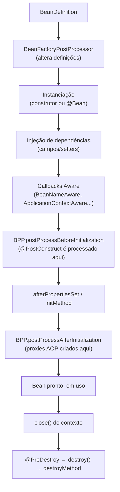

# Ciclo de Vida e Escopos dos Beans

> **Resumo:** um bean passa por etapas previsíveis (instanciar, injetar, inicializar, usar, destruir) e o Spring oferece ganchos em cada uma. Os `BeanPostProcessor`s, que criam proxies e processam `@PostConstruct`, são o mecanismo de extensão mais importante do contêiner. Os escopos definem quantas instâncias existem e por quanto tempo.
> **Pré-requisitos:** [02-ioc-e-injecao-de-dependencia.md](02-ioc-e-injecao-de-dependencia.md), [03-application-context-e-beans.md](03-application-context-e-beans.md).
> **Versões:** Spring Framework 7.0.8, Java 25. Exemplos executados. `@PostConstruct`/`@PreDestroy` vêm de `jakarta.annotation-api` (3.0.0 nos testes).

## 1. Definição

- **Ciclo de vida**: sequência de fases de um bean, do momento em que a `BeanDefinition` é usada até a destruição no `close()` do contexto.
- **`BeanPostProcessor` (BPP)**: extensão que intercepta **cada bean** antes e depois da inicialização e pode **substituí-lo** (por um proxy, por exemplo).
- **`BeanFactoryPostProcessor` (BFPP)**: extensão que altera **definições** antes de qualquer bean ser instanciado.
- **Escopo**: política que define quantas instâncias de uma definição existem e seu tempo de vida (`singleton`, `prototype`, `request`, ...).

Problema que resolve: dar a classes comuns um "momento seguro" para inicializar recursos (depois que todas as dependências foram injetadas), liberar recursos ao encerrar, e permitir que infraestrutura (transações, cache, validação) se plugue sem alterar o código do bean.

## 2. Conceitos fundamentais

### 2.1 Ordem completa das etapas

Saída real (executada) de um bean que usa **todos** os ganchos:

```
0 BFPP: 11 definicoes, ainda sem instancias
1 construtor
2 BeanNameAware: stock
3 BPP before
4 @PostConstruct
5 afterPropertiesSet
6 initMethod
7 BPP after
   (bean em uso)
8 @PreDestroy
9 destroy()
10 destroyMethod
```



Detalhe importante: `@PostConstruct` e `@PreDestroy` não são lidos pelo "núcleo": quem os processa é o `CommonAnnotationBeanPostProcessor`, um BPP (por isso aparecem entre as chamadas "BPP before" e `afterPropertiesSet`).

### 2.2 Formas de declarar inicialização e destruição

| Mecanismo | Quando usar |
|---|---|
| `@PostConstruct` / `@PreDestroy` (`jakarta.annotation`) | **padrão recomendado**: sem acoplamento ao Spring |
| `InitializingBean` / `DisposableBean` | código de infraestrutura que precisa do Spring |
| `@Bean(initMethod=..., destroyMethod=...)` | classe de terceiros que você não pode anotar |
| `SmartLifecycle` | iniciar/parar componentes **em fases ordenadas** (consumidores de mensagens, servidor web) |

Se houver vários, a ordem é a da lista acima (anotação, depois interface, depois método customizado). Na prática, use **um só**.

Cuidado com `@PostConstruct`: ele roda **antes** do bean ser envolvido por proxies (§2.3). Chamar um método `@Transactional` ali **não** terá transação. Para "fazer algo quando a aplicação estiver pronta", use eventos (`ContextRefreshedEvent`, `ApplicationReadyEvent` no Boot; ver [08](08-eventos-validacao-e-conversao.md)).

### 2.3 `BeanFactoryPostProcessor` vs `BeanPostProcessor`

| | `BeanFactoryPostProcessor` | `BeanPostProcessor` |
|---|---|---|
| Quando roda | uma vez, **antes** de instanciar beans | para **cada** bean, durante a criação |
| Opera sobre | `BeanDefinition`s | instâncias |
| Exemplos reais | `ConfigurationClassPostProcessor` (`@Configuration`, scanning), `PropertySourcesPlaceholderConfigurer` (`${...}`) | `AutowiredAnnotationBeanPostProcessor`, `CommonAnnotationBeanPostProcessor`, criador de proxies AOP (`@Transactional`, `@Async`) |
| Pode substituir o objeto? | não (altera receita) | **sim** (devolve outro objeto, ex.: proxy) |

```java
static class Tracer implements BeanPostProcessor {
    public Object postProcessBeforeInitialization(Object bean, String name) { return bean; }
    public Object postProcessAfterInitialization(Object bean, String name) {
        // retornar um proxy aqui é exatamente como o Spring implementa @Transactional
        return bean;
    }
}

static class Bfpp implements BeanFactoryPostProcessor {
    public void postProcessBeanFactory(ConfigurableListableBeanFactory bf) {
        bf.getBeanDefinition("stock").setLazyInit(false);   // muda a receita
    }
}

@Configuration
static class Cfg {
    @Bean static Bfpp bfpp() { return new Bfpp(); }       // STATIC
    @Bean static Tracer tracer() { return new Tracer(); } // STATIC
}
```

**Por que `static`?** Post-processors precisam existir **cedo**. Um método `@Bean` não estático obriga o contêiner a criar primeiro a própria classe `@Configuration`, cedo demais para ser injetada e processada, e o Spring registra um aviso ("is not eligible for getting processed by all BeanPostProcessors"). Com `static`, o método é chamado sem instanciar a configuração.

### 2.4 Escopos

| Escopo | Instâncias | Disponível em | Destruição gerenciada? |
|---|---|---|---|
| **`singleton`** (padrão) | uma por contexto | sempre | sim |
| **`prototype`** | uma **nova** a cada injeção/`getBean` | sempre | **não** (o contêiner abandona o objeto após entregar) |
| `request` | uma por requisição HTTP | contexto web | sim |
| `session` | uma por sessão HTTP | contexto web | sim |
| `application` | uma por `ServletContext` | contexto web | sim |
| `websocket` | uma por sessão WebSocket | contexto WebSocket | sim |
| customizado (`SimpleThreadScope`, etc.) | você define (`Scope`) | registrado manualmente | depende |

Teste executado:

```java
@Bean Counter single() { return new Counter(); }                              // singleton
@Bean @Scope("prototype") Counter proto() { return new Counter(); }          // prototype
// getBean("single") == getBean("single")  → true
// getBean("proto")  == getBean("proto")   → false
```

**Singleton do Spring ≠ padrão Singleton do GoF**: é um por *contexto* (por nome de bean), não por classe/JVM. Dois contextos criam duas instâncias. Ver [06-padroes-de-projeto/02-criacionais.md](../06-padroes-de-projeto/02-criacionais.md).

**Consequência de design:** singletons são compartilhados por todas as threads ([01-java/12-concorrencia.md](../01-java/12-concorrencia.md)). Beans singleton devem ser **sem estado mutável** (ou thread-safe). Estado por usuário não vai em campo de singleton.

### 2.5 O problema de escopo mais curto dentro de mais longo

Um singleton injeta um `prototype` **uma única vez** (na criação do singleton). Se você precisa de uma instância nova a cada uso, injete um `ObjectProvider<T>` (ou `Supplier` via `@Bean`), ou use um proxy de escopo:

```java
@Component @Scope(value = "request", proxyMode = ScopedProxyMode.TARGET_CLASS)
class RequestContext { /* dados da requisição atual */ }
// o singleton recebe um proxy; cada chamada é delegada ao bean do request corrente
```

```java
@Service
class ReportService {
    private final ObjectProvider<ReportBuilder> builders;   // ReportBuilder é prototype
    ReportService(ObjectProvider<ReportBuilder> builders) { this.builders = builders; }

    Report build() { return builders.getObject().build(); }   // instância nova a cada chamada
}
```

## 3. Como funciona por dentro

### 3.1 `doCreateBean`: o método que implementa o ciclo

O fluxo está em `AbstractAutowireCapableBeanFactory`:

1. `createBeanInstance`: escolhe construtor/factory method e chama `newInstance` (reflection).
2. `populateBean`: aplica injeção de campos/setters (via `InstantiationAwareBeanPostProcessor`s como o do `@Autowired`).
3. `initializeBean`: callbacks `Aware` → `applyBeanPostProcessorsBeforeInitialization` → `invokeInitMethods` (`afterPropertiesSet` e `initMethod`) → `applyBeanPostProcessorsAfterInitialization`.
4. `registerDisposableBeanIfNecessary`: registra os callbacks de destruição **apenas para singletons** (e beans de escopos com ciclo de vida gerenciado).

Por isso o **prototype não sofre destruição**: nada foi registrado para ele.

### 3.2 Onde nascem os proxies

Os proxies de AOP/`@Transactional` são criados em `postProcessAfterInitialization` por um BPP (`AnnotationAwareAspectJAutoProxyCreator`/`InfrastructureAdvisorAutoProxyCreator`). Ele devolve um objeto **diferente** do original, e é esse que vai para o contêiner e para quem depende do bean. Isso explica por que o `this` dentro do bean **não** é o proxy (*self-invocation*, [07](07-aop-e-proxies.md)) e por que `@PostConstruct`, que roda antes, não tem aspectos aplicados.

### 3.3 Dependências circulares: o cache de 3 níveis

O `DefaultSingletonBeanRegistry` mantém três mapas: `singletonObjects` (prontos), `earlySingletonObjects` (referências antecipadas) e `singletonFactories` (fábricas de referência antecipada). Com injeção por campo/setter, o bean A, ainda incompleto, registra uma fábrica; quando B pede A, recebe essa referência antecipada.

Teste executado com `X { @Autowired Y y; }` e `Y { @Autowired X x; }`:

- Padrão (`AnnotationConfigApplicationContext`): **funciona** (`y.x == x`).
- Com `ctx.setAllowCircularReferences(false)`: lança `BeanCurrentlyInCreationException`.
- Por construtor: sempre falha (não há objeto parcial para expor).

O Spring Boot desabilita referências circulares por padrão desde a 2.6 (`spring.main.allow-circular-references`, padrão `false`; propriedade confirmada nos metadados do `spring-boot-4.1.2.jar`. Veja [03-spring-boot/03](../03-spring-boot/03-configuracao-externalizada.md)). Se a referência antecipada for envolvida por proxy, o Spring pode lançar `BeanCurrentlyInCreationException` por "versão bruta injetada": sinal de que o ciclo precisa ser desfeito.

## 4. Evolução histórica

- **1.x**: `InitializingBean`/`DisposableBean` e `init-method` no XML.
- **2.5**: suporte às anotações JSR-250 `@PostConstruct`/`@PreDestroy`.
- **3.0**: escopos customizados e `request`/`session` para web como anotações.
- **4.x/5.x**: `SmartLifecycle` para fases ordenadas de start/stop.
- **6.0**: `jakarta.annotation`; **7.0**: removido `javax.annotation`.
- **6.1**: `Lifecycle` com suporte a *checkpoint/restore* (CRaC) e a parada graciosa em fases.
- Referências circulares: permitidas por padrão no Framework; proibidas por padrão no Boot (2.6+).

Contexto geral: [01-o-que-e-spring.md](01-o-que-e-spring.md) §4.

## 5. Exemplos práticos

### 5.1 Bean com recurso (conexão) e ciclo de vida

```java
@Component
class MessageConsumer {
    private final BrokerClient client;
    private Connection connection;

    MessageConsumer(BrokerClient client) { this.client = client; }

    @PostConstruct
    void connect() { this.connection = client.open(); }   // dependências já injetadas

    @PreDestroy
    void disconnect() { connection.close(); }              // no close() do contexto
}
```

### 5.2 Bean `Aware`: obter dados do contêiner

```java
@Component
class DiagnosticsBean implements BeanNameAware, ApplicationContextAware {
    private String name;
    private ApplicationContext ctx;
    public void setBeanName(String name) { this.name = name; }
    public void setApplicationContext(ApplicationContext ctx) { this.ctx = ctx; }
}
```

Use `Aware` só em infraestrutura. Em código de negócio, injete o que precisa.

### 5.3 Um BPP que mede tempo (proxy de verdade)

<!-- não compilado -->
```java
@Component
class TimingBpp implements BeanPostProcessor {
    @Override
    public Object postProcessAfterInitialization(Object bean, String name) {
        if (!(bean instanceof PaymentGateway g)) return bean;
        return (PaymentGateway) java.lang.reflect.Proxy.newProxyInstance(
            bean.getClass().getClassLoader(), new Class<?>[]{PaymentGateway.class},
            (proxy, method, args) -> {
                long t0 = System.nanoTime();
                try { return method.invoke(g, args); }
                finally { System.out.println(name + "." + method.getName() + " " + (System.nanoTime() - t0) + "ns"); }
            });
    }
}
```

É uma versão minúscula do que o Spring AOP faz. Atenção: um BPP é criado **antes** dos demais beans, e beans que ele próprio injeta ficam sem processamento. Evite dependências em BPPs.

### 5.4 Escopo `prototype` com `ObjectProvider`

Veja §2.5: injetar `ObjectProvider<ReportBuilder>` garante uma instância nova a cada `getObject()`.

## 6. Configurações e anotações relevantes

| Anotação/API | Para que serve | Exemplo |
|---|---|---|
| `@PostConstruct` / `@PreDestroy` | init/destroy sem acoplamento | `@PostConstruct void init()` |
| `InitializingBean` / `DisposableBean` | init/destroy por interface | `afterPropertiesSet()`, `destroy()` |
| `@Bean(initMethod, destroyMethod)` | idem, para classes de terceiros | `destroyMethod = ""` desliga a inferência |
| `SmartLifecycle` | start/stop com fases | `getPhase()`, `isAutoStartup()` |
| `BeanPostProcessor` | intercepta instâncias | ver §2.3 |
| `BeanFactoryPostProcessor` | altera definições | `@Bean static` |
| `@Scope` | escolhe o escopo | `@Scope("prototype")`, `@RequestScope`, `@SessionScope` |
| `ScopedProxyMode` | proxy para escopo mais curto | `proxyMode = TARGET_CLASS` |
| `@Lazy` | adia criação | `@Lazy @Component class X` |
| `setAllowCircularReferences(false)` | proíbe ciclos por campo/setter | no `ConfigurableApplicationContext` antes do `refresh()` |

## 7. Quando usar e quando NÃO usar

- **`@PostConstruct`**: validar configuração, abrir recursos leves. **Não** para trabalho longo/bloqueante (atrasa a subida), nem para chamar métodos com aspectos (`@Transactional`, `@Async`, `@Cacheable`).
- **`prototype`**: objetos com estado por uso, criados sob demanda. **Não** assuma que o Spring os destrói: libere você mesmo.
- **`request`/`session`**: dados ligados ao ciclo HTTP; prefira passar parâmetros explicitamente quando possível.
- **`BeanPostProcessor` próprio**: código de infraestrutura/framework. Em aplicações, quase sempre há alternativa mais simples (eventos, AOP, `@Configuration`).

## 8. Erros comuns e boas práticas

- **Estado mutável em singleton** compartilhado por threads (bug de concorrência clássico).
- **`prototype` injetado em singleton** esperando uma instância por uso (§2.5).
- **`@PostConstruct` chamando método transacional** (sem proxy ainda).
- **BPP/BFPP como `@Bean` não estático**: aviso de "not eligible for getting processed" e injeção quebrada.
- **Esquecer que prototype não tem destroy**: vazamento de conexões/arquivos.
- **Ciclo "resolvido" por campo**: dívida técnica; no Boot nem sobe por padrão.
- **Boa prática**: `@PostConstruct` curto e idempotente; recursos abertos em `@PostConstruct`/`SmartLifecycle` e fechados em `@PreDestroy`; singletons imutáveis ou thread-safe.

## 9. Perguntas de revisão

1. **Em que ordem rodam construtor, `@PostConstruct`, `afterPropertiesSet` e `initMethod`?**
   <details><summary>Resposta</summary>Construtor, injeção de dependências, callbacks `Aware`, BPP before, `@PostConstruct`, `afterPropertiesSet`, `initMethod`, BPP after.</details>
2. **Qual a diferença entre `BeanFactoryPostProcessor` e `BeanPostProcessor`?**
   <details><summary>Resposta</summary>O primeiro altera `BeanDefinition`s uma vez, antes de qualquer instância. O segundo intercepta cada instância durante a criação e pode substituí-la (proxies).</details>
3. **Por que o Spring não chama `@PreDestroy` em beans `prototype`?**
   <details><summary>Resposta</summary>O contêiner só registra callbacks de destruição para singletons (e escopos gerenciados). Após entregar um prototype, ele deixa de referenciá-lo; a limpeza é responsabilidade do cliente.</details>
4. **Por que um singleton com `prototype` injetado "sempre usa o mesmo" objeto?**
   <details><summary>Resposta</summary>A injeção ocorre uma única vez, na criação do singleton. Para obter instâncias novas, injete `ObjectProvider<T>` ou use proxy de escopo.</details>
5. **Por que chamar um método `@Transactional` dentro de `@PostConstruct` não abre transação?**
   <details><summary>Resposta</summary>O proxy transacional é criado em `postProcessAfterInitialization`, depois de `@PostConstruct`; além disso, a chamada interna usa `this`, não o proxy.</details>

## 10. Referências oficiais

- Bean scopes: <https://docs.spring.io/spring-framework/reference/core/beans/factory-scopes.html>
- Customizing the nature of a bean (lifecycle): <https://docs.spring.io/spring-framework/reference/core/beans/factory-nature.html>
- Container extension points (BPP/BFPP): <https://docs.spring.io/spring-framework/reference/core/beans/factory-extension.html>
- Javadoc: <https://docs.spring.io/spring-framework/docs/current/javadoc-api/>
