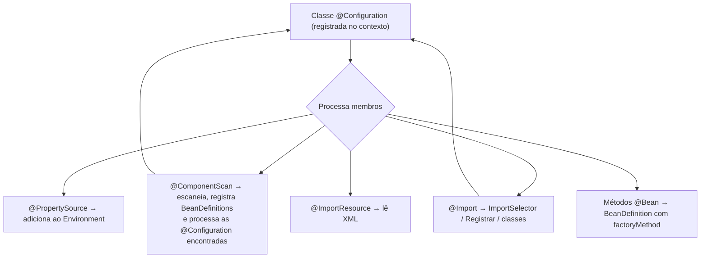

# Configuração no Spring Core

> **Resumo:** como dizer ao contêiner quais beans existem e com quais valores: da configuração em XML às classes Java e anotações, passando por scanning, `@Import`, profiles, `Environment`, `@Value`, `@PropertySource` e SpEL. É a base conceitual da configuração externalizada do Spring Boot.
> **Pré-requisitos:** [03-application-context-e-beans.md](03-application-context-e-beans.md), [04-ciclo-de-vida-e-escopos.md](04-ciclo-de-vida-e-escopos.md).
> **Versões:** Spring Framework 7.0.8, Java 25. Exemplos executados.

## 1. Definição

- **Configuração (metadados)**: informação que o contêiner usa para criar beans: quais classes, com quais dependências e valores.
- **`Environment`**: abstração que reúne **propriedades** (`PropertySource`s) e **profiles** ativos.
- **Profile**: rótulo (`dev`, `prod`, `test`) que liga/desliga conjuntos de beans.
- **SpEL** (*Spring Expression Language*): linguagem de expressões avaliada pelo contêiner, escrita em `#{...}`.

Problema que resolve: o mesmo artefato precisa rodar em ambientes diferentes (banco, URLs, moeda, limites) **sem recompilar**, e a montagem dos beans precisa ser declarada de forma verificável.

## 2. Conceitos fundamentais

### 2.1 Três gerações de configuração

| Estilo | Exemplo | Hoje |
|---|---|---|
| **XML** | `<bean id="clock" class="java.time.Clock" factory-method="systemUTC"/>` | legado; `<bean>` ainda suportado no 7.0, namespaces `<mvc:*>` e `<lang:*>` depreciados |
| **Java Config** | `@Configuration` + `@Bean` | padrão para terceiros e montagens |
| **Anotações + scanning** | `@Component`, `@Service`, `@ComponentScan` | padrão para código próprio |

Os três coexistem e geram o mesmo resultado: `BeanDefinition`s ([03](03-application-context-e-beans.md)). XML (validado):

```xml
<beans xmlns="http://www.springframework.org/schema/beans" ...>
    <bean id="clock" class="java.time.Clock" factory-method="systemUTC"/>
</beans>
```

```java
try (var c = new ClassPathXmlApplicationContext("beans.xml")) {
    System.out.println(c.getBean("clock").getClass().getSimpleName());   // SystemClock
}
```

### 2.2 `@ComponentScan`: como funciona e onde falha

`@ComponentScan("com.example.orders")` varre o pacote e subpacotes atrás de classes com `@Component` (e meta-anotações: `@Service`, `@Repository`, `@Controller`, `@Configuration`).

```java
@Configuration
@ComponentScan(basePackages = "com.example.orders",
    excludeFilters = @ComponentScan.Filter(type = FilterType.REGEX, pattern = ".*Legacy.*"))
class AppConfig {}
```

Pontos-chave:

- Sem atributos, varre o **pacote da classe anotada** e abaixo. Classe em pacote irmão ou superior **não é vista** (causa nº 1 de `NoSuchBeanDefinitionException`).
- `useDefaultFilters = false` + `includeFilters` restringe a varredura a tipos específicos (usado nos exemplos desta base para isolar cenários).
- O scanning **não carrega a classe**: lê o bytecode (`ClassReader`/metadados) e só carrega as que combinam, o que o torna barato. Ver [06](06-como-java-e-spring-conversam.md).
- Em **AOT/native**, a varredura acontece em **build time** ([10](10-aot-e-native.md)).

### 2.3 `@Import` e composição de configurações

```java
@Configuration
@Import({SecurityConfig.class, MessagingConfig.class})   // inclui classes @Configuration
class AppConfig {}
```

`@Import` aceita: classes `@Configuration`/componentes, `ImportSelector` (decide classes por código; base das auto-configurações do Boot), `ImportBeanDefinitionRegistrar` e, a partir do 7.0, `BeanRegistrar`. Também há `@ImportResource("classpath:legacy.xml")` para trazer XML a uma configuração Java.

### 2.4 Profiles

```java
interface Notifier { String go(); }

@Component @Profile("dev")  class ConsoleNotifier implements Notifier { public String go() { return "console"; } }
@Component @Profile("!dev") class MailNotifier    implements Notifier { public String go() { return "mail"; } }
```

Teste executado: com perfil `dev` ativo, o bean `Notifier` é `console`; com `prod`, é `mail`.

```java
try (var c = new AnnotationConfigApplicationContext()) {
    c.getEnvironment().setActiveProfiles("dev");   // antes do refresh!
    c.register(Scan.class);
    c.refresh();
}
```

Formas de ativar: `spring.profiles.active` (propriedade/variável `SPRING_PROFILES_ACTIVE`/`-D`), `setActiveProfiles`, `@ActiveProfiles` em testes. Expressões: `@Profile("prod & !eu")`, `@Profile({"a","b"})` (OU). Sem profile ativo, vale o `default`.

Cuidado: profile demais vira "N versões da aplicação". Prefira **propriedades** para valores e profiles para **trocar implementações** (ex.: serviço real vs. fake).

### 2.5 `Environment` e `PropertySource`

O `Environment` resolve uma propriedade consultando uma **lista ordenada de `PropertySource`s**; a primeira que tiver a chave vence.

```java
Environment env = ctx.getEnvironment();
env.getProperty("orders.max-items", Integer.class);   // 5 (converte o tipo)
env.getProperty("user.language");                      // "en" (propriedade do sistema)
```

Ordem observada num contexto puro com `@PropertySource` (executado):

```
[systemProperties, systemEnvironment, class path resource [app.properties]]
```

Ou seja, `-Dorders.currency=USD` (system property) **sobrescreve** o `app.properties`. O Spring Boot acrescenta muitas outras fontes (argumentos de linha de comando, `application.yml`, etc.) em ordem de precedência bem definida ([03-spring-boot/03](../03-spring-boot/03-configuracao-externalizada.md)).

### 2.6 `@PropertySource` e `@Value`

```java
@Configuration
@PropertySource("classpath:app.properties")      // orders.currency=BRL, orders.max-items=5
class Props {
    @Bean String banner(
        @Value("${orders.currency}") String cur,             // propriedade obrigatória
        @Value("${orders.max-items:10}") int max,            // com padrão (10), converte para int
        @Value("${orders.missing:padrao}") String miss,      // ausente → "padrao"
        @Value("#{ T(java.lang.Math).max(2, ${orders.max-items}) * 10 }") int spel) {
        return cur + "/" + max + "/" + miss + "/" + spel;
    }
}
// → BRL/5/padrao/50
```

| Sintaxe | Significado |
|---|---|
| `${chave}` | **placeholder**: resolvido no `Environment` (erro se ausente) |
| `${chave:padrao}` | com valor padrão |
| `#{expressão}` | **SpEL**: avaliado pelo contêiner (pode combinar com `${}`) |
| `@Value` em campo/parâmetro/`@Bean` | injeta o resultado |

`@PropertySource` lê `.properties` (e, com `factory` customizada, outros formatos); **não lê YAML** por padrão. Isso é um dos motivos de o Boot tratar configuração por conta própria.

### 2.7 SpEL em poucas linhas

```java
var parser = new SpelExpressionParser();
parser.parseExpression("'pedido-' + 42").getValue();                    // "pedido-42"
parser.parseExpression("T(java.lang.Math).max(2, 5) * 10").getValue();  // 50
```

| Recurso | Exemplo |
|---|---|
| Literais e operadores | `#{ 1 + 2 }`, `#{ a > b ? a : b }` |
| Tipos estáticos | `#{ T(java.time.Instant).now() }` |
| Referência a beans | `#{ orderService.defaultCurrency }` |
| Elvis e navegação segura | `#{ cfg.name ?: 'x' }`, `#{ obj?.prop }` |
| Coleções | `#{ list.?[price > 10] }` (seleção), `#{ list.![name] }` (projeção) |

Uso real do SpEL: `@Value`, `@ConditionalOnExpression`, `@Cacheable(condition=...)`, `@PreAuthorize`. **Segurança:** nunca avalie SpEL vindo de entrada do usuário; o 7.0 tem limites padrão por avaliação (`SpelParserConfiguration`: 10.000 operações, configurável por `spring.expression.maxOperations`; 10.000 caracteres por expressão; conferido no 7.0.10) para mitigar abusos, e `SimpleEvaluationContext` é a opção restrita.

### 2.8 `@ConfigurationProperties` (ponte para o Boot)

`@Value` espalha chaves pelo código. Quando as propriedades formam um grupo, o **Spring Boot** oferece `@ConfigurationProperties` (binding tipado, validação, *relaxed binding*), visto em [03-spring-boot/03](../03-spring-boot/03-configuracao-externalizada.md). No Framework puro, use `Environment` ou `@Value`.

## 3. Como funciona por dentro

### 3.1 Quem processa a configuração

`ConfigurationClassPostProcessor` (um `BeanDefinitionRegistryPostProcessor`, ver [03](03-application-context-e-beans.md) §3.1) lê a classe de configuração e, recursivamente:



Cada `@Bean` vira uma definição com `factoryBeanName` (a configuração) e `factoryMethodName` (o método): instanciar o bean é **chamar esse método via reflection** ([01-java/10](../01-java/10-anotacoes-e-reflection.md)).

### 3.2 Resolução de `@Value` e placeholders

1. O `AutowiredAnnotationBeanPostProcessor` encontra `@Value` no ponto de injeção.
2. A `BeanFactory` resolve `${...}` através de um *embedded value resolver* (registrado pelo contexto sobre o `Environment`; também por `PropertySourcesPlaceholderConfigurer`, que precisa ser declarado `static` quando usado manualmente).
3. O resultado é avaliado como SpEL se contiver `#{...}` (`StandardBeanExpressionResolver`).
4. O texto é convertido ao tipo alvo (`int`, `Duration`, `List`...) pelo `ConversionService`/`PropertyEditor` ([08](08-eventos-validacao-e-conversao.md)).

Por isso `@Value("${orders.max-items:10}") int max` entrega um `int`, não uma `String`.

### 3.3 Como `@Profile` exclui beans

`@Profile` é uma meta-anotação de `@Conditional(ProfileCondition.class)`. Durante a leitura das definições, o `ConditionEvaluator` pergunta ao `Environment` se o perfil está ativo; se não, a definição **nem é registrada**. É o mecanismo-base que o Spring Boot generaliza em `@ConditionalOnClass`, `@ConditionalOnProperty` etc. ([03-spring-boot/02](../03-spring-boot/02-auto-configuracao.md)).

## 4. Evolução histórica

- **1.x/2.x**: XML; `PropertyPlaceholderConfigurer` para `${...}`.
- **2.5**: `@Autowired`, estereótipos, `<context:component-scan>`.
- **3.0**: `@Configuration`/`@Bean`, `@Import`, SpEL, `@Value` com `#{}`.
- **3.1**: `Environment`, **profiles**, `@PropertySource`, `@Profile`, `@Conditional` (4.0).
- **4.0**: `@Conditional` generaliza `@Profile`; **5.x**: `@Configuration(proxyBeanMethods)`.
- **6.x**: configuração processada em build time (AOT). **7.0**: `BeanRegistrar`; namespaces XML `<mvc:*>`/`<lang:*>` depreciados.

Visão geral em [01-o-que-e-spring.md](01-o-que-e-spring.md) §4.

## 5. Exemplos práticos

### 5.1 Configuração por camadas (domínio de pedidos)

```java
@Configuration
@Import({PaymentConfig.class, InfraConfig.class})
@ComponentScan(basePackages = "com.example.orders")
@PropertySource("classpath:orders.properties")
class OrdersApplicationConfig {}
```

### 5.2 Trocar implementação por profile

```java
@Configuration
class GatewayConfig {

    @Bean @Profile("prod")
    PaymentGateway realGateway(@Value("${payments.url}") String url) { return new HttpPaymentGateway(url); }

    @Bean @Profile("!prod")
    PaymentGateway fakeGateway() { return new InMemoryPaymentGateway(); }
}
```

### 5.3 Ler propriedades de forma tipada via `Environment`

```java
@Service
class PricingService {
    private final int maxItems;
    PricingService(Environment env) {
        this.maxItems = env.getRequiredProperty("orders.max-items", Integer.class);  // erro claro se faltar
    }
}
```

### 5.4 Valor com padrão e SpEL

```java
@Value("${orders.currency:BRL}")                 private String currency;
@Value("#{'${orders.tags:a,b}'.split(',')}")      private List<String> tags;   // SpEL sobre texto
```

### 5.5 Ordem de precedência prática

```bash
java -Dorders.currency=USD -jar app.jar        # system property vence o arquivo
```

## 6. Configurações e anotações relevantes

| Anotação/API | Para que serve | Exemplo |
|---|---|---|
| `@Configuration` | classe de configuração Java | `@Configuration(proxyBeanMethods = false)` |
| `@ComponentScan` | habilita scanning | `@ComponentScan(basePackages = "com.example")` |
| `@Import` | inclui outras configurações/seletores | `@Import(InfraConfig.class)` |
| `@ImportResource` | importa XML | `@ImportResource("classpath:legacy.xml")` |
| `@Profile` | beans por perfil | `@Profile("prod & !eu")` |
| `@PropertySource` | carrega `.properties` no `Environment` | `@PropertySource("classpath:app.properties")` |
| `@Value` | injeta propriedade/SpEL | `@Value("${a:default}")` |
| `Environment` | acesso programático a propriedades/perfis | `env.getProperty("x", Integer.class)` |
| `@Conditional` | condição própria para registrar bean | `@Conditional(OnLinuxCondition.class)` |
| `@Lazy` | adia criação | `@Lazy @Bean` |
| `spring.profiles.active` | ativa perfis (externamente) | `-Dspring.profiles.active=dev` |
| `@ActiveProfiles` | ativa perfis em testes | `@ActiveProfiles("test")` |

## 7. Quando usar e quando NÃO usar

- **Scanning**: código próprio, com estereótipos. **`@Bean`**: classes de terceiros e montagens. **XML**: só em legado.
- **`@Profile`**: trocar **implementações** por ambiente. **Propriedades**: trocar **valores**.
- **`@Value`**: um ou dois valores simples. Para grupos de propriedades, use `@ConfigurationProperties` (Boot).
- **SpEL**: expressões curtas em anotações. **Não** para lógica de negócio; é difícil de testar e depurar, e é uma superfície de ataque se receber dados externos.
- **`@PropertySource` para YAML/segredos**: inadequado; segredos vêm de variáveis de ambiente/cofres.

## 8. Erros comuns e boas práticas

- **Classe fora do pacote escaneado** → bean "inexistente".
- **Placeholder sem valor** (`${x}` ausente): falha na subida (`Could not resolve placeholder`). Dê padrão (`${x:valor}`) quando fizer sentido.
- **Confundir `${...}` com `#{...}`**: o primeiro é propriedade, o segundo é SpEL.
- **`setActiveProfiles` depois do `refresh()`**: não tem efeito.
- **Vários profiles ativos com condições que se sobrepõem**, gerando beans duplicados.
- **Segredos em `@PropertySource`/repositório.**
- **Inferir YAML em `@PropertySource`**: não funciona sem factory própria.
- **Boa prática**: uma fonte de verdade por valor; profiles para implementações; `Environment.getRequiredProperty` para falhar cedo; configurações pequenas e coesas combinadas por `@Import`.

## 9. Perguntas de revisão

1. **Por que uma classe anotada com `@Service` às vezes "não existe" no contexto?**
   <details><summary>Resposta</summary>Provavelmente está fora do pacote varrido pelo `@ComponentScan` (pacote irmão/superior da classe de configuração), ou o scanning não foi habilitado.</details>
2. **Qual a diferença entre `${...}` e `#{...}` em `@Value`?**
   <details><summary>Resposta</summary>`${}` resolve uma propriedade no `Environment`; `#{}` avalia uma expressão SpEL. Podem ser combinados: `#{ ${x} * 2 }`.</details>
3. **Se a mesma propriedade existe em `app.properties` e como `-D` na JVM, qual vale?**
   <details><summary>Resposta</summary>A system property (`-D`), porque `systemProperties` aparece antes do arquivo na lista de `PropertySource`s do `Environment`.</details>
4. **Como `@Profile` funciona por dentro?**
   <details><summary>Resposta</summary>É uma `@Conditional(ProfileCondition)`. Na leitura das definições, o `ConditionEvaluator` consulta o `Environment`; se o perfil não estiver ativo, a definição não é registrada.</details>
5. **Quando preferir `@Bean` a um estereótipo?**
   <details><summary>Resposta</summary>Quando a classe é de terceiros (não dá para anotar), exige montagem com lógica, ou deve ser registrada condicionalmente.</details>

## 10. Referências oficiais

- Java-based container configuration: <https://docs.spring.io/spring-framework/reference/core/beans/java.html>
- Classpath scanning: <https://docs.spring.io/spring-framework/reference/core/beans/classpath-scanning.html>
- Environment abstraction (profiles e properties): <https://docs.spring.io/spring-framework/reference/core/beans/environment.html>
- SpEL: <https://docs.spring.io/spring-framework/reference/core/expressions.html>
- Spring Framework 7.0 release notes: <https://github.com/spring-projects/spring-framework/wiki/Spring-Framework-7.0-Release-Notes>
