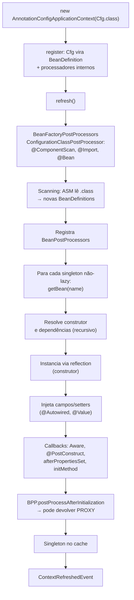
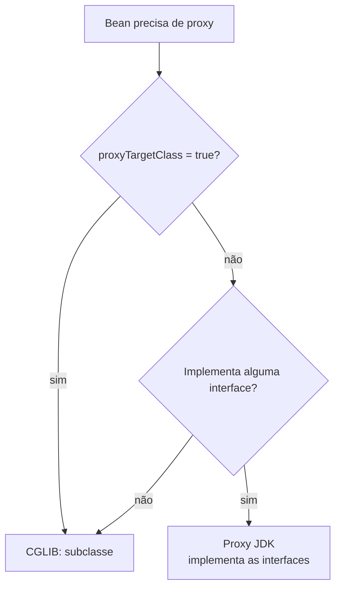

# Como Java e Spring conversam (arquivo central)

> **Resumo:** passo a passo do que acontece entre `new AnnotationConfigApplicationContext(...)` e o primeiro bean pronto: scanning, `BeanDefinition`s, reflection, injeção, proxies e eventos. Inclui um mini-container de DI em Java puro (~100 linhas) que reproduz o essencial. Se você ler só um arquivo de Spring, leia este.
> **Pré-requisitos:** [10-anotacoes-e-reflection](../01-java/10-anotacoes-e-reflection.md), [11-proxies-dinamicos-e-bytecode](../01-java/11-proxies-dinamicos-e-bytecode.md), [02](02-ioc-e-injecao-de-dependencia.md), [03](03-application-context-e-beans.md), [04](04-ciclo-de-vida-e-escopos.md), [05](05-configuracao.md).
> **Versões:** Spring Framework 7.0.8, Java 25. Mini-container e trace do Spring compilados e executados.

## 1. Definição

O Spring **não é mágica nem um compilador especial**: é uma biblioteca Java comum que, em tempo de execução, usa **recursos da própria plataforma**:

| Recurso do Java | O que o Spring faz com ele |
|---|---|
| Leitura de `.class` / classpath | descobre candidatos a bean (scanning) |
| **Anotações** com `RUNTIME` ([10](../01-java/10-anotacoes-e-reflection.md)) | lê metadados (`@Component`, `@Autowired`, `@Bean`...) |
| **Reflection** | chama construtores, métodos e lê/escreve campos |
| **Proxies** JDK e subclasses geradas (CGLIB) | injeta comportamento extra (transações, cache, async) |
| `ClassLoader` ([02](../01-java/02-jvm-por-dentro.md)) | carrega as classes dos beans |
| Interfaces e polimorfismo | resolve dependências por **tipo** |

Problema que resolve: entender isso transforma erros "misteriosos" (`NoSuchBeanDefinitionException`, `@Transactional` ignorado, ciclos) em consequências previsíveis do mecanismo.

## 2. Conceitos fundamentais

### 2.1 A ideia em uma frase

> O contêiner constrói um **grafo de objetos** a partir de **metadados** (BeanDefinitions): primeiro descreve *o que* criar (sem criar), depois cria na ordem das dependências, e por fim permite que *post-processors* troquem cada objeto por outro (proxy).

Há duas fases bem separadas, e quase tudo no Spring se explica por elas:

1. **Fase de definição**: classes → `BeanDefinition`s (só metadados; nenhum bean de aplicação existe ainda).
2. **Fase de instanciação**: definições → objetos (construtor, injeção, callbacks, proxy).

Entre as duas, os `BeanFactoryPostProcessor`s ainda podem **alterar ou adicionar definições** ([04 §2](04-ciclo-de-vida-e-escopos.md)).

### 2.2 Vocabulário mínimo

- **`BeanDefinition`**: receita (classe, escopo, dependências, init/destroy, lazy).
- **`BeanFactory`**: cria e guarda beans a partir das definições ([03](03-application-context-e-beans.md)).
- **`BeanPostProcessor` (BPP)**: pode substituir o objeto recém-criado (é onde nascem os proxies).
- **`ApplicationContext`**: `BeanFactory` + eventos + `Environment` + recursos.

## 3. Como funciona por dentro

### 3.1 Visão geral: do `new` ao bean pronto



Validado com um `AnnotationConfigApplicationContext` (Spring 7.0.8): logo após `register`, existem **6 definições** (a `@Configuration` + 5 processadores internos); depois do `refresh()` aparecem as dos seus componentes (11 no total no exemplo de §5.2).

### 3.2 Passo 1: descobrir classes sem carregá-las

O `@ComponentScan` **não** faz `Class.forName` em tudo que acha. O Spring lê o **bytecode** dos `.class` com a biblioteca ASM (empacotada em `spring-core`) e consulta anotações nos metadados (`MetadataReader`). Só vira classe carregada o que passa no filtro. Consequências:

- scanning é barato (não inicializa classes, não executa `static {}`);
- só encontra classes **no classpath** do pacote base (e dentro de JARs);
- a classe precisa ser **concreta e visível** ao scanner (não interface, não abstrata, em geral não estática aninhada privada).

Cada classe aprovada vira um `ScannedGenericBeanDefinition` com nome gerado (`orderService` para `OrderService`). Veja o detalhe de `ConfigurationClassPostProcessor` em [05 §2.2](05-configuracao.md).

### 3.3 Passo 2: escolher o construtor e resolver dependências

Para criar `OrderService`, o Spring faz (simplificado), por reflection:

1. `Class.getDeclaredConstructors()`; se há **um só**, é o candidato (Spring 4.3+); se há vários, usa o anotado com `@Autowired` ou o padrão sem argumentos.
2. Para cada parâmetro, procura bean pelo **tipo** (`PaymentGateway`). Se há vários candidatos: `@Primary`, `@Qualifier`, nome do parâmetro ([02 §2.4](02-ioc-e-injecao-de-dependencia.md)).
3. Cada dependência é obtida com `getBean(...)`, ou seja, **recursivamente**: o grafo é criado em profundidade, dependências primeiro.
4. Com os argumentos prontos: `Constructor.newInstance(args)`.

Os nomes dos parâmetros (usados no desempate) vêm do `-parameters` do `javac` (o plugin do Boot habilita por padrão; em Maven puro, configure).

### 3.4 Passo 3: injeção em campos e setters

Se existir `@Autowired` em campo ou setter, o `AutowiredAnnotationBeanPostProcessor` ([02](02-ioc-e-injecao-de-dependencia.md)) faz, **depois** do construtor: `Field.setAccessible(true)` + `Field.set(bean, dependency)`. Por isso campo `private final` não é possível por esse caminho, e por isso field injection esconde dependências: o objeto existe "meio montado" depois do `new`. Em módulos fechados é preciso `opens` ([10 §3](../01-java/10-anotacoes-e-reflection.md)).

### 3.5 Passo 4: callbacks e post-processors

Ordem completa em [04 §3](04-ciclo-de-vida-e-escopos.md): `Aware` → `postProcessBeforeInitialization` (inclui `@PostConstruct`) → `afterPropertiesSet`/`initMethod` → **`postProcessAfterInitialization`**. Esta última etapa é o gancho do AOP: o BPP pode devolver **outro objeto** no lugar do original. Quem estiver com `getBean("x")` recebe o proxy; o objeto real fica escondido dentro dele.

### 3.6 Proxies: JDK vs CGLIB

O proxy tem o mesmo "contrato" do bean e delega com um desvio no meio ([11](../01-java/11-proxies-dinamicos-e-bytecode.md)). Quem decide o tipo é o `ProxyFactory`/`DefaultAopProxyFactory`:



| | Proxy JDK | CGLIB (subclasse gerada) |
|---|---|---|
| Base | `java.lang.reflect.Proxy` | `class X$$SpringCGLIB$$0 extends X` |
| Requer | interface | classe **não-final**, métodos não-`final`/`private` |
| Injetar como | a **interface** (não a classe concreta) | classe ou interface |
| Construtor | não chama o do alvo | usa `Objenesis`, sem chamar o construtor de novo |

No Spring Boot, o padrão é `proxyTargetClass=true` (CGLIB) por causa de falhas confusas ao injetar a classe concreta ([Boot](../03-spring-boot/01-o-que-e-spring-boot.md)). Em Spring puro, o padrão de `@EnableAspectJAutoProxy`/`@EnableTransactionManagement` é JDK quando há interface. O proxy sozinho já explica a **self-invocation**: detalhado em [07](07-aop-e-proxies.md).

### 3.7 O que é o `ContextRefreshedEvent`

No fim do `refresh()`, o contexto publica `ContextRefreshedEvent` via `ApplicationEventMulticaster`. É o sinal de "todos os singletons existem". `@EventListener` usa o mesmo mecanismo ([08](08-eventos-validacao-e-conversao.md)). Ao fechar: `ContextClosedEvent`, depois `@PreDestroy`/`destroy()`.

### 3.8 Runtime vs AOT

Tudo acima é **dinâmico**: reflection e proxies em tempo de execução, decidindo a cada subida. O modo AOT do Spring executa a **fase de definição durante o build** e gera código Java que registra as definições sem reflection, o que viabiliza GraalVM native image ([10-aot-e-native](10-aot-e-native.md)).

## 4. Evolução histórica

Até o Spring 2.x tudo vinha de XML lido por `XmlBeanDefinitionReader`; o mecanismo central (definições → instanciação → BPPs) é o mesmo desde o 1.x. O 2.5 trouxe anotações e scanning; o 3.0 trouxe Java Config e SpEL; o 4.3 permitiu construtor único sem `@Autowired`; o 6.0 passou a gerar código em AOT. Linha do tempo completa em [01 §4](01-o-que-e-spring.md); impacto do Java em [00-evolucao-do-java](../01-java/00-evolucao-do-java.md).

## 5. Exemplos práticos

### 5.1 Mini-container de DI em Java puro (~100 linhas, compilado e executado)

Objetivo: provar que o "núcleo" do Spring cabe numa página. Ele faz **scanning de pacote, definições, injeção por construtor por tipo, singleton, detecção de ciclo, callback de inicialização e proxy JDK**. Anotações:

```java
package minidi;

import java.lang.annotation.*;

@Retention(RetentionPolicy.RUNTIME)
@Target(ElementType.TYPE)
public @interface Component {}      // equivalente (muito simplificado) ao @Component

// arquivo Init.java: @Retention(RUNTIME) @Target(METHOD) public @interface Init {}  (como @PostConstruct)
```

O contêiner:

```java
package minidi;

import java.io.File;
import java.lang.reflect.*;
import java.net.URL;
import java.util.*;

public class MiniContext {

    /** BeanDefinition simplificada: só metadado, nenhuma instância. */
    record Definition(String name, Class<?> type) {}

    private final Map<String, Definition> definitions = new LinkedHashMap<>();
    private final Map<String, Object> singletons = new HashMap<>();   // cache
    private final Deque<String> inCreation = new ArrayDeque<>();      // detecta ciclos

    public MiniContext(String basePackage) throws Exception {
        scan(basePackage);                                  // 1) fase de definição
        for (String name : List.copyOf(definitions.keySet())) {
            getBean(name);                                  // 2) fase de instanciação (eager)
        }
    }

    // ---- 1) Scanning: percorre .class, carrega e procura @Component por reflection
    private void scan(String pkg) throws Exception {
        URL url = Thread.currentThread().getContextClassLoader().getResource(pkg.replace('.', '/'));
        walk(new File(url.toURI()), pkg);
    }

    private void walk(File dir, String pkg) throws Exception {
        for (File f : Objects.requireNonNull(dir.listFiles())) {
            if (f.isDirectory()) walk(f, pkg + "." + f.getName());
            else if (f.getName().endsWith(".class")) {
                Class<?> c = Class.forName(pkg + "." + f.getName().replace(".class", ""));
                if (c.isAnnotationPresent(Component.class) && !c.isInterface()) {
                    String n = Character.toLowerCase(c.getSimpleName().charAt(0)) + c.getSimpleName().substring(1);
                    definitions.put(n, new Definition(n, c));
                }
            }
        }
    }

    // ---- 2) Busca por tipo (aceita interface) ou por nome
    public <T> T getBean(Class<T> type) throws Exception {
        List<String> candidates = definitions.values().stream()
                .filter(d -> type.isAssignableFrom(d.type())).map(Definition::name).toList();
        if (candidates.size() != 1)
            throw new IllegalStateException(candidates.isEmpty()
                    ? "Nenhum bean do tipo " + type.getSimpleName()
                    : "Ambíguo para " + type.getSimpleName() + ": " + candidates);
        return type.cast(getBean(candidates.get(0)));
    }

    public Object getBean(String name) throws Exception {
        Object existing = singletons.get(name);
        if (existing != null) return existing;
        if (inCreation.contains(name))
            throw new IllegalStateException("Dependência circular: " + inCreation + " -> " + name);
        inCreation.push(name);
        try {
            Object bean = create(definitions.get(name));
            singletons.put(name, bean);
            return bean;
        } finally {
            inCreation.pop();
        }
    }

    // ---- 3) Instanciação + injeção por construtor + callback de inicialização
    private Object create(Definition def) throws Exception {
        Constructor<?> ctor = def.type().getDeclaredConstructors()[0];   // simplificação: um construtor
        Object[] args = new Object[ctor.getParameterCount()];
        for (int i = 0; i < args.length; i++) {
            args[i] = getBean(ctor.getParameterTypes()[i]);              // dependência por tipo (recursivo)
        }
        ctor.setAccessible(true);
        Object bean = ctor.newInstance(args);
        for (Method m : def.type().getDeclaredMethods()) {
            if (m.isAnnotationPresent(Init.class)) { m.setAccessible(true); m.invoke(bean); }
        }
        return wrapIfNeeded(bean);                                       // 4) "BeanPostProcessor"
    }

    // ---- 4) Proxy JDK: se implementa interface, devolve proxy que mede o tempo (AOP mínimo)
    private Object wrapIfNeeded(Object bean) {
        Class<?>[] ifaces = bean.getClass().getInterfaces();
        if (ifaces.length == 0) return bean;
        return Proxy.newProxyInstance(bean.getClass().getClassLoader(), ifaces, (proxy, method, args) -> {
            long t0 = System.nanoTime();
            try {
                method.setAccessible(true);   // a interface do exemplo é package-private
                return method.invoke(bean, args);
            } catch (InvocationTargetException e) {
                throw e.getCause();           // devolve a exceção real, não a de reflection
            } finally {
                System.out.printf("  [proxy] %s.%s levou %d µs%n",
                        bean.getClass().getSimpleName(), method.getName(), (System.nanoTime() - t0) / 1000);
            }
        });
    }
}
```

Uso (domínio de pedidos) e saída real:

```java
package com.example.orders;

import minidi.*;

interface PaymentGateway { String charge(long cents); }

@Component
class CardGateway implements PaymentGateway {
    public String charge(long cents) { return "cobrado " + cents; }
}

@Component
class OrderRepository {
    @Init void started() { System.out.println("[init] OrderRepository pronto"); }
    String save(String id) { return "salvo " + id; }
}

@Component
class OrderService {
    private final OrderRepository repo;
    private final PaymentGateway gateway;
    OrderService(OrderRepository repo, PaymentGateway gateway) { this.repo = repo; this.gateway = gateway; }
    String place(String id) { return repo.save(id) + " / " + gateway.charge(1500); }
}

public class App {
    public static void main(String[] args) throws Exception {
        var ctx = new MiniContext("com.example.orders");
        System.out.println(ctx.getBean(OrderService.class).place("o-1"));
        System.out.println(ctx.getBean(PaymentGateway.class).getClass().getSimpleName().startsWith("$Proxy"));
        System.out.println(ctx.getBean("orderService") == ctx.getBean(OrderService.class)); // singleton
    }
}
```

```text
[init] OrderRepository pronto
  [proxy] CardGateway.charge levou 5136 µs
salvo o-1 / cobrado 1500
true      <- o bean que recebemos pela interface é um proxy
true      <- mesma instância (singleton)
```

Com `A(B b)` e `B(A a)`, a subida falha com `IllegalStateException: Dependência circular: [...] -> b` (ordem exata depende da listagem de arquivos).

**Mapeamento para o Spring real:**

| Mini-container | Spring |
|---|---|
| `scan`/`walk` + `Class.forName` | `ClassPathBeanDefinitionScanner` + leitura ASM (sem carregar a classe) |
| `Definition` | `BeanDefinition` (com escopo, lazy, init/destroy, valores) |
| `singletons` + `getBean` | `DefaultSingletonBeanRegistry` (cache de 3 níveis, [04 §3](04-ciclo-de-vida-e-escopos.md)) |
| `inCreation` | `singletonsCurrentlyInCreation` |
| `getDeclaredConstructors()[0]` | `ConstructorResolver` (escolhe o melhor construtor, converte tipos) |
| `getBean(paramType)` | `DefaultListableBeanFactory.resolveDependency` (qualifiers, `@Primary`, genéricos, `Optional`...) |
| `@Init` | `@PostConstruct` via `CommonAnnotationBeanPostProcessor` |
| `wrapIfNeeded` | `AbstractAutoProxyCreator` (BPP) → `ProxyFactory` |
| Falta | escopos, `@Bean`, `@Configuration`, injeção em campo/setter, `Environment`, eventos, destruição, circular por campo, ordem de beans |

### 5.2 O mesmo, com o Spring de verdade: observando cada etapa

Código completo (validado) com um BPP que embrulha em `ProxyFactory` e um listener de evento:

```java
public class Trace {
    public interface PaymentGateway { String charge(long cents); }

    @Component static class CardGateway implements PaymentGateway {
        public String charge(long c) { return "ok " + c; }
    }
    @Repository static class OrderRepository {
        public String save(String id) { return "saved " + id; }
    }
    @Service static class OrderService {
        private final OrderRepository repo; private final PaymentGateway gw;
        OrderService(OrderRepository repo, PaymentGateway gw) {
            this.repo = repo; this.gw = gw;
            System.out.println("[ctor] OrderService recebeu repo=" + repo.getClass().getSimpleName()
                    + " gw=" + gw.getClass().getSimpleName());
        }
        public String place(String id) { return repo.save(id) + "/" + gw.charge(10); }
    }

    /** BPP: ProxyFactory escolhe JDK (há interface) ou CGLIB (não há). */
    @Component static class ProxyingBpp implements BeanPostProcessor {
        public Object postProcessAfterInitialization(Object bean, String name) {
            if (!(bean instanceof PaymentGateway || bean instanceof OrderRepository)) return bean;
            var pf = new ProxyFactory(bean);
            pf.addAdvice((MethodInterceptor) inv -> {
                System.out.println("  [advice] " + inv.getMethod().getName());
                return inv.proceed();
            });
            return pf.getProxy();
        }
    }

    @Component static class Listener {
        @EventListener void on(ContextRefreshedEvent e) { System.out.println("[event] ContextRefreshedEvent"); }
    }

    @Configuration @ComponentScan(basePackageClasses = Trace.class) static class Cfg {}

    public static void main(String[] a) {
        var ctx = new AnnotationConfigApplicationContext();
        ctx.register(Cfg.class);
        System.out.println("antes do refresh: " + ctx.getBeanDefinitionCount() + " definições");
        ctx.refresh();
        System.out.println("depois: " + ctx.getBeanDefinitionCount());
        for (String n : ctx.getBeanDefinitionNames())
            if (!n.startsWith("org.springframework"))
                System.out.println("  " + n + " -> " + ctx.getBean(n).getClass().getName());
        System.out.println(ctx.getBean(OrderService.class).place("o-1"));
        ctx.close();
    }
}
```

Saída real (Spring 7.0.8, Java 25, compilado com `-parameters`):

```text
antes do refresh: 6 definições
[ctor] OrderService recebeu repo=Trace$OrderRepository$$SpringCGLIB$$0 gw=$Proxy11
[event] ContextRefreshedEvent
depois: 11
  trace.CardGateway -> jdk.proxy2.$Proxy11
  trace.OrderRepository -> trace.Trace$OrderRepository$$SpringCGLIB$$0
  trace.OrderService -> trace.Trace$OrderService
  ... (Cfg, Listener, ProxyingBpp)
  [advice] save
  [advice] charge
saved o-1/ok 10
```

Leitura da saída:

- **6 → 11 definições**: o scanning só roda no `refresh()` (fase de definição).
- `CardGateway` tem interface → **proxy JDK** (`jdk.proxy2.$Proxy11`). `OrderRepository` não tem → **CGLIB** (`$$SpringCGLIB$$0`).
- `OrderService` **recebeu os proxies** no construtor: o BPP rodou nas dependências *antes* de elas serem injetadas. Por isso `@Transactional` funciona sem o serviço saber.
- `[advice]` aparece em cada chamada: o desvio do proxy.

(Nomes de bean de classe aninhada ficam como `trace.CardGateway`; classes de topo teriam `cardGateway`.)

### 5.3 Reproduzindo erros típicos pelo modelo mental

| Sintoma | Causa pelo mecanismo |
|---|---|
| `NoSuchBeanDefinitionException` | classe fora do pacote do scan, sem estereótipo, ou condição/profile que impediu a definição (fase 1) |
| `NoUniqueBeanDefinitionException` | dois candidatos para o mesmo tipo e nenhum desempate (`@Primary`/`@Qualifier`/nome) |
| `BeanCurrentlyInCreationException` | ciclo por construtor: a árvore de criação volta a um bean "em criação" |
| `@Transactional` não faz nada | chamada interna (`this.metodo()`) ou método `private`/`final`: não passa pelo proxy |
| `ClassCastException` ao injetar classe concreta | bean é proxy JDK (só implementa a interface) |
| `NullPointerException` em campo `@Autowired` | objeto criado com `new` fora do contêiner |

## 6. Configurações e anotações relevantes

| Item | Para que serve | Exemplo |
|---|---|---|
| `@ComponentScan` | define pacotes da fase de definição | `@ComponentScan("com.example.orders")` |
| `@EnableAspectJAutoProxy(proxyTargetClass=true)` | força CGLIB no AOP | em `@Configuration` |
| `-parameters` (javac) | guarda nomes de parâmetros para desempate | `<parameters>true</parameters>` no compiler plugin |
| `BeanPostProcessor` | substituir/decorar o bean criado | exemplo de §5.2 |
| `BeanFactoryPostProcessor` | alterar definições antes da criação | `@Bean static` |
| `@Lazy` | adia criação até o primeiro uso (em injeção, injeta proxy) | `@Lazy` no parâmetro |
| `spring.main.lazy-initialization` (Boot) | todos lazy | `true` |
| `DefaultListableBeanFactory.setAllowCircularReferences` | proíbe circulares por campo/setter | ver [04 §3.3](04-ciclo-de-vida-e-escopos.md) |

## 7. Quando usar e quando NÃO usar

- **Escrever o seu próprio contêiner**: apenas para aprender ou para cenários extremamente limitados. O mini-container acima não trata escopos, ordem, concorrência, lifecycle de destruição, nem múltiplos construtores.
- **Entender o mecanismo**: sempre. Ao depurar, pergunte "em qual fase isso ocorre e qual objeto recebo, o real ou um proxy?".
- **Não** dependa de detalhes internos (`getClass().getName()` de proxies, nomes `$$SpringCGLIB$$`, números de definições): mudam entre versões.
- **Não** use `ApplicationContext.getBean` no código de negócio (service locator): esconde dependências.

## 8. Erros comuns e boas práticas

- **Achar que o bean é a classe que você escreveu**: com AOP é um proxy. Compare por interface ou use `AopUtils`/`AopProxyUtils.getSingletonTarget` (só em infraestrutura).
- **Chamar `new` em classe que depende de injeção.**
- **Colocar lógica pesada em construtor de bean**: roda na subida e atrasa a inicialização; prefira `@PostConstruct` com cuidado ou eventos.
- **Misturar `@Autowired` em campo com testes unitários**: obriga reflection ou contexto; construtor deixa instanciar com `new`.
- **BPP dependendo de beans comuns**: eles são criados cedo demais e podem **não** ser processados (o Spring avisa com `not eligible for getting processed by all BeanPostProcessors`).
- **Boa prática**: construtor único, `final`, interfaces onde há contrato, desligar circularidade, `static` nos `@Bean` de BFPP.

## 9. Perguntas de revisão

1. **Quais são as duas grandes fases da subida do contexto?**
   <details><summary>Resposta</summary>Definição (classes → `BeanDefinition`s, só metadados) e instanciação (definições → objetos, com injeção, callbacks e proxies). Entre elas os `BeanFactoryPostProcessor`s podem alterar definições.</details>
2. **Por que o scanning é barato?**
   <details><summary>Resposta</summary>Porque lê o bytecode dos `.class` com ASM e consulta metadados de anotações sem carregar nem inicializar as classes; só as aprovadas viram definições.</details>
3. **Em que ponto do ciclo nasce o proxy e quem recebe a versão original?**
   <details><summary>Resposta</summary>Em `postProcessAfterInitialization` de um BPP. O contêiner guarda o objeto devolvido (o proxy); o original fica só dentro do proxy. Quem injeta o bean recebe o proxy.</details>
4. **Quando o Spring usa proxy JDK e quando CGLIB?**
   <details><summary>Resposta</summary>JDK se há interface e `proxyTargetClass` é falso; CGLIB (subclasse) se `proxyTargetClass` é verdadeiro ou não há interface. CGLIB exige classe e métodos não-`final`. Boot assume CGLIB por padrão.</details>
5. **Como o mini-container detecta dependência circular e por que isso ocorre no construtor?**
   <details><summary>Resposta</summary>Mantém uma pilha de beans em criação; se pede um já presente nela, falha. No construtor o objeto precisa da dependência *antes* de existir, então não há como entregar uma referência parcial (diferente da injeção por campo no Spring).</details>

## 10. Referências oficiais

- Container overview e Bean overview: <https://docs.spring.io/spring-framework/reference/core/beans.html>
- Customizing beans (BPP/BFPP): <https://docs.spring.io/spring-framework/reference/core/beans/factory-extension.html>
- Proxying mechanisms: <https://docs.spring.io/spring-framework/reference/core/aop/proxying.html>
- `java.lang.reflect.Proxy`: <https://docs.oracle.com/en/java/javase/25/docs/api/java.base/java/lang/reflect/Proxy.html>
- Spring Framework (projeto): <https://spring.io/projects/spring-framework>
