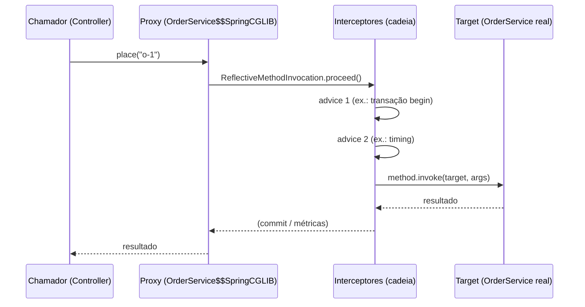
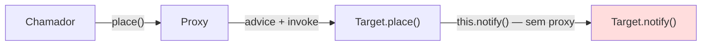

# AOP e proxies no Spring

> **Resumo:** como o Spring adiciona comportamento transversal (transação, cache, async, segurança, log) sem alterar o código de negócio: por meio de proxies criados em tempo de execução. Explica Spring AOP vs AspectJ, o que cada anotação "mágica" realmente faz e por que a *self-invocation* é a maior armadilha.
> **Pré-requisitos:** [06-como-java-e-spring-conversam](06-como-java-e-spring-conversam.md), [11-proxies-dinamicos-e-bytecode](../01-java/11-proxies-dinamicos-e-bytecode.md).
> **Versões:** Spring Framework 7.0.8, AspectJ weaver 1.9.25, Java 25. Exemplos de §5.1 e §5.2 executados.

## 1. Definição

**AOP** (*Aspect-Oriented Programming*) separa **preocupações transversais** (*cross-cutting concerns*) da lógica de negócio. Uma preocupação transversal é algo que "corta" muitas classes: transações, logs, métricas, segurança, cache, retry.

Problema que resolve: sem AOP, cada serviço repetiria `try { begin; ...; commit } catch { rollback }`. Com AOP, o código fica no **aspecto** e é aplicado por **declaração** (`@Transactional`).

Vocabulário:

| Termo | Significado |
|---|---|
| **Aspect** | módulo com a preocupação transversal (`@Aspect`) |
| **Join point** | ponto de execução que pode ser interceptado. No **Spring AOP, sempre uma execução de método** |
| **Pointcut** | expressão que seleciona join points (`execution(* com.example..*Service.*(..))`) |
| **Advice** | o que fazer: `@Before`, `@AfterReturning`, `@AfterThrowing`, `@After`, `@Around` |
| **Weaving** | aplicar os aspectos ao código alvo |
| **Target** | o objeto original cujos métodos são interceptados |
| **Proxy** | objeto que o Spring entrega no lugar do target |

## 2. Conceitos fundamentais

### 2.1 Spring AOP vs AspectJ

| | **Spring AOP** | **AspectJ** |
|---|---|---|
| Mecanismo | **proxy** em tempo de execução | **weaving** no bytecode (compilação ou load-time) |
| Join points | só execução de métodos de beans Spring | métodos, construtores, campos, `new`, `static`... |
| Alcance | só objetos gerenciados pelo contêiner | qualquer classe |
| Self-invocation | **não** intercepta | intercepta (altera o bytecode) |
| Custo/complexidade | baixo; sem ferramentas extras | exige compilador `ajc` ou agente `-javaagent` |
| Quando | 95% dos casos | necessidades avançadas |

Detalhe: Spring AOP usa a **sintaxe de anotações do AspectJ** (`@Aspect`, `@Around`, expressões de pointcut) e a biblioteca `aspectjweaver` para *interpretar* as expressões, mas **não** faz weaving. Por isso você precisa da dependência `aspectjweaver` (no Boot 4.1: `spring-boot-starter-aspectj`, que traz `spring-aop` e `aspectjweaver`; o antigo `spring-boot-starter-aop` não tem versão 4.x no Maven Central, parando em 4.0.0-M2) para usar `@Aspect`.

### 2.2 Tipos de advice

- `@Before`: antes do método; não impede a execução (a menos que lance exceção).
- `@AfterReturning` / `@AfterThrowing`: após retorno / após exceção.
- `@After` (finally): sempre depois.
- `@Around`: **o mais poderoso**: recebe `ProceedingJoinPoint`, decide se e quando chamar `proceed()`, altera argumentos e retorno. Os outros podem ser escritos com ele. É o que `@Transactional` e `@Cacheable` usam, na prática.

### 2.3 Expressões de pointcut mais usadas

| Designador | Seleciona | Exemplo |
|---|---|---|
| `execution(...)` | execução de método (o mais usado) | `execution(public * com.example.orders.service.*.*(..))` |
| `within(...)` | todos os métodos de tipos/pacotes | `within(com.example.orders..*)` |
| `@annotation(...)` | métodos com a anotação | `@annotation(com.example.Timed)` |
| `@within(...)` | métodos de classes com a anotação | `@within(org.springframework.stereotype.Service)` |
| `bean(...)` | por nome de bean (específico do Spring) | `bean(*Service)` |
| `args(...)` / `this` / `target` | tipo dos argumentos / proxy / alvo | `args(String)` |

## 3. Como funciona por dentro

### 3.1 Cadeia de criação e de chamada

1. `@EnableAspectJAutoProxy` (ou o auto-config do Boot) registra um BPP: `AnnotationAwareAspectJAutoProxyCreator` (subclasse de `AbstractAutoProxyCreator`).
2. Para **cada bean criado**, `postProcessAfterInitialization` pergunta: "algum *advisor* (pointcut + advice) se aplica a algum método desta classe?". Se nenhum se aplica, devolve o bean original.
3. Se aplica, constrói um proxy (JDK ou CGLIB, [06 §3.6](06-como-java-e-spring-conversam.md)) com a **cadeia de interceptores**.
4. Quem injeta o bean recebe o proxy.



A ordem entre aspectos é definida por `@Order` (menor valor = mais externo).

### 3.2 Por que a self-invocation não passa pelo proxy

O proxy **envolve** o target; o target não sabe que está dentro de um proxy. Quando `place()` chama `this.notify()`, `this` é o **objeto real**, e a chamada vai direto, sem interceptores:



Validado (Spring 7.0.8, §5.1): `place()` dispara o aspecto; o `notify()` interno **não**. Não é um defeito do Spring, é consequência de como proxies funcionam. Vale para **todos** os recursos por proxy (`@Transactional`, `@Async`, `@Cacheable`, `@Retryable`, `@PreAuthorize`...).

### 3.3 Limites mecânicos do proxy

| Situação | Efeito |
|---|---|
| Método `private` | CGLIB não sobrescreve; **não interceptado** |
| Método `final` (CGLIB) | não sobrescrito; chamada vai direto ao alvo, e o Spring emite aviso (validado: *"Public final method ... cannot get proxied via CGLIB"*) |
| Classe `final` | CGLIB não consegue subclasse → falha na criação do proxy |
| Método `static` | não é invocação de instância; nunca interceptado |
| Proxy JDK + injeção da classe concreta | `ClassCastException` (validado: `$Proxy0 cannot be cast to Impl`) |
| `new` manual | objeto fora do contêiner; sem proxy |
| Bean criado antes dos BPPs | pode não ser elegível (aviso `not eligible for getting processed by all BeanPostProcessors`) |

> Nota: a partir do Spring Framework 6.x, CGLIB usa `Objenesis` para instanciar a subclasse e mantém os campos do proxy **não inicializados** (os campos da classe estão no target). Por isso **nunca** acesse campos de um bean proxied a partir de fora: use getters (o proxy delega para o alvo).

### 3.4 Como as anotações "mágicas" funcionam

Todas seguem o mesmo padrão: **uma anotação de habilitação** registra um BPP/advisor que cria proxies, e um **interceptor** faz o trabalho.

| Recurso | Habilitação | Interceptor / o que faz |
|---|---|---|
| `@Transactional` | `@EnableTransactionManagement` | `TransactionInterceptor`: abre/commita/rollback via `PlatformTransactionManager` ([09](09-transacoes.md)) |
| `@Async` | `@EnableAsync` | `AsyncExecutionInterceptor`: submete a chamada a um `TaskExecutor` e devolve `Future`/`void` |
| `@Cacheable` / `@CacheEvict` | `@EnableCaching` | `CacheInterceptor`: consulta/grava no `CacheManager` |
| `@Retryable` | `@EnableResilientMethods` (Framework 7) | repete a chamada em falha |
| `@PreAuthorize` | `@EnableMethodSecurity` | verifica autorização antes de chamar |
| `@Validated` (métodos) | `MethodValidationPostProcessor` | valida parâmetros/retorno por Bean Validation |
| `@Scheduled` | `@EnableScheduling` | **não é proxy**: um BPP registra a tarefa no scheduler |

O Spring Boot liga a maioria disso por auto-configuração quando o starter está presente ([Boot 02](../03-spring-boot/02-auto-configuracao.md)). `@Retryable`, `@ConcurrencyLimit` e `@EnableResilientMethods` ficam em `org.springframework.resilience.annotation` (confirmado no jar do 7.0.8).

### 3.5 Ordem entre interceptores

Cada recurso tem uma ordem padrão (por exemplo, o advisor de transação tem `Ordered.LOWEST_PRECEDENCE`; o de cache e o de segurança têm outros valores). Quando se combinam `@Transactional` + `@Cacheable` + um aspecto próprio, a ordem faz diferença (cache dentro ou fora da transação). Controle com `@Order` no aspecto e com `order` na anotação de habilitação (`@EnableTransactionManagement(order = ...)`).

## 4. Evolução histórica

O Spring 1.x já trazia AOP com proxies (`ProxyFactoryBean` em XML). O 2.0 (2006) integrou a **sintaxe `@AspectJ`** e o namespace `<aop:*>`. O 3.x/4.x consolidou as habilitações `@Enable*`. A partir do 5.x/6.x, CGLIB virou "reembalado" dentro do `spring-core`, e o 6.0 acrescentou suporte AOT para os proxies. No 7.0, vários recursos de resiliência (`@Retryable`, `@ConcurrencyLimit`) foram trazidos para o próprio Framework. Visão geral em [01 §4](01-o-que-e-spring.md).

## 5. Exemplos práticos

### 5.1 Aspecto próprio + self-invocation (executado)

```java
@Retention(RetentionPolicy.RUNTIME) @Target(ElementType.METHOD)
public @interface Timed {}

@Aspect @Component
class TimingAspect {
    @Around("@annotation(com.example.orders.Timed)")
    Object time(ProceedingJoinPoint pjp) throws Throwable {
        System.out.println("  [aspect] antes " + pjp.getSignature().getName());
        try { return pjp.proceed(); }
        finally { System.out.println("  [aspect] depois"); }
    }
}

@Service
class OrderService {
    @Timed public String place(String id)  { return "placed " + id + " / " + notify(id); }  // self-invocation!
    @Timed public String notify(String id) { return "notified " + id; }
    @Timed public String viaProxy(String id) {
        return ((OrderService) AopContext.currentProxy()).notify(id);                        // via proxy
    }
    @Timed final public String finalMethod() { return "final"; }
}

@Configuration @ComponentScan @EnableAspectJAutoProxy(exposeProxy = true)
class Cfg {}
```

Saída real:

```text
aop.Aop$OrderService$$SpringCGLIB$$0 aop=true cglib=true     <- é proxy CGLIB (classe sem interface)
-- place (chama notify internamente)
  [aspect] antes place
  [aspect] depois                                            <- notify() NÃO foi interceptado
placed o-1 / notified o-1
-- viaProxy (AopContext)
  [aspect] antes viaProxy
  [aspect] antes notify                                      <- agora notify() passou pelo proxy
  [aspect] depois
  [aspect] depois
notified o-2
-- final                                                     <- final: sem aspecto (+ WARNING do CGLIB)
final
```

### 5.2 JDK vs CGLIB e `ClassCastException` (executado)

```java
var pf = new ProxyFactory(new Impl());            // Impl implements Greeter
pf.addAdvice((MethodInterceptor) i -> i.proceed());
Object p = pf.getProxy();                         // jdk.proxy1.$Proxy0  (JDK)
Impl i = (Impl) p;                                // ClassCastException

var pf2 = new ProxyFactory(new Impl());
pf2.setProxyTargetClass(true);                    // força CGLIB
Impl ok = (Impl) pf2.getProxy();                  // Jdk$Impl$$SpringCGLIB$$0
AopProxyUtils.ultimateTargetClass(p);             // Impl (a classe real por trás do proxy)
```

### 5.3 Corrigir self-invocation: alternativas (em ordem de preferência)

1. **Mover o método para outro bean** (a solução mais limpa; respeita a divisão de responsabilidades):

```java
@Service
class OrderService {
    private final NotificationService notifications;        // outro bean → passa pelo proxy dele
    OrderService(NotificationService notifications) { this.notifications = notifications; }
    @Transactional public void place(Order o) { /* ... */ notifications.notifyCustomer(o); }
}
```

2. **Auto-injeção** (`@Lazy` self): funciona, mas é cheiro de design. <!-- não compilado -->

```java
@Service
class OrderService {
    @Lazy @Autowired private OrderService self;       // proxy de si mesmo
    public void a() { self.b(); }                     // b() passa pelo proxy
}
```

3. **`AopContext.currentProxy()`** (requer `exposeProxy = true`; acopla o código ao Spring; validado em §5.1).
4. **AspectJ com weaving** (`@EnableLoadTimeWeaving` ou plugin `ajc`): intercepta chamadas internas, mas muda o modelo de build.

### 5.4 Aspecto realista: auditoria de métodos de serviço <!-- não compilado -->

```java
@Aspect @Component @Order(Ordered.HIGHEST_PRECEDENCE + 10)
class AuditAspect {
    private static final Logger log = LoggerFactory.getLogger(AuditAspect.class);

    @AfterReturning(pointcut = "execution(* com.example.orders.service.*Service.place*(..))",
                    returning = "result")
    void audit(JoinPoint jp, Object result) {
        log.info("{} executado com {} => {}", jp.getSignature().toShortString(),
                 Arrays.toString(jp.getArgs()), result);
    }
}
```

Cuidado com dados sensíveis em `jp.getArgs()` (senhas, cartões) e com custo em métodos muito chamados.

## 6. Configurações e anotações relevantes

| Anotação / API | Para que serve | Exemplo |
|---|---|---|
| `@EnableAspectJAutoProxy` | liga a criação de proxies para `@Aspect` | `@EnableAspectJAutoProxy(proxyTargetClass = true, exposeProxy = true)` |
| `@Aspect` + `@Component` | declara o aspecto como bean | ver §5.1 |
| `@Around`, `@Before`... | tipos de advice | `@Around("execution(* ..*Service.*(..))")` |
| `@Pointcut` | reutiliza expressão nomeada | `@Pointcut("within(@Service *)") void services() {}` |
| `@Order` | ordem entre aspectos | `@Order(1)` |
| `AopContext.currentProxy()` | obter o proxy corrente | exige `exposeProxy=true` |
| `AopUtils.isAopProxy/isJdkDynamicProxy/isCglibProxy` | inspecionar | usado em §5.1 |
| `AopProxyUtils.ultimateTargetClass` | classe real | usado em §5.2 |
| `spring.aop.proxy-target-class` (Boot) | CGLIB vs JDK (padrão `true`) | `false` |
| `spring.aop.auto` (Boot) | liga/desliga AOP automático | `true` |

As duas propriedades `spring.aop.*` existem no Boot 4.1.2 com padrão `true` (conferido nos metadados de `spring-boot-autoconfigure-4.1.2.jar`).

## 7. Quando usar e quando NÃO usar

- **Use** para preocupações realmente transversais e **independentes do negócio**: log de acesso, métricas, auditoria, tempo, segurança, transações, cache.
- **Use** `@Around` só quando precisa controlar a execução; senão, `@Before`/`@AfterReturning` são mais claros.
- **Não use** AOP para lógica de negócio (regras de desconto, validações do domínio): fica invisível, difícil de depurar e de testar.
- **Não use** pointcuts muito amplos (`execution(* *(..))`): afetam beans de infraestrutura, desempenho e ordem de criação.
- **Não conte** com AOP em chamadas internas, métodos `private`/`final`/`static` ou objetos criados com `new`.
- Se precisa interceptar construtores, campos ou classes fora do Spring, o caminho é **AspectJ** (weaving).

## 8. Erros comuns e boas práticas

- **`@Transactional`/`@Async`/`@Cacheable` "não funciona"** → quase sempre self-invocation, método não-`public`/`final`, ou bean criado com `new`.
- **Injetar a classe concreta com proxy JDK** → `ClassCastException`/`BeanNotOfRequiredTypeException`. Injete a interface ou use CGLIB.
- **Exceção engolida no `@Around`** (esquecer de relançar) → o chamador não vê o erro; sempre relance ou trate conscientemente.
- **Pointcut genérico demais** → aspectos aplicados a centenas de beans; use `within`/`@annotation` específicos.
- **Aspecto que depende de beans que dependem do aspecto** → ciclo de criação; mantenha aspectos simples.
- **Ordem implícita**: especifique `@Order` quando dois aspectos mexem na mesma chamada.
- **Boa prática**: anotação própria (como `@Timed`) em vez de pointcuts por nome, que quebram ao renomear; teste o aspecto com um contexto Spring mínimo (como o de §5.1); documente efeitos colaterais.

## 9. Perguntas de revisão

1. **Qual a diferença essencial entre Spring AOP e AspectJ?**
   <details><summary>Resposta</summary>Spring AOP usa proxies em runtime e só intercepta execução de métodos de beans do contêiner. AspectJ altera o bytecode (weaving) e intercepta qualquer join point, inclusive chamadas internas, construtores e campos.</details>
2. **Por que `this.notify()` dentro de `place()` não dispara o aspecto?**
   <details><summary>Resposta</summary>Porque `this` é o objeto real (target), não o proxy. Só chamadas que chegam pelo proxy passam pelos interceptores.</details>
3. **Como o Spring decide entre proxy JDK e CGLIB?**
   <details><summary>Resposta</summary>JDK quando o bean implementa interface e `proxyTargetClass` não está ativo; CGLIB caso contrário. Boot usa CGLIB por padrão (`spring.aop.proxy-target-class=true`).</details>
4. **Cite três situações em que um método não será interceptado.**
   <details><summary>Resposta</summary>Self-invocation; método `private`, `final` ou `static`; objeto criado com `new` (fora do contêiner). Também chamadas feitas antes do bean estar proxied.</details>
5. **Qual a vantagem de `@Around` sobre os outros advices e o seu custo?**
   <details><summary>Resposta</summary>Controla se/quando o método roda e pode alterar argumentos e retorno; custo é a responsabilidade de chamar `proceed()` e relançar exceções corretamente.</details>

## 10. Referências oficiais

- Aspect Oriented Programming with Spring: <https://docs.spring.io/spring-framework/reference/core/aop.html>
- Proxying Mechanisms (inclui self-invocation): <https://docs.spring.io/spring-framework/reference/core/aop/proxying.html>
- @AspectJ support: <https://docs.spring.io/spring-framework/reference/core/aop/ataspectj.html>
- Projeto AspectJ: <https://eclipse.dev/aspectj/>
- Spring Framework: <https://spring.io/projects/spring-framework>
