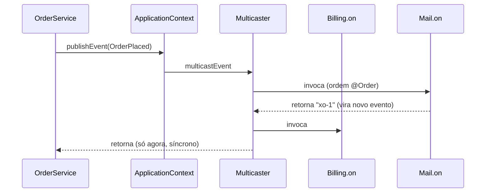

# Eventos, validação e conversão no Spring

> **Resumo:** três serviços de infraestrutura do contêiner que aparecem em quase toda aplicação: publicar e ouvir **eventos** (desacoplamento interno), **validar** dados com Bean Validation e **converter/formatar** tipos (texto ↔ objetos). São a base do que o Spring MVC faz com o corpo e os parâmetros de uma requisição.
> **Pré-requisitos:** [04-ciclo-de-vida-e-escopos](04-ciclo-de-vida-e-escopos.md), [05-configuracao](05-configuracao.md), [07-aop-e-proxies](07-aop-e-proxies.md), [10-anotacoes-e-reflection](../01-java/10-anotacoes-e-reflection.md).
> **Versões:** Spring Framework 7.0.8, Hibernate Validator 9.0.1.Final (Jakarta Validation 3.1), Java 25. Exemplos de §5 executados.

## 1. Definição

- **Evento**: objeto publicado no contêiner (`ApplicationEventPublisher`) e entregue a **ouvintes** registrados. Implementa o padrão Observer ([06-padroes/04](../06-padroes-de-projeto/04-comportamentais.md)) *dentro do processo*.
- **Bean Validation** (Jakarta Validation): especificação de restrições declarativas (`@NotBlank`, `@Min`, `@Email`) validadas por uma implementação (Hibernate Validator).
- **Conversão** (`ConversionService`, `Converter`): transforma um tipo em outro (`String → LocalDate`, `String → Money`). **Formatação** (`Formatter`): converte de/para texto levando em conta o `Locale`.

Problemas que resolvem: (1) chamar N colaboradores a partir de um serviço cria acoplamento; (2) regras de formato repetidas em `if`s; (3) strings vindas de HTTP/propriedades precisam virar tipos Java de forma consistente.

## 2. Conceitos fundamentais

### 2.1 Eventos

| Peça | Papel |
|---|---|
| `ApplicationEventPublisher` | publica (`publishEvent(Object)`); o próprio `ApplicationContext` implementa |
| `ApplicationEventMulticaster` | entrega a cada ouvinte; padrão: `SimpleApplicationEventMulticaster` |
| `ApplicationListener<E>` ou `@EventListener` | ouvinte |
| Evento | **qualquer objeto** (desde o 4.2); estender `ApplicationEvent` é opcional |

Características essenciais:

- **Síncrono por padrão**: o ouvinte roda **na thread de quem publicou**, antes de `publishEvent` retornar (validado: o ouvinte imprimiu `thread=main`). Uma exceção do ouvinte propaga ao publicador.
- **Mesma transação** do publicador (porque é a mesma thread).
- Seleção por **tipo** do parâmetro (inclui supertipos e genéricos resolvíveis).
- Se o método devolve um valor não nulo, ele é **publicado como um novo evento** (validado).

Eventos do próprio contêiner: `ContextRefreshedEvent`, `ContextStartedEvent`, `ContextStoppedEvent`, `ContextClosedEvent`. No Boot: `ApplicationStartedEvent`, `ApplicationReadyEvent`, `ApplicationFailedEvent` ([Boot 01](../03-spring-boot/01-o-que-e-spring-boot.md)).

### 2.2 Eventos transacionais

`@TransactionalEventListener` (módulo `spring-tx`) liga o ouvinte a uma **fase** da transação do publicador:

| `phase` | Quando |
|---|---|
| `AFTER_COMMIT` (padrão) | só se a transação confirmou |
| `AFTER_ROLLBACK` | só se desfez |
| `AFTER_COMPLETION` | após qualquer desfecho |
| `BEFORE_COMMIT` | antes do commit |

Sem transação ativa, o evento é **descartado** (a menos que `fallbackExecution = true`). Detalhes em [09-transacoes](09-transacoes.md).

### 2.3 Bean Validation

Camadas:

1. **Jakarta Validation API** (`jakarta.validation.*`): anotações e `Validator`.
2. **Implementação**: Hibernate Validator. Precisa também de uma **Jakarta Expression Language** (ex.: `org.glassfish.expressly:expressly`) para interpolar mensagens. No Boot, o `spring-boot-starter-validation` traz tudo.
3. **Ponte Spring**: `LocalValidatorFactoryBean` (um `Validator` do Spring *e* do Jakarta) integra com o contêiner, injetando beans em `ConstraintValidator`s e adaptando erros para `Errors`/`BindingResult`.

Restrições comuns: `@NotNull`, `@NotBlank` (string não vazia/branca), `@NotEmpty`, `@Size`, `@Min/@Max`, `@Positive`, `@Email`, `@Pattern`, `@Past/@Future`, `@Valid` (propaga validação a objetos aninhados), restrições em **type use** (`List<@NotBlank String>`).

### 2.4 Conversão e formatação

Dois sistemas históricos, hoje unificados:

| API | Origem | Uso |
|---|---|---|
| `PropertyEditor` (`java.beans`) | Java antigo | legado; estado por instância, não thread-safe |
| **`Converter<S,T>`** | Spring 3.0 | conversão tipada, sem estado |
| `GenericConverter` / `ConverterFactory` | Spring 3.0 | múltiplos tipos / hierarquia (ex.: `String → qualquer Enum`) |
| **`Formatter<T>`** | Spring 3.0 | texto ↔ objeto **com `Locale`** |
| `ConversionService` | Spring 3.0 | ponto de entrada: `convert(obj, Target.class)` |

O `DefaultConversionService` já traz dezenas de conversores (números, enums, coleções, `Optional`, `String → Duration`...). O `DefaultFormattingConversionService` soma `@NumberFormat`, `@DateTimeFormat` e `java.time`.

## 3. Como funciona por dentro

### 3.1 Eventos

1. No `refresh()`, o contexto cria o `ApplicationEventMulticaster` (bean `applicationEventMulticaster`) e registra os `ApplicationListener`s.
2. Métodos `@EventListener` viram `ApplicationListenerMethodAdapter`, criados pelo `EventListenerMethodProcessor` (um `SmartInitializingSingleton`) **depois** que todos os singletons existem.
3. `publishEvent(obj)`: embrulha em `PayloadApplicationEvent` se não for `ApplicationEvent`, resolve o tipo com `ResolvableType`, pede ao multicaster os ouvintes compatíveis (cache por tipo) e chama cada um; se há `condition`, avalia SpEL antes.
4. Para execução assíncrona: `@Async` no método do ouvinte (proxy → [07](07-aop-e-proxies.md)) ou um `Executor` no multicaster.



### 3.2 Validação

`validator.validate(obj)`: o Hibernate Validator monta, por reflection, o *metadata* de restrições da classe (anotações em campos, getters, construtores, parâmetros e **componentes de record**), instancia cada `ConstraintValidator` e coleta as `ConstraintViolation`s (caminho da propriedade, mensagem, valor inválido). O metadata é cacheado por classe. O `LocalValidatorFactoryBean` converte `ConstraintViolation` em `FieldError` do Spring (código = nome da anotação, ex. `Min`), o que alimenta o `BindingResult` no MVC.

**Validação de métodos**: com `@Validated` na classe e o `MethodValidationPostProcessor` (proxy, [07 §3.4](07-aop-e-proxies.md)), restrições em parâmetros/retorno são checadas na chamada e lançam `ConstraintViolationException`. No Framework 6.1+, o MVC passou a ter validação de métodos nativa nos controllers (`HandlerMethodValidationException`). A classe `HandlerMethodValidationException` existe em `spring-web` 7.0.10 (conferido no JAR); o uso em Boot MVC está em [03-spring-boot/04](../03-spring-boot/04-web-mvc.md).

### 3.3 Conversão

`ConversionService.convert(source, targetType)`: descobre um conversor por par `(TypeDescriptor origem, TypeDescriptor destino)`, subindo pela hierarquia de tipos e usando um cache. Se não há conversor direto, **tenta caminhos** (`Object → String` via `toString`, `String → Object` via construtor `valueOf`/factory). Usos internos do Spring:

- `@Value("${porta}")` → `int` (via `Environment`/`TypeConverter`);
- `@ConfigurationProperties` no Boot;
- *data binding* do MVC: parâmetros de URL, `@RequestParam`, `@PathVariable`;
- `@DateTimeFormat`/`@NumberFormat` em campos.

## 4. Evolução histórica

Eventos existem desde o 1.x; o **Spring 4.2** introduziu `@EventListener` e eventos como POJOs, e `@TransactionalEventListener`. A conversão (`ConversionService`) chegou no 3.0, substituindo `PropertyEditor`s no uso cotidiano. A Bean Validation integra desde o 3.0 (JSR 303); o 6.0 migrou para `jakarta.validation`. Veja [00-evolucao-do-java §6](../01-java/00-evolucao-do-java.md) para `javax` → `jakarta`.

## 5. Exemplos práticos

### 5.1 Eventos (executado)

```java
record OrderPlaced(String orderId, long cents) {}

@Component class Billing {
    @EventListener void on(OrderPlaced e) {
        System.out.println("[billing] " + e + " thread=" + Thread.currentThread().getName());
    }
}

@Component class Mail {
    @EventListener @Order(1) String on(OrderPlaced e) {      // retorno vira OUTRO evento
        System.out.println("[mail] first");
        return "x" + e.orderId();
    }
    @EventListener void chained(String s) { System.out.println("[chained] " + s); }
    @EventListener(condition = "#e.cents > 1000")             // SpEL sobre o parâmetro
    void big(OrderPlaced e) { System.out.println("[big] " + e.orderId()); }
}

@Component class OrderService {
    private final ApplicationEventPublisher publisher;
    OrderService(ApplicationEventPublisher publisher) { this.publisher = publisher; }
    void place(String id, long cents) {
        System.out.println("publicando");
        publisher.publishEvent(new OrderPlaced(id, cents));
        System.out.println("publicou");
    }
}
```

Saída real de `place("o-1", 1500)`:

```text
publicando
[mail] first
[chained] xo-1
[billing] OrderPlaced[orderId=o-1, cents=1500] thread=main
[big] o-1
publicou                      <- só depois de TODOS os ouvintes: síncrono
```

**Armadilha encontrada na execução:** `condition = "#e.cents > 1000"` só funcionou compilando com `-parameters`. Sem o nome do parâmetro, `#e` é `null` e a subida **falha** com `EL1007E: Property or field 'cents' cannot be found on null`. Alternativas que não dependem disso: `#root.event` (o evento) ou `#a0`/`#p0` (primeiro argumento).

### 5.2 Ouvinte assíncrono e após o commit <!-- não compilado -->

```java
@Component
class ReceiptSender {
    // roda em outra thread (requer @EnableAsync) e só depois do commit
    @Async
    @TransactionalEventListener(phase = TransactionPhase.AFTER_COMMIT)
    void send(OrderPlaced e) { /* enviar e-mail */ }
}
```

Quando o `@Async` entra, a exceção não volta ao publicador; configure um `AsyncUncaughtExceptionHandler` ([Boot 11](../03-spring-boot/11-cache-agendamento-e-async.md)).

### 5.3 Bean Validation (executado)

```java
record Customer(@NotBlank String name,
                @Email String email,
                @Min(18) int age,
                @Size(min = 1) List<@NotBlank String> tags) {}

@Bean LocalValidatorFactoryBean validator() { return new LocalValidatorFactoryBean(); }
```

```java
var c = new Customer("", "nao-email", 10, List.of());

// API Jakarta:
Set<ConstraintViolation<Customer>> v = validator.validate(c);
// age: must be greater than or equal to 18
// email: must be a well-formed email address
// name: must not be blank
// tags: size must be between 1 and 2147483647

// API Spring (Errors/BindingResult):
Errors errors = new BeanPropertyBindingResult(c, "customer");
validator.validate(c, errors);
errors.getErrorCount();                      // 4
errors.getFieldError("age").getCode();       // "Min"
```

Observação: anotações em **componentes de record** são propagadas ao campo/acessor conforme o `@Target` da anotação, e a validação funcionou como esperado.

**Restrição própria:**

```java
@Target({FIELD, PARAMETER, RECORD_COMPONENT}) @Retention(RUNTIME)
@Constraint(validatedBy = SkuValidator.class)
@interface Sku { String message() default "invalid SKU"; Class<?>[] groups() default {}; Class<? extends Payload>[] payload() default {}; }

class SkuValidator implements ConstraintValidator<Sku, String> {
    public boolean isValid(String v, ConstraintValidatorContext c) { return v == null || v.matches("[A-Z]{3}-\\d{4}"); }
}
```

`null` é considerado válido por convenção; combine com `@NotNull` para exigir. Um `ConstraintValidator` pode receber beans por construtor porque o `LocalValidatorFactoryBean` usa a `SpringConstraintValidatorFactory`.

### 5.4 Conversão e formatação (executado)

```java
record Money(BigDecimal amount) {}

class StringToMoney implements Converter<String, Money> {
    public Money convert(String s) {
        return new Money(new BigDecimal(s.replace("R$", "").trim().replace(",", ".")));
    }
}

class MoneyFormatter implements Formatter<Money> {
    public Money parse(String text, Locale l) { return new StringToMoney().convert(text); }
    public String print(Money m, Locale l)    { return "R$ " + m.amount().toPlainString(); }
}

var cs = new DefaultConversionService();
cs.addConverter(new StringToMoney());
cs.convert("R$ 12,50", Money.class);          // Money[amount=12.50]
cs.convert("1,2,3", int[].class).length;      // 3   (conversor de coleção embutido)
cs.convert("42", Integer.class);              // 42
cs.canConvert(String.class, Money.class);     // true

var fs = new DefaultFormattingConversionService();
fs.addFormatter(new MoneyFormatter());
fs.convert(new Money(new BigDecimal("9.9")), String.class);   // "R$ 9.9"
fs.convert("R$ 7,5", Money.class);                              // Money[amount=7.5]
```

Em Spring MVC/Boot basta declarar `Converter`/`Formatter` como **beans**; o Boot os registra no `WebConversionService` automaticamente ([Boot 04](../03-spring-boot/04-web-mvc.md)).

## 6. Configurações e anotações relevantes

| Anotação / API | Para que serve | Exemplo |
|---|---|---|
| `@EventListener` | método ouvinte (`condition` em SpEL) | `@EventListener(condition="#root.event.cents>1000")` |
| `@TransactionalEventListener` | ouvinte atrelado a fase de transação | `phase = AFTER_COMMIT` |
| `ApplicationEventPublisher` | publicar | `publisher.publishEvent(obj)` |
| `@Async` + `@EnableAsync` | ouvinte assíncrono | ver §5.2 |
| `@Order` | ordem entre ouvintes | `@Order(1)` |
| `@Valid` | propaga validação a objeto aninhado/parâmetro de controller | `void create(@Valid @RequestBody Customer c)` |
| `@Validated` | grupos e validação de métodos (classe-proxy) | `@Validated class CustomerService` |
| `LocalValidatorFactoryBean` | ponte Spring ↔ Jakarta Validation | `@Bean` |
| `Converter<S,T>` / `Formatter<T>` | conversão / formatação | ver §5.4 |
| `@NumberFormat`, `@DateTimeFormat` | formato em campos | `@DateTimeFormat(iso = ISO.DATE)` |
| `ConversionService` | converter programaticamente | `cs.convert(...)` |

## 7. Quando usar e quando NÃO usar

**Eventos**
- Use para **efeitos colaterais desacopláveis** (enviar e-mail, auditoria, atualizar cache) sem que o serviço conheça cada interessado.
- **Não** use quando o resultado do ouvinte é parte do fluxo (use chamada direta: o fluxo fica legível e testável) nem como substituto de **mensageria**: eventos são em memória, **não duráveis** e não atravessam processos (para isso: Kafka/RabbitMQ, [Cloud 07](../04-spring-cloud/07-mensageria.md), e Outbox em [padrões de microsserviços](../06-padroes-de-projeto/07-padroes-de-microsservicos.md)).
- Evite cadeias longas de eventos: o fluxo de controle some.

**Validação**
- Valide **nas bordas** (entrada HTTP, mensagens) e proteja **invariantes no domínio** (construtores/factory). Não duplique regras de negócio complexas em anotações.
- Regras dependentes de banco ("e-mail único") **não** são restrições de bean: exigem consulta (e ainda condição de corrida; proteja com índice único).

**Conversão**
- `Converter` para tipos de domínio recorrentes; `Formatter` para texto dependente de `Locale`. Para conversão pontual no código, um método estático/construtor é mais simples.

## 8. Erros comuns e boas práticas

- **Esperar que o ouvinte rode em outra thread**: é síncrono, e erro do ouvinte quebra o publicador.
- **`@TransactionalEventListener` sem transação** → evento perdido silenciosamente.
- **Ouvinte `AFTER_COMMIT` que precisa gravar no banco**: a transação original já terminou; use `@Transactional(propagation = REQUIRES_NEW)` no ouvinte.
- **`condition` SpEL com nome de parâmetro sem `-parameters`** → `null` e falha (observado em §5.1).
- **Esquecer `@Valid`** em objeto aninhado ou parâmetro: nada é validado.
- **Validação sem o provedor na classpath**: `NoProviderFoundException` ou ausência de EL (`jakarta.el`) → falha de mensagem.
- **`@NotNull` em primitivo** (sempre não nulo) e `@NotBlank` em tipo não-`String` → sem sentido ou erro.
- **PropertyEditors compartilhados entre threads.** Prefira `Converter`.
- **Conversor com estado**: `Converter`s são singletons; mantenha-os sem estado.
- **Boa prática**: eventos pequenos e imutáveis (records) com dados, não entidades gerenciadas; mensagens de validação em `ValidationMessages.properties` para i18n; um `@RestControllerAdvice` converte `MethodArgumentNotValidException` em resposta padronizada ([Boot 04](../03-spring-boot/04-web-mvc.md)).

## 9. Perguntas de revisão

1. **Um `@EventListener` normal roda em qual thread e em qual transação?**
   <details><summary>Resposta</summary>Na mesma thread do publicador (síncrono) e, portanto, na mesma transação. Uma exceção volta ao publicador. Para outra thread, use `@Async` ou um executor no multicaster.</details>
2. **Como um ouvinte pode reagir apenas se a transação confirmar?**
   <details><summary>Resposta</summary>Com `@TransactionalEventListener(phase = AFTER_COMMIT)` (padrão). Sem transação ativa o evento é ignorado, salvo `fallbackExecution = true`.</details>
3. **Qual a diferença entre `@Valid` e `@Validated`?**
   <details><summary>Resposta</summary>`@Valid` (Jakarta) marca propagação de validação para objetos aninhados e parâmetros. `@Validated` (Spring) permite **grupos** e, na classe, ativa a validação de métodos por proxy.</details>
4. **Por que o `LocalValidatorFactoryBean` existe se o Hibernate Validator já valida?**
   <details><summary>Resposta</summary>Para integrar ao contêiner: injeção em `ConstraintValidator`s, uso como `Validator` do Spring e conversão de violações em `Errors`/`BindingResult` e mensagens do `MessageSource`.</details>
5. **Quando usar `Converter` e quando `Formatter`?**
   <details><summary>Resposta</summary>`Converter` para transformação tipada sem texto localizado (ex.: `String → Money` fixo, `Entity ← id`); `Formatter` quando a representação textual depende de `Locale` (datas, números, moedas).</details>

## 10. Referências oficiais

- Standard and Custom Events: <https://docs.spring.io/spring-framework/reference/core/beans/context-introduction.html>
- Validation, Data Binding, and Type Conversion: <https://docs.spring.io/spring-framework/reference/core/validation.html>
- Spring Type Conversion: <https://docs.spring.io/spring-framework/reference/core/validation/convert.html>
- Spring Field Formatting: <https://docs.spring.io/spring-framework/reference/core/validation/format.html>
- Jakarta Validation: <https://beanvalidation.org/>
- Hibernate Validator: <https://hibernate.org/validator/>
