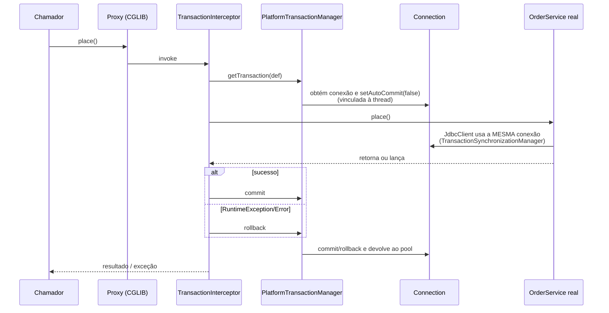

# Transações no Spring

> **Resumo:** como o Spring abstrai transações (local, JTA, reativa) e como `@Transactional` funciona por proxy: propagação, isolamento, regras de rollback, `readOnly`, e as armadilhas clássicas (checked exceptions, self-invocation, `UnexpectedRollbackException`).
> **Pré-requisitos:** [07-aop-e-proxies](07-aop-e-proxies.md), [08-eventos-validacao-e-conversao](08-eventos-validacao-e-conversao.md), [08-excecoes](../01-java/08-excecoes.md).
> **Versões:** Spring Framework 7.0.8, H2 2.3.232, Java 25. Todos os cenários de §5 foram executados.

## 1. Definição

**Transação**: unidade de trabalho que ou **efetiva tudo** (*commit*) ou **desfaz tudo** (*rollback*). Propriedades ACID: Atomicidade, Consistência, Isolamento, Durabilidade.

**Gerenciamento de transações do Spring**: uma camada que oferece um modelo de programação **único** sobre tecnologias diferentes (JDBC, JPA/Hibernate, JTA, R2DBC), de forma **declarativa** (`@Transactional`) ou **programática** (`TransactionTemplate`).

Problema que resolve: abrir conexão, `setAutoCommit(false)`, `commit`/`rollback`, `finally` e fechar, repetido em todo método e acoplado a uma tecnologia. O Spring centraliza isso e garante que todas as operações de uma "unidade de trabalho" usem **a mesma conexão**.

## 2. Conceitos fundamentais

### 2.1 As abstrações

| Tipo | Papel |
|---|---|
| `PlatformTransactionManager` (imperativo) / `ReactiveTransactionManager` | decide *begin/commit/rollback* para uma tecnologia |
| `TransactionDefinition` | propagação, isolamento, timeout, `readOnly`, nome |
| `TransactionStatus` | estado corrente (nova? só-rollback? concluída?) |
| `TransactionTemplate` | API programática |
| `@Transactional` | API declarativa (proxy → [07](07-aop-e-proxies.md)) |

Implementações do gerenciador: `DataSourceTransactionManager` (JDBC puro, `JdbcClient`/`JdbcTemplate`), `JpaTransactionManager` (JPA/Hibernate, também cobre JDBC no mesmo `DataSource`), `JtaTransactionManager` (XA, múltiplos recursos), `R2dbcTransactionManager`. O Boot escolhe por auto-configuração ([Boot 06](../03-spring-boot/06-spring-data-jpa.md)).

### 2.2 Propagação (`Propagation`)

Define o que acontece quando um método transacional é chamado **dentro** de outra transação:

| Valor | Já existe transação | Não existe |
|---|---|---|
| **`REQUIRED`** (padrão) | participa dela | cria nova |
| **`REQUIRES_NEW`** | **suspende** a atual e cria uma independente | cria nova |
| `SUPPORTS` | participa | roda sem transação |
| `NOT_SUPPORTED` | suspende e roda sem | roda sem |
| `MANDATORY` | participa | **lança** `IllegalTransactionStateException` |
| `NEVER` | **lança** exceção | roda sem |
| `NESTED` | cria *savepoint* na mesma transação física (só alguns gerenciadores, JDBC) | cria nova |

`REQUIRED` significa uma única transação **física**; os métodos internos são "transações lógicas" que compartilham o mesmo destino. Se qualquer participante marcar *rollback-only*, **tudo** será desfeito (§3.3).

### 2.3 Isolamento (`Isolation`)

Controla o que uma transação enxerga de outras concorrentes. É um atributo do **banco**; o Spring apenas o repassa à conexão.

| Nível | Impede | Ainda permite |
|---|---|---|
| `READ_UNCOMMITTED` | nada | dirty read, non-repeatable read, phantom |
| `READ_COMMITTED` | dirty read | non-repeatable read, phantom |
| `REPEATABLE_READ` | + non-repeatable read | phantom (varia por banco) |
| `SERIALIZABLE` | todos | (custo de concorrência) |
| `DEFAULT` (padrão) | usa o do banco | PostgreSQL/Oracle: `READ_COMMITTED`; MySQL InnoDB: `REPEATABLE_READ` |

Os padrões por banco acima são os documentados pelos fornecedores (não executados aqui); confirme no seu SGBD, pois o comportamento real (MVCC, bloqueios) é do banco.

### 2.4 Regras de rollback (o ponto mais mal compreendido)

**Por padrão, o rollback ocorre para `RuntimeException` e `Error`, mas NÃO para exceções checked.** (Por isso a exceção checked "confirma" a transação.) Isso vem da convenção do EJB: checked = condição de negócio recuperável.

```java
@Transactional                                   // checked IOException → COMMIT
@Transactional(rollbackFor = IOException.class)  // → rollback
@Transactional(noRollbackFor = DuplicateKeyException.class) // runtime que NÃO desfaz
```

Existem também `rollbackForClassName`/`noRollbackForClassName`. No Framework 7.0, `@EnableTransactionManagement(rollbackOn = RollbackOn.ALL_EXCEPTIONS)` muda o padrão **global** para desfazer também em checked (o padrão é `RollbackOn.RUNTIME_EXCEPTIONS`); confirmado por `javap` no 7.0.8.

### 2.5 `readOnly`, `timeout`

- `readOnly = true`: **dica** ao driver/ORM/gerenciador (ex.: Hibernate evita *dirty checking*/flush; alguns drivers roteiam para réplica). **Não impede** gravações em todos os bancos; não é uma garantia de segurança.
- `timeout`: segundos até o `TransactionTimedOutException`.

## 3. Como funciona por dentro

### 3.1 O caminho de uma chamada `@Transactional`



Elementos-chave:

- O interceptor é `TransactionInterceptor`; ele lê os atributos de `@Transactional` via `AnnotationTransactionAttributeSource` (método → classe; **a anotação no método vence**).
- **`TransactionSynchronizationManager`** guarda, em `ThreadLocal`, a conexão/sessão da transação atual. `JdbcClient`/`JdbcTemplate`/`EntityManager` consultam esse local para reutilizar a conexão. Por isso: **a transação pertence à thread**. Outra thread (`@Async`, `parallelStream`, `CompletableFuture`) **não** participa dela.
- Em chamadas reativas o contexto trafega no `Context` do Reactor, não em `ThreadLocal`.

### 3.2 Como `REQUIRES_NEW` funciona

O gerenciador **suspende** o recurso da transação atual (desvincula a conexão da thread, guardando-a), abre **outra conexão** do pool, executa e comita/desfaz de forma independente; ao terminar, **restaura** a anterior. Consequência: exige 2 conexões simultâneas (cuidado com *pool starvation*) e o que a interna comitou **fica** mesmo se a externa desfizer (validado em §5.1: `withAudit` → 1 linha de auditoria permaneceu).

### 3.3 Rollback-only e `UnexpectedRollbackException`

Com `REQUIRED`, a transação interna é só "lógica". Quando ela lança uma `RuntimeException` e o interceptor interno decide *rollback*, ele **não pode desfazer** de fato (a física pertence à externa): marca a transação global como **rollback-only**. Se a externa **capturar** a exceção e seguir, ao tentar `commit` o gerenciador percebe a marca e lança `UnexpectedRollbackException` (validado: §5.1 `swallow`, resultado 0 linhas). A transação externa nunca consegue "ignorar" um rollback interno.

### 3.4 Ordem em `@Transactional` + outros recursos

O `TransactionInterceptor` é um advisor como os demais ([07 §3.5](07-aop-e-proxies.md)). Em `@Cacheable` + `@Transactional`, quem fica mais externo muda se o cache é lido dentro ou fora da transação. Em `@Async` + `@Transactional`, a transação começa **na thread nova** (não herda a do chamador).

### 3.5 Eventos transacionais e `TransactionSynchronization`

`TransactionSynchronizationManager.registerSynchronization(...)` permite callbacks `beforeCommit`/`afterCommit`/`afterCompletion`. É a base de `@TransactionalEventListener` ([08 §2.2](08-eventos-validacao-e-conversao.md)).

## 4. Evolução histórica

| Era | Como era |
|---|---|
| Pré-Spring | JDBC/JTA manual; transações declarativas só em EJB (CMT) com servidor de aplicação |
| Spring 1.x | `TransactionProxyFactoryBean` em XML; transação declarativa sem EJB |
| 2.0 | `<tx:annotation-driven/>` e `@Transactional` |
| 3.x–4.x | `@EnableTransactionManagement`; `@TransactionalEventListener` (4.2) |
| 5.2 | transações **reativas** (`ReactiveTransactionManager`) |
| 6.0 | `jakarta.transaction` (`javax` → `jakarta`); suporte AOT |
| 6.1 | `JdbcClient` |
| 7.0 | `@EnableTransactionManagement(rollbackOn = ...)` para regra global de rollback |

Para a linha geral, [01 §4](01-o-que-e-spring.md).

## 5. Exemplos práticos

### 5.1 Matriz de comportamento (executada em H2)

Setup: `DataSourceTransactionManager`, `JdbcClient`, `@EnableTransactionManagement`; `Orders` insere em `orders(id)`.

```java
@Service
class OrderService {
    private final Orders orders; private final Audit audit;
    OrderService(Orders o, Audit a) { orders = o; audit = a; }

    @Transactional public void okCommit(String id) { orders.insert(id); }

    @Transactional public void runtimeFail(String id) {
        orders.insert(id); throw new IllegalStateException("boom");
    }

    @Transactional public void checkedFail(String id) throws IOException {
        orders.insert(id); throw new IOException("checked");
    }

    @Transactional(rollbackFor = IOException.class)
    public void checkedRollback(String id) throws IOException {
        orders.insert(id); throw new IOException("checked");
    }

    @Transactional public void withAudit(String id) {
        orders.insert(id); audit.logNew(id);          // Audit: REQUIRES_NEW
        throw new IllegalStateException("boom");
    }

    @Transactional public void swallow(String id) {
        orders.insert(id);
        try { audit.fail(); } catch (IllegalStateException e) { /* engolida */ }
    }

    @Transactional public void setRollbackOnly(String id) {
        orders.insert(id);
        TransactionAspectSupport.currentTransactionStatus().setRollbackOnly();
    }

    public void inner(String id) { outerSelf(id); }                 // self-invocation
    @Transactional public void outerSelf(String id) { orders.insert(id); throw new IllegalStateException("x"); }

    public void noTx() { audit.mandatory(); }                       // Audit.mandatory: MANDATORY
}
```

Resultados reais (linhas na tabela após a chamada):

| Cenário | Exceção | Linhas | Leitura |
|---|---|---|---|
| `okCommit` | nenhuma | **1** | commit |
| `runtimeFail` | `IllegalStateException` | **0** | rollback padrão |
| `checkedFail` | `IOException` (embrulhada pelo helper do teste) | **1** | **checked → COMMIT!** |
| `checkedRollback` | `IOException` | **0** | `rollbackFor` corrige |
| `withAudit` | `IllegalStateException` | **1** | pedido desfeito, **auditoria `REQUIRES_NEW` permaneceu** |
| `swallow` | **`UnexpectedRollbackException`** | **0** | rollback-only de transação interna não pode ser ignorado |
| `setRollbackOnly` | nenhuma | **0** | rollback programático sem exceção |
| `inner` → `outerSelf` | `IllegalStateException` | **1** | **self-invocation: sem transação, o `insert` ficou** |
| `noTx` (MANDATORY) | `IllegalTransactionStateException` | 0 | exige transação existente |

O cenário `inner` é o mais perigoso: o método **parece** transacional e **não é**. Cada `insert` roda em auto-commit; lançar a exceção não desfaz nada.

### 5.2 Programático com `TransactionTemplate` (executado)

```java
var tt = new TransactionTemplate(transactionManager);

tt.executeWithoutResult(status -> {       // rollback explícito
    orders.insert("t");
    status.setRollbackOnly();             // → 0 linhas
});

tt.executeWithoutResult(status -> orders.insert("t"));   // commit → 1 linha
```

Quando preferir: controle fino (transação só em parte do método), código fora de beans proxied, ou para evitar self-invocation sem criar outra classe. Exceções `RuntimeException` dentro do callback também provocam rollback.

### 5.3 Onde colocar `@Transactional`

```java
// Camada de serviço (caso de uso = fronteira transacional)
@Service
class PlaceOrderUseCase {
    @Transactional
    public OrderId execute(PlaceOrder cmd) {
        // 1 caso de uso = 1 transação curta
    }
}
```

Regra de ouro: **transação na fronteira do caso de uso (serviço)**, não no repositório nem no controller; mantenha-a **curta** (sem chamadas HTTP externas, sem esperar usuário). Para efeitos externos (e-mail, mensageria) use `@TransactionalEventListener(AFTER_COMMIT)` ou o padrão **Outbox** ([06-padroes/07](../06-padroes-de-projeto/07-padroes-de-microsservicos.md)).

### 5.4 Leitura e relação com JPA <!-- não compilado -->

```java
@Service
class OrderQueries {
    @Transactional(readOnly = true)
    public List<OrderSummary> recent() { /* ... */ }
}
```

Com JPA, uma `@Transactional` abre também o `EntityManager`/*persistence context*; entidades carregadas dentro dela ficam gerenciadas e alterações são gravadas no `flush`/commit. Detalhes (e `Open Session in View`) em [Boot 06](../03-spring-boot/06-spring-data-jpa.md) e [08-anti-padroes](../06-padroes-de-projeto/08-anti-padroes.md).

## 6. Configurações e anotações relevantes

| Anotação / API | Para que serve | Exemplo |
|---|---|---|
| `@EnableTransactionManagement` | liga o suporte declarativo | `@EnableTransactionManagement(proxyTargetClass = true)` |
| `@Transactional` | demarca a transação | `@Transactional(rollbackFor = Exception.class)` |
| `propagation`, `isolation` | ver §2.2/§2.3 | `propagation = REQUIRES_NEW` |
| `readOnly`, `timeout` | otimização / limite | `@Transactional(readOnly = true, timeout = 5)` |
| `rollbackFor` / `noRollbackFor` | regras de rollback | `rollbackFor = IOException.class` |
| `transactionManager` / `value` | escolher o gerenciador (com vários) | `@Transactional("ordersTm")` |
| `TransactionTemplate` | programático | ver §5.2 |
| `TransactionAspectSupport.currentTransactionStatus()` | `setRollbackOnly` | ver §5.1 |
| `@TransactionalEventListener` | reagir a fases | [08](08-eventos-validacao-e-conversao.md) |
| `spring.transaction.default-timeout` / `rollback-on-commit-failure` (Boot) | padrões globais | existem no Boot 4.1.2 (módulo `spring-boot-transaction`); sem valor padrão definido |
| `spring.jpa.open-in-view` (Boot) | Open Session in View (padrão `true`, desaconselhado) | `false` |

## 7. Quando usar e quando NÃO usar

- **Use** `@Transactional` nos **métodos públicos de serviço** que fazem várias gravações que devem ser atômicas.
- **Não** anote repositórios Spring Data para "garantir" atomicidade de um caso de uso (eles já têm transação por operação; o serviço agrupa).
- **Não** use `@Transactional` em métodos que chamam serviços externos lentos (HTTP, filas): segura conexão do pool e bloqueios do banco.
- **Não** use `readOnly = true` como mecanismo de segurança.
- **Não** use `REQUIRES_NEW` por reflexo: duplica conexões e pode gerar **deadlock** com a externa (a interna espera locks que a externa segura).
- **Transações distribuídas (XA/JTA)** raramente valem o custo em microsserviços: prefira consistência eventual (Saga/Outbox, [06-padroes/07](../06-padroes-de-projeto/07-padroes-de-microsservicos.md)).
- Com **virtual threads**/reativo: o modelo `ThreadLocal` funciona com virtual threads; no reativo use `ReactiveTransactionManager`/`TransactionalOperator`.

## 8. Erros comuns e boas práticas

- **Checked exception não faz rollback** (padrão). Use `rollbackFor` ou lance `RuntimeException`.
- **Self-invocation** (§3.2 do [07](07-aop-e-proxies.md), §5.1 aqui): mova para outro bean ou use `TransactionTemplate`.
- **Método `private`/`final`/`static`** ou classe `final` com CGLIB: sem transação (e sem erro).
- **Engolir exceção** dentro de método transacional, achando que o commit prossegue: ou o rollback não acontece (a exceção nunca chegou ao interceptor) ou ocorre `UnexpectedRollbackException`.
- **Iniciar thread própria** (`new Thread`, `@Async`, `parallelStream`) esperando participar da transação.
- **Conexão presa**: transações longas esgotam o pool (`HikariPool ... Connection is not available`).
- **Misturar tecnologias** sem o gerenciador certo (JPA + JdbcTemplate: use `JpaTransactionManager` para compartilhar a conexão).
- **`@Transactional` em interface** com proxy de classe: pode não ser lido; anote a **implementação**.
- **Lazy loading fora da transação** → `LazyInitializationException` (JPA).
- **Boa prática**: transações curtas, na camada de serviço, `readOnly=true` em consultas, regras de rollback explícitas, testes que verificam rollback de verdade (como a matriz de §5.1), `@TransactionalEventListener`/Outbox para efeitos externos.

## 9. Perguntas de revisão

1. **Qual o padrão de rollback do `@Transactional` e como mudá-lo?**
   <details><summary>Resposta</summary>Desfaz para `RuntimeException` e `Error`; **não** para exceções checked. Altera com `rollbackFor`/`noRollbackFor` (ou lançando uma runtime).</details>
2. **Por que um método `@Transactional` chamado de dentro da própria classe não abre transação?**
   <details><summary>Resposta</summary>Porque `this` é o objeto real, não o proxy que contém o `TransactionInterceptor`. Solução: outro bean, `TransactionTemplate`, auto-injeção ou AspectJ.</details>
3. **Qual a diferença entre `REQUIRED` e `REQUIRES_NEW`?**
   <details><summary>Resposta</summary>`REQUIRED` participa da transação existente (uma física). `REQUIRES_NEW` suspende a atual e abre outra, independente, com commit/rollback próprios e outra conexão.</details>
4. **O que causa `UnexpectedRollbackException`?**
   <details><summary>Resposta</summary>Um participante de transação `REQUIRED` falhou e marcou a transação global como rollback-only; a externa capturou o erro e tentou commit. O Spring avisa que o commit foi convertido em rollback.</details>
5. **Por que uma transação não "atravessa" uma `parallelStream` ou `@Async`?**
   <details><summary>Resposta</summary>Porque o estado da transação (conexão) está em `ThreadLocal` (`TransactionSynchronizationManager`); outra thread não o enxerga e abre/usa outra conexão sem transação.</details>

## 10. Referências oficiais

- Transaction Management: <https://docs.spring.io/spring-framework/reference/data-access/transaction.html>
- Declarative transactions e propagação: <https://docs.spring.io/spring-framework/reference/data-access/transaction/declarative.html>
- Transaction-bound events: <https://docs.spring.io/spring-framework/reference/data-access/transaction/event.html>
- Javadoc `@Transactional`: <https://docs.spring.io/spring-framework/docs/current/javadoc-api/org/springframework/transaction/annotation/Transactional.html>
- Spring Framework: <https://spring.io/projects/spring-framework>
