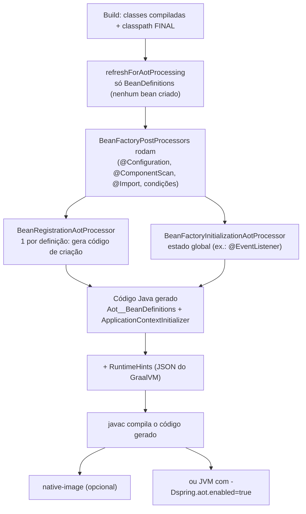

# AOT e native image no Spring

> **Resumo:** o processamento AOT (*Ahead-of-Time*) do Spring executa no **build** o que o contêiner normalmente faz em **runtime** (ler configuração, decidir beans, usar reflection) e gera código Java comum e *hints* para o GraalVM. É o que torna possível compilar uma aplicação Spring como executável nativo, com partida em milissegundos e menos memória, em troca de flexibilidade.
> **Pré-requisitos:** [06-como-java-e-spring-conversam](06-como-java-e-spring-conversam.md), [10-anotacoes-e-reflection](../01-java/10-anotacoes-e-reflection.md), [01-plataforma-java §CDS/native](../01-java/01-plataforma-java.md), [05-configuracao](05-configuracao.md).
> **Versões:** Spring Framework 7.0.8, Java 25. A geração AOT (§5.1) foi **executada**; a compilação com `native-image` **não** (GraalVM não está instalado no ambiente), por isso §5.3 está marcada `<!-- não compilado -->`.

## 1. Definição

- **AOT do Spring**: etapa de build que inspeciona o `ApplicationContext` (apenas as *definições*, sem criar beans) e produz: **código-fonte Java** que registra os beans, **bytecode** de proxies e `RuntimeHints` (reflection, recursos, serialização, proxies JDK).
- **GraalVM Native Image**: compilador AOT que transforma uma aplicação Java em executável nativo **fechando o mundo** (*closed world*): só entra o que é alcançável pela análise estática; reflection, recursos e proxies dinâmicos precisam ser declarados.
- **`RuntimeHints`**: o "manifesto" que diz ao GraalVM o que será acessado dinamicamente.

Problema que resolve: o Spring clássico depende de reflection, scanning de classpath e proxies gerados em runtime ([06](06-como-java-e-spring-conversam.md)), tudo o que o `native-image` não enxerga. O AOT **converte** essas decisões dinâmicas em código estático e declarações.

Ganhos típicos de um executável nativo: partida muito mais rápida, menos memória em repouso, binário sem JVM (bom para *serverless*/escala a zero). Custos: build lento e pesado, menos dinamismo, pico de throughput normalmente **menor** que o do JIT, depuração/monitoramento diferentes.

## 2. Conceitos fundamentais

### 2.1 JIT vs AOT, JVM vs nativo

| | JVM (JIT) | JVM + AOT do Spring | Native image |
|---|---|---|---|
| Decisões do contêiner | em runtime | no build | no build |
| Reflection/proxy | livre | menos usada (código gerado) | só o declarado |
| Partida | lenta (carrega e aquece) | um pouco melhor | muito rápida |
| Pico de desempenho | alto (JIT adaptativo) | alto | geralmente menor (⚠️ depende de PGO) |
| Memória | maior | maior | menor |
| Build | rápido | rápido | lento (minutos, GBs de RAM) |

Alternativas para partida rápida **sem** native: CDS/AppCDS e Project Leyden (AOT cache) ([01-plataforma-java](../01-java/01-plataforma-java.md)), CRaC (checkpoint/restore). O AOT do Spring combina com elas: `-Dspring.aot.enabled=true` na JVM aproveita o código gerado. O cache AOT da JVM foi medido com um app Boot 4.1.2 em [03-spring-boot/13](../03-spring-boot/13-empacotamento-e-deploy.md) (2,7 s → 1,75 s); CRaC com Boot 4.1 não foi executado.

### 2.2 As fases do processamento AOT

A doc do Framework descreve o ponto de entrada `ApplicationContextAotGenerator`:



Na etapa de refresh AOT só são invocados `MergedBeanDefinitionPostProcessor` e `SmartInstantiationAwareBeanPostProcessor` entre os BPPs. No fim, o resultado é uma classe `ApplicationContextInitializer` que monta o contexto **sem scanning nem reflection** para criar os beans.

### 2.3 Hints

O `native-image` precisa saber de antemão o que será acessado por reflection, quais recursos do classpath serão lidos, que classes serão serializadas e que interfaces terão proxy JDK. A API:

| Hint | O que declara | Exemplo |
|---|---|---|
| `hints.reflection()` | tipos/membros acessados por reflection | `registerType(Order.class, MemberCategory.INVOKE_DECLARED_CONSTRUCTORS)` |
| `hints.resources()` | arquivos do classpath | `registerPattern("templates/*.txt")` |
| `hints.proxies()` | interfaces de proxy JDK | `registerJdkProxy(PaymentGateway.class)` |
| `hints.serialization()` | tipos `Serializable` | `registerType(TypeReference.of(Order.class))` |

O Spring **infere** muitos hints sozinho (tipos de retorno de controllers para JSON, `@ConfigurationProperties`, entidades JPA). Você declara só o que o framework não consegue ver (reflection feita por você, recursos lidos por nome dinâmico).

## 3. Como funciona por dentro

### 3.1 Antes e depois: o mesmo bean

Em runtime clássico, para criar `OrderService` o `ConstructorResolver` usa reflection (`getDeclaredConstructors`, `newInstance`). No AOT, o gerador emite **chamada direta ao construtor** (resultado real, §5.1):

```java
// Aot__BeanDefinitions.java (GERADO)
private static BeanInstanceSupplier<Aot.OrderService> getOrderServiceInstanceSupplier() {
  return BeanInstanceSupplier.<Aot.OrderService>forConstructor(Aot.OrderRepository.class, Aot.PaymentGateway.class)
          .withGenerator((registeredBean, args) -> new Aot.OrderService(args.get(0), args.get(1)));
}

public static BeanDefinition getOrderServiceBeanDefinition() {
  RootBeanDefinition beanDefinition = new RootBeanDefinition(Aot.OrderService.class);
  beanDefinition.setInstanceSupplier(getOrderServiceInstanceSupplier());
  return beanDefinition;
}
```

`@Bean` vira `forFactoryMethod(...)` com chamada direta ao método (`...getBean("aot.Cfg", Aot.Cfg.class).banner()`). A `@Configuration` já foi proxied em **build** (as classes `Aot$Cfg$$SpringCGLIB$$0` e `FastClass` aparecem como arquivos `.class` gerados), pois no nativo não há geração de classes em runtime.

### 3.2 Decisões congeladas no build

Como a lógica roda no build, o contexto "enxerga" apenas **o que o build viu**. A doc oficial lista:

- **Classpath fixo**: o que está no classpath do build é o que existe.
- **`@Profile`**: perfis são escolhidos no build e ativados automaticamente em runtime. No experimento (§5.1) o bean `@Profile("dev") DevOnly` **não aparece** no código gerado, pois `dev` não estava ativo.
- **`@Conditional*` por propriedades do `Environment`** são avaliados **só no build** (não dá mais para ligar/desligar bean por propriedade no deploy).
- **Instance suppliers (lambdas) e `registerSingleton`**: não podem ser transformados.
- **Component scan** ocorre no build; não funciona em imagem nativa.
- **Tipo do bean tão preciso quanto possível**, pois o contêiner não instancia no build.

### 3.3 O que o `native-image` acrescenta

- **Análise de alcançabilidade** a partir do `main`: classes não alcançáveis são removidas.
- **Inicialização em build-time**: classes podem ser inicializadas durante o build (estado estático congelado na imagem). Cuidado com `static` que lê ambiente, hora ou aleatoriedade.
- **Sem `ClassLoader` dinâmico**, sem carregar JARs em runtime, sem `Class.forName` com nomes arbitrários (sem hint).
- **Proxies**: JDK só para interfaces declaradas; CGLIB só as classes **geradas no build** (por isso o AOT as pré-gera).
- **GC e JIT**: SubstrateVM tem seu coletor (Serial/G1 conforme edição/versão, consulte a doc do GraalVM; não conferido aqui); não há JIT, logo o aquecimento é zero mas o pico é menor.

### 3.4 Testando hints

Três ferramentas (da doc oficial):

- `RuntimeHintsPredicates` (em `spring-core`): afirma, em teste unitário, que um `RuntimeHints` contém o esperado.
- **Agente de teste** (`spring-core-test`): grava invocações reais de reflection e confere se os hints cobrem (`@EnabledIfRuntimeHintsAgent`).
- **Tracing agent do GraalVM**: gera JSON de configuração observando a execução.

## 4. Evolução histórica

| Ano | Marco |
|---|---|
| 2019–2021 | Projeto **Spring Native** (experimental): hints manuais por biblioteca |
| 2022 | **Spring Framework 6.0 / Boot 3.0** incorporam AOT e native como suporte oficial; Spring Native é descontinuado |
| 2023–2025 | Mais hints inferidos, `@Reflective`, `@RegisterReflectionForBinding`, integração com testes AOT |
| 7.0 (2025) | AOT continua focado em GraalVM; a doc indica suporte futuro a outros casos de JVM |

Paralelamente, Leyden/CDS/CRaC oferecem partida rápida sem sair da JVM ([00-evolucao-do-java](../01-java/00-evolucao-do-java.md)).

## 5. Exemplos práticos

### 5.1 Gerar o código AOT e inspecioná-lo (executado)

```java
public class Aot {
    public interface PaymentGateway { String charge(long c); }
    @Component public static class CardGateway implements PaymentGateway { public String charge(long c) { return "ok"; } }
    @Repository public static class OrderRepository {}

    @Service @ImportRuntimeHints(OrderService.Hints.class)
    public static class OrderService {
        public OrderService(OrderRepository r, PaymentGateway g) {}
        static class Hints implements RuntimeHintsRegistrar {
            public void registerHints(RuntimeHints h, ClassLoader cl) {
                h.resources().registerPattern("templates/*.txt");
            }
        }
    }

    @Profile("dev") @Component public static class DevOnly {}

    @Configuration @ComponentScan(basePackageClasses = Aot.class)
    public static class Cfg { @Bean String banner() { return "hi"; } }

    public static void main(String[] a) {
        var ctx = new GenericApplicationContext();
        new AnnotatedBeanDefinitionReader(ctx).register(Cfg.class);
        var files = new FileSystemGeneratedFiles(Path.of("gen"));
        var gen = new DefaultGenerationContext(
                new ClassNameGenerator(ClassName.get("aot", "Aot")), files);   // ClassName = org.springframework.javapoet
        var initializer = new ApplicationContextAotGenerator().processAheadOfTime(ctx, gen);
        gen.writeGeneratedContent();
        System.out.println("initializer: " + initializer);
    }
}
```

Saída: `initializer: aot.Aot__ApplicationContextInitializer`. Arquivos gerados em `gen/`:

```text
sources/aot/Aot__ApplicationContextInitializer.java   ← ponto de entrada
sources/aot/Aot__BeanDefinitions.java                 ← 1 método por bean (sem reflection)
sources/aot/Aot__BeanFactoryRegistrations.java
sources/org/springframework/context/event/...         ← @EventListener infra
classes/aot/Aot$Cfg$$SpringCGLIB$$0.class (+FastClass) ← proxy da @Configuration gerado no build
```

Observações confirmadas: `OrderService` é criado com `new` direto (§3.1); `DevOnly` **não** está no código gerado; o hint `templates/*.txt` foi registrado. O fluxo real de um projeto não é escrito à mão assim: as ferramentas de build (Maven/Gradle do Boot) chamam o mesmo mecanismo (`process-aot`).

### 5.2 Declarar hints para reflection própria <!-- não compilado -->

```java
@Component
@ImportRuntimeHints(ReportTemplates.Hints.class)
class ReportTemplates {
    String load(String name) throws IOException {
        // nome dinâmico → o GraalVM não descobre sozinho
        return new ClassPathResource("reports/" + name + ".txt").getContentAsString(StandardCharsets.UTF_8);
    }

    static class Hints implements RuntimeHintsRegistrar {
        public void registerHints(RuntimeHints hints, ClassLoader cl) {
            hints.resources().registerPattern("reports/*.txt");
        }
    }
}

// Para reflection via anotação:
@RegisterReflectionForBinding(OrderDto.class)   // serialização/binding de DTO
class WebhookHandler { /* ... */ }
```

Teste do hint:

```java
@Test
void registersReportResources() {
    var hints = new RuntimeHints();
    new ReportTemplates.Hints().registerHints(hints, getClass().getClassLoader());
    assertThat(RuntimeHintsPredicates.resource().forResource("reports/daily.txt")).accepts(hints);
}
```

### 5.3 Compilar para nativo (visão de Spring Boot) <!-- não compilado -->

No Boot, o plugin Maven/Gradle cuida de AOT + `native-image`. Ordem típica:

```text
mvn -Pnative native:compile            # Maven (perfil 'native' do parent do Boot)
./gradlew nativeCompile                # Gradle
mvn -Pnative spring-boot:build-image   # imagem de contêiner nativa via Buildpacks
```

Detalhes e verificações em [Boot 13](../03-spring-boot/13-empacotamento-e-deploy.md). A doc do Boot 4.1 exige GraalVM 25 ou superior; o perfil `native` e o `native-maven-plugin` existem no `spring-boot-starter-parent` 4.1.2 (conferido no POM). Na JVM, para validar o código AOT sem nativo: `java -Dspring.aot.enabled=true -jar app.jar`.

### 5.4 Escrevendo código "amigo do AOT"

```java
@Configuration
class PaymentConfig {
    @Bean                                  // retorne o TIPO CONCRETO, não a interface
    CardGateway cardGateway(Clock clock) { // parâmetros simples/beans, nada de estruturas complexas
        return new CardGateway(clock);
    }
}
```

- evite `@Bean` retornando `Object`/interface genérica quando a decisão do tipo importa;
- evite vários construtores (use `@Autowired` no preferido);
- evite `getBean(name, args)`; use fábrica;
- evite dependências circulares (`@Lazy`/`ObjectProvider`);
- `FactoryBean`: declare o genérico resolvido.

## 6. Configurações e anotações relevantes

| Item | Para que serve | Exemplo |
|---|---|---|
| `-Dspring.aot.enabled=true` | usa o código AOT gerado na JVM | `java -Dspring.aot.enabled=true -jar app.jar` |
| `@ImportRuntimeHints` | registra `RuntimeHintsRegistrar` junto do componente | ver §5.2 |
| `RuntimeHintsRegistrar` | contrato para declarar hints | `registerHints(hints, cl)` |
| `META-INF/spring/aot.factories` | registro global de processors/registrars | `org.springframework.aot.hint.RuntimeHintsRegistrar=...` |
| `@Reflective` | marca elemento que será acessado por reflection | meta-anotação de `@EventListener` |
| `@ReflectiveScan` | varre pacotes atrás de `@Reflective` | `@ReflectiveScan("com.example.orders")` |
| `@RegisterReflection` | declara reflection em tipos arbitrários | `@RegisterReflection(classes = X.class, memberCategories = ...)` |
| `@RegisterReflectionForBinding` | serialização/binding de DTOs | `@RegisterReflectionForBinding(OrderDto.class)` |
| `BeanRegistrationAotProcessor` | customiza o código gerado por bean | extensão avançada |
| `BeanFactoryInitializationAotProcessor` | contribuição global | extensão avançada |
| `RuntimeHintsPredicates` | testar hints | ver §5.2 |

## 7. Quando usar e quando NÃO usar

**Use nativo quando:**
- partida e memória são críticas: *serverless*, escala a zero, CLIs, muitas instâncias pequenas;
- o conjunto de funcionalidades é estável e fechado (sem plugins carregados em runtime).

**Não use (ou adie) quando:**
- throughput de pico e latência sustentada são prioridade (o JIT costuma vencer em carga contínua);
- o app depende de reflection pesada, plugins, `ClassLoader` dinâmico, bibliotecas sem metadados GraalVM;
- o time precisa de ciclo de build rápido (a compilação nativa leva minutos) ou de ferramentas JVM (JFR completo, agentes, debug) ;
- beans são ligados/desligados por propriedades em tempo de deploy (as condições ficam congeladas no build).

**Alternativas na JVM** (partida rápida sem perder dinamismo): CDS/AppCDS, Leyden, CRaC, virtual threads para aproveitar recursos ([12-concorrencia](../01-java/12-concorrencia.md)), ajuste de JIT.

Para a maioria das aplicações de negócio, **JVM tradicional continua a escolha padrão**; nativo é uma otimização com contrapartidas, não um destino obrigatório.

## 8. Erros comuns e boas práticas

- **Funciona na JVM, falha no nativo** com `ClassNotFoundException`, `NoSuchMethodException` ou recurso ausente: faltou hint. Rode a aplicação com o agente de tracing do GraalVM e/ou use os testes de hints.
- **Condição por propriedade que "não funciona" no deploy**: foi avaliada no build.
- **Perfil trocado no deploy**: no AOT os perfis são fixados no build.
- **Reflection em bibliotecas de terceiros sem metadados**: verifique o *GraalVM Reachability Metadata Repository* ou escreva hints.
- **Estado `static` inicializado no build** (hora, variáveis de ambiente, geradores): vira constante na imagem.
- **Imagem nativa em Docker sem memória suficiente no build**: `native-image` consome vários GB.
- **Medir só partida e ignorar o throughput**: compare com carga realista (JIT vs nativo).
- **Boa prática**: teste a aplicação **nativa** no CI (testes nativos), escreva `@Bean` com tipos concretos, centralize hints perto do código que os exige, mantenha dependências com suporte conhecido a nativo, e comece sem nativo: adote quando houver meta de partida/memória a cumprir.

## 9. Perguntas de revisão

1. **O que o processamento AOT do Spring gera e o que ele evita em runtime?**
   <details><summary>Resposta</summary>Gera código Java de registro/criação dos beans, bytecode de proxies e `RuntimeHints`. Evita scanning de classpath, leitura de metadados por reflection e a criação de proxies em runtime.</details>
2. **Por que `@Profile` e `@Conditional` em propriedades se comportam diferente no AOT?**
   <details><summary>Resposta</summary>Porque as condições são avaliadas durante o build; o conjunto de beans é fixado então. Perfis são escolhidos no build e ativados automaticamente em runtime.</details>
3. **O que são `RuntimeHints` e quando preciso escrevê-los?**
   <details><summary>Resposta</summary>São declarações para o GraalVM (reflection, recursos, proxies, serialização). O Spring infere vários, mas é preciso declarar usos dinâmicos próprios, via `@ImportRuntimeHints`, `@Reflective`/`@RegisterReflection*`.</details>
4. **Por que o código gerado cria `OrderService` com `new` em vez de reflection?**
   <details><summary>Resposta</summary>Porque no nativo reflection exige declaração e é mais custosa; o gerador emite a chamada direta ao construtor, que a análise estática enxerga e que é mais rápida.</details>
5. **Cite duas razões para não adotar native image.**
   <details><summary>Resposta</summary>Pico de throughput normalmente menor que JIT; builds lentos e pesados; menos dinamismo (reflection, plugins, condições por propriedade em deploy); ferramentas JVM limitadas; dependências sem suporte.</details>

## 10. Referências oficiais

- Ahead of Time Optimizations (Spring Framework): <https://docs.spring.io/spring-framework/reference/core/aot.html>
- GraalVM Native Image: <https://www.graalvm.org/latest/reference-manual/native-image/>
- GraalVM Reachability Metadata: <https://github.com/oracle/graalvm-reachability-metadata>
- Spring Boot Native Image Support: <https://docs.spring.io/spring-boot/reference/packaging/native-image/index.html>
- Spring Framework: <https://spring.io/projects/spring-framework>
