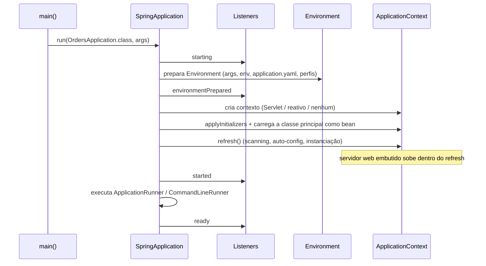

# O que é o Spring Boot

> **Resumo:** o Spring Boot é uma camada de **convenção sobre configuração** em cima do Spring Framework: starters para dependências, auto-configuração para beans, configuração externalizada e um jar executável com servidor embutido. Ele não substitui o Framework: ele monta o `ApplicationContext` por você.
> **Pré-requisitos:** [01-o-que-e-spring](../02-spring-core/01-o-que-e-spring.md), [03-application-context-e-beans](../02-spring-core/03-application-context-e-beans.md), [05-configuracao](../02-spring-core/05-configuracao.md), [14-modulos-e-build](../01-java/14-modulos-e-build.md).
> **Versões:** Spring Boot 4.1.2 (Framework 7.0.x, Java 17+; compatível até o Java 27), Java 25 nos exemplos. Projeto de §5 compilado e executado.

## 1. Definição

**Spring Boot** é um projeto do ecossistema Spring que reduz o trabalho de **montar e executar** uma aplicação Spring. Ele entrega:

| Pilar | O que faz | Detalhe em |
|---|---|---|
| **Starters** | um artefato que puxa o conjunto coerente de dependências de uma funcionalidade | §2.2 |
| **Auto-configuração** | registra beans conforme o que está no classpath e nas propriedades | [02](02-auto-configuracao.md) |
| **Configuração externalizada** | mesma aplicação, ambientes diferentes, sem recompilar | [03](03-configuracao-externalizada.md) |
| **Execução** | `main()`, servidor embutido, jar executável (*fat jar*) | §3.3 e [13](13-empacotamento-e-deploy.md) |
| **Produção** | Actuator, métricas, health checks | [09](09-actuator-e-observabilidade.md) |

Problema que resolve: com o Spring "puro" você escolhia versões compatíveis de dezenas de bibliotecas, declarava `DataSource`, `EntityManagerFactory`, `DispatcherServlet`, conversores, e empacotava um WAR para um servidor instalado à parte. Isso era repetido em todo projeto. O Boot transforma esse boilerplate em **padrões sensatos que você sobrescreve** quando precisa.

> O Boot **não** gera código nem usa XML mágico: tudo o que ele faz é `@Configuration` condicional comum ([02-spring-core/03](../02-spring-core/03-application-context-e-beans.md)). Entender isso tira o "mágico" do framework.

## 2. Conceitos fundamentais

### 2.1 `@SpringBootApplication`

É uma anotação composta ([10-anotacoes-e-reflection](../01-java/10-anotacoes-e-reflection.md)):

```java
@SpringBootConfiguration      // = @Configuration (marca a classe de configuração principal)
@EnableAutoConfiguration      // liga a auto-configuração (§3.2)
@ComponentScan                // varre o pacote da classe e subpacotes
public @interface SpringBootApplication { ... }
```

Consequência prática: a classe principal deve ficar no **pacote raiz** (`com.example.orders`), porque o scanning começa no pacote dela. Classes em `com.outro` não são encontradas.

### 2.2 Starters e BOM

Um **starter** é um jar quase vazio cujo `pom.xml` declara dependências. Ex.: `spring-boot-starter-webmvc` traz Spring MVC, Jackson, Tomcat e logging. O nome segue `spring-boot-starter-*`; starters de terceiros usam `*-spring-boot-starter` (o prefixo `spring-boot` é reservado ao projeto oficial).

As **versões** vêm do BOM `spring-boot-dependencies`, importado pelo `spring-boot-starter-parent` (ou pelo plugin do Gradle). Você declara a dependência **sem versão**; o Boot garante um conjunto testado em conjunto ([14 §3](../01-java/14-modulos-e-build.md)).

| Starter (Boot 4.x) | Para quê |
|---|---|
| `spring-boot-starter` | núcleo + logging + auto-configuração (base de todos) |
| `spring-boot-starter-webmvc` | aplicações web Servlet (Spring MVC + Tomcat) |
| `spring-boot-starter-webflux` | stack reativa ([05](05-webflux-e-reativo.md)) |
| `spring-boot-starter-data-jpa` | JPA/Hibernate ([06](06-spring-data-jpa.md)) |
| `spring-boot-starter-validation` | Bean Validation |
| `spring-boot-starter-security` | Spring Security ([08](08-spring-security.md)) |
| `spring-boot-starter-actuator` | Actuator ([09](09-actuator-e-observabilidade.md)) |
| `spring-boot-starter-webmvc-test` | testes de MVC ([10](10-testes-no-spring-boot.md)) |

⚠️ No Boot 4, os testes e a auto-configuração foram **modularizados**: existe um módulo por tecnologia (`spring-boot-webmvc`, `spring-boot-jackson`, `spring-boot-tomcat`...), e cada starter de teste acompanha o seu (`...-test`). Ao migrar do 3.x, confira os nomes na [§4](#4-evolução-histórica).

### 2.3 O que o Boot decide por você (e como mudar)

| Decisão padrão | Como alterar |
|---|---|
| Servidor Tomcat embutido, porta 8080 | trocar o starter (Jetty), `server.port` |
| Jackson para JSON | `ServerHttpMessageConvertersCustomizer` ([04](04-web-mvc.md)) |
| Logging via Logback | `logging.*`, `logback-spring.xml` |
| Proxies CGLIB para AOP | `spring.aop.proxy-target-class` ([07](../02-spring-core/07-aop-e-proxies.md)) |
| Bean que você define substitui o do Boot | `@ConditionalOnMissingBean` no lado do Boot ([02](02-auto-configuracao.md)) |

Regra de ouro: **o que você declarou ganha**. Os beans automáticos "recuam" (*back off*).

## 3. Como funciona por dentro

### 3.1 `SpringApplication.run()`



Pontos importantes:

1. **Tipo de aplicação** é deduzido do classpath: Servlet (Spring MVC presente), reativa (WebFlux) ou `NONE`. Pode ser forçado em `spring.main.web-application-type`.
2. O `Environment` é montado **antes** do contexto: por isso `application.yaml` consegue definir perfis e `spring.config.import` ([03](03-configuracao-externalizada.md)).
3. O `refresh()` é exatamente o do Framework ([02-spring-core/06 §3](../02-spring-core/06-como-java-e-spring-conversam.md)). O servidor web sobe em uma etapa do refresh (`onRefresh`/`finishRefresh`), com o `DispatcherServlet` registrado como bean.
4. `CommandLineRunner` e `ApplicationRunner` rodam **depois** que o contexto está pronto: bom lugar para tarefas de inicialização.

### 3.2 `@EnableAutoConfiguration` por dentro

Resumo (detalhado em [02](02-auto-configuracao.md)): a anotação importa um `ImportSelector` que lê o arquivo `META-INF/spring/org.springframework.boot.autoconfigure.AutoConfiguration.imports` de **todos os jars do classpath**, filtra por condições (`@ConditionalOnClass` etc.) e registra as classes sobreviventes como `BeanDefinition`s. É puro Spring Framework.

### 3.3 Jar executável

O `spring-boot-maven-plugin` (`repackage`) gera um jar com layout próprio: classes da aplicação em `BOOT-INF/classes`, dependências em `BOOT-INF/lib`, e `Main-Class: org.springframework.boot.loader.launch.JarLauncher`. O launcher monta um `ClassLoader` que lê jars aninhados ([02-jvm-por-dentro](../01-java/02-jvm-por-dentro.md)) e então chama o `Start-Class` (`OrdersApplication`). Confirmado no `MANIFEST.MF` do projeto de §5. Detalhes em [13](13-empacotamento-e-deploy.md).

## 4. Evolução histórica

Contexto geral em [02-spring-core/01 §4](../02-spring-core/01-o-que-e-spring.md) e [00-evolucao-do-java](../01-java/00-evolucao-do-java.md).

| Boot | Ano (aprox.) | Java mín. | Framework | Marco |
|---|---|---|---|---|
| 1.0 | 2014 | 6 | 4.0 | nasce: starters, auto-config, jar executável, Actuator |
| 2.0 | 2018 | 8 | 5.0 | suporte a WebFlux, Micrometer, HikariCP padrão |
| 3.0 | 2022 | 17 | 6.0 | `javax.*` → `jakarta.*`, AOT/GraalVM nativo, Micrometer Observation |
| 4.0 | 2025 | 17 | 7.0 | base Jakarta EE 11, **modularização** do código, Jackson 3, JSpecify |
| 4.1 | 2026 | 17 (até 27) | 7.0.10+ | linha de referência desta base |

⚠️ VERIFICAR: anos e versões mínimas de 1.x–3.x são de memória (pendência já registrada). Valores do 4.1.2 confirmados em docs.spring.io/spring-boot/system-requirements.html.

Mudanças do Boot 4 que mais afetam código existente (confirmadas ao montar o projeto de §5):

- Classes de teste de MVC movidas: `org.springframework.boot.webmvc.test.autoconfigure.AutoConfigureMockMvc`.
- `@ConfigurationProperties` em records e `@DefaultValue` em `org.springframework.boot.context.properties.bind`.
- JSON usa **Jackson 3** (`tools.jackson.databind`): o pacote mudou, as anotações (`jackson-annotations`) continuam em `com.fasterxml.jackson.annotation`.
- Starter web Servlet passou a se chamar `spring-boot-starter-webmvc` (o `spring-boot-starter-web` ainda existe no repositório Maven, mas prefira o novo nome; ⚠️ VERIFICAR se está deprecado na 4.1).

## 5. Exemplos práticos

### 5.1 O menor projeto

```xml
<parent>
  <groupId>org.springframework.boot</groupId>
  <artifactId>spring-boot-starter-parent</artifactId>
  <version>4.1.2</version>
</parent>
<properties><java.version>25</java.version></properties>
<dependencies>
  <dependency>
    <groupId>org.springframework.boot</groupId>
    <artifactId>spring-boot-starter-webmvc</artifactId>
  </dependency>
</dependencies>
<build><plugins>
  <plugin>
    <groupId>org.springframework.boot</groupId>
    <artifactId>spring-boot-maven-plugin</artifactId>
  </plugin>
</plugins></build>
```

```java
package com.example.orders;

import org.springframework.boot.SpringApplication;
import org.springframework.boot.autoconfigure.SpringBootApplication;

@SpringBootApplication
public class OrdersApplication {
    public static void main(String[] args) {
        SpringApplication.run(OrdersApplication.class, args);
    }
}
```

`mvn package` e `java -jar target/orders-1.jar` bastam. Resultado real da execução: `Tomcat started on port ... (http)` e `Started OrdersApplication in 1.185 seconds`.

### 5.2 O que o Boot montou (relatório de condições)

Rodando com `--debug`, o Boot imprime o **Conditions Evaluation Report**. No projeto de §5.1 com `webmvc` e `validation`, 59 itens "matched", incluindo:

```
DispatcherServletAutoConfiguration matched
ErrorMvcAutoConfiguration#basicErrorController matched
HttpMessageConvertersAutoConfiguration matched
JacksonAutoConfiguration#jacksonJsonMapper matched
```

e entre os que **não** casaram: `GsonHttpMessageConvertersConfiguration` (Gson ausente), `Jackson2HttpMessageConvertersConfiguration...` (Jackson 2 ausente). É a melhor ferramenta de diagnóstico para "por que esse bean existe/não existe?" ([02](02-auto-configuracao.md)).

### 5.3 Código de inicialização com `ApplicationRunner`

```java
@Component
class StartupLogger implements ApplicationRunner {
    private static final Logger log = LoggerFactory.getLogger(StartupLogger.class);
    private final OrdersProperties props;
    StartupLogger(OrdersProperties props) { this.props = props; }

    @Override public void run(ApplicationArguments args) {
        log.info("Moeda padrão: {}", props.currency());
    }
}
```

<!-- não compilado -->

### 5.4 Customizar o `SpringApplication`

```java
public static void main(String[] args) {
    new SpringApplicationBuilder(OrdersApplication.class)
        .bannerMode(Banner.Mode.OFF)
        .profiles("local")
        .run(args);
}
```

<!-- não compilado -->

## 6. Configurações e anotações relevantes

| Item | Para que serve | Exemplo |
|---|---|---|
| `@SpringBootApplication` | classe principal (config + auto-config + scan) | `@SpringBootApplication` |
| `@EnableAutoConfiguration(exclude=...)` / `spring.autoconfigure.exclude` | desligar auto-configurações | `spring.autoconfigure.exclude=...DataSourceAutoConfiguration` |
| `spring.main.web-application-type` | `servlet`, `reactive` ou `none` | `none` em jobs |
| `spring.main.banner-mode` | banner de inicialização | `off` |
| `spring.main.lazy-initialization` | beans criados sob demanda | `true` (⚠️ erros só aparecem no uso) |
| `debug=true` / `--debug` | imprime o relatório de condições | `java -jar app.jar --debug` |
| `ApplicationRunner` / `CommandLineRunner` | rodar código após o contexto subir | §5.3 |
| `spring-boot-devtools` | restart automático em desenvolvimento | `runtime`/`optional`; **nunca** em produção |

## 7. Quando usar e quando NÃO usar

**Use** para praticamente qualquer aplicação Spring nova: APIs, serviços, batch, workers. É o ponto de partida de Spring Cloud e dos demais projetos.

**Pense duas vezes quando:**
- precisa controlar cada bean e o tempo de startup ao milissegundo (Framework puro ou nativo via [AOT](../02-spring-core/10-aot-e-native.md));
- a aplicação será implantada como WAR em servidor compartilhado (possível, mas é o caminho secundário);
- o time não entende o que está sendo auto-configurado: "funciona" até o dia em que não funciona. Aprenda o relatório de condições.

## 8. Erros comuns e boas práticas

1. **Classe principal fora do pacote raiz**: controladores "somem". Mantenha-a na raiz.
2. **Versões fixadas à mão** de dependências gerenciadas pelo BOM: causam conflitos. Deixe o BOM mandar; só sobrescreva por motivo forte (CVE).
3. **`@SpringBootApplication` com `@ComponentScan` extra** apontando para pacotes amplos: sobrescreve o scan padrão.
4. **Excluir auto-configuração para "consertar" erro** sem entender: use `--debug` primeiro.
5. **Devtools em produção**: mantenha como `optional`/`runtime` e fora do jar final (o plugin já o exclui por padrão).
6. **`lazy-initialization` para esconder startup lento**: troca falha rápida por falha em produção.
7. Boas práticas: use um construtor único por bean; use records para propriedades ([03](03-configuracao-externalizada.md)); mantenha um teste de contexto carregando (`@SpringBootTest`).

## 9. Perguntas de revisão

1. O que `@SpringBootApplication` agrega, e por que a posição da classe importa?
<details><summary>Resposta</summary>`@SpringBootConfiguration` + `@EnableAutoConfiguration` + `@ComponentScan`. O scan começa no pacote da classe, então ela deve estar no pacote raiz da aplicação.</details>

2. Qual a diferença entre starter e auto-configuração?
<details><summary>Resposta</summary>Starter resolve **dependências** (jars no classpath). Auto-configuração resolve **beans** (o que é registrado no contexto, com base nesse classpath e nas propriedades).</details>

3. Quem vence quando você define um `ObjectMapper`/`JsonMapper` próprio?
<details><summary>Resposta</summary>O seu: a auto-configuração usa `@ConditionalOnMissingBean` e recua.</details>

4. Como descobrir por que um bean foi (ou não) criado?
<details><summary>Resposta</summary>`--debug` (Conditions Evaluation Report), ou `ConditionEvaluationReport` no Actuator (`/actuator/conditions`).</details>

5. O que existe dentro do jar executável gerado pelo plugin?
<details><summary>Resposta</summary>`BOOT-INF/classes`, `BOOT-INF/lib`, o `JarLauncher` como `Main-Class` e a classe da aplicação como `Start-Class`.</details>

## 10. Referências oficiais

- Spring Boot (projeto): https://spring.io/projects/spring-boot
- Reference: https://docs.spring.io/spring-boot/reference/
- Requisitos de sistema: https://docs.spring.io/spring-boot/system-requirements.html
- Using Spring Boot: https://docs.spring.io/spring-boot/reference/using/index.html
- Javadoc/API: https://docs.spring.io/spring-boot/api/java/index.html (⚠️ VERIFICAR caminho exato; senão use a raiz da doc)
