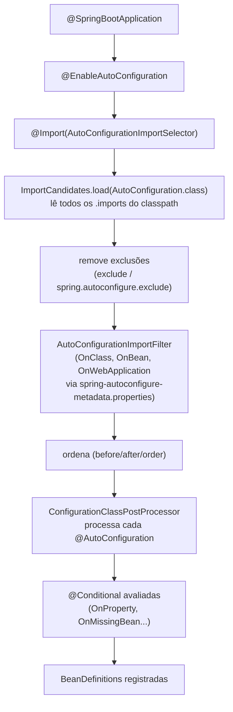

# Auto-configuração

> **Resumo:** a auto-configuração é o mecanismo que registra beans automaticamente conforme o classpath, as propriedades e os beans que você já declarou. Por dentro é só `@Configuration` condicional, descoberta por um arquivo `.imports`. Entendê-la é a diferença entre usar o Boot e ser surpreendido por ele.
> **Pré-requisitos:** [01-o-que-e-spring-boot](01-o-que-e-spring-boot.md), [03-application-context-e-beans](../02-spring-core/03-application-context-e-beans.md), [05-configuracao](../02-spring-core/05-configuracao.md), [10-anotacoes-e-reflection](../01-java/10-anotacoes-e-reflection.md).
> **Versões:** Spring Boot 4.1.2, Java 25. Auto-configuração própria e `ApplicationContextRunner` de §5 foram executados.

## 1. Definição

**Auto-configuração** é um conjunto de classes `@AutoConfiguration` (um tipo de `@Configuration`) publicadas nos próprios jars das bibliotecas. O Boot carrega **todas** as candidatas e mantém só as cujas **condições** (`@Conditional...`) forem verdadeiras.

Problema que resolve: dizer "se há `DataSource` e JPA no classpath e o usuário não definiu `EntityManagerFactory`, crie um" sem que cada projeto escreva isso. A regra de recuo (*back off*) garante que **o código do usuário sempre vence**.

## 2. Conceitos fundamentais

### 2.1 Anotações de condição

Todas são especializações de `@Conditional` do Framework (interface `Condition`, avaliada durante o `refresh()`, na fase de definições, [02-spring-core/06 §3](../02-spring-core/06-como-java-e-spring-conversam.md)).

| Categoria | Anotação | Verdadeira quando |
|---|---|---|
| Classe | `@ConditionalOnClass` / `@ConditionalOnMissingClass` | a classe está / não está no classpath |
| Bean | `@ConditionalOnBean` / `@ConditionalOnMissingBean` | existe / não existe bean do tipo (`value`), nome (`name`) |
| Propriedade | `@ConditionalOnProperty` (`prefix`, `name`, `havingValue`, `matchIfMissing`) e `@ConditionalOnBooleanProperty` | propriedade com o valor esperado |
| Recurso | `@ConditionalOnResource` | arquivo existe |
| Aplicação web | `@ConditionalOnWebApplication` / `NotWebApplication` | tipo da aplicação |
| Implantação | `@ConditionalOnWarDeployment` / `NotWarDeployment` | empacotada como WAR ou não |
| SpEL | `@ConditionalOnExpression` | expressão verdadeira |

Fonte: docs.spring.io/spring-boot/reference/features/developing-auto-configuration.html (Boot 4.1).

### 2.2 `@AutoConfiguration`

Anotação meta-anotada com `@Configuration(proxyBeanMethods = false)` ([lite mode, 02-spring-core/03](../02-spring-core/03-application-context-e-beans.md)) com atributos de ordenação `before`, `beforeName`, `after`, `afterName`. Equivalentes: `@AutoConfigureBefore`, `@AutoConfigureAfter`; `@AutoConfigureOrder` ordena classes que não se conhecem.

⚠️ Ordem afeta **só o registro das definições**. A criação das instâncias continua sendo guiada por dependências e `@DependsOn`. Isso importa porque `@ConditionalOnMissingBean` olha as **definições já registradas**: é por isso que auto-configurações são processadas **depois** dos beans do usuário.

### 2.3 Onde o Boot encontra as candidatas

Arquivo `META-INF/spring/org.springframework.boot.autoconfigure.AutoConfiguration.imports`: um nome de classe por linha, `#` para comentário, `$` para classe aninhada. Cada módulo do Boot 4 tem o seu: medido nos jars 4.1.2, `spring-boot-autoconfigure` lista 12 classes, `spring-boot-webmvc` 6 e `spring-boot-jackson` 1. O total efetivo depende dos módulos presentes no classpath.

Regras: auto-configurações **só** podem ser carregadas por esse arquivo; fique fora do alcance do `@ComponentScan` (pacote dedicado) e nunca ative scanning dentro delas, use `@Import`.

Existe também `...AutoConfiguration.replacements`, para renomear/mover uma auto-configuração mantendo compatibilidade.

## 3. Como funciona por dentro

### 3.1 O caminho completo



Passos que valem destacar:

1. O `AutoConfigurationImportSelector` é um `DeferredImportSelector`: roda **depois** de todas as outras `@Configuration` do usuário serem lidas. É o que torna `@ConditionalOnMissingBean` confiável.
2. Um **pré-filtro** barato: o annotation processor `spring-boot-autoconfigure-processor` gera `META-INF/spring-autoconfigure-metadata.properties` com as condições de classe/bean/web de cada auto-configuração. O Boot as avalia **lendo esse arquivo**, sem carregar a classe, o que acelera o startup.
3. Só então as classes sobreviventes são processadas pelo `ConfigurationClassPostProcessor` ([02-spring-core/05](../02-spring-core/05-configuracao.md)), que avalia as condições finas.

### 3.2 `@ConditionalOnClass` sem carregar a classe

Anotações são lidas por ASM, sem carregar a classe da condição. Por isso uma auto-configuração pode ser *referenciada* mesmo quando uma dependência opcional está ausente. A restrição prática: `@ConditionalOnClass` deve ficar em uma classe aninhada própria, não em um método `@Bean` cujo **tipo de retorno** é a classe ausente (a assinatura do método seria carregada via reflection e quebraria).

```java
@AutoConfiguration
public class MetricsAutoConfiguration {

    @Configuration(proxyBeanMethods = false)
    @ConditionalOnClass(MeterRegistry.class)        // classe aninhada protege o tipo
    static class MicrometerConfiguration {
        @Bean MeterBinder ordersBinder() { ... }
    }
}
```

<!-- não compilado -->

### 3.3 `@ConditionalOnMissingBean` na prática

Dois cuidados que a documentação destaca:

- **Seja específico no tipo de retorno** do `@Bean`: `ConditionalOnMissingBean` sem argumentos usa o tipo de retorno do método. Retornar `Object` ou uma interface genérica demais gera falsos positivos/negativos.
- Use `@ConditionalOnBean`/`@ConditionalOnMissingBean` **só em auto-configurações**: em classes de usuário a ordem de avaliação é imprevisível.

### 3.4 Exclusão e desligar por propriedade

```java
@SpringBootApplication(exclude = DataSourceAutoConfiguration.class)
```

ou, sem recompilar, `spring.autoconfigure.exclude=<FQCN>`. Para desligar um recurso por propriedade, a convenção das auto-configurações do Boot é `@ConditionalOnProperty(prefix="...", name="enabled", matchIfMissing=true)`.

## 4. Evolução histórica

- **Boot 1.x–2.6:** candidatas em `META-INF/spring.factories`, chave `EnableAutoConfiguration`.
- **Boot 2.7:** surge `AutoConfiguration.imports` e `@AutoConfiguration`; `spring.factories` deprecado para isso.
- **Boot 3.0:** a chave `EnableAutoConfiguration` no `spring.factories` **deixou de funcionar**; só `.imports`.
- **Boot 4.0:** código dividido em módulos; cada módulo traz o seu `.imports`; surge o arquivo `.replacements` para migrar classes entre módulos; pacotes de testes e auto-configuração foram reorganizados (ver [01 §4](01-o-que-e-spring-boot.md#4-evolução-histórica)).

⚠️ VERIFICAR as versões exatas de 2.7 e 3.0 (de memória).

## 5. Exemplos práticos

### 5.1 Auto-configuração própria (executada)

Biblioteca fictícia de auditoria no projeto-exemplo:

```java
package com.example.orders.starter;

import org.springframework.boot.autoconfigure.AutoConfiguration;
import org.springframework.boot.autoconfigure.condition.*;
import org.springframework.context.annotation.Bean;

@AutoConfiguration
@ConditionalOnProperty(prefix = "audit", name = "enabled", matchIfMissing = true)
public class AuditAutoConfiguration {

    public interface AuditSink { void log(String msg); }

    @Bean
    @ConditionalOnMissingBean            // recua se o usuário definir o seu
    AuditSink auditSink() { return msg -> System.out.println("[audit] " + msg); }
}
```

`src/main/resources/META-INF/spring/org.springframework.boot.autoconfigure.AutoConfiguration.imports`:

```
com.example.orders.starter.AuditAutoConfiguration
```

No relatório `--debug` do projeto, ambos os itens aparecem em *Positive matches*:

```
AuditAutoConfiguration matched
AuditAutoConfiguration#auditSink matched
```

### 5.2 Testar com `ApplicationContextRunner` (executado)

```java
@Test void runner() {
    var r = new ApplicationContextRunner()
        .withConfiguration(AutoConfigurations.of(AuditAutoConfiguration.class));

    // padrão: bean criado
    r.run(c -> assertThat(c).hasSingleBean(AuditAutoConfiguration.AuditSink.class));

    // propriedade desliga
    r.withPropertyValues("audit.enabled=false")
     .run(c -> assertThat(c).doesNotHaveBean(AuditAutoConfiguration.AuditSink.class));

    // bean do usuário vence: continua um só
    r.withBean(AuditAutoConfiguration.AuditSink.class, () -> m -> {})
     .run(c -> assertThat(c).hasSingleBean(AuditAutoConfiguration.AuditSink.class));
}
```

Passou no Boot 4.1.2 (import: `org.springframework.boot.test.context.runner.ApplicationContextRunner`). Para web use `WebApplicationContextRunner`; para simular dependência ausente, `withClassLoader(new FilteredClassLoader(Foo.class))`. `ApplicationContextRunner` não funciona em native image.

### 5.3 Dois módulos: `acme-spring-boot` + starter

Padrão para bibliotecas:

1. **`acme-spring-boot`**: auto-configuração, `@ConfigurationProperties`, dependências **opcionais** (`<optional>true</optional>`).
2. **`acme-spring-boot-starter`**: jar vazio que depende do anterior e das libs reais; deve depender de `spring-boot-starter`.

Não comece o nome de módulo com `spring-boot` (reservado). Use prefixo próprio nas chaves (`acme.*`), nunca `spring.*` ou `server.*`. Se for simples, um módulo só chamado `acme-spring-boot-starter` basta.

### 5.4 Diagnosticar

```bash
java -jar target/orders-1.jar --debug | sed -n '/Positive matches/,/Exclusions/p'
```

```
Negative matches:
   GsonHttpMessageConvertersConfiguration:
      Did not match: @ConditionalOnClass did not find required class 'com.google.gson.Gson'
```

(Saída resumida; real no projeto de validação, com 59 itens positivos.) O Actuator expõe o mesmo em `/actuator/conditions` ([09](09-actuator-e-observabilidade.md)).

## 6. Configurações e anotações relevantes

| Item | Para que serve | Exemplo |
|---|---|---|
| `@AutoConfiguration` | declara uma auto-configuração | `@AutoConfiguration(after = JacksonAutoConfiguration.class)` |
| `.imports` | lista de candidatas | `META-INF/spring/org.springframework.boot.autoconfigure.AutoConfiguration.imports` |
| `@ConditionalOnProperty` | liga/desliga por propriedade | `@ConditionalOnProperty(prefix="audit", name="enabled", matchIfMissing=true)` |
| `@ConditionalOnMissingBean` | recuar diante do usuário | tipo de retorno específico |
| `spring.autoconfigure.exclude` | excluir sem recompilar | `...DataSourceAutoConfiguration` |
| `--debug` / `debug=true` | relatório de condições | `java -jar app.jar --debug` |
| `spring-boot-autoconfigure-processor` | gera metadados de filtro e de propriedades | `annotationProcessorPaths` |
| `ApplicationContextRunner` | testar auto-configuração | §5.2 |
| `@ImportAutoConfiguration` | importar auto-config específica em testes/slices | ⚠️ VERIFICAR uso no 4.1 |

## 7. Quando usar e quando NÃO usar

**Escreva uma auto-configuração própria** quando criar uma biblioteca/starter reutilizável por vários projetos, ou um padrão corporativo (cliente HTTP com mTLS, auditoria, logging).

**Não escreva** para um serviço único: um `@Configuration` normal basta e é mais legível. Também não use auto-configuração como substituto de módulos bem definidos dentro de uma mesma aplicação.

## 8. Erros comuns e boas práticas

1. **Auto-configuração dentro do alcance do scan**: vira configuração comum e perde o recuo. Pacote separado e fora do pacote raiz da aplicação.
2. **`@ConditionalOnBean` em classes de usuário**: ordem imprevisível.
3. **Esquecer o `.imports`**: a classe existe e nada acontece. Teste com `ApplicationContextRunner`.
4. **Tipo de retorno amplo em `@Bean`** com `@ConditionalOnMissingBean`.
5. **`@Bean` que retorna tipo de classe opcional** sem proteção em classe aninhada: `NoClassDefFoundError` na ausência da dependência.
6. **Usar o namespace `spring.*` nas propriedades** da sua lib. Use o seu.
7. **Excluir auto-config sem checar efeitos**: excluir `DataSourceAutoConfiguration` em app que usa JPA quebra o startup.
8. Boa prática: documente toda propriedade com Javadoc no campo (o processor gera `spring-configuration-metadata.json` para o IDE); use `Duration` em vez de `long`.

## 9. Perguntas de revisão

1. Como o Boot descobre as auto-configurações?
<details><summary>Resposta</summary>Lê `META-INF/spring/org.springframework.boot.autoconfigure.AutoConfiguration.imports` de todos os jars do classpath, via `AutoConfigurationImportSelector`.</details>

2. Por que `@ConditionalOnMissingBean` funciona se a ordem de registro é arbitrária?
<details><summary>Resposta</summary>Auto-configurações são importadas por um `DeferredImportSelector`, processado depois das configurações do usuário. Assim as definições do usuário já existem quando a condição é avaliada.</details>

3. Para que serve o `spring-autoconfigure-metadata.properties`?
<details><summary>Resposta</summary>Pré-filtrar auto-configurações (classe/bean/web) sem carregar as classes, reduzindo o tempo de startup.</details>

4. Como desligar uma auto-configuração sem alterar código?
<details><summary>Resposta</summary>`spring.autoconfigure.exclude=<FQCN>` (ou `exclude` na anotação, que exige recompilar).</details>

5. Qual a estrutura recomendada para publicar um starter?
<details><summary>Resposta</summary>Um módulo `*-spring-boot` com a auto-configuração e dependências opcionais, e um `*-spring-boot-starter` vazio que agrega as dependências.</details>

## 10. Referências oficiais

- Criando auto-configuração: https://docs.spring.io/spring-boot/reference/features/developing-auto-configuration.html
- Using auto-configuration: https://docs.spring.io/spring-boot/reference/using/auto-configuration.html
- Reference geral: https://docs.spring.io/spring-boot/reference/
- Projeto: https://spring.io/projects/spring-boot
