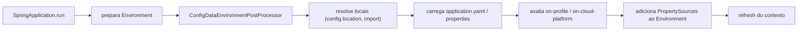

# Configuração externalizada

> **Resumo:** o Boot lê propriedades de dezenas de fontes (arquivos, variáveis de ambiente, linha de comando, JSON, árvores de diretórios) numa ordem de precedência fixa, e as **vincula** a objetos tipados com `@ConfigurationProperties`. O mesmo jar roda em qualquer ambiente sem recompilar.
> **Pré-requisitos:** [05-configuracao](../02-spring-core/05-configuracao.md) (Environment, PropertySource, `@Value`), [01-o-que-e-spring-boot](01-o-que-e-spring-boot.md), [05-recursos-modernos](../01-java/05-recursos-modernos-da-linguagem.md) (records).
> **Versões:** Spring Boot 4.1.2, Java 25. Binding em record, perfis e a precedência env/JSON/CLI de §5 foram executados.

## 1. Definição

**Configuração externalizada**: manter fora do código tudo que muda entre ambientes (URL do banco, timeouts, chaves, feature flags) e fornecê-lo no momento da execução. É o princípio *Config* dos Twelve-Factor Apps.

O Boot adiciona ao `Environment` do Framework ([02-spring-core/05 §3](../02-spring-core/05-configuracao.md)):

1. uma **ordem de PropertySources** bem definida (§2.1);
2. o carregamento de `application.properties`/`.yaml` com perfis e importação (`spring.config.import`);
3. o **binding relaxado** para objetos tipados (`@ConfigurationProperties`).

## 2. Conceitos fundamentais

### 2.1 Ordem de precedência (a última vence)

Fonte: docs.spring.io/spring-boot/reference/features/external-config.html (4.1).

| # | Fonte |
|---|---|
| 1 | Propriedades padrão (`SpringApplication.setDefaultProperties`) |
| 2 | `@PropertySource` em `@Configuration` (tarde demais para `logging.*` e `spring.main.*`) |
| 3 | **Arquivos de configuração** (`application.properties`/`.yaml`) |
| 4 | `random.*` |
| 5 | **Variáveis de ambiente** do SO |
| 6 | Propriedades de sistema Java (`-Dchave=valor`) |
| 7 | JNDI (`java:comp/env`) |
| 8–9 | Parâmetros de `ServletContext`/`ServletConfig` |
| 10 | `SPRING_APPLICATION_JSON` / `spring.application.json` |
| 11 | **Argumentos de linha de comando** (`--chave=valor`) |
| 12–14 | Testes: `properties` do `@SpringBootTest`, `@DynamicPropertySource`, `@TestPropertySource` |
| 15 | Devtools global (`$HOME/.config/spring-boot`) |

Verificado no projeto de teste (`orders.currency` no YAML = `BRL`):

| Cenário | Valor efetivo |
|---|---|
| só o YAML | `BRL` |
| `ORDERS_CURRENCY=EUR` | `EUR` (env vence arquivo) |
| env `EUR` + `SPRING_APPLICATION_JSON={"orders":{"currency":"USD"}}` | `USD` (JSON vence env) |
| env `EUR` + `--orders.currency=JPY` | `JPY` (CLI vence tudo) |

⚠️ Um valor `null` em JSON é tratado como ausente: não "limpa" uma propriedade de menor precedência.

### 2.2 Arquivos: onde procurar

Locais padrão, do **menor** para o **maior** precedência:

1. raiz do classpath
2. `classpath:/config/`
3. diretório atual `file:./`
4. `file:./config/`
5. subdiretórios imediatos de `file:./config/*/`

Ordem de carga (o posterior sobrescreve): arquivo dentro do jar → `application-{perfil}` dentro do jar → arquivo fora do jar → `application-{perfil}` fora do jar. No mesmo local, `.properties` vence `.yaml`.

| Propriedade | Efeito |
|---|---|
| `spring.config.name` | muda o nome-base (`application`) |
| `spring.config.location` | **substitui** os locais padrão |
| `spring.config.additional-location` | **acrescenta** locais (que vencem os padrão) |
| `spring.config.import` | importa outros arquivos/fontes |
| `optional:` (prefixo) | tolera local ausente |

`spring.config.location` e `name` são lidos cedo: só funcionam como variável de ambiente, `-D` ou argumento de linha de comando, **não** dentro do próprio `application.yaml`.

### 2.3 `spring.config.import`

```properties
spring.config.import=optional:file:./dev.properties
spring.config.import=env:MY_CONFIGURATION          # conteúdo de uma variável de ambiente
spring.config.import=optional:configtree:/run/secrets/   # Kubernetes/Docker secrets
```

`configtree:` mapeia **nome do arquivo → chave** e **conteúdo → valor**: cada arquivo em `/run/secrets/` vira uma propriedade. Valores importados sobrescrevem o arquivo que os importa. Cada importação é processada uma vez. O Config Server do Spring Cloud também usa este mecanismo ([04-spring-cloud/02](../04-spring-cloud/02-config-server.md)).

### 2.4 Perfis

Um **perfil** é um rótulo que ativa configuração e beans ([`@Profile` no Core](../02-spring-core/05-configuracao.md)). No Boot:

```yaml
# application.yaml
orders:
  currency: BRL
spring:
  mvc:
    problemdetails:
      enabled: true
---                                  # YAML: separador de documento
spring:
  config:
    activate:
      on-profile: prod               # só vale com o perfil prod ativo
orders:
  limits:
    max-items: 10
```

- Ativar: `spring.profiles.active=prod` (ou `SPRING_PROFILES_ACTIVE=prod`, `--spring.profiles.active=prod`). Vários: `prod,live` (o último vence em conflito).
- Sem perfil ativo vale o perfil `default`.
- `on-profile` aceita expressões: `"prod | staging"`, `"!local"`. `on-cloud-platform: kubernetes` ativa a seção quando o Boot detecta o ambiente.
- Em `.properties`, o separador de documentos é `#---` (ou `!---`) numa linha só.
- `spring.profiles.include`/`spring.profiles.group.*` agrupam perfis. ⚠️ VERIFICAR a sintaxe exata no 4.1 (não conferida nesta sessão).

Verificado: com `spring.profiles.active=prod`, `limits.maxItems` resolveu para `10`; sem o perfil, ficaria o `@DefaultValue("50")`.

### 2.5 Placeholders e valores aleatórios

```properties
app.name=Orders
app.description=${app.name} roda na moeda ${orders.currency:BRL}     # :BRL é o default
secret=${random.uuid}   # random.int, random.int(10), random.int[1024,65536], random.long, random.value
```

Em placeholders, prefira o nome canônico em *kebab-case* minúsculo (`${demo.item-price}` casa com `demo.item-price`, `demo.itemPrice` e `DEMO_ITEMPRICE`; `${demo.itemPrice}` não casa com `demo.item-price`).

### 2.6 Variáveis de ambiente

Regra: troque `.` por `_`, remova ou troque `-` por `_` e use maiúsculas. `orders.currency` → `ORDERS_CURRENCY` (validado). `orders.payment-timeout` → `ORDERS_PAYMENTTIMEOUT` (hífens são removidos). Para listas, `ORDERS_PAYMENTMETHODS_0=CARD`. ⚠️ VERIFICAR variações (underscore duplo para mapas/chaves com `_`) na doc.

## 3. Como funciona por dentro

### 3.1 Carregamento (`ConfigDataEnvironment`)



Os `PropertySource`s entram **antes** do contexto, por isso `application.yaml` pode definir perfis e `spring.main.*`. O Config Data é um `EnvironmentPostProcessor`; esse é o ponto de extensão para fontes customizadas (Vault, Consul).

### 3.2 O binder e o binding relaxado

`@ConfigurationProperties` usa `org.springframework.boot.context.properties.bind.Binder`, que:

1. lê as propriedades sob o prefixo (`orders.*`) do `Environment`, **qualquer fonte**;
2. normaliza os nomes: `payment-timeout`, `paymentTimeout`, `payment_timeout` e `PAYMENT_TIMEOUT` são o mesmo nome (a forma canônica em arquivos é *kebab-case*);
3. converte tipos com o conversor próprio do Boot (`Duration` `"45s"`, `DataSize` `"10MB"`, `Period`, enums case-insensitive, listas);
4. valida com Bean Validation se houver `@Validated` ([02-spring-core/08](../02-spring-core/08-eventos-validacao-e-conversao.md));
5. falha o startup se algo estiver inválido (fail-fast).

Dois modos: **JavaBean** (construtor padrão + setters) e **construtor** (imutável). Com um único construtor com parâmetros, ou **record**, o binding é por construtor automaticamente; com vários construtores use `@ConstructorBinding`. Exige `-parameters` (o `spring-boot-starter-parent` já configura).

> `@ConfigurationProperties` **não** funciona em construtor binding se a classe for `@Component`/`@Bean`: registre com `@EnableConfigurationProperties` ou `@ConfigurationPropertiesScan`.

### 3.3 `@Value` vs `@ConfigurationProperties`

| | `@Value("${x}")` | `@ConfigurationProperties` |
|---|---|---|
| Binding relaxado | **não** (nome exato, canônico) | sim |
| Tipos complexos | difícil | listas, mapas, objetos aninhados |
| Validação | manual | `@Validated` |
| Metadados para IDE | não | sim (annotation processor) |
| SpEL | sim | não |
| Defaults | no placeholder | `@DefaultValue`/inicializador (não vão ao `Environment`) |

Observação do manual: defaults de `@DefaultValue` ou de campos **não** estão no `Environment`, então `@Value("${orders.currency}")` falha se a propriedade não existir de fato.

## 4. Evolução histórica

- **Boot 1.x:** `application.properties` + `@ConfigurationProperties` com setters; `spring.profiles` em YAML.
- **Boot 2.0:** novo `Binder` (binding relaxado reescrito).
- **Boot 2.4:** novo carregamento "Config Data" (`spring.config.import`, `on-profile`, `optional:`); `spring.profiles` e `spring.config.activate.on-profile` substituíram o antigo `spring.profiles:` em documento.
- **Boot 3.0:** construtor binding automático para classe com um construtor (sem `@ConstructorBinding`); funciona com records.
- **Boot 4.x:** pacote de `@DefaultValue` e relacionados em `org.springframework.boot.context.properties.bind`; `@Name` para chaves com palavras reservadas.

⚠️ VERIFICAR as versões exatas de 2.0/2.4/3.0 (de memória).

## 5. Exemplos práticos

### 5.1 Propriedades tipadas com record (executado)

```java
package com.example.orders.config;

@Validated
@ConfigurationProperties("orders")
public record OrdersProperties(
        @NotBlank String currency,
        @DefaultValue("30s") Duration paymentTimeout,
        @DefaultValue Limits limits,                       // objeto sempre não nulo
        @DefaultValue("CARD") List<String> paymentMethods) {

    public record Limits(@Min(1) @DefaultValue("50") int maxItems) {}
}
```

```java
@SpringBootApplication
@ConfigurationPropertiesScan          // encontra os @ConfigurationProperties do pacote
public class OrdersApplication { ... }
```

Com o YAML de §2.4 e perfil `prod`, o objeto ligado foi:

```
OrdersProperties[currency=BRL, paymentTimeout=PT45S, limits=Limits[maxItems=10], paymentMethods=[CARD]]
```

Note: `payment-timeout: 45s` virou `Duration`; `paymentMethods` usou o default; `maxItems` veio do perfil.

### 5.2 Injetando e usando

```java
@RestController
@RequestMapping("/orders")
public class OrderController {
    private final OrdersProperties props;
    public OrderController(OrdersProperties props) { this.props = props; }
    // ... usa props.currency()
}
```

Executado: `POST /orders` respondeu `"currency":"BRL"`; com `ORDERS_CURRENCY=EUR` no ambiente, `EUR`.

### 5.3 Validação fail-fast

Com `orders.currency=` (vazio) a aplicação **não sobe**: o binder lança `BindValidationException` e o relatório de falha do Boot aponta `orders.currency` e a restrição violada.

<!-- não compilado: comportamento descrito pela doc; o caso vazio não foi executado -->

### 5.4 Segredos em contêiner

```yaml
spring:
  config:
    import: "optional:configtree:/run/secrets/"
```

Um arquivo `/run/secrets/orders.db.password` vira a propriedade `orders.db.password`. Não grave senhas em `application.yaml` versionado.

<!-- não compilado -->

### 5.5 Executando com configuração externa

```bash
java -jar orders.jar --spring.profiles.active=prod --orders.currency=USD
ORDERS_CURRENCY=EUR java -jar orders.jar
java -jar orders.jar --spring.config.additional-location=file:/etc/orders/
```

## 6. Configurações e anotações relevantes

| Item | Para que serve | Exemplo |
|---|---|---|
| `@ConfigurationProperties` | binding tipado por prefixo | `@ConfigurationProperties("orders")` |
| `@ConfigurationPropertiesScan` / `@EnableConfigurationProperties` | registrar as classes | no `@SpringBootApplication` |
| `@DefaultValue` | default em construtor/record | `@DefaultValue("30s") Duration` |
| `@Validated` + Bean Validation | validar no binding | `@NotBlank`, `@Min` |
| `@ConstructorBinding` | escolher construtor entre vários | classes com 2+ construtores |
| `@Name` | chave com palavra reservada | `@Name("import")` |
| `spring.profiles.active` | ativar perfis | `prod` |
| `spring.config.activate.on-profile` | seção condicional | `"prod \| staging"` |
| `spring.config.import` | importar fontes | `optional:configtree:/run/secrets/` |
| `spring.config.location` / `additional-location` | mudar locais | `file:/etc/orders/` |
| `SPRING_APPLICATION_JSON` | JSON em variável | `{"orders":{"currency":"USD"}}` |
| `spring-boot-configuration-processor` | gera metadados para IDE | `annotationProcessorPaths` |

## 7. Quando usar e quando NÃO usar

**Use `@ConfigurationProperties`** para qualquer grupo de configurações com mais de uma ou duas chaves, ou que precise de validação.

**Use `@Value`** para um valor isolado e simples, ou quando precisar de SpEL.

**Não coloque** em `application.yaml` versionado: segredos, hosts de produção, e dados específicos de ambiente. Use variáveis de ambiente, `configtree`, ou um cofre (Vault / Config Server com criptografia).

**Evite** lógica de negócio dependente de perfil espalhada (`if (isProd)`): perfis servem para configurar **infraestrutura**, não para bifurcar regras.

## 8. Erros comuns e boas práticas

1. **Esperar que o `application-{perfil}` seja mesclado com listas**: listas são **substituídas**, não somadas, entre fontes.
2. **`${demo.itemPrice}` em placeholder** quando a chave é `item-price`: use o nome canônico.
3. **`spring.config.location` dentro do YAML**: é lido cedo demais; passe por ambiente/CLI.
4. **Construtor binding sem `-parameters`** fora do starter-parent: nomes de parâmetros somem.
5. **Classe com `@ConfigurationProperties` registrada como `@Component`** em modo construtor: o binding por construtor não ocorre.
6. **Perfis demais** e matriz de arquivos difícil de manter: prefira poucos perfis e valores por variável de ambiente.
7. **Esquecer que a CLI vence tudo**: em testes, `@TestPropertySource` vence também.
8. Boas práticas: *kebab-case* nas chaves; records imutáveis; `@Validated`; `Duration`/`DataSize` no lugar de `long`; prefixo próprio (`orders.*`); documentar com Javadoc e gerar metadados.

## 9. Perguntas de revisão

1. Entre uma variável de ambiente, um argumento `--chave=valor` e o `application.yaml`, quem vence?
<details><summary>Resposta</summary>Argumento de linha de comando > variável de ambiente > arquivo. Confirmado com `orders.currency` (JPY, EUR, BRL).</details>

2. Por que `spring.config.location` não funciona dentro do `application.yaml`?
<details><summary>Resposta</summary>Porque define onde os arquivos são procurados, então precisa existir antes de eles serem lidos. Deve vir de variável de ambiente, `-D` ou CLI.</details>

3. O que `@DefaultValue Limits limits` faz num record?
<details><summary>Resposta</summary>Garante um objeto `Limits` não nulo com seus defaults mesmo que nenhuma propriedade `limits.*` exista.</details>

4. Por que `@ConfigurationProperties` costuma ser melhor que `@Value`?
<details><summary>Resposta</summary>Binding relaxado, tipos complexos, validação, metadados para IDE e agrupamento por prefixo.</details>

5. Como o Boot 4 trata uma classe `@ConfigurationProperties` com construtor único?
<details><summary>Resposta</summary>Usa construtor binding automaticamente (imutável); com vários construtores é preciso `@ConstructorBinding`.</details>

## 10. Referências oficiais

- Externalized Configuration: https://docs.spring.io/spring-boot/reference/features/external-config.html
- Profiles: https://docs.spring.io/spring-boot/reference/features/profiles.html
- Application Properties (apêndice): https://docs.spring.io/spring-boot/appendix/application-properties/index.html
- Reference geral: https://docs.spring.io/spring-boot/reference/
- Twelve-Factor App (Config): https://12factor.net/config
