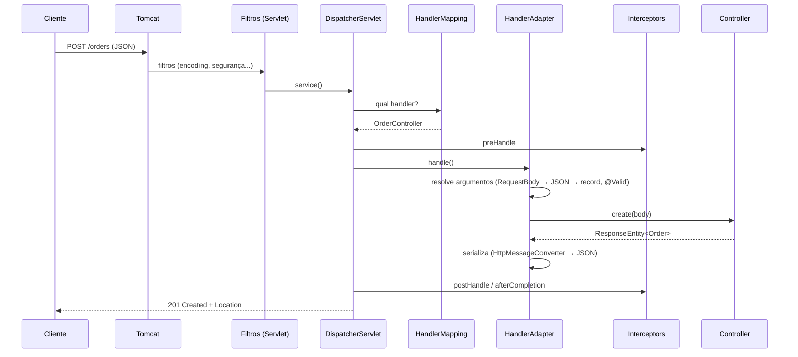

# Web MVC no Spring Boot

> **Resumo:** como o Spring MVC (stack Servlet) atende uma requisição HTTP: `DispatcherServlet`, mapeamento, conversão de argumentos, serialização JSON, validação, tratamento de erros com Problem Details (RFC 9457) e o que o Boot auto-configura.
> **Pré-requisitos:** [01-o-que-e-spring-boot](01-o-que-e-spring-boot.md), [02-auto-configuracao](02-auto-configuracao.md), [03-configuracao-externalizada](03-configuracao-externalizada.md), [08-eventos-validacao-e-conversao](../02-spring-core/08-eventos-validacao-e-conversao.md), [13-io-nio-e-http](../01-java/13-io-nio-e-http.md).
> **Versões:** Spring Boot 4.1.2, Spring Framework 7.0.x, Tomcat 11.0.27 (Servlet 6.1), Jackson 3.1.7 (`tools.jackson`), Java 25. Controlador, validação e erros de §5 foram executados com MockMvc.

## 1. Definição

**Spring MVC** é o framework web do Spring baseado na API Servlet: um único *front controller* (`DispatcherServlet`) recebe todas as requisições e as despacha para métodos de controladores anotados. O Boot auto-configura o servidor embutido, o `DispatcherServlet`, os conversores HTTP, o tratamento de erro e os recursos estáticos.

Problema que resolve: sem ele, cada endpoint seria um `HttpServlet` que lê `request.getParameter`, converte tipos, escreve JSON e trata exceção manualmente. O MVC separa **roteamento**, **conversão**, **validação** e **resposta**.

Alternativa não bloqueante: [WebFlux](05-webflux-e-reativo.md).

## 2. Conceitos fundamentais

### 2.1 Anotações de controlador

| Anotação | Papel |
|---|---|
| `@RestController` | `@Controller` + `@ResponseBody`: o retorno vira corpo HTTP |
| `@RequestMapping` / `@GetMapping`, `@PostMapping`, `@PutMapping`, `@PatchMapping`, `@DeleteMapping` | rota + método HTTP |
| `@PathVariable` | `/orders/{id}` |
| `@RequestParam` | `?min=10` |
| `@RequestBody` | corpo → objeto (via `HttpMessageConverter`) |
| `@RequestHeader`, `@CookieValue` | cabeçalhos e cookies |
| `@Valid` / `@Validated` | dispara Bean Validation |
| `ResponseEntity<T>` | controla status, cabeçalhos e corpo |
| `@ExceptionHandler`, `@ControllerAdvice` / `@RestControllerAdvice` | tratamento de erro local / global |

### 2.2 Anatomia de uma requisição



Em caso de exceção, o `DispatcherServlet` consulta os `HandlerExceptionResolver`s (`ExceptionHandlerExceptionResolver` → `@ExceptionHandler`, `ResponseStatusExceptionResolver`, `DefaultHandlerExceptionResolver`) antes de recorrer ao `/error`.

### 2.3 Conversão de mensagens

`HttpMessageConverter`s transformam corpo HTTP ↔ objeto Java conforme `Content-Type`/`Accept`. Com `spring-boot-starter-webmvc`, o JSON usa **Jackson 3**. Customização no Boot 4: beans `ServerHttpMessageConvertersCustomizer` (servidor) e `ClientHttpMessageConvertersCustomizer` (clientes), com `addCustomConverter(...)` (antes dos padrões) e `withJsonConverter(...)` (substitui o JSON).

```java
@Bean
ServerHttpMessageConvertersCustomizer serverConverters() {
    JsonMapper mapper = JsonMapper.builder()
        .defaultDateFormat(new SimpleDateFormat("yyyy-MM"))
        .build();                                   // tools.jackson.databind.json.JsonMapper
    return builder -> builder.withJsonConverter(new JacksonJsonHttpMessageConverter(mapper));
}
```

Exemplo adaptado da doc; <!-- não compilado -->

### 2.4 Erros: `ProblemDetail` (RFC 9457)

Com `spring.mvc.problemdetails.enabled=true`, erros internos do MVC (corpo inválido, tipo errado, método não suportado) respondem em `application/problem+json`. Seu próprio `@ExceptionHandler` pode retornar `ProblemDetail` e herda o formato. Sem a propriedade, o Boot responde com o JSON/HTML do `/error` (`BasicErrorController`).

### 2.5 O que o Boot auto-configura

| Recurso | Padrão |
|---|---|
| Servidor | Tomcat embutido, porta 8080 |
| `DispatcherServlet` | mapeado em `/` |
| Conversão de JSON | Jackson |
| Recursos estáticos | `/static`, `/public`, `/resources`, `/META-INF/resources` |
| Página de boas-vindas | `index.html` estático |
| Erro `/error` | JSON para clientes de API, HTML "Whitelabel" para navegadores |
| Conversores/Formatters | beans `Converter`/`Formatter` do contexto são registrados sozinhos |
| Formato de data | `spring.mvc.format.date`, `.time`, `.date-time` |

Não use `@EnableWebMvc` junto com a auto-configuração: ele a **desliga**. Para ajustar mantendo o Boot, implemente `WebMvcConfigurer` **sem** `@EnableWebMvc`.

## 3. Como funciona por dentro

### 3.1 Registro de handlers

Na inicialização, `RequestMappingHandlerMapping` percorre os beans com `@Controller`/`@RequestMapping`, usa reflection ([10](../01-java/10-anotacoes-e-reflection.md)) para ler as anotações em cada método e monta um registro `RequestMappingInfo → HandlerMethod`. Em tempo de requisição, o casamento usa padrões `PathPattern` (padrão desde o Spring 5.3/Boot 2.6; `spring.mvc.pathmatch.matching-strategy=ant-path-matcher` volta ao antigo).

### 3.2 Resolução de argumentos

`RequestMappingHandlerAdapter` chama, para cada parâmetro, o primeiro `HandlerMethodArgumentResolver` que o aceita: `@RequestBody` → `RequestResponseBodyMethodProcessor` (usa os converters), `@PathVariable` → `PathVariableMethodArgumentResolver`, etc. Conversão de tipo simples (`"abc"` → `BigDecimal`) usa o `ConversionService` ([02-spring-core/08](../02-spring-core/08-eventos-validacao-e-conversao.md)); falhas viram `MethodArgumentTypeMismatchException` → 400.

`@Valid` em `@RequestBody`: após a conversão, o `Validator` roda. Violações → `MethodArgumentNotValidException` → 400. Na versão 6.1+ a validação também pode ocorrer em parâmetros simples (`@RequestParam @Min(1) int x`), gerando `HandlerMethodValidationException`. ⚠️ VERIFICAR a classe exata no 7.0.

### 3.3 Threads e Servlet

Cada requisição ocupa **uma thread do Tomcat** do início ao fim (modelo thread-per-request). Quem bloqueia (JDBC, HTTP síncrono) segura a thread. Com **virtual threads** ([12](../01-java/12-concorrencia.md)) isso fica barato: `spring.threads.virtual.enabled=true` faz o Boot usar virtual threads no Tomcat e em executores. ⚠️ VERIFICAR a propriedade na doc do 4.1 (pendência de PROGRESSO).

### 3.4 Filtros vs interceptors vs advice

| Mecanismo | Camada | Vê o controlador? | Uso típico |
|---|---|---|---|
| `Filter` (Servlet) | antes do `DispatcherServlet` | não | segurança, CORS, logging, compressão |
| `HandlerInterceptor` | dentro do MVC | sim (`handler`) | auditoria, métricas por rota |
| `@ControllerAdvice` | tratamento global | sim | erros, `@InitBinder`, `@ModelAttribute` |
| AOP ([02-spring-core/07](../02-spring-core/07-aop-e-proxies.md)) | qualquer bean | — | transação, cache |

## 4. Evolução histórica

- **Spring 1.x–2.x:** MVC baseado em interfaces (`Controller`, `SimpleFormController`) e XML.
- **2.5/3.0:** controladores anotados (`@Controller`, `@RequestMapping`); 3.0 traz REST e `@ResponseBody`.
- **4.0:** `@RestController`. **5.0:** WebFlux como stack paralela. **5.3:** `PathPattern` ganha espaço.
- **6.0:** `jakarta.servlet`, `ProblemDetail` e `ErrorResponse` (RFC 7807); `RestClient` chega no 6.1.
- **7.0:** versionamento de API nativo, RFC 9457, `RestTestClient`; Jackson 3 como padrão no Boot 4.

⚠️ VERIFICAR as versões exatas em [02-spring-core/01 §4](../02-spring-core/01-o-que-e-spring.md).

## 5. Exemplos práticos

Domínio: pedidos. O código abaixo roda no projeto de validação (`/tmp/validacao/s7`).

### 5.1 Controlador completo

```java
@RestController
@RequestMapping("/orders")
public class OrderController {

    public record CreateOrder(@NotBlank String customerId, @Positive BigDecimal total) {}
    public record Order(long id, String customerId, BigDecimal total, String currency) {}

    static class OrderNotFound extends RuntimeException {
        OrderNotFound(long id) { super("Pedido " + id + " não encontrado"); }
    }

    private final Map<Long, Order> store = new ConcurrentHashMap<>();
    private final AtomicLong seq = new AtomicLong();
    private final OrdersProperties props;

    public OrderController(OrdersProperties props) { this.props = props; }

    @PostMapping
    ResponseEntity<Order> create(@Valid @RequestBody CreateOrder body) {
        var o = new Order(seq.incrementAndGet(), body.customerId(), body.total(), props.currency());
        store.put(o.id(), o);
        URI location = ServletUriComponentsBuilder.fromCurrentRequest().path("/{id}").build(o.id());
        return ResponseEntity.created(location).body(o);          // 201 + Location
    }

    @GetMapping("/{id}")
    Order find(@PathVariable long id) {
        var o = store.get(id);
        if (o == null) throw new OrderNotFound(id);
        return o;
    }

    @GetMapping
    List<Order> list(@RequestParam(defaultValue = "0") BigDecimal min) {
        return store.values().stream().filter(o -> o.total().compareTo(min) >= 0).toList();
    }

    @ExceptionHandler(OrderNotFound.class)
    ProblemDetail notFound(OrderNotFound e) {
        return ProblemDetail.forStatusAndDetail(HttpStatus.NOT_FOUND, e.getMessage());
    }
}
```

### 5.2 Respostas reais (MockMvc, `problemdetails.enabled=true`)

```
POST /orders {"customerId":"c1","total":10.5}
 → 201  Location: http://localhost/orders/1
        {"id":1,"customerId":"c1","total":10.5,"currency":"BRL"}

GET /orders/99
 → 404  application/problem+json
        {"detail":"Pedido 99 não encontrado","instance":"/orders/99","status":404,"title":"Not Found"}

POST /orders {"customerId":"","total":-1}
 → 400  application/problem+json
        {"detail":"Invalid request content.","instance":"/orders","status":400,"title":"Bad Request"}

GET /orders?min=abc
 → 400  {"detail":"Failed to convert 'min' with value: 'abc'","instance":"/orders","status":400,"title":"Bad Request"}
```

Observação: o erro de validação padrão **não lista os campos**. Para detalhar, sobrescreva o tratamento (§5.3).

### 5.3 Erros de validação com campos

```java
@RestControllerAdvice
class ApiExceptionHandler extends ResponseEntityExceptionHandler {

    @Override
    protected ResponseEntity<Object> handleMethodArgumentNotValid(
            MethodArgumentNotValidException ex, HttpHeaders headers,
            HttpStatusCode status, WebRequest request) {
        ProblemDetail pd = ProblemDetail.forStatusAndDetail(HttpStatus.BAD_REQUEST, "Dados inválidos");
        pd.setProperty("errors", ex.getFieldErrors().stream()
            .collect(Collectors.toMap(FieldError::getField, FieldError::getDefaultMessage, (a, b) -> a)));
        return handleExceptionInternal(ex, pd, headers, status, request);
    }
}
```

<!-- não compilado -->

### 5.4 Teste (executado)

```java
@SpringBootTest(properties = "spring.profiles.active=prod")
@AutoConfigureMockMvc    // org.springframework.boot.webmvc.test.autoconfigure (Boot 4)
class OrdersTest {
    @Autowired MockMvc mvc;

    @Test void flow() throws Exception {
        mvc.perform(post("/orders").contentType(MediaType.APPLICATION_JSON)
                .content("{\"customerId\":\"c1\",\"total\":10.5}"))
           .andExpect(status().isCreated()).andExpect(header().exists("Location"));
        mvc.perform(get("/orders/99")).andExpect(status().isNotFound());
    }
}
```

Mais sobre testes em [10](10-testes-no-spring-boot.md).

### 5.5 Recursos estáticos e CORS

```yaml
spring:
  web:
    resources:
      chain:
        strategy:
          content:
            enabled: true      # URLs com hash do conteúdo (cache busting)
            paths: /**
```

```java
@Configuration
class WebConfig implements WebMvcConfigurer {
    @Override public void addCorsMappings(CorsRegistry r) {
        r.addMapping("/orders/**").allowedOrigins("https://app.example.com");
    }
}
```

<!-- não compilado -->

### 5.6 Versionamento de API (Framework 7 / Boot 4.1)

```properties
spring.mvc.apiversion.default=1.0.0
spring.mvc.apiversion.use.header=X-Version
```

Em `@GetMapping(path = "/orders", version = "1.1")`. ⚠️ VERIFICAR o atributo `version` e as estratégias (header, caminho, parâmetro, media type) na doc do 7.0; não executado.

## 6. Configurações e anotações relevantes

| Item | Para que serve | Exemplo |
|---|---|---|
| `server.port` | porta | `8081`; `0` = aleatória |
| `server.servlet.context-path` | prefixo de contexto | `/api` |
| `spring.mvc.problemdetails.enabled` | erros `application/problem+json` | `true` |
| `spring.mvc.format.date` / `.date-time` | formato de datas em parâmetros | `iso` |
| `spring.mvc.static-path-pattern` | URL dos estáticos | `/static/**` |
| `spring.web.resources.static-locations` | pastas dos estáticos | `classpath:/static/` |
| `spring.web.resources.add-mappings` | desliga estáticos (API pura) | `false` |
| `spring.mvc.pathmatch.matching-strategy` | `path-pattern-parser` (padrão) ou `ant-path-matcher` | — |
| `spring.mvc.contentnegotiation.favor-parameter` | `?format=` | `true` |
| `spring.mvc.apiversion.*` | versionamento (header etc.) | §5.6 |
| `spring.threads.virtual.enabled` | virtual threads | `true` (⚠️ VERIFICAR) |
| `ServerHttpMessageConvertersCustomizer` | ajustar JSON/converters | §2.3 |
| `WebMvcConfigurer` | ajustes de MVC sem perder o Boot | CORS, interceptors |
| `@CrossOrigin` | CORS por controlador | `@CrossOrigin("https://app.example.com")` |

## 7. Quando usar e quando NÃO usar

**MVC** é a escolha padrão: o código é imperativo e direto, o ecossistema (JPA, JDBC, Security) é bloqueante, e com virtual threads escala bem para I/O bloqueante.

**Considere [WebFlux](05-webflux-e-reativo.md)** quando houver streaming, backpressure ou stack inteira não bloqueante. **Não** adote só por "performance": sem I/O não bloqueante fim a fim ele não ajuda.

**Não use** controladores para regra de negócio: eles traduzem HTTP ↔ serviços. **Não exponha entidades JPA** diretamente: use DTOs (records) para não vazar o modelo de persistência e evitar ciclos/`LazyInitializationException`.

## 8. Erros comuns e boas práticas

1. **`@EnableWebMvc` com Boot**: desativa a auto-configuração (JSON, estáticos, erros).
2. **Retornar `200` com erro no corpo**: use status corretos e `ProblemDetail`.
3. **Esquecer `@Valid`**: restrições no record são ignoradas.
4. **Expor entidade JPA** no controlador.
5. **Lógica de negócio dentro do controlador** e `@Transactional` nele: coloque em serviços.
6. **Tratar exceção com `catch` em cada método**: centralize em `@RestControllerAdvice`.
7. **`ObjectMapper` do Jackson 2 em código novo do Boot 4**: o Jackson 3 está em `tools.jackson.*`; misturar causa `NoSuchBeanDefinitionException`/serialização inesperada.
8. **CORS aberto (`*`) com credenciais**: viola a política do navegador; liste origens.
9. **Bloquear em endpoints `async`** (`Callable`, `DeferredResult`) sem entender o pool usado.
10. Boa prática: records como DTOs, `ResponseEntity` só quando precisa de status/cabeçalhos, URLs no plural e substantivos, `Location` em `201`, paginação em listas.

## 9. Perguntas de revisão

1. Qual o papel do `DispatcherServlet`?
<details><summary>Resposta</summary>É o *front controller*: recebe todas as requisições, consulta `HandlerMapping` para achar o handler, executa via `HandlerAdapter` (resolvendo argumentos e escrevendo a resposta) e delega exceções a `HandlerExceptionResolver`s.</details>

2. Por que `@EnableWebMvc` é um erro em aplicações Boot?
<details><summary>Resposta</summary>Importa a configuração MVC "pura" do Framework e faz a auto-configuração do Boot recuar (conversores, estáticos, erro, Jackson configurado).</details>

3. Qual a diferença entre `Filter`, `HandlerInterceptor` e `@ControllerAdvice`?
<details><summary>Resposta</summary>Filtros atuam na camada Servlet, antes do MVC, sem conhecer o controlador; interceptors rodam dentro do MVC e conhecem o handler; advice trata exceções e binding globalmente.</details>

4. O que acontece com `GET /orders?min=abc` quando `min` é `BigDecimal`?
<details><summary>Resposta</summary>Falha de conversão (`MethodArgumentTypeMismatchException`), tratada como 400. Executado: `Failed to convert 'min' with value: 'abc'`.</details>

5. Como habilitar o formato RFC 9457 nos erros do MVC?
<details><summary>Resposta</summary>`spring.mvc.problemdetails.enabled=true`, que resulta em `application/problem+json`; respostas customizadas retornam `ProblemDetail`.</details>

## 10. Referências oficiais

- Spring Boot, Servlet Web Applications: https://docs.spring.io/spring-boot/reference/web/servlet.html
- Spring Framework, Web MVC: https://docs.spring.io/spring-framework/reference/web/webmvc.html
- Spring Framework, tratamento de erros (ProblemDetail): https://docs.spring.io/spring-framework/reference/web/webmvc/mvc-ann-rest-exceptions.html
- RFC 9457: https://www.rfc-editor.org/rfc/rfc9457
- Projeto: https://spring.io/projects/spring-framework
