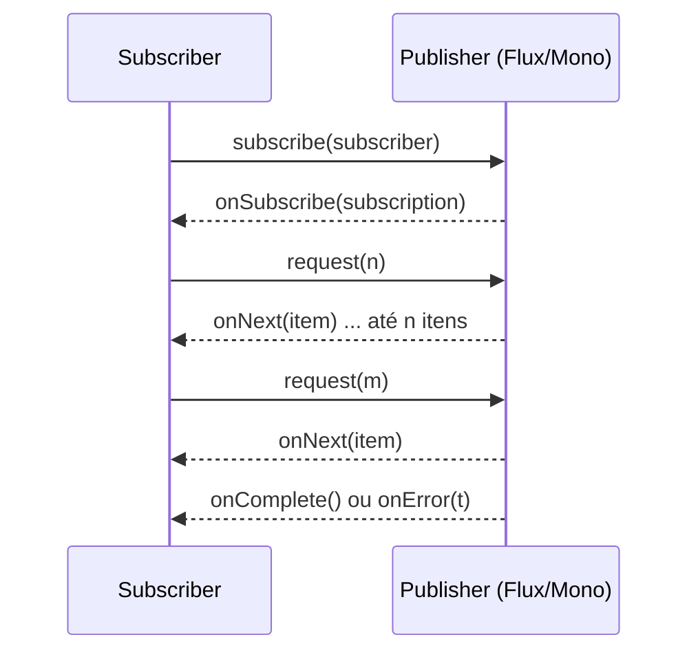
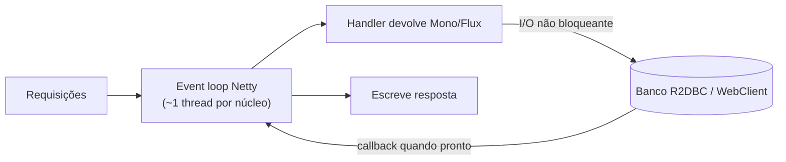

# WebFlux e programação reativa

> **Resumo:** o Spring WebFlux é a stack web não bloqueante do Spring, construída sobre o Project Reactor (`Mono` e `Flux`). Entender *quando* ele compensa (e quando virtual threads resolvem o mesmo problema com código imperativo) é a decisão arquitetural central deste arquivo.
> **Pré-requisitos:** [04-web-mvc](04-web-mvc.md), [12-concorrencia](../01-java/12-concorrencia.md) (threads, virtual threads), [09-programacao-funcional](../01-java/09-programacao-funcional.md).
> **Versões:** Spring Boot 4.1.2, Spring Framework 7.0.x, Reactor 3.8.x, Netty (servidor padrão), Java 25. Exemplos de §5 executados com `WebTestClient`, `WebClient` e `StepVerifier` (projeto `/tmp/validacao/s8a`).

## 1. Definição

**Programação reativa** é um modelo em que o dado *chega* a quem o consome por um fluxo assíncrono, com **backpressure** (o consumidor diz quantos itens aguenta). No Java, a especificação comum é a *Reactive Streams* (`java.util.concurrent.Flow` desde o Java 9: `Publisher`, `Subscriber`, `Subscription`, `Processor`). O **Reactor** implementa essa especificação com dois tipos:

- `Mono<T>`: 0 ou 1 elemento (equivale a um `CompletableFuture<T>` preguiçoso).
- `Flux<T>`: 0 a N elementos (equivale a um `Stream<T>` assíncrono e com backpressure).

O **Spring WebFlux** é o framework web construído sobre eles. Aceita dois estilos de programação: controladores anotados (`@RestController`, igual ao MVC, mas retornando `Mono`/`Flux`) e **funcional** (`RouterFunction` + `HandlerFunction`).

**Problema que resolve:** no modelo "uma thread por requisição" do [Spring MVC](04-web-mvc.md), cada thread fica **bloqueada** durante o I/O (banco, HTTP externo). Com milhares de requisições concorrentes lentas, o limite de threads (memória de stack, troca de contexto) vira o gargalo. O modelo reativo usa poucas threads (*event loop*) que nunca esperam: quando o I/O não está pronto, a thread atende outra coisa. Veja a comparação em [12-concorrencia §6](../01-java/12-concorrencia.md).

## 2. Conceitos fundamentais

### 2.1 Publisher, Subscriber e a regra de ouro



**Nada acontece até alguém assinar (`subscribe`).** `Mono.fromSupplier(...)` apenas *descreve* a computação. Executado: com um contador no supplier, o valor era `0` antes do `subscribe` e `2` depois de dois `block()` (cada assinatura reexecuta a fonte). No WebFlux, quem assina é o framework: você devolve o `Mono`/`Flux` e ele assina ao escrever a resposta. Consequência prática: um `Mono` criado e **não** retornado nem assinado nunca executa (bug clássico: chamar `repo.save(x)` reativo e ignorar o retorno).

### 2.2 Operadores essenciais

| Operador | O que faz | Equivalente imperativo |
|---|---|---|
| `map` | transforma cada item (síncrono) | `stream.map` |
| `flatMap` | item → `Publisher`, mescla resultados (**sem ordem garantida**) | chamada assíncrona por item |
| `concatMap` | como `flatMap`, mas sequencial e preserva ordem | laço com `await` |
| `filter`, `take`, `skip` | seleção | `stream.filter/limit/skip` |
| `zip` / `Mono.zip` | combina N fontes em paralelo, espera todas | `CompletableFuture.allOf` |
| `switchIfEmpty`, `defaultIfEmpty` | alternativa se vazio | `Optional.orElse` |
| `onErrorReturn`, `onErrorResume`, `onErrorMap` | recuperação/tradução de erro | `catch` |
| `retry`, `retryWhen(Retry.backoff(...))` | repetição | laço com tentativas |
| `timeout` | falha se passar do prazo | `Future.get(timeout)` |
| `doOnNext`, `doOnError`, `log()` | efeitos colaterais / depuração | `peek`, log |
| `publishOn` / `subscribeOn` | escolhem em qual *scheduler* (pool) executar | executor |
| `block()` | bloqueia até o resultado | **só em testes ou `main`** |

`flatMap` com concorrência: o segundo argumento limita assinaturas simultâneas (`flatMap(fn, 8)`), controle indispensável ao chamar serviço externo para cada item de um `Flux` grande.

### 2.3 Backpressure

O assinante pede `request(n)`; o publisher não emite mais que isso. Executado com `StepVerifier.create(Flux.range(1, 1000), 2)`: o teste só recebeu `1, 2`, depois pediu 1 e recebeu `3`, e cancelou. Estratégias quando a fonte é rápida demais e não respeita demanda (ex.: eventos de UI, `Flux.interval`): `onBackpressureBuffer`, `onBackpressureDrop`, `onBackpressureLatest`. Em HTTP, o backpressure atravessa o socket via controle de fluxo do TCP: o Netty para de ler quando o cliente não consome.

### 2.4 Os dois modelos de programação do WebFlux

```java
// Estilo anotado: igual ao MVC, só muda o tipo de retorno
@GetMapping("/{id}")
Mono<Order> byId(@PathVariable long id) { return service.find(id); }

// Estilo funcional: rotas como dados
@Bean
RouterFunction<ServerResponse> routes(OrderHandler h) {
    return RouterFunctions.route()
        .GET("/orders/{id}", h::byId)
        .GET("/orders", h::list)
        .build();
}
```

Os dois compartilham a mesma infraestrutura (`DispatcherHandler`, `WebFilter`, codecs). Nenhum é melhor: o anotado é o mais usado e mais fácil de migrar do MVC.

## 3. Como funciona por dentro

### 3.1 Event loop e a regra "nunca bloqueie"



O servidor padrão é o **Netty** (`spring-boot-starter-webflux` traz `reactor-netty`). Ele roda poucas threads de event loop (o nome da thread executando o handler foi `webflux-http-epoll-2`, executado). **Bloquear uma delas** (`Thread.sleep`, JDBC, `block()`, `synchronized` longo) trava *todas* as conexões atribuídas àquela thread. Por isso a regra é absoluta: dentro de código reativo, nenhuma chamada bloqueante. Se for inevitável (biblioteca legada), isole: `Mono.fromCallable(legacy::call).subscribeOn(Schedulers.boundedElastic())`. Em desenvolvimento, a biblioteca **BlockHound** detecta chamadas bloqueantes em threads não bloqueantes.

### 3.2 Assembly vs execução

Encadear operadores (`mono.map(...).flatMap(...)`) apenas **monta** uma cadeia de objetos `Mono`/`Flux` decoradores (fase de *assembly*). Ao assinar, o `subscribe` percorre a cadeia de trás para frente (cada operador assina o anterior) e o `request(n)` e os `onNext` viajam em sentidos opostos. Isto explica dois efeitos:

- **Stack traces inúteis**: o erro estoura dentro do Reactor, longe da linha que montou a cadeia. Mitigação: `Hooks.onOperatorDebug()` (caro, só em dev), o agente `reactor-tools` (`ReactorDebugAgent.init()`), ou `.checkpoint("descrição")`.
- **`ThreadLocal` não acompanha o fluxo**: o mesmo pipeline pode saltar entre threads. O Reactor propaga contexto pelo **`Context`** (`contextWrite`) e o Micrometer integra por *context propagation*. Isto afeta MDC de log, `SecurityContext` e transações (ver [Boot 09](09-actuator-e-observabilidade.md)).

### 3.3 Schedulers

| Scheduler | Uso |
|---|---|
| `Schedulers.parallel()` | trabalho de CPU curto (1 thread por núcleo) |
| `Schedulers.boundedElastic()` | isolar chamadas bloqueantes (pool limitado, também pode usar virtual threads: ⚠️ VERIFICAR a propriedade `reactor.schedulers.defaultBoundedElasticOnVirtualThreads` no Reactor 3.8) |
| `Schedulers.single()` | tarefas sequenciais |
| `Schedulers.immediate()` | na thread atual |

`subscribeOn` decide onde a **assinatura** começa; `publishOn` muda a thread dos operadores **a jusante** daquele ponto.

### 3.4 Tipos de cliente e servidor

O WebFlux roda em Netty, Tomcat, Jetty ou Undertow (⚠️ VERIFICAR a lista de servidores suportados no Boot 4.1) via adaptadores. O cliente reativo é o **`WebClient`** (§5.4). O acesso a dados reativo usa drivers próprios: **R2DBC** (SQL), Spring Data MongoDB/Redis/Cassandra reativos ([07-spring-data-outros](07-spring-data-outros.md)). **JPA/JDBC são bloqueantes**: usá-los em WebFlux obriga a `boundedElastic`, o que desfaz a vantagem.

## 4. Evolução histórica

- **2013–2015**: manifesto reativo e *Reactive Streams* (Netflix, Lightbend, Pivotal, Red Hat). RxJava popularizou o modelo.
- **Java 9 (2017)**: a especificação entra no JDK como `java.util.concurrent.Flow`.
- **Spring Framework 5.0 / Boot 2.0 (2017–2018)**: nasce o WebFlux sobre Reactor 3 (datas de memória: ⚠️ VERIFICAR).
- **2018–2020**: R2DBC, Spring Data reativo, RSocket; Reactor vira o motor de `WebClient`.
- **Java 21 (2023)**: *virtual threads* ([JEP 444](https://openjdk.org/jeps/444)) atacam o mesmo problema de escalabilidade sem mudar o estilo de código. A adoção do WebFlux "só por escala" caiu desde então.
- **Spring Framework 6.1 / Boot 3.2**: `RestClient` (síncrono, fluente) e `spring.threads.virtual.enabled`; **Boot 4 / Framework 7**: o `RestTemplate` entra em desuso gradual (⚠️ VERIFICAR o cronograma de depreciação) e o `WebClient` segue como cliente reativo. Linha do tempo geral em [00-evolucao-do-java](../01-java/00-evolucao-do-java.md).

## 5. Exemplos práticos

### 5.1 Projeto mínimo

```xml
<dependency>
  <groupId>org.springframework.boot</groupId>
  <artifactId>spring-boot-starter-webflux</artifactId>
</dependency>
<!-- testes: -->
<dependency>
  <groupId>org.springframework.boot</groupId>
  <artifactId>spring-boot-starter-webflux-test</artifactId>
  <scope>test</scope>
</dependency>
<dependency>
  <groupId>io.projectreactor</groupId>
  <artifactId>reactor-test</artifactId>
  <scope>test</scope>
</dependency>
```

### 5.2 Controlador: Mono, Flux e Server-Sent Events (executado)

```java
record Order(long id, BigDecimal total) {}

@RestController
@RequestMapping("/orders")
class OrderController {

    @GetMapping("/{id}")
    Mono<Order> byId(@PathVariable long id) {
        return Mono.just(new Order(id, BigDecimal.TEN)).delayElement(Duration.ofMillis(50));
    }

    // text/event-stream: o cliente recebe cada item assim que emitido
    @GetMapping(produces = MediaType.TEXT_EVENT_STREAM_VALUE)
    Flux<Order> stream() {
        return Flux.interval(Duration.ofMillis(20)).take(3)
                   .map(i -> new Order(i, BigDecimal.valueOf(i)));
    }
}
```

Saída executada do `GET /orders` com `Accept: text/event-stream`: `[Order[id=0, total=0], Order[id=1, total=1], Order[id=2, total=2]]`. Sem `produces` de streaming, um `Flux` com `application/json` é **coletado em lista** antes de responder (um array JSON).

### 5.3 Operadores e teste com StepVerifier (executado)

```java
// filter + map + flatMap assíncrono
StepVerifier.create(
        Flux.range(1, 5)
            .filter(i -> i % 2 == 1)
            .map(i -> i * 10)
            .flatMap(i -> Mono.just(i).delayElement(Duration.ofMillis(10))))
    .expectNext(10, 30, 50)
    .verifyComplete();

// erro tratado no fluxo: 10/0 lança ArithmeticException, onErrorReturn emite -1 e completa
StepVerifier.create(Flux.just(1, 2, 0).map(i -> 10 / i).onErrorReturn(-1))
    .expectNext(10, 5, -1)
    .verifyComplete();
```

Atenção ao segundo exemplo: `onErrorReturn` **encerra** o fluxo; o `Flux` original não continua depois do erro. Para tratar erro *por item* sem abortar, mova o tratamento para dentro de um `flatMap`.

### 5.4 WebClient (executado)

```java
WebClient client = WebClient.create("http://localhost:8080");

Mono<Order> order = client.get().uri("/orders/{id}", 9)
        .retrieve()                       // 4xx/5xx viram WebClientResponseException
        .bodyToMono(Order.class);

// chamadas independentes em paralelo
Mono<Tuple2<Order, Customer>> both = Mono.zip(
        client.get().uri("/orders/9").retrieve().bodyToMono(Order.class),
        client.get().uri("/customers/1").retrieve().bodyToMono(Customer.class));
```

Execução: `Order[id=9, total=10]`. No Boot, injete o `WebClient.Builder` (auto-configurado, com codecs Jackson e métricas) e construa o cliente a partir dele.

### 5.5 Estilo funcional

```java
@Component
class OrderHandler {
    Mono<ServerResponse> byId(ServerRequest req) {
        long id = Long.parseLong(req.pathVariable("id"));
        return service.find(id)
            .flatMap(o -> ServerResponse.ok().bodyValue(o))
            .switchIfEmpty(ServerResponse.notFound().build());
    }
}
```

<!-- não compilado -->

### 5.6 Isolar código bloqueante

```java
// biblioteca legada síncrona: nunca direto no event loop
Mono<Report> report = Mono.fromCallable(() -> legacyClient.generate(id))
        .subscribeOn(Schedulers.boundedElastic());
```

<!-- não compilado -->

### 5.7 Testes

`WebTestClient` (`@AutoConfigureWebTestClient`) chama os endpoints e verifica status/JSON (`expectStatus().isOk()`, `jsonPath("$.id").isEqualTo(7)`, executado). `StepVerifier` testa o `Publisher` em si, inclusive tempo virtual (`StepVerifier.withVirtualTime`) para `delayElement`/`interval` sem esperar de verdade. Mais em [10-testes-no-spring-boot](10-testes-no-spring-boot.md).

## 6. Configurações e anotações relevantes

| Item | Para que serve | Exemplo |
|---|---|---|
| `spring-boot-starter-webflux` | stack reativa com Netty | dependência Maven |
| `Mono<T>` / `Flux<T>` como retorno | handler assíncrono | `Mono<Order> byId(...)` |
| `produces = TEXT_EVENT_STREAM_VALUE` | streaming SSE | `@GetMapping(produces=...)` |
| `RouterFunction` / `HandlerFunction` | modelo funcional | `RouterFunctions.route().GET(...)` |
| `WebClient.Builder` | cliente HTTP reativo auto-configurado | `builder.baseUrl(url).build()` |
| `WebFilter` | filtro reativo (equivale ao `Filter`) | `class Log implements WebFilter` |
| `spring.main.web-application-type` | força `reactive` / `servlet` / `none` quando há ambos no classpath | `=reactive` |
| `Schedulers.boundedElastic()` | isolar bloqueio | `subscribeOn(...)` |
| `Hooks.onOperatorDebug()` / `.checkpoint()` | stack traces úteis | só em dev |
| `reactor-test` (`StepVerifier`) | teste de publishers | `StepVerifier.create(flux)` |

Com `webmvc` e `webflux` no mesmo classpath, o Boot prefere **MVC**. Propriedades do Netty/WebClient (`spring.reactor.*`, `server.netty.*`) ⚠️ VERIFICAR na referência do Boot 4.1.

## 7. Quando usar e quando NÃO usar

**Use WebFlux quando:**
- o fluxo é **naturalmente de streaming** (SSE, WebSocket, grande volume de eventos com backpressure);
- o serviço é essencialmente um **gateway/agregador** com muita I/O de saída e quase nenhuma lógica (ex.: Spring Cloud Gateway é reativo: [04-api-gateway](../04-spring-cloud/04-api-gateway.md));
- **toda** a pilha (driver, cliente HTTP, mensageria) já é não bloqueante;
- a equipe domina Reactor.

**NÃO use quando:**
- o acesso a dados é **JPA/JDBC**: você bloqueará o event loop ou pagará `boundedElastic` sem ganho;
- o objetivo é só "escalar": no Java 21+ as **virtual threads** dão escala parecida mantendo código imperativo (veja a comparação abaixo);
- a equipe não tem experiência: depuração, stack traces, `ThreadLocal` e testes ficam bem mais difíceis;
- a carga é modesta: MVC resolve com menos complexidade.

### Comparação com virtual threads

| Aspecto | MVC + virtual threads | WebFlux |
|---|---|---|
| Estilo de código | imperativo, linear | declarativo, operadores |
| Bloqueio no handler | aceitável (a thread virtual "estaciona") | proibido |
| Backpressure | não há nativo | nativo, ponta a ponta |
| Streaming (SSE, fluxos infinitos) | possível, sem backpressure formal | natural |
| JPA/JDBC | funciona | exige isolar |
| Depuração | stack traces normais, `ThreadLocal` funciona | difícil |
| Ativar no Boot | `spring.threads.virtual.enabled=true` (⚠️ VERIFICAR no Boot 4.1) | trocar o starter |
| Maturidade de bibliotecas | todo o ecossistema bloqueante | ecossistema reativo separado |

Resumo: para **o caso típico de API CRUD**, MVC + virtual threads é a escolha padrão atual; WebFlux fica para streaming e cenários onde backpressure e composição assíncrona são requisito. Um limite das virtual threads é o *pinning* em `synchronized` (corrigido no Java 24, JEP 491; ⚠️ VERIFICAR) e a falta de backpressure.

## 8. Erros comuns e boas práticas

1. **Bloquear o event loop** (`Thread.sleep`, `repo.findAll()` JPA, `.block()` dentro de handler). Em dev, use BlockHound; em produção, o sintoma é latência altíssima com CPU baixa.
2. **Esquecer de assinar/retornar**: `repo.save(o);` sem usar o retorno nunca grava.
3. **Assinar manualmente dentro de handler** (`mono.subscribe()`): perde propagação de erro e cancelamento. Encadeie com `flatMap` e retorne.
4. **`flatMap` achando que preserva ordem**: use `concatMap` ou `flatMapSequential`.
5. **Misturar `Optional`/`null` com `Mono`**: `Mono` não aceita `null`; use `Mono.empty()` e `switchIfEmpty`.
6. **`onErrorReturn`/`onErrorResume` engolindo erros** sem log: o erro some e o fluxo termina como sucesso.
7. **Usar `ThreadLocal`/MDC/`SecurityContextHolder` esperando propagação automática**: use `Context` e as integrações de *context propagation*.
8. **`Flux` ilimitado em resposta JSON**: sem `TEXT_EVENT_STREAM`/`APPLICATION_NDJSON`, o framework acumula tudo em memória.
9. **Sem `timeout` em chamadas externas**: um serviço lento prende recursos para sempre. Combine `timeout`, `retryWhen(Retry.backoff(...))` e circuit breaker ([06-resiliencia](../04-spring-cloud/06-resiliencia.md)).
10. Boa prática: preferir tipos de valor imutáveis (records) como elementos; manter handlers finos; testar com `StepVerifier`; medir antes de escolher WebFlux.

## 9. Perguntas de revisão

1. O que acontece se um `Mono` for criado mas nunca assinado?
<details><summary>Resposta</summary>Nada executa: o `Mono` só descreve a computação (assembly). Nos testes: um contador dentro de <code>Mono.fromSupplier</code> continuou em <code>0</code> até o primeiro <code>block()</code>, e cada assinatura reexecutou a fonte (contador <code>2</code> após duas).</details>

2. Por que bloquear uma thread do event loop é pior que bloquear uma thread do Tomcat?
<details><summary>Resposta</summary>O event loop tem poucas threads (~1 por núcleo) que atendem milhares de conexões; bloqueá-las trava todas as conexões associadas. No Tomcat, cada requisição tem a própria thread de um pool maior.</details>

3. Qual a diferença entre `map` e `flatMap`?
<details><summary>Resposta</summary><code>map</code> aplica uma função síncrona item a item. <code>flatMap</code> recebe uma função que devolve um <code>Publisher</code> e mescla os resultados (sem garantir ordem; <code>concatMap</code> preserva).</details>

4. O que é backpressure e onde apareceu nos exemplos?
<details><summary>Resposta</summary>É o consumidor controlar a vazão via <code>request(n)</code>. Com <code>StepVerifier.create(Flux.range(1,1000), 2)</code> só chegaram 2 itens até o teste pedir mais.</details>

5. Em que cenário típico de CRUD com JPA você escolheria MVC + virtual threads em vez de WebFlux?
<details><summary>Resposta</summary>Quando o acesso a dados é bloqueante (JPA/JDBC): virtual threads toleram o bloqueio e mantêm o código imperativo, enquanto WebFlux exigiria isolar cada chamada em <code>boundedElastic</code>, perdendo o benefício.</details>

## 10. Referências oficiais

- Spring Framework, Web on Reactive Stack: https://docs.spring.io/spring-framework/reference/web/webflux.html
- Spring Boot, Reactive Web Applications: https://docs.spring.io/spring-boot/reference/web/reactive.html
- Project Reactor, documentação: https://projectreactor.io/docs/core/release/reference/
- Reactive Streams: https://www.reactive-streams.org/
- JEP 444 (Virtual Threads): https://openjdk.org/jeps/444
- Projeto: https://spring.io/projects/spring-framework
