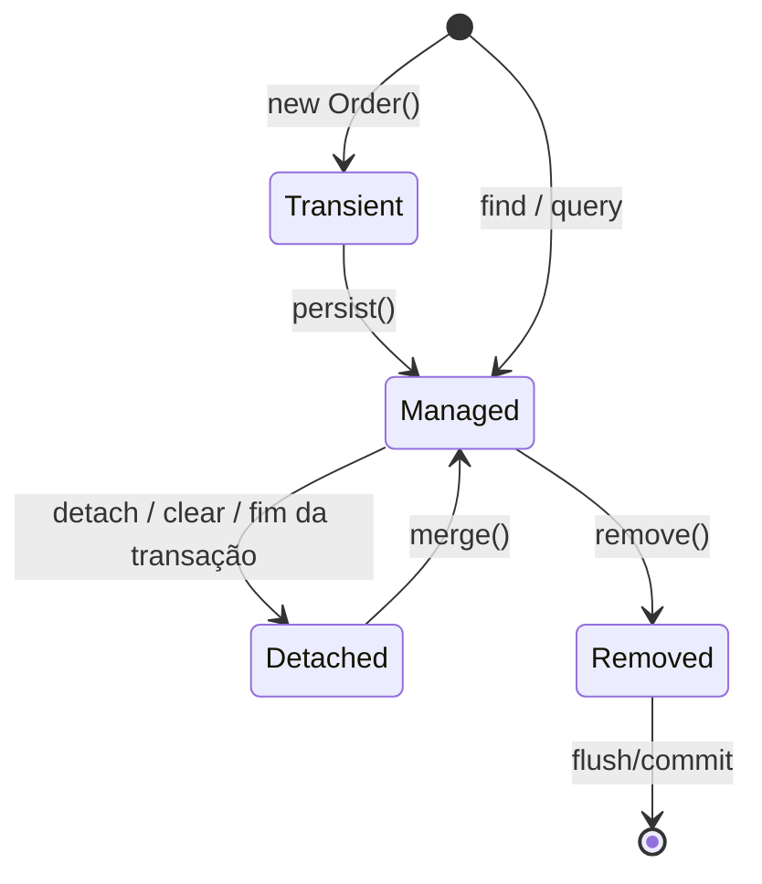
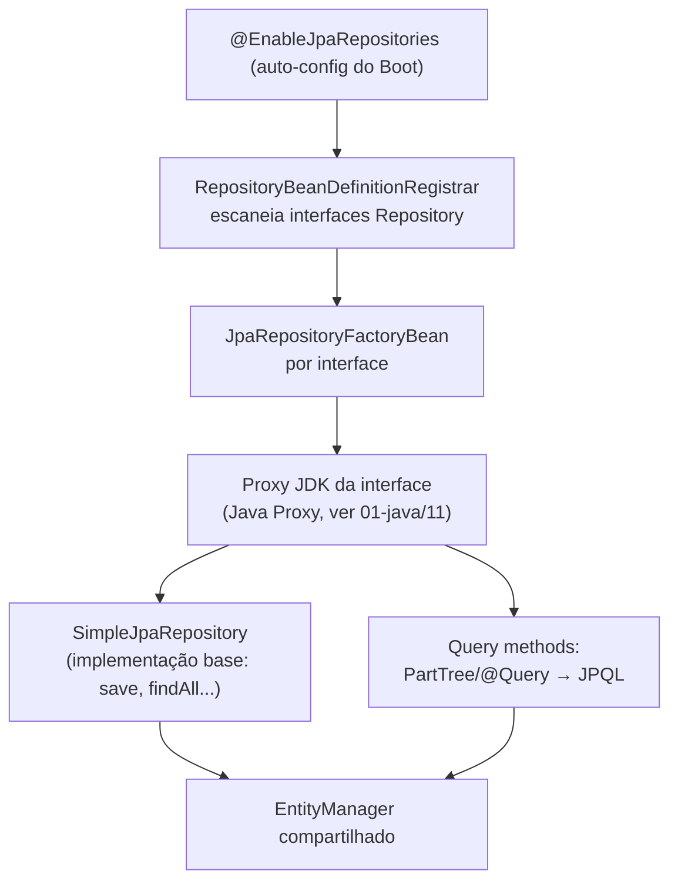

# Spring Data JPA

> **Resumo:** como o Spring Boot integra JPA/Hibernate: entidades, relacionamentos, repositórios gerados a partir de interfaces, query methods, `@Query`, paginação, projeções e os problemas clássicos (N+1, `LazyInitializationException`, concorrência otimista). É a camada de persistência da maioria dos serviços.
> **Pré-requisitos:** [09-transacoes](../02-spring-core/09-transacoes.md), [07-aop-e-proxies](../02-spring-core/07-aop-e-proxies.md), [06-generics](../01-java/06-generics.md), [03-tipos-e-memoria](../01-java/03-tipos-e-memoria.md) (equals/hashCode).
> **Versões:** Spring Boot 4.1.2, Spring Data JPA 4.x, Hibernate ORM 7.x (JPA 3.2, `jakarta.persistence`), H2 2.3, Java 25. Todos os exemplos das §5 foram executados com `@DataJpaTest` (projeto `/tmp/validacao/s8b`); as contagens de queries são do `Statistics` do Hibernate.

## 1. Definição

Três camadas que costumam ser confundidas:

| Camada | O que é |
|---|---|
| **JPA** (Jakarta Persistence) | **especificação**: anotações (`@Entity`, `@Id`...), `EntityManager`, JPQL |
| **Hibernate** | **implementação** de JPA (o provedor que o Boot usa por padrão), gera o SQL |
| **Spring Data JPA** | abstração do Spring sobre JPA: você declara `interface OrderRepository extends JpaRepository<Order, Long>` e o Spring **gera a implementação** em tempo de execução |

**Problema que resolve:** o mapeamento objeto-relacional (ORM) elimina o código repetitivo de JDBC (abrir conexão, montar `ResultSet`, converter linhas em objetos) e o Spring Data elimina o DAO escrito à mão. **O custo**: o SQL é gerado implicitamente, então é preciso entender o que o Hibernate faz (cache de primeiro nível, *dirty checking*, *lazy loading*) para não produzir queries ineficientes. Alternativa mais explícita: [JdbcClient / Spring Data JDBC](07-spring-data-outros.md).

## 2. Conceitos fundamentais

### 2.1 Entidades

```java
@Entity
@Table(name = "orders")
class Order {
    @Id @GeneratedValue(strategy = GenerationType.IDENTITY)
    private Long id;

    @ManyToOne(fetch = FetchType.LAZY, optional = false)
    private Customer customer;

    @OneToMany(mappedBy = "order", cascade = CascadeType.ALL, orphanRemoval = true)
    private List<OrderItem> items = new ArrayList<>();

    private BigDecimal total = BigDecimal.ZERO;

    @Version
    private Long version;        // controle de concorrência otimista

    protected Order() {}         // exigido pelo JPA (construtor sem argumentos, não privado)
    Order(Customer c) { this.customer = c; }
}
```

Regras da especificação para entidades: classe **não `final`** (o Hibernate cria *proxies* por subclasse para lazy loading, ver [11-proxies](../01-java/11-proxies-dinamicos-e-bytecode.md)), construtor sem argumentos (pode ser `protected`), campos não `final`. Por isso **records não podem ser entidades**; usam-se como DTOs/projeções (§2.7). Sobre `equals`/`hashCode` em entidades, veja §8.

### 2.2 Estratégias de geração de id

| Estratégia | Como funciona | Observação |
|---|---|---|
| `IDENTITY` | coluna auto-incremento do banco | o `INSERT` é imediato (id só vem do banco), **desativa batch de inserts** |
| `SEQUENCE` | consulta uma sequence (com *pooled optimizer*) | permite batch; padrão recomendado onde há sequence (PostgreSQL, Oracle) |
| `UUID` | gerado pela aplicação | sem ida ao banco; cuidado com índices aleatórios |
| `TABLE` | tabela emulando sequence | lento, evite |

### 2.3 Estados da entidade e o contexto de persistência



O **contexto de persistência** (`EntityManager`, cache de primeiro nível) acompanha uma transação: uma mesma linha vira **um único objeto** dentro dele (identidade), e toda alteração em objeto *managed* é detectada no `flush` (**dirty checking**) e gravada **sem chamar `save()`**. Executado: ao adicionar um item a um `Order` carregado e chamar `flush()`, o Hibernate emitiu os `INSERT`/`UPDATE` e a coluna `@Version` passou a `1`.

### 2.4 Relacionamentos e fetch

| Anotação | Padrão de fetch | Recomendação |
|---|---|---|
| `@ManyToOne`, `@OneToOne` | `EAGER` | declare `LAZY` explicitamente |
| `@OneToMany`, `@ManyToMany` | `LAZY` | manter `LAZY` |

- **`mappedBy`** indica o lado *inverso* (não dono da FK). O dono é o lado `@ManyToOne` (tem a coluna `customer_id`). Sem `mappedBy`, um `@OneToMany` vira tabela de junção extra.
- `cascade` propaga operações (`persist`, `remove`...) e `orphanRemoval=true` apaga filhos removidos da coleção. Use em **composição** (item pertence ao pedido), nunca entre agregados independentes.
- Mantenha os dois lados sincronizados com métodos auxiliares (`order.add(...)` do exemplo ajusta `items` e `total`).

### 2.5 Repositórios

```java
interface OrderRepository extends JpaRepository<Order, Long> { }
```

Hierarquia: `Repository` (marcador) ← `CrudRepository` (`save`, `findById`, `findAll`, `deleteById`, `count`) ← `ListCrudRepository`/`PagingAndSortingRepository` ← `JpaRepository` (`flush`, `saveAndFlush`, `findAll` retornando `List`, `deleteAllInBatch`). Detalhe: `save()` faz `persist` se a entidade é nova e `merge` se não (decide por id/`@Version`); para entidade já *managed* dentro de transação, **não precisa** chamar `save`.

### 2.6 Query methods, `@Query` e paginação

```java
interface OrderRepository extends JpaRepository<Order, Long> {

    // derivado do nome: where customer.name = ? order by total desc
    List<Order> findByCustomerNameOrderByTotalDesc(String name);

    // paginação e ordenação
    Page<Order> findByTotalGreaterThan(BigDecimal min, Pageable pageable);

    // JPQL explícito
    @Query("select o from Order o join fetch o.customer")
    List<Order> allWithCustomer();

    // atualização em massa (ignora o contexto de persistência!)
    @Modifying
    @Query("update Order o set o.total = 0 where o.total < :x")
    int zero(@Param("x") BigDecimal x);
}
```

Palavras do parser de nomes: `findBy`, `existsBy`, `countBy`, `deleteBy`, e operadores `And`, `Or`, `Between`, `LessThan`, `Like`, `In`, `IsNull`, `OrderBy`, `First/Top`. Para consultas complexas, prefira `@Query` ou *Specifications*/Querydsl a nomes gigantes. Executado: `findByCustomerNameOrderByTotalDesc("c1")` retornou 1 pedido.

**Paginação**: `Pageable` (`PageRequest.of(página, tamanho, Sort)`) com retorno `Page<T>` (executa também um `count`: `getTotalElements`, `getTotalPages`) ou `Slice<T>` (sem count, só sabe se há próxima página). Executado com 5 pedidos e página de 2: `total=5 pages=3`, primeiro item é o de maior total (ordem `desc`).

### 2.7 Projeções

Evitam carregar a entidade inteira:

```java
interface OrderSummary { Long getId(); BigDecimal getTotal(); }     // baseada em interface
record OrderRow(Long id, String customerName, BigDecimal total) {}   // DTO (record)

List<OrderSummary> findSummaryBy();

@Query("select new com.example.orders.OrderRow(o.id, o.customer.name, o.total) from Order o where o.total >= :min")
List<OrderRow> rows(@Param("min") BigDecimal min);
```

Executado: `OrderRow[id=6, customerName=c0, total=21.00]`. A projeção de interface seleciona só as colunas das propriedades declaradas (*closed projection*); com `@Value("#{...}")` vira *open* e carrega a entidade. O construtor `select new` exige o **nome qualificado** da classe.

## 3. Como funciona por dentro

### 3.1 De interface a objeto



O bean injetado é um **proxy JDK** cujo `InvocationHandler` roteia: métodos do `CrudRepository` vão para `SimpleJpaRepository` (classe concreta com `@Transactional(readOnly = true)` na classe e `@Transactional` em métodos que escrevem); *query methods* são traduzidos **na inicialização** (nome → `PartTree` → critérios JPA; `@Query` → JPQL validado). Um nome de método inválido (`findByCustomerNam`) **falha ao subir a aplicação**, não em tempo de execução. Isso se apoia em tudo visto em [06-como-java-e-spring-conversam](../02-spring-core/06-como-java-e-spring-conversam.md) e [07-aop-e-proxies](../02-spring-core/07-aop-e-proxies.md).

### 3.2 `EntityManager` compartilhado e transações

O repositório recebe um `EntityManager` **proxy** que delega ao `EntityManager` real vinculado à **transação corrente** (via `ThreadLocal`, como visto em [09-transacoes](../02-spring-core/09-transacoes.md)). Sem transação ativa, cada operação abre e fecha um contexto próprio, e **entidades retornadas ficam *detached***. Com `@Transactional` no serviço, todas as chamadas compartilham o mesmo contexto: entidades continuam *managed*, o *lazy loading* funciona e o dirty checking grava no commit. O auto-configurado é o `JpaTransactionManager`.

### 3.3 Flush, SQL e lazy loading

- **Flush**: o Hibernate acumula alterações e as envia ao banco no *commit*, antes de uma query que possa ser afetada (modo `AUTO`) ou em `flush()` explícito.
- **Lazy loading**: associações `LAZY` são substituídas por *proxies* (entidade) ou coleções persistentes (`PersistentBag`); a primeira leitura dispara o `SELECT`. Fora de sessão, lança `LazyInitializationException` (executado: com a entidade *detached*, `getItems().size()` lançou exatamente isso).
- **`@Version`**: o `UPDATE` ganha `where id=? and version=?`; zero linhas afetadas significa que outro processo alterou antes.

### 3.4 O que o Boot auto-configura

`HibernateJpaAutoConfiguration` (DataSource do Boot, `LocalContainerEntityManagerFactoryBean`, `JpaTransactionManager`), `JpaRepositoriesAutoConfiguration` (escaneia a partir do pacote da `@SpringBootApplication`), DDL automático para bancos embutidos. Em banco real, o padrão é `ddl-auto=none`: **use [migrações](12-migracoes-de-banco.md)** (Flyway/Liquibase) em produção.

## 4. Evolução histórica

- **JPA 1.0 (2006, Java EE 5)**: padroniza o ORM inspirado em Hibernate/TopLink; **Spring Data JPA 1.0 (2011)** surge do projeto Spring Data (datas de memória: ⚠️ VERIFICAR).
- **JPA 2.x** (2009–2013): Criteria API, `@ElementCollection`; **2.2** (2017): suporte a `java.time`.
- **Jakarta Persistence 3.0 (2020)**: pacote `javax.persistence` → `jakarta.persistence` (Spring Boot 3 / Hibernate 6).
- **Hibernate 6 (2022)**: reescrita do motor SQL; **Hibernate 7 / JPA 3.2** com o Boot 4 (⚠️ VERIFICAR versões exatas no BOM do 4.1).
- **Boot 4**: starters e *test slices* modularizados (`spring-boot-starter-data-jpa-test`, `org.springframework.boot.data.jpa.test.autoconfigure.DataJpaTest`, executado). Linha do tempo do Spring em [01-o-que-e-spring](../02-spring-core/01-o-que-e-spring.md).

## 5. Exemplos práticos

### 5.1 Dependências e configuração mínima

```xml
<dependency>
  <groupId>org.springframework.boot</groupId>
  <artifactId>spring-boot-starter-data-jpa</artifactId>
</dependency>
<dependency>
  <groupId>com.h2database</groupId><artifactId>h2</artifactId><scope>runtime</scope>
</dependency>
<dependency>
  <groupId>org.springframework.boot</groupId>
  <artifactId>spring-boot-starter-data-jpa-test</artifactId><scope>test</scope>
</dependency>
```

```properties
spring.jpa.hibernate.ddl-auto=create-drop   # só para testes/protótipo
spring.jpa.open-in-view=false
spring.jpa.show-sql=false                   # prefira logger org.hibernate.SQL
spring.jpa.properties.hibernate.generate_statistics=true   # só para diagnóstico
```

Com banco real, defina `spring.datasource.url/username/password` ([03-configuracao-externalizada](03-configuracao-externalizada.md)). Atenção ao import: `jakarta.persistence.Query` e `jakarta.persistence.EntityGraph` colidem com `org.springframework.data.jpa.repository.Query`/`EntityGraph`; com `import jakarta.persistence.*;` o compilador acusa *reference to Query is ambiguous* (erro real que ocorreu na validação). Importe as anotações individualmente.

### 5.2 O problema N+1 (executado)

Cenário: 5 pedidos, cada um com um `Customer` `LAZY`.

```java
var orders = repo.findAll();                                  // 1 query: select * from orders
orders.forEach(o -> o.getCustomer().getName());               // +5 queries (uma por cliente)
```

Resultado medido: **`N+1: queries=6`**. Correções:

```java
@Query("select o from Order o join fetch o.customer")
List<Order> allWithCustomer();                                // JOIN FETCH: queries=1

@EntityGraph(attributePaths = "items")
@Query("select o from Order o")
List<Order> allWithItems();                                   // EntityGraph: queries=1
```

Medido: `JOIN FETCH: queries=1` e `EntityGraph items: queries=1`. Alertas: (a) `join fetch` de **uma coleção** com paginação faz o Hibernate paginar **em memória** (aviso `HHH90003004`/`firstResult/maxResults specified with collection fetch`: ⚠️ VERIFICAR o código exato na 7.x); resolva paginando os ids antes ou usando `@BatchSize`/`hibernate.default_batch_fetch_size`; (b) *join fetch* de duas coleções `List` causa `MultipleBagFetchException` e produto cartesiano.

### 5.3 Dirty checking sem `save()` (executado)

```java
@Transactional
void addItem(Long id) {
    Order o = repo.findById(id).orElseThrow();
    o.add("sku", 1, BigDecimal.ONE);     // sem repo.save(o): o flush grava a alteração
}
```

### 5.4 Concorrência otimista (executado)

```java
var a = repo.findById(id).get();  em.detach(a);          // leitura 1 (versão 0)
var b = repo.findById(id).get();  b.add("z", 1, ONE);     // outra transação altera
em.flush(); em.clear();                                   // versão passa para 1
a.setTotal(...);  repo.saveAndFlush(a);                   // tenta gravar com versão 0
// → ObjectOptimisticLockingFailureException (Spring traduz OptimisticLockException)
```

Resultado: `LOCK=ObjectOptimisticLockingFailureException`. A aplicação deve tratar (reler e tentar de novo, ou devolver `409 Conflict` ao cliente; ver [04-web-mvc §@ControllerAdvice](04-web-mvc.md)). Para bloqueio pessimista: `@Lock(LockModeType.PESSIMISTIC_WRITE)`.

### 5.5 Serviço transacional com DTO na saída

```java
@Service
class OrderService {
    private final OrderRepository repo;
    OrderService(OrderRepository repo) { this.repo = repo; }

    @Transactional(readOnly = true)
    OrderDto find(Long id) {
        Order o = repo.findById(id).orElseThrow(() -> new OrderNotFound(id));
        return new OrderDto(o.getId(), o.getCustomer().getName(), o.getTotal());
    }
}
record OrderDto(Long id, String customer, BigDecimal total) {}
```

<!-- não compilado -->

Converter para DTO **dentro** da transação evita `LazyInitializationException` e vazamento de entidade na API.

### 5.6 Testes de repositório

`@DataJpaTest` sobe só a camada JPA com banco embutido, cada teste em transação revertida ao final. Mais em [10-testes-no-spring-boot](10-testes-no-spring-boot.md). Para validar contra o banco real (dialeto, tipos), use Testcontainers; H2 pode divergir de PostgreSQL/MySQL.

## 6. Configurações e anotações relevantes

| Item | Para que serve | Exemplo |
|---|---|---|
| `@Entity`, `@Table`, `@Column` | mapeamento de classe/colunas | `@Table(name="orders")` |
| `@Id`, `@GeneratedValue` | chave primária | `strategy = SEQUENCE` |
| `@Embedded`/`@Embeddable` | objeto de valor na mesma tabela | `Address` |
| `@ManyToOne`/`@OneToMany`/`@ManyToMany` | relacionamentos | `fetch = LAZY` |
| `@Version` | lock otimista | `Long version` |
| `@Transactional` | fronteira de transação | `readOnly = true` em leituras |
| `@Query`, `@Modifying`, `@Param` | JPQL/SQL nativo e updates | `@Query(nativeQuery = true)` |
| `@EntityGraph` | define o que buscar junto | `attributePaths = "items"` |
| `@Lock` | bloqueio pessimista | `PESSIMISTIC_WRITE` |
| `@BatchSize` | carrega lazies em lotes | `@BatchSize(size = 50)` |
| `spring.jpa.hibernate.ddl-auto` | `none`/`validate`/`update`/`create-drop` | `validate` em produção |
| `spring.jpa.open-in-view` | OSIV (padrão `true`, com aviso no log) | `false` |
| `spring.jpa.show-sql` / logger `org.hibernate.SQL` | ver SQL gerado | `logging.level.org.hibernate.SQL=DEBUG` |
| `spring.jpa.properties.hibernate.jdbc.batch_size` | batch de insert/update | `50` |
| `spring.jpa.properties.hibernate.default_batch_fetch_size` | mitiga N+1 globalmente | `32` |
| `spring.data.jpa.repositories.bootstrap-mode` | inicialização `default`/`deferred`/`lazy` | `deferred` |

## 7. Quando usar e quando NÃO usar

**Use JPA/Spring Data JPA quando:** o domínio é rico (agregados, relacionamentos, regras), há muito CRUD, e a equipe conhece o modelo de contexto de persistência.

**Não use (ou use com cautela) quando:**
- a carga é dominada por **relatórios/consultas analíticas complexas** ou SQL específico do banco: prefira `JdbcClient`, jOOQ ou views ([07-spring-data-outros](07-spring-data-outros.md));
- processamento em **lote massivo**: o contexto de persistência cresce; use `StatelessSession`, batch JDBC ou `@Modifying`;
- o time precisa de **previsibilidade total do SQL**: **Spring Data JDBC** é mais simples (sem lazy loading, sem dirty checking);
- aplicação **reativa**: JPA é bloqueante ([05-webflux](05-webflux-e-reativo.md)); use R2DBC.

## 8. Erros comuns e boas práticas

1. **N+1** por `LAZY` acessado em laço: meça com `Statistics`/log SQL, corrija com `join fetch`, `@EntityGraph` ou `@BatchSize`.
2. **Open Session in View (OSIV)**: o padrão `spring.jpa.open-in-view=true` mantém a sessão aberta até o fim da requisição web, escondendo `LazyInitializationException` mas segurando conexão do pool durante a serialização JSON e disparando queries inesperadas na camada web. Desative e busque o necessário na transação. Avaliação mais ampla em [08-anti-padroes](../06-padroes-de-projeto/08-anti-padroes.md).
3. **`EAGER` em `@ManyToOne` por omissão**: declare `LAZY`; `EAGER` em coleções é praticamente sempre errado.
4. **`equals`/`hashCode` ruins**: com id gerado, o id é `null` antes de persistir. Regras seguras: `equals` baseado no id **só se não nulo** (e mesma classe de proxy) e `hashCode` constante por classe; ou chave natural imutável (ver [03-tipos-e-memoria](../01-java/03-tipos-e-memoria.md)). Nunca `@Data` do Lombok em entidade (gera `equals/hashCode/toString` que disparam lazy loading).
5. **Expor entidades na API REST**: ciclos (pedido ↔ item) na serialização, vazamento de campos e acoplamento ao schema. Use DTOs/records.
6. **`@Transactional` na controller ou ausente**: a transação pertence ao serviço; lembre-se da *self-invocation* ([07-aop](../02-spring-core/07-aop-e-proxies.md)).
7. **`@Modifying` e contexto desatualizado**: updates em massa não alteram entidades já carregadas; use `clearAutomatically = true` ou releia.
8. **`ddl-auto=update` em produção**: não remove nem renomeia, pode alterar schema de forma imprevisível. Use Flyway/Liquibase ([12](12-migracoes-de-banco.md)) e `validate`.
9. **`IDENTITY` esperando batch de insert**: o Hibernate desativa o batching; use `SEQUENCE`.
10. **Query method gigante** (`findByCustomerNameAndStatusAndCreatedAtBetween...`): use `@Query`, Specification ou DTO dedicado.
11. Boa prática: transações curtas; `readOnly = true` em consultas; paginar listas; testar contra o mesmo banco da produção (Testcontainers); logar o SQL em desenvolvimento.

## 9. Perguntas de revisão

1. Qual a diferença entre JPA, Hibernate e Spring Data JPA?
<details><summary>Resposta</summary>JPA é a especificação; Hibernate a implementação que gera SQL; Spring Data JPA gera, em tempo de execução, a implementação das interfaces de repositório sobre o <code>EntityManager</code>.</details>

2. Por que não é preciso chamar `save()` após alterar uma entidade dentro de `@Transactional`?
<details><summary>Resposta</summary>A entidade está <em>managed</em> no contexto de persistência; no <code>flush</code>/commit o Hibernate compara o estado com o snapshot (<em>dirty checking</em>) e emite o <code>UPDATE</code>. Executado: item adicionado e <code>flush()</code> gravaram e incrementaram <code>@Version</code>.</details>

3. O que é o N+1 e como foi medido e corrigido aqui?
<details><summary>Resposta</summary>1 query para listar + N para carregar associações <code>LAZY</code> de cada linha. Medido: <code>queries=6</code> para 5 pedidos; com <code>join fetch</code> e <code>@EntityGraph</code> caiu para <code>queries=1</code>.</details>

4. O que acontece ao acessar uma coleção `LAZY` de entidade *detached*?
<details><summary>Resposta</summary><code>LazyInitializationException</code> (executado), pois a sessão já foi fechada. Soluções: buscar o necessário dentro da transação (fetch join/EntityGraph/DTO), não ativar OSIV como remendo.</details>

5. Como o `@Version` evita atualizações perdidas?
<details><summary>Resposta</summary>O <code>UPDATE</code> inclui <code>where version = ?</code>; se outra transação já incrementou, nenhuma linha é afetada e é lançada <code>ObjectOptimisticLockingFailureException</code> (executado).</details>

## 10. Referências oficiais

- Spring Data JPA: https://docs.spring.io/spring-data/jpa/reference/
- Spring Boot, SQL Databases: https://docs.spring.io/spring-boot/reference/data/sql.html
- Hibernate ORM: https://hibernate.org/orm/documentation/
- Jakarta Persistence: https://jakarta.ee/specifications/persistence/
- Projeto: https://spring.io/projects/spring-data-jpa
