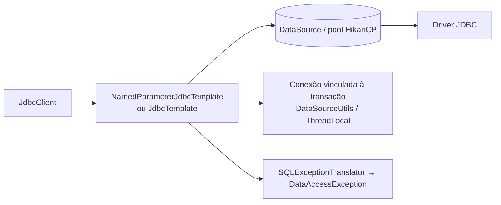

# Spring Data além do JPA: JdbcClient, Spring Data JDBC, MongoDB e Redis

> **Resumo:** o JPA não é a única opção de acesso a dados no Spring. Este arquivo cobre o `JdbcClient` (SQL explícito, sem ORM), o Spring Data JDBC (agregados simples, sem *lazy loading*) e uma visão geral de MongoDB (documentos) e Redis (chave-valor, cache). A ideia é saber escolher a ferramenta pelo tipo de dado e de consulta.
> **Pré-requisitos:** [06-spring-data-jpa](06-spring-data-jpa.md), [09-transacoes](../02-spring-core/09-transacoes.md), [03-configuracao-externalizada](03-configuracao-externalizada.md).
> **Versões:** Spring Boot 4.1.2, Spring Framework 7.0.x (`JdbcClient` desde o 6.1), Spring Data 2026.x ⚠️ VERIFICAR o nome/versão do release train do Spring Data no Boot 4.1, H2 2.3, Java 25. **Executados**: `JdbcClient` e Spring Data JDBC (projetos `/tmp/validacao/s8b` e `s8d`). **Não executados** (sem MongoDB/Redis no ambiente): trechos de §5.3 e §5.4 marcados `<!-- não compilado -->`.

## 1. Definição

O projeto **Spring Data** oferece um modelo de programação comum (interfaces de repositório, *query methods*, paginação, auditoria) sobre armazenamentos diferentes. O núcleo é `Repository<T, ID>`; cada módulo (JPA, JDBC, MongoDB, Redis, Cassandra, Elasticsearch, Neo4j...) implementa o mesmo contrato com o motor do respectivo banco.

Abaixo do Spring Data fica o **suporte a JDBC do Spring Framework**: `JdbcTemplate` (clássico), `NamedParameterJdbcTemplate` e o **`JdbcClient`** (6.1), uma API fluente e moderna sobre os dois.

| Ferramenta | Modelo | SQL | Estado/cache | Melhor para |
|---|---|---|---|---|
| `JdbcClient` | linhas → records/objetos | você escreve | nenhum | consultas diretas, relatórios, partes críticas |
| Spring Data JDBC | **agregado** (raiz + filhos) | gerado para CRUD, `@Query` nativo | nenhum (sem dirty checking) | domínio com DDD tático, simplicidade |
| Spring Data JPA | grafo de entidades | JPQL/gerado | contexto de persistência | domínio rico, relacionamentos complexos |
| Spring Data MongoDB | documento JSON/BSON | consulta por critério/agregação | nenhum | dados hierárquicos, esquema flexível |
| Spring Data Redis | chave-valor/estruturas | comandos Redis | memória | cache, sessão, contadores, filas simples |

## 2. Conceitos fundamentais

### 2.1 JdbcClient

Constrói a chamada em cadeia: `sql(...)` → parâmetros → `query/update`. Aceita parâmetros **posicionais** (`?`) ou **nomeados** (`:name`), mapeia linhas para *records*, classes com construtor/setters ou tipos simples, e traduz `SQLException` em exceções da hierarquia `DataAccessException` (ver [08-excecoes](../01-java/08-excecoes.md)).

Pontos-chave:
- `.query(Row.class)` usa um mapeamento por nome de coluna ↔ componente do record (`SimplePropertyRowMapper`);
- `.query(String.class)` / `Long.class` mapeia uma coluna única;
- terminais: `.list()`, `.set()`, `.optional()`, `.single()`, `.stream()` (lembre de fechar), `.update()`, `.update(keyHolder)`;
- **sempre** passe valores como parâmetros, nunca concatene (SQL injection).

### 2.2 Spring Data JDBC: agregados

Filosofia: **aggregate root** (conceito de DDD) é a unidade de persistência. Salvar a raiz salva (ou recria) todos os filhos; ler a raiz carrega tudo. Não há:
- *lazy loading* (nada de `LazyInitializationException`);
- contexto de persistência nem *dirty checking*: `save()` **sempre** grava o que você passa;
- cache de primeiro nível, proxies ou `cascade`: o ciclo de vida dos filhos é dono da raiz.

Referências entre agregados são feitas por **id** (`AggregateReference<Customer, Long>`), não por associação de objeto. O resultado é um modelo previsível, com SQL simples. O preço: sem navegação preguiçosa e sem JPQL.

### 2.3 MongoDB (visão geral)

Banco de **documentos** (BSON). Uma entidade vira um documento `@Document` e o Spring Data o mapeia com `MongoTemplate`/`MongoRepository`. Vantagens: esquema flexível, documento aninhado (pedido com itens dentro, sem *join*), escala horizontal por *sharding*. Limitações: transações multi-documento existem, mas exigem *replica set* e custam; relacionamentos entre coleções são manuais; consistência e modelagem diferem do relacional.

### 2.4 Redis (visão geral)

Armazenamento em memória com estruturas (string, hash, list, set, sorted set, stream). Usos típicos no Spring: **cache** (`@Cacheable`, [11-cache-agendamento-e-async](11-cache-agendamento-e-async.md)), **sessão** (Spring Session), *rate limiting*, contadores, *pub/sub*. O cliente padrão do Boot é o **Lettuce** (não bloqueante, compartilha conexão); o acesso é feito via `StringRedisTemplate`/`RedisTemplate` ou `Repository` com `@RedisHash`.

## 3. Como funciona por dentro

### 3.1 JdbcClient por baixo



O `JdbcClient` é um **fachada** sobre `JdbcTemplate`/`NamedParameterJdbcTemplate`: o Boot auto-configura o `DataSource` (HikariCP é o pool padrão), o `JdbcTemplate`, o `NamedParameterJdbcTemplate`, o `JdbcClient` e o `DataSourceTransactionManager`. A conexão usada dentro de `@Transactional` é a **mesma** da transação (via `ThreadLocal`, [09-transacoes](../02-spring-core/09-transacoes.md)); fora dela, uma conexão é emprestada e devolvida a cada chamada (*autocommit*). Com **JPA e JDBC juntos**, o `JpaTransactionManager` expõe a mesma conexão ao `JdbcClient`, então ambos participam da mesma transação.

### 3.2 Spring Data JDBC por baixo

Ao salvar uma raiz, o `JdbcAggregateTemplate` percorre o grafo: **insere** a raiz e depois os filhos, atribuindo a chave estrangeira; ao **atualizar** uma raiz com coleção, ele **apaga todos os filhos e reinsere** os atuais (a coleção é tratada como valor da raiz, sem *diff*). Executado: depois de atualizar o pedido trocando a lista de itens `[a, b]` por `[c]`, a leitura retornou `[OrderItem[sku=c, quantity=3]]`. Isso é simples e correto, mas custoso para coleções enormes (ver §8).

A decisão "insert ou update?" vem do `@Id`: `null` → insert, não nulo → update (ou `@Version`/`Persistable`/`isNew` customizado). **Cuidado**: com id **atribuído pela aplicação** (UUID), o `@Id` não é nulo e o Spring Data tentaria `UPDATE`; use `@Version` ou implemente `Persistable`.

### 3.3 Mongo e Redis por baixo

- **MongoDB**: o `MappingMongoConverter` converte objeto ↔ `Document` por reflection ([10-anotacoes-e-reflection](../01-java/10-anotacoes-e-reflection.md)); o campo `@Id` é o `_id`. Repositórios derivam consultas do nome do método (`findByCustomer`) como no JPA, geradas em `Query` do Mongo.
- **Redis**: `RedisTemplate` serializa chaves e valores com *serializers* (`StringRedisSerializer`, JSON). Erro comum é gravar com o serializer padrão do JDK (bytes ilegíveis para outros clientes).

## 4. Evolução histórica

- **Spring Data (2010–2011)** nasce para unificar acesso a bancos NoSQL e relacionais.
- **`JdbcTemplate` (Spring 1.0, 2003)**: um dos primeiros recursos do Spring; **`NamedParameterJdbcTemplate`**, `SimpleJdbcInsert` vieram nas versões seguintes.
- **Spring Data JDBC (2018, Spring Data Lovelace)**: criado como alternativa simples ao JPA, inspirado em DDD (datas de memória: ⚠️ VERIFICAR).
- **`JdbcClient` (Spring Framework 6.1, nov/2023)**: API fluente, a recomendação atual para código novo sobre JDBC puro.
- **Spring Data MongoDB/Redis reativos** acompanham o WebFlux ([05-webflux](05-webflux-e-reativo.md)). Linha do tempo geral em [01-o-que-e-spring](../02-spring-core/01-o-que-e-spring.md).

## 5. Exemplos práticos

### 5.1 JdbcClient (executado)

```xml
<dependency>
  <groupId>org.springframework.boot</groupId><artifactId>spring-boot-starter-jdbc</artifactId>
</dependency>
```

```java
@Repository
class ProductQueries {
    record Row(long id, String name) {}
    private final JdbcClient jdbc;
    ProductQueries(JdbcClient jdbc) { this.jdbc = jdbc; }

    long insert(String name, BigDecimal price) {
        var keys = new GeneratedKeyHolder();
        jdbc.sql("insert into p(name, price) values (:name, :price)")
            .param("name", name).param("price", price)
            .update(keys);
        return keys.getKey().longValue();
    }

    List<Row> cheaperThan(BigDecimal max) {
        return jdbc.sql("select id, name from p where price < ?")
                   .param(max).query(Row.class).list();
    }

    Optional<String> nameOf(long id) {
        return jdbc.sql("select name from p where id = ?").param(id).query(String.class).optional();
    }
}
```

Saídas medidas: `insert n=1 key=1`; `rows=[Row[id=1, name=Mouse]]`; `optional` de id inexistente → `Optional.empty`; `count(*)` com `.single()` → `1`. Nos testes, a anotação `@JdbcTest` (`org.springframework.boot.jdbc.test.autoconfigure.JdbcTest`, Boot 4) sobe só `DataSource`, `JdbcTemplate` e `JdbcClient` com banco embutido.

`single()` lança `IncorrectResultSizeDataAccessException` se não houver exatamente uma linha; `optional()` aceita zero ou uma.

### 5.2 Spring Data JDBC com agregado (executado)

```xml
<dependency>
  <groupId>org.springframework.boot</groupId><artifactId>spring-boot-starter-data-jdbc</artifactId>
</dependency>
```

```java
@Table("ORDERS")
record Order(@Id Long id, String customer, BigDecimal total,
             @MappedCollection(idColumn = "ORDERS", keyColumn = "ORDERS_KEY") List<OrderItem> items) {}

@Table("ORDER_ITEM")
record OrderItem(String sku, int quantity) {}      // filho: sem @Id, pertence à raiz

interface OrderRepository extends ListCrudRepository<Order, Long> {
    List<Order> findByCustomer(String customer);
}
```

```sql
create table orders(id bigint auto_increment primary key, customer varchar(50), total decimal(10,2));
create table order_item(id bigint auto_increment primary key, orders bigint,
                        sku varchar(20), quantity int, orders_key int);
```

Resultados: `save` devolve a raiz com `id=1`, `findById` carrega os dois itens, `findByCustomer("ana")` retorna 1. **Records funcionam como agregados** (ao contrário de entidades JPA), com id `null` indicando novo registro. Detalhes descobertos na validação:

- **Identificadores entre aspas**: o Spring Data JDBC cita os nomes (`INSERT INTO "orders"`). No H2, que guarda nomes sem aspas em MAIÚSCULAS, `@Table("orders")` falhou com `Table "orders" not found (candidates are: "ORDERS")`. Em bancos com nomes minúsculos (PostgreSQL) o efeito é o inverso. Use o nome exatamente como criado no schema, ou ajuste a estratégia de nomes/`ConfigureQuotedIdentifiers` (⚠️ VERIFICAR a propriedade no Spring Data 4.x).
- O schema **não é gerado** automaticamente (diferente do `ddl-auto` do JPA): crie com `schema.sql` (`spring.sql.init.mode=always`) ou, em produção, [Flyway/Liquibase](12-migracoes-de-banco.md).
- Teste: `@DataJdbcTest` (`org.springframework.boot.data.jdbc.test.autoconfigure`).

### 5.3 MongoDB

<!-- não compilado -->
```java
@Document("orders")
record Order(@Id String id, String customer, List<Item> items, BigDecimal total) {
    record Item(String sku, int quantity) {}
}

interface OrderRepository extends MongoRepository<Order, String> {
    List<Order> findByCustomer(String customer);
    List<Order> findByItemsSku(String sku);       // consulta dentro do documento aninhado
}
```

```properties
spring.mongodb.uri=mongodb://localhost:27017/orders
```

Dependência: `spring-boot-starter-data-mongodb`. ⚠️ VERIFICAR o prefixo da propriedade de conexão no Boot 4.1 (`spring.mongodb.*` foi introduzido na linha 4.x; no 3.x era `spring.data.mongodb.*`). Para testes use Testcontainers ([10-testes-no-spring-boot](10-testes-no-spring-boot.md)).

### 5.4 Redis

<!-- não compilado -->
```java
@Service
class StockCounter {
    private final StringRedisTemplate redis;
    StockCounter(StringRedisTemplate redis) { this.redis = redis; }

    long reserve(String sku) {
        return redis.opsForValue().increment("stock:reserved:" + sku);   // INCR atômico
    }
    void cacheOrder(String id, String json) {
        redis.opsForValue().set("order:" + id, json, Duration.ofMinutes(10)); // com TTL
    }
}
```

```properties
spring.data.redis.host=localhost
spring.data.redis.port=6379
spring.cache.type=redis        # usar Redis como backend de @Cacheable
```

Dependência: `spring-boot-starter-data-redis`. Operações como `INCR` são **atômicas** no servidor (o Redis executa comandos em uma thread), o que resolve contadores concorrentes sem lock na aplicação.

### 5.5 Combinando: JPA para escrita, JdbcClient para leitura

Um padrão comum e saudável (parte do espírito CQRS, [06-padroes-arquiteturais](../06-padroes-de-projeto/06-padroes-arquiteturais.md)): comandos usam entidades JPA com regras de negócio; relatórios usam `JdbcClient` devolvendo *records*, sem materializar entidades. Ambos usam o mesmo `DataSource` e podem compartilhar a transação.

## 6. Configurações e anotações relevantes

| Item | Para que serve | Exemplo |
|---|---|---|
| `JdbcClient` | API fluente de SQL | `jdbc.sql("...").param(x).query(T.class).list()` |
| `spring.datasource.url/username/password` | conexão | `jdbc:postgresql://localhost/orders` |
| `spring.datasource.hikari.*` | pool HikariCP | `maximum-pool-size=10` |
| `spring.sql.init.mode` / `schema.sql` / `data.sql` | script de inicialização | `always` |
| `@Table`, `@Id`, `@MappedCollection`, `@Column` | mapeamento Spring Data JDBC | `@Table("ORDERS")` |
| `@Version` | lock otimista (JPA e JDBC) | `Long version` |
| `@Query` (Spring Data JDBC) | SQL nativo no repositório | `@Query("select * from orders where ...")` |
| `@Document`, `@Indexed` | documento Mongo | `@Document("orders")` |
| `MongoTemplate` | consultas programáticas | `mongo.find(query, Order.class)` |
| `StringRedisTemplate`, `RedisTemplate` | acesso a Redis | `opsForValue().set(...)` |
| `@RedisHash` | repositório em hash Redis | `@RedisHash(timeToLive = 600)` |
| `spring.data.redis.*` | conexão Redis | `host`, `port`, `password` |
| `@DataJdbcTest`, `@JdbcTest`, `@DataMongoTest`, `@DataRedisTest` | test slices | pacotes `org.springframework.boot.<módulo>.test.autoconfigure` |

## 7. Quando usar e quando NÃO usar

| Ferramenta | Use quando | Evite quando |
|---|---|---|
| **JdbcClient** | SQL complexo/analítico, desempenho previsível, partes críticas, leitura (relatórios) | muito CRUD repetitivo e navegação entre entidades |
| **Spring Data JDBC** | domínio modelado em agregados pequenos, equipe que quer simplicidade | grafos grandes com navegação livre; coleções enormes por agregado |
| **JPA** | domínio rico, relacionamentos complexos, grande ecossistema | SQL sofisticado como maioria; equipe sem domínio do contexto de persistência |
| **MongoDB** | documentos auto-contidos, esquema variável, escrita de alto volume por documento | muitos relacionamentos e transações multi-entidade; relatórios relacionais |
| **Redis** | cache, sessões, contadores, *rate limit*, dados voláteis com TTL | fonte primária de dados críticos sem persistência configurada (AOF/RDB), consultas ad hoc |

Regra prática: **comece simples** (relacional + JPA ou JDBC), adicione Redis para cache quando medir necessidade, e introduza Mongo só se o modelo de documento fizer sentido real.

## 8. Erros comuns e boas práticas

1. **Concatenar valores no SQL** do `JdbcClient`: injeção de SQL. Use `?`/`:nome`.
2. **`.single()` quando pode não existir linha**: use `.optional()`.
3. **`.stream()` sem fechar** (try-with-resources): vaza conexão do pool.
4. **Agregado gigante no Spring Data JDBC**: atualizar a raiz reescreve todos os filhos; mantenha agregados pequenos e referencie outros por id.
5. **Id atribuído manualmente no Spring Data JDBC** sem `@Version`/`Persistable`: o framework tenta `UPDATE` em vez de `INSERT` e nada é gravado/ocorre erro.
6. **Esquecer que o schema não é gerado** no Spring Data JDBC (e no `JdbcClient`).
7. **Nomes de tabela com aspas/maiúsculas** (§5.2): sintoma `Table "x" not found`.
8. **Redis como banco principal sem persistência**: dados somem em reinício; defina AOF/RDB ou trate como cache.
9. **Serializer padrão do `RedisTemplate`**: bytes Java ilegíveis; prefira `StringRedisTemplate` ou JSON.
10. **MongoDB sem índices** nos campos consultados: *collection scan*. Declare `@Indexed`/índices e verifique com `explain()`.
11. Boa prática: um `DataSource` com pool dimensionado; `@Transactional` no serviço para JDBC também; separar leitura (`JdbcClient`) de escrita (JPA/JDBC) quando a consulta for pesada; testar com o banco real via Testcontainers.

## 9. Perguntas de revisão

1. Qual a diferença entre `JdbcTemplate` e `JdbcClient`?
<details><summary>Resposta</summary><code>JdbcClient</code> (6.1) é uma API fluente sobre o mesmo mecanismo: <code>sql(...).param(...).query(T.class).list()</code>, com parâmetros nomeados/posicionais e mapeamento direto para records, no lugar de <code>RowMapper</code> e <code>query(sql, args, mapper)</code>.</details>

2. Por que o Spring Data JDBC não sofre de `LazyInitializationException`?
<details><summary>Resposta</summary>Porque não há lazy loading nem contexto de persistência: ao ler a raiz do agregado, todos os filhos são carregados; ao salvar, tudo é gravado explicitamente.</details>

3. O que acontece ao salvar um agregado existente cuja lista de filhos mudou?
<details><summary>Resposta</summary>O Spring Data JDBC apaga os filhos antigos e insere os atuais. Executado: <code>[a, b]</code> → <code>[c]</code> resultou em um único item <code>c</code>.</details>

4. Por que `@Table("orders")` falhou no H2 no teste?
<details><summary>Resposta</summary>Porque o Spring Data JDBC cita os identificadores, e o H2 criou a tabela como <code>ORDERS</code> (maiúscula, sem aspas). O nome citado em minúsculo não existe: <code>Table "orders" not found (candidates are: "ORDERS")</code>.</details>

5. Quando um `INCR` em Redis dispensa lock na aplicação?
<details><summary>Resposta</summary>Sempre que o contador for só incremento: o Redis executa cada comando atomicamente em uma única thread, então incrementos concorrentes de vários serviços não se perdem.</details>

## 10. Referências oficiais

- Spring Framework, Data Access (JDBC): https://docs.spring.io/spring-framework/reference/data-access.html
- Spring Data JDBC: https://docs.spring.io/spring-data/relational/reference/jdbc.html
- Spring Data MongoDB: https://docs.spring.io/spring-data/mongodb/reference/
- Spring Data Redis: https://docs.spring.io/spring-data/redis/reference/
- Spring Boot, Data: https://docs.spring.io/spring-boot/reference/data/index.html
- Projeto: https://spring.io/projects/spring-data
