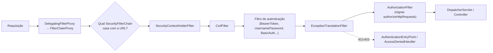
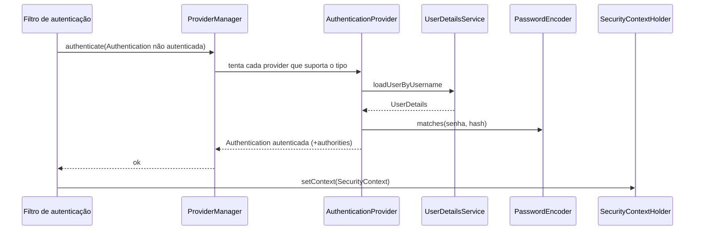

# Spring Security

> **Resumo:** como o Spring Security protege aplicações Boot: a cadeia de filtros (`SecurityFilterChain`), autenticação vs autorização, usuários e senhas (`UserDetailsService`, `PasswordEncoder`), tokens JWT com OAuth2 Resource Server, OAuth2 Client e segurança por método. Segurança mal configurada é uma das falhas mais caras; o mecanismo precisa ser entendido, não decorado.
> **Pré-requisitos:** [04-web-mvc](04-web-mvc.md) (filtros vs interceptors), [07-aop-e-proxies](../02-spring-core/07-aop-e-proxies.md) (segurança por método usa proxy), [02-auto-configuracao](02-auto-configuracao.md).
> **Versões:** Spring Boot 4.1.2, Spring Security 7.x ⚠️ VERIFICAR a versão exata do BOM, Spring Framework 7.0.x, Java 25. Exemplos de §5 executados com MockMvc, JWT HS256 e `@PreAuthorize` (projeto `/tmp/validacao/s8c`). OAuth2 Client e fluxos com IdP externo **não executados**.

## 1. Definição

**Autenticação** responde "quem é você?" (provar identidade: senha, token, certificado). **Autorização** responde "o que você pode fazer?" (papéis, permissões, regras). O Spring Security implementa ambas como uma **cadeia de filtros Servlet** que intercepta a requisição *antes* do `DispatcherServlet` ([04-web-mvc §filtros](04-web-mvc.md)), mais um modelo de objetos (`Authentication`, `GrantedAuthority`, `SecurityContext`) e proteção contra ataques web (CSRF, fixação de sessão, cabeçalhos de segurança).

Problema que resolve: sem ele, cada controlador reinventaria verificação de login, hash de senha, sessão e proteção CSRF. Com ele, a política é **declarada em um lugar** e aplicada de forma uniforme.

## 2. Conceitos fundamentais

### 2.1 Modelo de objetos

| Tipo | Papel |
|---|---|
| `SecurityContext` / `SecurityContextHolder` | guarda a `Authentication` do usuário corrente (por padrão em `ThreadLocal`) |
| `Authentication` | "principal + credenciais + autoridades"; `isAuthenticated()` |
| `GrantedAuthority` | uma permissão (`ROLE_ADMIN`, `SCOPE_orders:read`) |
| `UserDetails` / `UserDetailsService` | usuário carregado de uma fonte (banco, memória) |
| `AuthenticationManager` / `ProviderManager` | delega a `AuthenticationProvider`s |
| `PasswordEncoder` | hash e verificação de senha |
| `SecurityFilterChain` | conjunto ordenado de filtros + regras de autorização para um padrão de URL |

**Role vs authority:** um *role* é uma authority com o prefixo `ROLE_`. `hasRole("ADMIN")` equivale a `hasAuthority("ROLE_ADMIN")`. Em tokens OAuth2, escopos viram `SCOPE_<escopo>`. Executado: um JWT com `scope=orders:write` autorizou `hasAuthority('SCOPE_orders:write')`, mas **não** `hasRole("ADMIN")` (403 no `DELETE`).

### 2.2 A cadeia de filtros



O Boot registra o `springSecurityFilterChain` (um `FilterChainProxy`) que escolhe a **primeira** `SecurityFilterChain` cujo `securityMatcher` casa com a requisição. Há uma `@Bean SecurityFilterChain` padrão (todas as URLs autenticadas, login por formulário e Basic, senha aleatória gerada no log) que **recua** assim que você define a sua.

Códigos de falha: **401** = não autenticado (token ausente/inválido), **403** = autenticado mas sem permissão. Medido: sem token → `401`; token malformado → `401`; token válido sem a authority → `403`.

### 2.3 Configuração moderna (lambda DSL)

```java
@Configuration
@EnableMethodSecurity
class SecurityConfig {

    @Bean
    SecurityFilterChain apiChain(HttpSecurity http) throws Exception {
        return http
            .csrf(AbstractHttpConfigurer::disable)      // API stateless com token no header
            .sessionManagement(s -> s.sessionCreationPolicy(SessionCreationPolicy.STATELESS))
            .authorizeHttpRequests(a -> a
                .requestMatchers("/public/**").permitAll()
                .requestMatchers(HttpMethod.DELETE, "/orders/**").hasRole("ADMIN")
                .anyRequest().authenticated())           // negar por padrão
            .oauth2ResourceServer(o -> o.jwt(Customizer.withDefaults()))
            .build();
    }
}
```

O estilo antigo `WebSecurityConfigurerAdapter` (herança + `configure(HttpSecurity)`) foi **removido** (Security 6); a configuração é por *beans* `SecurityFilterChain`. A ordem das regras importa: vale a **primeira** que casar, então regras específicas vêm antes de `anyRequest()`.

### 2.4 Senhas

Nunca armazene senha em texto puro nem com hash rápido (MD5/SHA-1/SHA-256 simples). Use algoritmos **adaptativos e com salt**: BCrypt, SCrypt, Argon2, PBKDF2. O `PasswordEncoderFactories.createDelegatingPasswordEncoder()` grava o algoritmo no prefixo (`{bcrypt}$2a$...`), permitindo **migrar** o algoritmo no futuro sem invalidar hashes antigos (`upgradeEncoding`). Executado: `pe.encode("secret")` → `{bcrypt}...` e `matches("secret", hash)` → `true`.

### 2.5 UserDetailsService

```java
@Bean
UserDetailsService users(PasswordEncoder pe) {
    return new InMemoryUserDetailsManager(
        User.withUsername("ana").password(pe.encode("secret")).roles("USER").build(),
        User.withUsername("root").password(pe.encode("s3cret")).roles("ADMIN").build());
}

// Em produção: implementar para ler do banco
@Service
class DbUserDetailsService implements UserDetailsService {
    public UserDetails loadUserByUsername(String username) {
        return repo.findByUsername(username)
            .map(u -> User.withUsername(u.username()).password(u.passwordHash())
                          .authorities(u.authorities()).build())
            .orElseThrow(() -> new UsernameNotFoundException(username));
    }
}
```

<!-- não compilado -->

### 2.6 CSRF e CORS

- **CSRF** (*Cross-Site Request Forgery*): ataque que usa a sessão/cookie da vítima. Habilitado por padrão para métodos que alteram estado. Em aplicações com **sessão/cookie** (formulários), mantenha. Em APIs **stateless com token no `Authorization`** (o navegador não o anexa sozinho), pode ser desabilitado.
- **CORS**: política do navegador sobre origens diferentes; configure com `.cors(Customizer.withDefaults())` e um bean `CorsConfigurationSource` (o MVC sozinho não basta se o filtro de segurança rejeitar o *preflight* antes).

### 2.7 Segurança por método

```java
@PreAuthorize("hasAuthority('SCOPE_orders:write')")
@PostMapping("/orders") String create() { ... }

@PreAuthorize("#id == authentication.name")        // SpEL com o parâmetro e o usuário
@GetMapping("/customers/{id}") String me(@PathVariable String id) { ... }
```

Habilitada por `@EnableMethodSecurity`. Anotações: `@PreAuthorize`, `@PostAuthorize` (sobre o retorno), `@PreFilter`/`@PostFilter` (coleções), `@Secured`, `@RolesAllowed` (JSR-250). Executado: `POST /orders` sem o escopo → `403`; com → `200`; `GET /customers/bob` por `ana` → `403`. O parâmetro `#id` exige informação de nomes de parâmetros (`-parameters`, que o plugin do Boot/Maven parent ativa), como no `@EventListener` do [08 de Spring Core](../02-spring-core/08-eventos-validacao-e-conversao.md).

## 3. Como funciona por dentro

### 3.1 Fluxo de autenticação



Para o **Resource Server**, o filtro é o `BearerTokenAuthenticationFilter`: extrai o token do cabeçalho `Authorization: Bearer ...`, usa o `JwtAuthenticationProvider` que chama o `JwtDecoder` (valida assinatura, `exp`, e opcionalmente `iss`/`aud`) e um conversor (`JwtGrantedAuthoritiesConverter`) que transforma a claim `scope`/`scp` em `SCOPE_...`.

### 3.2 Persistência do contexto

O `SecurityContext` fica em `ThreadLocal` (`SecurityContextHolder`) durante a requisição; em apps com sessão, o `SecurityContextRepository` o guarda na `HttpSession` entre requisições. Em APIs *stateless*, o contexto é reconstruído a cada requisição a partir do token. Com `@Async`/virtual threads/Reactor, o `ThreadLocal` **não é propagado sozinho**: use `DelegatingSecurityContextExecutor`/propagação de contexto (e no WebFlux, `ReactiveSecurityContextHolder`).

### 3.3 Autorização

O `AuthorizationFilter` consulta um `AuthorizationManager<RequestAuthorizationContext>` montado das regras `authorizeHttpRequests`. Para método, o `@EnableMethodSecurity` registra *advisors* AOP ([07-aop-e-proxies](../02-spring-core/07-aop-e-proxies.md)) que aplicam `AuthorizationManager`s no proxy: **valem as mesmas limitações** (self-invocation e métodos `private`/`final` não são protegidos).

## 4. Evolução histórica

- **Acegi Security (2003–2007)** → **Spring Security 2.0 (2008)**.
- **3.x/4.x**: Java Config (`WebSecurityConfigurerAdapter`) substitui XML.
- **5.x (2017–2021)**: OAuth2 Login, Resource Server e Client nativos (substituindo o projeto `spring-security-oauth` descontinuado); `DelegatingPasswordEncoder` como padrão.
- **6.x (2022, Boot 3)**: `authorizeHttpRequests` substitui `authorizeRequests`; `WebSecurityConfigurerAdapter` removido; `javax` → `jakarta`; `@EnableMethodSecurity` substitui `@EnableGlobalMethodSecurity`.
- **7.x (Boot 4)**: lambda DSL como único estilo (os métodos encadeados antigos como `.and()` foram removidos ⚠️ VERIFICAR), novidades como *authorization server* integrado ao Security (projeto Spring Authorization Server incorporado ⚠️ VERIFICAR). Veja [00-evolucao-do-java](../01-java/00-evolucao-do-java.md) para o contexto `javax` → `jakarta`.

## 5. Exemplos práticos

### 5.1 Dependências

```xml
<dependency>
  <groupId>org.springframework.boot</groupId><artifactId>spring-boot-starter-security</artifactId>
</dependency>
<dependency>
  <groupId>org.springframework.boot</groupId>
  <artifactId>spring-boot-starter-security-oauth2-resource-server</artifactId>
</dependency>
<dependency>
  <groupId>org.springframework.boot</groupId>
  <artifactId>spring-boot-starter-security-test</artifactId><scope>test</scope>
</dependency>
```

Apenas adicionar `spring-boot-starter-security` já protege tudo (formulário + Basic, usuário `user`, senha aleatória no log). É seguro por padrão, e por isso o primeiro `401` de quem esqueceu de configurar.

### 5.2 API stateless com JWT (executado)

Bean do decoder (em produção o `issuer-uri` do IdP substitui a chave simétrica):

```java
@Bean JwtDecoder jwtDecoder() {
    return NimbusJwtDecoder.withSecretKey(new SecretKeySpec(KEY, "HmacSHA256"))
                           .macAlgorithm(MacAlgorithm.HS256).build();
}
@Bean JwtEncoder jwtEncoder() {      // apenas para gerar tokens em testes / servidor de auth próprio
    return NimbusJwtEncoder.withSecretKey(new SecretKeySpec(KEY, "HmacSHA256")).build();
}
```

Com um servidor OIDC (Keycloak, Auth0, Entra ID) basta configurar:

```properties
spring.security.oauth2.resourceserver.jwt.issuer-uri=https://idp.example.com/realms/orders
# O Boot busca a configuração OIDC e as chaves públicas (JWKS) e valida iss, exp e assinatura RS256
```

<!-- não compilado -->

Resultados medidos nas rotas do exemplo (`/public/**` aberto, `/orders` autenticado, `DELETE /orders/**` só `ROLE_ADMIN`):

| Requisição | Status |
|---|---|
| `GET /public/ping` sem token | 200 |
| `GET /orders` sem token | 401 |
| `GET /orders` com token válido | 200 |
| `GET /orders` com `Bearer abc.def.ghi` | 401 |
| `POST /orders` token sem escopo `orders:write` | 403 |
| `POST /orders` token com escopo `orders:write` | 200 |
| `DELETE /orders/1` token só com escopo | 403 |
| `DELETE /orders/1` com authority `ROLE_ADMIN` | 200 |

### 5.3 Extraindo roles de uma claim própria

Por padrão só `scope`/`scp` vira authority. Para mapear uma claim `roles`:

```java
@Bean
JwtAuthenticationConverter jwtAuthConverter() {
    var granted = new JwtGrantedAuthoritiesConverter();
    granted.setAuthoritiesClaimName("roles");
    granted.setAuthorityPrefix("ROLE_");
    var conv = new JwtAuthenticationConverter();
    conv.setJwtGrantedAuthoritiesConverter(granted);
    return conv;
}
// .oauth2ResourceServer(o -> o.jwt(j -> j.jwtAuthenticationConverter(jwtAuthConverter())))
```

<!-- não compilado -->

### 5.4 Testando segurança

```java
mvc.perform(get("/orders").with(jwt().authorities(new SimpleGrantedAuthority("ROLE_ADMIN"))))
// também: @WithMockUser(roles = "ADMIN") e SecurityMockMvcRequestPostProcessors.csrf()
```

`SecurityMockMvcRequestPostProcessors.jwt()` (executado) injeta um `Jwt` sem passar pelo decoder; é a forma mais simples de testar autorização. Teste também o **caminho negativo** (401/403). Mais em [10-testes-no-spring-boot](10-testes-no-spring-boot.md).

### 5.5 Login com formulário e sessão (aplicação web clássica)

```java
@Bean
SecurityFilterChain web(HttpSecurity http) throws Exception {
    return http
        .authorizeHttpRequests(a -> a.requestMatchers("/css/**", "/login").permitAll()
                                     .anyRequest().authenticated())
        .formLogin(Customizer.withDefaults())
        .logout(Customizer.withDefaults())
        .build();                          // CSRF continua habilitado (necessário com sessão)
}
```

<!-- não compilado -->

### 5.6 OAuth2 Client / Login (visão geral, não executado)

Para "entrar com Google/GitHub" ou chamar APIs de terceiros em nome do usuário: `spring-boot-starter-security-oauth2-client`, registrar o cliente em `spring.security.oauth2.client.registration.<id>.*` e usar `.oauth2Login(Customizer.withDefaults())`. Fluxo recomendado: **Authorization Code com PKCE**. O `OAuth2AuthorizedClientManager` obtém e renova tokens; `WebClient`/`RestClient` com o *interceptor* de OAuth2 anexam o token em chamadas de saída. ⚠️ VERIFICAR nomes exatos dos starters no Boot 4.1.

Papéis em OAuth2: *Resource Owner* (usuário), *Client* (sua app), *Authorization Server* (IdP), *Resource Server* (API). **OAuth2 é de autorização; OpenID Connect (OIDC) é a camada de autenticação** sobre ele (ID Token).

## 6. Configurações e anotações relevantes

| Item | Para que serve | Exemplo |
|---|---|---|
| `SecurityFilterChain` (bean) | política HTTP | `http.authorizeHttpRequests(...)` |
| `securityMatcher(...)` | restringe a cadeia a URLs | `http.securityMatcher("/api/**")` |
| `@EnableMethodSecurity` | liga `@PreAuthorize` etc. | na `@Configuration` |
| `@PreAuthorize`/`@PostAuthorize` | regra SpEL por método | `hasRole('ADMIN')` |
| `hasRole` / `hasAuthority` / `permitAll` / `authenticated` | expressões de regra | `.requestMatchers("/x").hasRole("A")` |
| `PasswordEncoder` | hash de senha | `BCryptPasswordEncoder`, delegating |
| `UserDetailsService` | carrega usuários | `InMemoryUserDetailsManager` |
| `JwtDecoder` / `JwtEncoder` | validar/gerar JWT | `NimbusJwtDecoder` |
| `spring.security.oauth2.resourceserver.jwt.issuer-uri` / `jwk-set-uri` | configurar Resource Server | URL do IdP |
| `spring.security.oauth2.client.registration.*` | OAuth2 Client | `client-id`, `client-secret`, `scope` |
| `spring.security.user.name` / `password` | usuário padrão do Boot | só em desenvolvimento |
| `.csrf(...)`, `.cors(...)`, `.headers(...)` | defesas web | `csrf.disable()` só para API stateless |
| `@WithMockUser`, `jwt()` | testes | `spring-security-test` |
| `logging.level.org.springframework.security=DEBUG` | depurar a cadeia | mostra qual filtro rejeitou |

## 7. Quando usar e quando NÃO usar

**Use Spring Security** em qualquer aplicação exposta (é o padrão do ecossistema, bem testado). Escolhas dentro dele:

| Cenário | Mecanismo |
|---|---|
| Aplicação web com páginas e login de usuário | formulário + sessão + CSRF |
| API consumida por SPA/mobile/outros serviços | **Resource Server com JWT** (stateless) |
| Microsserviços internos | JWT propagado pelo gateway ([04-api-gateway](../04-spring-cloud/04-api-gateway.md)), mTLS opcional |
| "Entrar com Google/GitHub" | OAuth2 Login (OIDC) |
| Autenticação simples e interna (ferramenta, CI) | Basic sobre HTTPS |

**Não faça:** escrever seu próprio esquema de token/criptografia; manter o **servidor de autorização na própria API** se já existe um IdP (Keycloak, Entra, Auth0); usar JWT quando a sessão tradicional resolve (JWT não se revoga facilmente antes de expirar); usar chave simétrica compartilhada (HS256) entre muitos serviços (preferir assimétrica RS256/ES256 com JWKS).

## 8. Erros comuns e boas práticas

1. **Negar por padrão**: termine sempre com `.anyRequest().authenticated()` (ou `denyAll()`); evite `permitAll` amplo.
2. **Ordem das regras**: a primeira que casa vale; específicas antes de genéricas.
3. **Confundir 401 e 403** e devolver o erro errado; personalize `AuthenticationEntryPoint` e `AccessDeniedHandler` com `ProblemDetail`.
4. **`csrf().disable()` em app com sessão/cookie**: abre brecha de CSRF. Só em API stateless por token.
5. **Prefixo `ROLE_`**: `hasRole("ROLE_ADMIN")` está errado (o prefixo é adicionado); `hasAuthority("ROLE_ADMIN")` é a forma literal.
6. **Segurança só na URL**: proteja também a camada de serviço (`@PreAuthorize`) e, para dados por dono (`#id == authentication.name`), verifique propriedade do recurso (evita IDOR / *Broken Object Level Authorization*).
7. **Senhas**: sempre `DelegatingPasswordEncoder`/BCrypt/Argon2; nunca logar senha nem token.
8. **Segredos no repositório** (chave JWT, `client-secret`): use variáveis de ambiente/cofre ([03-configuracao-externalizada](03-configuracao-externalizada.md)).
9. **Valide o JWT por inteiro**: assinatura, `exp`, `iss`, `aud`; não confie no conteúdo sem validar; defina tempo de vida curto e refresh token.
10. **Self-invocation com `@PreAuthorize`**: chamada interna ao mesmo bean não passa pelo proxy ([07-aop](../02-spring-core/07-aop-e-proxies.md)).
11. **`ThreadLocal` em `@Async`**: contexto de segurança não propaga sozinho.
12. **Actuator exposto** sem proteção: restrinja endpoints sensíveis ([09-actuator](09-actuator-e-observabilidade.md)).
13. Boa prática: HTTPS sempre, cabeçalhos de segurança padrão (HSTS, `X-Content-Type-Options`), testes de autorização positivos e negativos, rotação de chaves, e revisão com o OWASP ASVS/Top 10.

## 9. Perguntas de revisão

1. Qual a diferença entre `401` e `403` no Spring Security?
<details><summary>Resposta</summary><code>401</code>: não autenticado (sem token/credencial inválida). <code>403</code>: autenticado, mas sem autorização. Medido: token malformado → 401; token sem escopo no <code>POST /orders</code> → 403.</details>

2. Por que `hasRole("ADMIN")` não aceitou um token com `scope=orders:write`?
<details><summary>Resposta</summary>Escopos viram authorities <code>SCOPE_orders:write</code>; <code>hasRole("ADMIN")</code> procura <code>ROLE_ADMIN</code>. Roles e escopos são authorities diferentes e precisam ser mapeados explicitamente.</details>

3. Por que o `DelegatingPasswordEncoder` prefixa o hash com `{bcrypt}`?
<details><summary>Resposta</summary>Para registrar o algoritmo usado e permitir trocar/atualizar o algoritmo no futuro mantendo hashes antigos válidos (<code>matches</code> escolhe o encoder pelo prefixo).</details>

4. Quando desabilitar CSRF é aceitável?
<details><summary>Resposta</summary>Em APIs stateless que autenticam por token no cabeçalho <code>Authorization</code> (o navegador não o envia automaticamente). Em aplicações com sessão/cookie, deve permanecer habilitado.</details>

5. Por que `@PreAuthorize` pode não valer em uma chamada interna?
<details><summary>Resposta</summary>A segurança por método é implementada por proxy AOP; chamar um método do mesmo bean via <code>this</code> contorna o proxy (self-invocation), então a verificação não ocorre.</details>

## 10. Referências oficiais

- Spring Security, referência: https://docs.spring.io/spring-security/reference/
- Spring Boot, Security: https://docs.spring.io/spring-boot/reference/web/spring-security.html
- Spring Security, OAuth2 Resource Server: https://docs.spring.io/spring-security/reference/servlet/oauth2/resource-server/index.html
- OWASP Top 10: https://owasp.org/www-project-top-ten/
- RFC 6749 (OAuth 2.0): https://www.rfc-editor.org/rfc/rfc6749
- RFC 7519 (JWT): https://www.rfc-editor.org/rfc/rfc7519
- Projeto: https://spring.io/projects/spring-security
