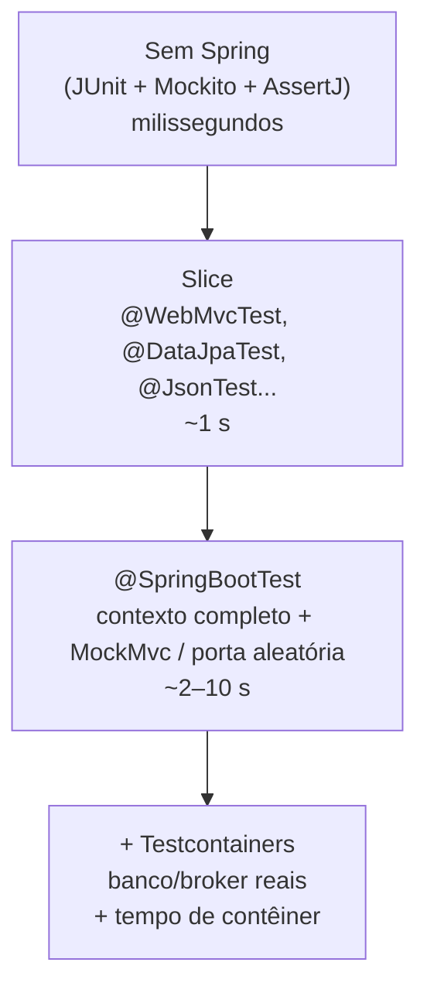
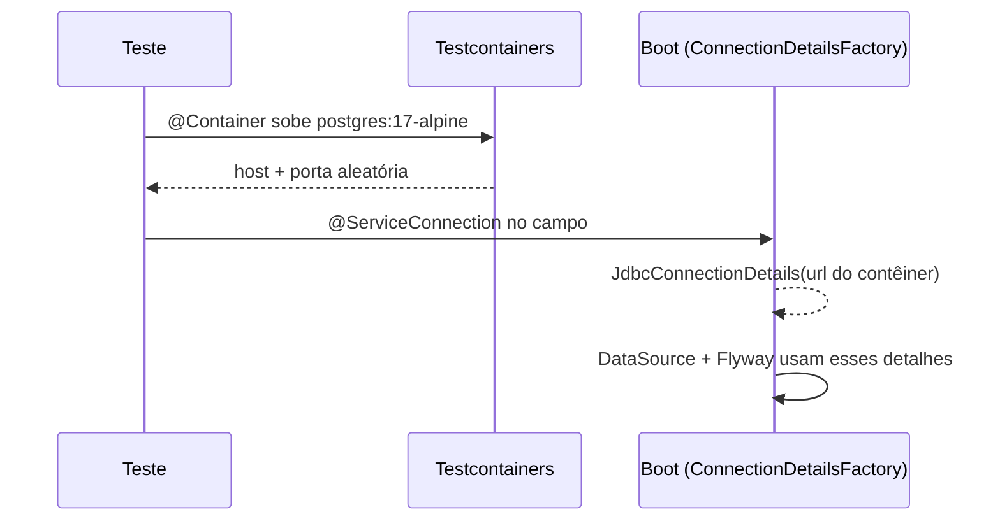

# Testes no Spring Boot

> **Resumo:** como testar aplicações Boot em camadas: testes unitários sem Spring, *slices* (`@WebMvcTest`, `@DataJpaTest`...) que sobem só uma fatia do contexto, `@SpringBootTest` para o conjunto, `@MockitoBean` para substituir dependências e Testcontainers com `@ServiceConnection` para usar bancos e brokers reais.
> **Pré-requisitos:** [15-testes-em-java](../01-java/15-testes-em-java.md) (JUnit 5, AssertJ, Mockito), [02-auto-configuracao](02-auto-configuracao.md), [04-web-mvc](04-web-mvc.md), [06-spring-data-jpa](06-spring-data-jpa.md).
> **Versões:** Spring Boot 4.1.2, Spring Framework 7.0.x, JUnit 5/Jupiter ⚠️ VERIFICAR se o BOM já usa JUnit 6, Testcontainers 2.x, Java 25. Exemplos executados em `/tmp/validacao/s9`: `@SpringBootTest`+`MockMvc`, `@WebMvcTest`+`@MockitoBean`, Testcontainers (PostgreSQL 17) com `@ServiceConnection`.

## 1. Definição

Teste no Spring Boot é o conjunto de anotações e starters que montam, para cada teste, **o menor contexto Spring capaz de provar o comportamento**. A decisão central é: *quanto do contexto preciso para este teste?* Quanto menos, mais rápido; quanto mais, mais realista.

Problema que resolve: subir a aplicação inteira para testar uma regra de validação leva segundos e arrasta banco, segurança e mensageria. Testar tudo com mocks puros não prova que as anotações, o mapeamento JSON ou as queries funcionam. A pirâmide de testes de Boot dá uma ferramenta para cada ponto.

## 2. Conceitos fundamentais

### 2.1 Os níveis



| Nível | Quando | Custo |
|---|---|---|
| Unitário puro | regra de negócio, `record` com validação, cálculos | quase zero |
| Slice | controlador (JSON, status, validação), repositório (SQL real), serialização | baixo |
| `@SpringBootTest` | fiação completa, filtros, segurança, transações ponta a ponta | médio |
| Com contêineres | comportamento específico do banco (tipos, locks, JSON, `ON CONFLICT`) | alto |

### 2.2 Starters de teste (mudança do Boot 4)

No Boot 4 cada tecnologia tem seu próprio starter de teste, em vez de um único `spring-boot-starter-test` com tudo:

| Starter | Para |
|---|---|
| `spring-boot-starter-webmvc-test` | `@WebMvcTest`, `MockMvc` |
| `spring-boot-starter-data-jpa-test` | `@DataJpaTest` |
| `spring-boot-starter-data-jdbc-test` | `@DataJdbcTest` |
| `spring-boot-starter-security-test` | `@WithMockUser`, `SecurityMockMvcRequestPostProcessors` |
| `spring-boot-starter-webflux-test` | `WebTestClient` |
| `spring-boot-starter-actuator-test` | testes com Actuator ⚠️ VERIFICAR o que traz |
| `spring-boot-testcontainers` | `@ServiceConnection` |

Os pacotes das anotações também seguem os módulos. Executados: `org.springframework.boot.webmvc.test.autoconfigure.WebMvcTest` e `AutoConfigureMockMvc`; para JPA, `org.springframework.boot.data.jpa.test.autoconfigure.*` (visto em [06](06-spring-data-jpa.md)). `@SpringBootTest` continua em `org.springframework.boot.test.context`.

### 2.3 `@SpringBootTest`

Procura a classe anotada com `@SpringBootConfiguration` (subindo pelos pacotes a partir do teste) e carrega o contexto completo. O `webEnvironment` controla o servidor:

| Valor | Efeito |
|---|---|
| `MOCK` (padrão) | contexto web simulado, sem porta; use com `MockMvc` |
| `RANDOM_PORT` | servidor real numa porta livre; use `RestTestClient`/`WebTestClient`/`TestRestTemplate` ⚠️ VERIFICAR o cliente recomendado no 4.1 (existe o artefato `spring-boot-resttestclient`) |
| `DEFINED_PORT` | porta configurada (evite: conflitos) |
| `NONE` | sem web |

### 2.4 Slices

Um slice usa `@TypeExcludeFilter`s para escanear **só** os componentes da camada e aplica apenas as auto-configurações dessa camada (via `@AutoConfigureXxx`/`@ImportAutoConfiguration`).

| Anotação | Sobe | Não sobe |
|---|---|---|
| `@WebMvcTest(Api.class)` | `@Controller`, `@ControllerAdvice`, `@JsonComponent`/Jackson, `Converter`, `Filter`, `WebMvcConfigurer`, segurança | `@Service`, `@Repository`, `@Component` genérico |
| `@DataJpaTest` | entidades, repositórios, `DataSource` embutido, `TestEntityManager`, transação com rollback | web, serviços |
| `@DataJdbcTest`, `@JdbcTest` | idem para JDBC | |
| `@JsonTest` | `ObjectMapper`/`JsonMapper`, `JacksonTester` | tudo mais |
| `@RestClientTest` | `RestClient` + servidor simulado | |

Executado (`SliceTest`): um `@WebMvcTest(Api.class)` criou **112** definições de bean; `Api`=1, `StockHealth`=0 (nosso `@Component` foi filtrado), `DataSource`=0. Sem banco, sem Flyway, sem Actuator de saúde: por isso é rápido.

### 2.5 Substituir beans: `@MockitoBean`, `@MockitoSpyBean`, `@TestConfiguration`

Desde o Framework 6.2/Boot 3.4, **`@MockitoBean` e `@MockitoSpyBean`** (pacote `org.springframework.test.context.bean.override.mockito`) substituem os antigos `@MockBean`/`@SpyBean`, que foram deprecados e **removidos no Boot 4**. Eles fazem parte do Spring Framework, não do Boot.

```java
@MockitoBean PriceService prices;     // todo bean desse tipo no contexto vira mock
```

`@TestConfiguration` declara beans extras (um relógio fixo, um *fake*) sem entrar no *scan* da aplicação.

## 3. Como funciona por dentro

### 3.1 O Spring TestContext Framework e o cache de contextos

O JUnit chama a `SpringExtension` (já registrada por `@SpringBootTest` e pelos slices). Ela delega ao **TestContext Framework**, que:

1. calcula uma **chave de cache** (`MergedContextConfiguration`) com classes de configuração, perfis, propriedades, inicializadores, `@MockitoBean` declarados etc.;
2. se já existe contexto com essa chave em *cache estático da JVM*, reutiliza; senão cria;
3. injeta os campos `@Autowired` no objeto de teste.

Consequência prática: **cada combinação diferente de configuração cria um contexto novo.** Um `@MockitoBean` a mais, uma `@TestPropertySource` diferente ou um `@ActiveProfiles` diferente numa classe de teste quebra o cache e custa outro startup. Em suítes grandes, padronizar a configuração dos testes de integração é a otimização mais barata. `@DirtiesContext` descarta o contexto de propósito: só use quando realmente mutou estado global.

### 3.2 Por que `@WebMvcTest` não carrega `@Service`

O `@WebMvcTest` registra um `WebMvcTypeExcludeFilter` que, durante o `@ComponentScan` da `@SpringBootApplication`, **só aceita tipos web**. Os `@Component` comuns são ignorados, por isso o controlador, que depende de um `@Service`, precisa que você forneça um `@MockitoBean` para ele. Se faltar, o erro é `NoSuchBeanDefinitionException` ao montar o `Api`.

### 3.3 Anotações de infraestrutura na classe principal quebram os slices (executado)

Pegadinha real, reproduzida em `s9`: a classe `App` tinha

```java
@SpringBootApplication
@EnableCaching @EnableAsync @EnableScheduling
public class App { ... }
```

e o `@WebMvcTest` falhou com:

```text
No qualifying bean of type 'org.springframework.cache.CacheManager' available:
no CacheResolver specified - register a CacheManager bean or remove the @EnableCaching annotation
```

Motivo: a classe `@SpringBootApplication` é **sempre** carregada pelos slices, e a `@EnableCaching` nela exige um `CacheManager` que o slice (que não ativa a auto-configuração de cache) não cria. Correção validada: mover as anotações para uma `@Configuration` separada, que o filtro do slice não escaneia:

```java
@Configuration
@EnableCaching @EnableAsync @EnableScheduling
class InfraConfig {}
```

Com isso o mesmo `@WebMvcTest` passou. Regra geral: **mantenha a classe principal sem `@Enable*` nem `@Bean`** além do `main`.

### 3.4 `@ServiceConnection` e as `ConnectionDetails`

O Boot 3.1+ tem uma abstração: `ConnectionDetails` (`JdbcConnectionDetails`, `RedisConnectionDetails`...). Normalmente a auto-configuração monta o `DataSource` a partir de `spring.datasource.*`; com `@ServiceConnection` sobre um contêiner, o Boot cria um bean `JdbcConnectionDetails` com URL, usuário e senha **do contêiner**, que tem prioridade sobre as propriedades. Por isso não existe `@DynamicPropertySource` nem URL fixa.



## 4. Evolução histórica

| Versão | Mudança |
|---|---|
| Boot 1.4 (2016) | `spring-boot-starter-test`, `@SpringBootTest`, slices (`@WebMvcTest`, `@DataJpaTest`), `@MockBean` |
| Boot 2.x | `JUnit 5` opcional; `@TestConfiguration`; `WebTestClient` |
| Boot 2.2 | JUnit 5 padrão (Vintage opcional) |
| Boot 3.1 (2023) | **Testcontainers** de primeira classe: `@ServiceConnection`, `@DynamicPropertySource` desnecessário; `spring-boot-testcontainers` |
| Framework 6.2 / Boot 3.4 | `@MockitoBean`/`@MockitoSpyBean` (bean override); `@MockBean` deprecado |
| Boot 4.0 | `@MockBean`/`@SpyBean` removidos; starters de teste por módulo; `RestTestClient` ⚠️ VERIFICAR |

⚠️ VERIFICAR as datas de 1.4, 2.2 e 3.1 (de memória). Para a evolução do JUnit e Mockito, veja [15-testes-em-java §4](../01-java/15-testes-em-java.md).

## 5. Exemplos práticos

### 5.1 Sem Spring: o teste mais barato

Se a lógica está num POJO/`record`, **não use Spring**:

```java
record Money(BigDecimal amount) {
    Money { if (amount.signum() < 0) throw new IllegalArgumentException("negativo"); }
}

class MoneyTest {
    @Test void rejectsNegative() {
        assertThatThrownBy(() -> new Money(new BigDecimal("-1")))
            .isInstanceOf(IllegalArgumentException.class);
    }
}
```

Esse teste roda em milissegundos e é o que mais deve existir. Construtor com injeção (única forma recomendada, ver [02-ioc](../02-spring-core/02-ioc-e-injecao-de-dependencia.md)) torna trivial instanciar a classe com *fakes*.

### 5.2 `@SpringBootTest` + `MockMvc` (executado)

```java
@SpringBootTest
@AutoConfigureMockMvc
class AppTest {
    @Autowired MockMvc mvc;
    @Autowired PriceService prices;

    @Test void actuatorAndCache() throws Exception {
        mvc.perform(get("/actuator/health"))
           .andExpect(status().isOk());
        prices.price("A"); prices.price("A");
        assertThat(prices.calls()).isEqualTo(1);   // 2ª chamada veio do cache
    }
}
```

Armadilha executada: acessar o **campo** `prices.calls` direto deu `NullPointerException`. O bean é um proxy CGLIB (por causa de `@Cacheable`), uma subclasse cujo campo herdado **não é inicializado**; só os métodos são delegados ao alvo ([07-aop-e-proxies](../02-spring-core/07-aop-e-proxies.md)). Exponha estado de teste por método, nunca por campo.

### 5.3 `@WebMvcTest` com `@MockitoBean` (executado)

```java
@WebMvcTest(Api.class)
class ApiSliceTest {
    @Autowired MockMvc mvc;
    @MockitoBean OrderService orders;      // o Service real não é carregado

    @Test void returnsOrder() throws Exception {
        when(orders.find(1L)).thenReturn(new OrderDto(1L, "Ana"));

        mvc.perform(get("/orders/1"))
           .andExpect(status().isOk())
           .andExpect(jsonPath("$.customer").value("Ana"));
    }
}
```

O que esse teste prova: rota, serialização JSON, validação, `@ControllerAdvice` e códigos de status. O que **não** prova: o `OrderService`, o banco, a segurança fora do slice (veja §7 para `@Import` do `SecurityFilterChain`).

### 5.4 `@DataJpaTest` (resumo, ver [06](06-spring-data-jpa.md))

```java
@DataJpaTest                       // H2 embutido, rollback ao fim de cada teste
class OrderRepositoryTest {
    @Autowired OrderRepository repo;
    @Autowired TestEntityManager em;

    @Test void findsByCustomer() {
        em.persistAndFlush(new Order("Ana"));
        assertThat(repo.findByCustomer("Ana")).hasSize(1);
    }
}
```

`@DataJpaTest` por padrão **troca o `DataSource` por um embutido**. Isso é conveniente, mas H2 não é PostgreSQL: se a query usa recurso específico, use `@AutoConfigureTestDatabase(replace = NONE)` com Testcontainers (§5.5). O teste roda em transação com *rollback*, o que também significa que **não testa o commit** (restrições `DEFERRED`, gatilhos no commit e o `@TransactionalEventListener(AFTER_COMMIT)` não disparam).

### 5.5 Testcontainers + `@ServiceConnection` + Flyway (executado)

Dependências de teste: `spring-boot-testcontainers`, `testcontainers-junit-jupiter`, `testcontainers-postgresql`, driver `org.postgresql:postgresql`. Docker precisa estar disponível.

```java
@SpringBootTest
@Testcontainers
class PgTest {
    @Container
    @ServiceConnection
    static PostgreSQLContainer pg = new PostgreSQLContainer("postgres:17-alpine");

    @Autowired JdbcClient jdbc;

    @Test void usesRealPostgres() {
        String v = jdbc.sql("select version()").query(String.class).single();
        long n = jdbc.sql("select count(*) from orders").query(Long.class).single();
        assertThat(v).contains("PostgreSQL");
    }
}
```

Saída executada: `PostgreSQL 17.11 on x86_64-pc-...` e `flyway rows=1`, ou seja, as migrações V1 e V2 rodaram **no PostgreSQL real** durante o startup do contexto, o que valida o SQL das migrações, algo que o H2 jamais garantiria. Observação do Boot 4/Testcontainers 2: a classe agora é `org.testcontainers.postgresql.PostgreSQLContainer` (pacote do módulo `testcontainers-postgresql`), e o contêiner não é mais genérico em `SELF` ⚠️ VERIFICAR a mudança exata de assinatura.

**Reaproveitar contêiner:** um contêiner `static` por classe é recriado por classe. Para uma suíte inteira, declare-o em uma classe base (padrão *singleton container*) ou registre-o como `@Bean @ServiceConnection` em uma `@TestConfiguration` compartilhada, o que também preserva o cache de contexto.

### 5.6 Segurança em testes

Com `spring-boot-starter-security-test`: `@WithMockUser(roles = "ADMIN")` e `.with(jwt())` (para Resource Server) em `MockMvc`. Em `@WebMvcTest` a segurança do Boot é aplicada, então um `GET` sem usuário retorna 401. Para usar sua `SecurityFilterChain` customizada no slice, `@Import(SecurityConfig.class)`; veja os 8 cenários executados em [08](08-spring-security.md).

## 6. Configurações e anotações relevantes

| Anotação/Propriedade | Para que serve | Exemplo |
|---|---|---|
| `@SpringBootTest(webEnvironment=...)` | contexto completo | `RANDOM_PORT` |
| `@AutoConfigureMockMvc` | injeta `MockMvc` no `@SpringBootTest` | |
| `@WebMvcTest(X.class)` | slice web | |
| `@DataJpaTest`, `@DataJdbcTest`, `@JsonTest` | demais slices | |
| `@MockitoBean`, `@MockitoSpyBean` | mock/spy como bean (Framework 6.2+) | |
| `@TestConfiguration` | beans extras só para teste | relógio fixo |
| `@ActiveProfiles("test")` | perfis | |
| `@TestPropertySource(properties=...)`, `@SpringBootTest(properties=...)` | propriedades | `spring.cache.type=none` |
| `@DirtiesContext` | invalida o cache de contexto | usar com parcimônia |
| `@Sql`, `@Transactional` | dados e rollback | |
| `@Testcontainers`, `@Container`, `@ServiceConnection` | contêineres | §5.5 |
| `@WithMockUser` | usuário simulado | |
| `@Import(...)` | traz configuração específica a um slice | `SecurityConfig` |

## 7. Quando usar e quando NÃO usar

**Prefira, por ordem:** teste sem Spring → slice → `@SpringBootTest` → com contêineres. Suba de nível só se o de baixo não consegue provar o que você precisa.

**Slices não valem** quando o comportamento depende de interação entre camadas (transação que abrange serviço + repositório, eventos, segurança por método). Nesses, `@SpringBootTest`.

**Mockar demais** gera testes que passam sempre e quebram em refatoração: prefira *fakes* em memória para repositórios simples e reserve `@MockitoBean` para bordas externas (gateway de pagamento, e-mail).

**H2 como substituto do banco real** esconde diferenças de dialeto, tipos, collation, locks e `JSON`. Use Testcontainers quando o SQL importa.

**`DEFINED_PORT`, `@DirtiesContext` e ordem de testes** são sintomas de testes acoplados.

## 8. Erros comuns e boas práticas

1. **`@Enable*`/`@Bean` na classe principal** quebra slices (§3.3, executado).
2. **Slice sem os `@MockitoBean` necessários**: `NoSuchBeanDefinitionException`.
3. **Acessar campo de bean proxy** (§5.2, executado: NPE).
4. **Cada teste com configuração ligeiramente diferente**: cada variação é um contexto novo (§3.1). Reutilize classes base e perfis.
5. **`@DataJpaTest` com `@Transactional` mascarando bugs de LAZY**: no teste a sessão está sempre aberta; o `LazyInitializationException` só aparece em produção ([06 §OSIV](06-spring-data-jpa.md)).
6. **`Thread.sleep` para esperar assíncrono**: use `Awaitility` ou `CompletableFuture#get`.
7. **Tempo e aleatoriedade no código**: injete `Clock`/`Supplier` e substitua em `@TestConfiguration`.
8. **Surefire só executa `*Test`/`Test*`/`*Tests`** por padrão: uma classe chamada `T` não rodou e o build deu "sucesso" com zero testes (acontecido nesta própria validação). Verifique o "Tests run".
9. **Mock de tudo ao redor do serviço**: o teste vira espelho da implementação.
10. **Docker indisponível no CI** faz os testes com contêineres falharem: prever o ambiente (ou `@EnabledIfDockerAvailable`).

## 9. Perguntas de revisão

1. Por que `@WebMvcTest` exige `@MockitoBean` para os serviços?
<details><summary>Resposta</summary>O slice só escaneia tipos web; `@Service` e `@Repository` não são carregados, então as dependências do controlador precisam ser fornecidas como mocks.</details>

2. O que é o cache de contextos e o que o invalida?
<details><summary>Resposta</summary>O TestContext Framework reutiliza contextos com a mesma `MergedContextConfiguration`. Mudar perfis, propriedades, classes de configuração ou conjunto de `@MockitoBean` cria outro; `@DirtiesContext` descarta explicitamente.</details>

3. Por que `@EnableCaching` na classe `@SpringBootApplication` quebrou o `@WebMvcTest`?
<details><summary>Resposta</summary>A classe principal sempre é carregada pelo slice; `@EnableCaching` exige um `CacheManager`, que o slice não cria. Mover para uma `@Configuration` separada resolve, pois ela não é escaneada pelo slice.</details>

4. O que o `@ServiceConnection` faz que o `@DynamicPropertySource` fazia à mão?
<details><summary>Resposta</summary>Registra `ConnectionDetails` a partir do contêiner (URL, usuário, senha), que têm prioridade sobre `spring.datasource.*`, sem precisar escrever propriedades.</details>

5. Por que `@DataJpaTest` não substitui testar com o banco real?
<details><summary>Resposta</summary>Por padrão usa banco embutido (H2) e roda em transação com rollback: dialeto, tipos e comportamento de commit diferem do banco de produção.</details>

## 10. Referências oficiais

- Spring Boot Reference, Testing: <https://docs.spring.io/spring-boot/reference/testing/index.html> ⚠️ VERIFICAR o caminho exato
- Spring Framework, Testing: <https://docs.spring.io/spring-framework/reference/testing.html>
- Testcontainers: <https://testcontainers.com>
- JUnit: <https://junit.org> · AssertJ: <https://assertj.github.io/doc/> · Mockito: <https://site.mockito.org>
- Anterior: [09-actuator-e-observabilidade](09-actuator-e-observabilidade.md) · Próximo: [11-cache-agendamento-e-async](11-cache-agendamento-e-async.md)
