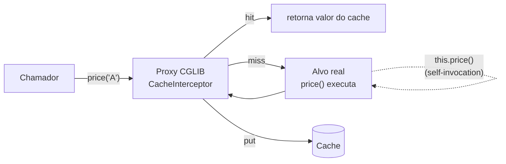

# Cache, Agendamento e Execução Assíncrona

> **Resumo:** três recursos de "trabalho fora do fluxo normal" baseados em proxy: cache declarativo (`@Cacheable`), tarefas agendadas (`@Scheduled`) e execução em outra thread (`@Async`). São fáceis de ligar e fáceis de usar errado: o proxy, os pools de thread e a ausência de coordenação entre instâncias são a fonte de quase todos os bugs. Inclui também `@Retryable` e `@ConcurrencyLimit`, que passaram a fazer parte do Spring Framework 7.
> **Pré-requisitos:** [07-aop-e-proxies](../02-spring-core/07-aop-e-proxies.md) (self-invocation), [12-concorrencia](../01-java/12-concorrencia.md) (executores, virtual threads), [09-transacoes](../02-spring-core/09-transacoes.md), [09-actuator-e-observabilidade](09-actuator-e-observabilidade.md).
> **Versões:** Spring Boot 4.1.2, Spring Framework 7.0.x, Java 25. Executado em `/tmp/validacao/s9` e `s9b`: `@Cacheable`/`@CacheEvict` (incluindo self-invocation), Caffeine via propriedades, `@Async` (platform e virtual threads), `@Scheduled` (fixedRate, thread), `@Retryable`, erro em `@Async void`. Redis como cache, Quartz, ShedLock **não executados**.

## 1. Definição

| Recurso | O que faz | Habilitação | Mecanismo |
|---|---|---|---|
| **Cache** | guarda o resultado de um método por chave e o devolve nas chamadas seguintes | `@EnableCaching` | proxy AOP (`CacheInterceptor`) |
| **Agendamento** | executa um método periodicamente ou em horários (cron) | `@EnableScheduling` | `ScheduledAnnotationBeanPostProcessor` + `TaskScheduler` |
| **Async** | executa o método em outra thread e devolve `void`/`Future` | `@EnableAsync` | proxy AOP (`AsyncExecutionInterceptor`) + `TaskExecutor` |
| **Resiliência** | repetir uma chamada, limitar concorrência | `@EnableResilientMethods` | proxy AOP (Framework 7) |

Problema que resolvem: sem eles, cada serviço reimplementaria mapa de cache com expiração, `ScheduledExecutorService` e `ExecutorService` com tratamento de erro. Com anotações a política fica visível e o código de negócio continua limpo.

## 2. Conceitos fundamentais

### 2.1 Cache

**Abstração, não implementação.** `@Cacheable` fala com `CacheManager`/`Cache`; o armazenamento concreto é escolhido por configuração:

| Implementação | Quando | Starter/dep. |
|---|---|---|
| `ConcurrentMapCache` (padrão) | desenvolvimento e testes; **sem expiração nem limite** | `spring-boot-starter-cache` |
| Caffeine | cache local de produção (limite, expiração, estatísticas) | `com.github.ben-manes.caffeine:caffeine` |
| Redis | cache **compartilhado** entre instâncias | `spring-boot-starter-data-redis` |
| Hazelcast, Infinispan, JCache (JSR-107), Couchbase | casos específicos | ver docs |

Anotações:

| Anotação | Efeito |
|---|---|
| `@Cacheable(cacheNames, key, condition, unless)` | se há valor para a chave, **não executa o método**; senão executa e guarda |
| `@CachePut` | executa sempre e atualiza o cache |
| `@CacheEvict(allEntries, beforeInvocation)` | remove entrada(s) |
| `@Caching` | combina várias |
| `@CacheConfig(cacheNames=...)` | padrões da classe |

`key` é uma expressão SpEL (`#sku`, `#order.id`); o padrão é uma `SimpleKey` composta pelos argumentos. `condition` é avaliada **antes** (decide se usa o cache); `unless` **depois**, com acesso a `#result` (decide se guarda: `unless = "#result == null"`).

### 2.2 Agendamento

| Atributo de `@Scheduled` | Semântica |
|---|---|
| `fixedRate` | intervalo entre **inícios** de execução |
| `fixedDelay` | intervalo entre o **fim** de uma e o início da próxima (nunca sobrepõe) |
| `cron` | expressão de 6 campos (segundo minuto hora dia mês dia-da-semana) |
| `initialDelay` | atraso antes da primeira execução |
| `zone` | fuso do cron |
| `scheduler` | qual `TaskScheduler` usar |

O método deve ter **zero parâmetros** e (efetivamente) retornar `void`. Exceções não encerram o agendamento: o `ErrorHandler` do scheduler registra e a próxima execução ocorre normalmente.

### 2.3 Async

`@Async` em método público de bean: a chamada retorna imediatamente e o corpo roda num `TaskExecutor`. Tipos de retorno:

| Retorno | Uso |
|---|---|
| `void` | "dispare e esqueça". **Exceções ficam fora do alcance do chamador** |
| `CompletableFuture<T>` / `Future<T>` | o chamador pode esperar ou compor |

### 2.4 Resiliência no Framework 7

Spring Retry saiu do caminho: o **Framework 7 incorpora** `@Retryable` e `@ConcurrencyLimit` no pacote `org.springframework.resilience.annotation` (confirmado listando `spring-context-7.0.8.jar`), ativados com `@EnableResilientMethods`.

```java
@Retryable(maxRetries = 3, delay = 10, includes = IllegalStateException.class)
public String call() { ... }

@ConcurrencyLimit(5)            // no máximo 5 execuções simultâneas
public void heavy() { ... }
```

`@Retryable` aqui é **conta de retentativas** além da chamada original (`maxRetries`), com `delay`, `multiplier`, `jitter`, `includes`/`excludes`. ⚠️ VERIFICAR a semântica exata dos atributos (`maxRetries` vs. total de tentativas) e sua versão de inclusão (7.0). Executado: método que falha nas duas primeiras chamadas retornou `"ok após 3"` com `attempts=3`. Para circuit breaker e bulkhead com métricas, o caminho continua sendo Resilience4j ([04-spring-cloud](../04-spring-cloud/)).

## 3. Como funciona por dentro

### 3.1 Proxy: o que isso implica

Cache e Async são **advices de proxy** ([07-aop-e-proxies](../02-spring-core/07-aop-e-proxies.md)). Três consequências, todas executadas:

**a) Self-invocation ignora o cache.** Em `PriceService`:

```java
@Cacheable("prices") public String price(String sku) { calls.incrementAndGet(); return ...; }
public String viaThis(String sku) { return price(sku); }   // this.price(): sem proxy
```

Três chamadas (`price("A")`, `price("A")`, `viaThis("A")`): executado, o método real rodou **2 vezes**, não 1. A segunda chamada externa veio do cache; a `viaThis` chamou `this.price`, passando por cima do proxy. Após `@CacheEvict` e nova chamada, `calls` foi para 3.

**b) Self-invocation ignora o `@Async`.** Executado: `where()` chamado pelo proxy rodou em `task-2`; o mesmo `where()` chamado via `viaThis()` rodou em `main`, **de forma síncrona e sem erro nenhum**.

**c) Retorno de objeto proxy: campos não funcionam.** `ps.calls` (campo) deu `NullPointerException`; só métodos são delegados (CGLIB cria subclasse sem inicializar campos).



### 3.2 Como o cache decide a chave e o que guarda

O `CacheInterceptor` monta uma chave (`KeyGenerator` ou `key` SpEL), consulta `Cache.get(key)`; se houver `ValueWrapper`, devolve. Senão invoca o método e faz `put`. `null` pode ser armazenado (`ValueWrapper` com `null`) salvo `unless`. Por padrão a chave é construída por `SimpleKeyGenerator`: **sem argumentos** → `SimpleKey.EMPTY`; **um** argumento → ele próprio; vários → `SimpleKey` composta. Os objetos usados como chave precisam de `equals/hashCode` corretos ([03-tipos-e-memoria](../01-java/03-tipos-e-memoria.md)); um `record` serve.

**Cache stampede (thundering herd):** com N threads pedindo a mesma chave ausente, todas executam o método. `@Cacheable(sync = true)` faz as demais esperarem a primeira (suportado pelos `Cache`s que implementam `get(key, Callable)`, como Caffeine).

### 3.3 Cache no Boot: a escolha do `CacheManager`

`CacheAutoConfiguration` só entra se existir `@EnableCaching` e **nenhum** `CacheManager`/`CacheResolver` próprio. Procura, em ordem, Redis → Caffeine → ... → `ConcurrentMapCacheManager` (primeiro que encontrar no classpath), ou o escolhido por `spring.cache.type`. Executado em `s9b`, com a dependência Caffeine e propriedades:

```yaml
spring:
  cache:
    type: caffeine
    cache-names: p
    caffeine:
      spec: maximumSize=10,expireAfterWrite=5m
```

o bean foi um `CaffeineCacheManager`. Sem a dependência, o padrão `ConcurrentMapCacheManager` cria caches **sob demanda** (o endpoint `caches` só listou `prices` depois do primeiro uso) e **cresce sem limite**: vazamento de memória clássico.

### 3.4 Async: o executor do Boot

O Boot cria um `ThreadPoolTaskExecutor` chamado `applicationTaskExecutor`, com prefixo de thread `task-` (observado: `task-1`, `task-2`). Parâmetros em `spring.task.execution.*` (`pool.core-size`, `pool.max-size`, `pool.queue-capacity`, `thread-name-prefix`, `shutdown.await-termination`).

**Virtual threads (Boot 3.2+, Java 21+):** com `spring.threads.virtual.enabled=true`, o mesmo executor passa a criar threads virtuais. Executado em `s9b`: o método `@Async` rodou em `VirtualThread[#57,task-1]/runnable@ForkJoinPool-1-worker-1`. Ver [12-concorrencia §virtual threads](../01-java/12-concorrencia.md). Atenção: com virtual threads **não há limite natural de paralelismo**; para proteger um recurso (banco, API externa), use `@ConcurrencyLimit` ou um semáforo, porque o pool deixou de ser o gargalo que antes o limitava.

**Fila e rejeição.** Nos metadados do Boot 4.1.2: `spring.task.execution.pool.core-size = 8` e `queue-capacity` **sem valor padrão** (fila ilimitada). Logo o pool nunca passa de 8 threads (`max-size` só vale se a fila enche) e, sob carga, as tarefas se acumulam na memória em vez de gerar rejeição. Defina `queue-capacity` se quiser contrapressão.

### 3.5 Erros em `@Async`

- Retorno `CompletableFuture`: a exceção completa o future excepcionalmente; o chamador a vê em `get()`/`exceptionally`.
- Retorno `void`: a exceção vai para o `AsyncUncaughtExceptionHandler`. O padrão (`SimpleAsyncUncaughtExceptionHandler`) só **loga**. Executado: `ERROR ... [task-1] SimpleAsyncUncaughtExceptionHandler : Unexpected exception occurred invoking async method: public void c.Flaky.boom()`, e o teste seguiu normalmente: o chamador nunca soube. Customize implementando `AsyncConfigurer#getAsyncUncaughtExceptionHandler`.

### 3.6 Agendamento: um thread só por padrão

O Boot cria `ThreadPoolTaskScheduler` com **pool de 1 thread** (`spring.task.scheduling.pool.size=1`, padrão confirmado nos metadados do 4.1.2). Duas tarefas lentas se atrasam mutuamente: uma `@Scheduled` de 30 s impede qualquer outra de rodar nesse intervalo. Aumente o pool ou, se houver virtual threads habilitadas, o scheduler as usa. Executado: tarefa `fixedRate=200` rodou em `scheduling-10` (nome de thread com prefixo `scheduling-`), 7 vezes em ~1,4 s de teste, e o endpoint `/actuator/scheduledtasks` mostrou `interval:200`, `lastExecution.status:SUCCESS`.

**`@Scheduled` não coordena instâncias.** Com 3 réplicas, o job roda 3 vezes. O Spring não sabe da existência das outras. Soluções: ShedLock (lock em banco/Redis), Quartz com `JobStore` JDBC (cluster), um `CronJob` do Kubernetes, ou leader election.

## 4. Evolução histórica

| Versão | Mudança |
|---|---|
| Framework 3.1 (2011) | abstração de cache (`@Cacheable`) |
| Framework 3.0 | `@Scheduled`, `@Async`, namespace `task:` ⚠️ VERIFICAR |
| Framework 4.1 | JCache (JSR-107) como alternativa |
| Framework 6.1 | `sync` em mais providers; `Lifecycle` com checkpoints (CRaC) ⚠️ VERIFICAR |
| Boot 3.2 | `spring.threads.virtual.enabled` para executor/scheduler/Tomcat |
| Framework 7.0 (2025) | `@Retryable` e `@ConcurrencyLimit` incorporados; Spring Retry (projeto separado) perde a função principal |
| Boot 4.0 | `spring-boot-starter-cache` modularizado; propriedades do `ThreadPool` mantidas |

⚠️ VERIFICAR as datas de 3.0/3.1/4.1 (de memória). Evolução geral do ecossistema: [01-o-que-e-spring §4](../02-spring-core/01-o-que-e-spring.md).

## 5. Exemplos práticos

### 5.1 Cache com Caffeine

```xml
<dependency><groupId>org.springframework.boot</groupId><artifactId>spring-boot-starter-cache</artifactId></dependency>
<dependency><groupId>com.github.ben-manes.caffeine</groupId><artifactId>caffeine</artifactId></dependency>
```

```java
@Configuration
@EnableCaching
class CacheConfig {}                       // fora da classe principal (ver 10 §3.3)

@Service
class ProductService {
    private final ProductRepository repo;
    ProductService(ProductRepository repo) { this.repo = repo; }

    @Cacheable(cacheNames = "products", key = "#sku", unless = "#result == null")
    public Product find(String sku) { return repo.findBySku(sku).orElse(null); }

    @CacheEvict(cacheNames = "products", key = "#product.sku")
    public void update(Product product) { repo.save(product); }
}
```

**Armadilha de transação:** o `@CacheEvict` roda ao fim do método, possivelmente **antes do commit** da transação. Outra thread pode ler o dado antigo do banco e recolocá-lo no cache. Se isso importa, remova o cache em um `@TransactionalEventListener(AFTER_COMMIT)` ([08-eventos](../02-spring-core/08-eventos-validacao-e-conversao.md)).

### 5.2 Cache e dados mutáveis

Cachear uma entidade JPA ou um objeto mutável devolve a **mesma instância** a todos os chamadores (em cache local), que podem alterá-la e corromper o cache. Cacheie DTOs imutáveis (`record`).

### 5.3 `@Async` configurado

```java
@Configuration
@EnableAsync
class AsyncConfig implements AsyncConfigurer {
    @Override
    public AsyncUncaughtExceptionHandler getAsyncUncaughtExceptionHandler() {
        return (ex, method, params) ->
            log.error("Falha em {} com {}", method.getName(), Arrays.toString(params), ex);
    }
}

@Service
class Notifier {
    @Async                       // público, chamado por OUTRO bean
    public CompletableFuture<Void> sendReceipt(Order order) { ... }
}
```

Dois pools diferentes para dois tipos de trabalho evitam que e-mails lentos consumam threads de um processamento crítico: `@Async("mailExecutor")` referencia o bean `TaskExecutor` pelo nome.

**Contexto não atravessa a thread:** `SecurityContext`, MDC (logs), `RequestContextHolder` e a transação ficam em `ThreadLocal`. Dentro de `@Async` **não há transação do chamador** e o usuário autenticado desaparece, a não ser que um `TaskDecorator` ou `DelegatingSecurityContextAsyncTaskExecutor` propague. Isso também vale para virtual threads.

### 5.4 Agendamento

```java
@Component
class ReportJob {
    @Scheduled(cron = "0 0 2 * * *", zone = "America/Sao_Paulo")   // 02:00 todo dia
    void nightlyReport() { ... }

    @Scheduled(fixedDelayString = "${jobs.cleanup.delay:PT5M}")     // configurável (duração ISO-8601)
    void cleanup() { ... }
}
```

Cron do Spring tem **6 campos** (inclui segundos), diferente do cron clássico do Unix (5). Exemplo executado: `@Scheduled(cron="* * * * * *")` (a cada segundo) foi aceito pelo registro; o `/scheduledtasks` lista a entrada em `cron`.

Desligar jobs em testes: **não existe** propriedade `spring.task.scheduling.enabled` (confirmado nos metadados do Boot 4.1.2; tentei usá-la e foi ignorada). Condicione a configuração com `@ConditionalOnProperty(name = "jobs.enabled", havingValue = "true")` na `@Configuration` que tem o `@EnableScheduling`.

### 5.5 `@Retryable` (executado)

```java
@Configuration @EnableResilientMethods class ResilienceConfig {}

@Service
class PaymentGateway {
    @Retryable(maxRetries = 3, delay = 200, multiplier = 2, includes = IOException.class)
    public Receipt charge(Order order) throws IOException { ... }
}
```

Só repita operações **idempotentes**; repetir uma cobrança sem chave de idempotência cobra duas vezes. E não empilhe retentativas em várias camadas (cliente × serviço × gateway): o número de chamadas multiplica.

### 5.6 Quartz e ShedLock (não executados)

Quando precisar de persistência dos agendamentos, cluster ou *misfire policy*: `spring-boot-starter-quartz` (existe na 4.1.2, verificado no repositório Maven). Para manter `@Scheduled` mas executar em apenas uma instância, ShedLock (biblioteca de terceiros) com `@SchedulerLock(name = "report", lockAtMostFor = "10m")`.

## 6. Configurações e anotações relevantes

| Item | Para que serve | Exemplo |
|---|---|---|
| `@EnableCaching` / `@Cacheable` / `@CachePut` / `@CacheEvict` | cache declarativo | §5.1 |
| `spring.cache.type` | escolhe a implementação | `caffeine`, `redis`, `none` |
| `spring.cache.cache-names` | pré-cria caches | `products,prices` |
| `spring.cache.caffeine.spec` | política do Caffeine | `maximumSize=500,expireAfterWrite=10m` |
| `spring.cache.redis.time-to-live` | TTL no Redis | `10m` |
| `@EnableAsync` / `@Async("exec")` | async | §5.3 |
| `spring.task.execution.pool.core-size` (padrão 8), `.max-size`, `.queue-capacity` (sem padrão = ilimitada) | pool do `applicationTaskExecutor` | `8`, `32`, `100` |
| `spring.task.execution.thread-name-prefix` | nome das threads | `app-` |
| `spring.task.execution.shutdown.await-termination` | espera ao desligar | `true` |
| `@EnableScheduling` / `@Scheduled` | agendamento | §5.4 |
| `spring.task.scheduling.pool.size` (padrão 1, confirmado) | threads do scheduler | `4` |
| `spring.threads.virtual.enabled` | executores em virtual threads | `true` |
| `@EnableResilientMethods` / `@Retryable` / `@ConcurrencyLimit` | resiliência (Framework 7) | §5.5 |

## 7. Quando usar e quando NÃO usar

**Cache:** dados lidos muito mais que escritos, caros de obter e tolerantes a obsolescência. **Não use** para dados que precisam estar sempre atuais, para resultados dependentes do usuário sem incluir o usuário na chave, ou como "correção" de uma query lenta que deveria ter índice.

**Cache local vs distribuído:** local (Caffeine) é rápido, mas cada instância tem sua cópia; invalidar numa instância não invalida nas outras. Redis resolve a consistência ao custo de latência de rede e serialização.

**`@Async`:** para trabalho independente do resultado da requisição (e-mail, auditoria). **Não use** quando o chamador precisa do resultado para continuar (use `CompletableFuture` e espere, ou nem use async), nem para trabalho que deve sobreviver a reinício: `@Async` perde tarefas em memória no deploy. Para isso, fila persistente (mensageria, outbox).

**`@Scheduled`:** tarefas simples, uma instância ou idempotentes. **Não use** para jobs críticos com garantia de execução, ou em cluster sem coordenação.

## 8. Erros comuns e boas práticas

1. **Self-invocation** em `@Cacheable`/`@Async`/`@Retryable`: ignorada em silêncio (§3.1, executado).
2. **Esquecer `@EnableCaching`/`@EnableAsync`/`@EnableScheduling`**: as anotações viram decoração sem efeito, sem erro. Verifique com o endpoint `scheduledtasks`/`caches`.
3. **`@Async` em método `private`/`static`/de classe `final`** não funciona (limites do proxy).
4. **Cache sem limite** (`ConcurrentMapCache`) em produção: memória cresce até OOM.
5. **Chave que não inclui todos os parâmetros relevantes** (idioma, tenant, usuário): vazamento de dados entre usuários.
6. **Cachear `null`** inadvertidamente: use `unless = "#result == null"`.
7. **`@Async void` sem handler**: falhas só aparecem no log.
8. **Pool do scheduler de 1 thread** bloqueado por tarefa longa.
9. **Esperar transação dentro de `@Async`**: ela não é herdada.
10. **Executar a mesma `@Scheduled` em N instâncias** sem coordenação.
11. **Perder o contexto** (MDC, segurança) na troca de thread.
12. **`@EnableX` na classe principal** quebra slices de teste ([10 §3.3](10-testes-no-spring-boot.md)).

## 9. Perguntas de revisão

1. Por que `viaThis()` não usou o cache nem a thread assíncrona nos testes executados?
<details><summary>Resposta</summary>Chamada interna (<code>this</code>) não passa pelo proxy que contém os interceptores de cache/async; o método do alvo é invocado diretamente.</details>

2. Qual a diferença entre `fixedRate` e `fixedDelay`?
<details><summary>Resposta</summary>`fixedRate` mede o intervalo entre inícios (pode sobrepor se o scheduler tiver mais threads); `fixedDelay` mede entre o fim de uma execução e o início da próxima.</details>

3. O que acontece com a exceção de um método `@Async void`?
<details><summary>Resposta</summary>Vai para o `AsyncUncaughtExceptionHandler`, que por padrão só registra no log; o chamador não é notificado.</details>

4. Por que o cache padrão (`ConcurrentMapCache`) é perigoso em produção?
<details><summary>Resposta</summary>Não tem limite nem expiração; as entradas se acumulam indefinidamente.</details>

5. O que muda para `@Async` ao habilitar `spring.threads.virtual.enabled=true`?
<details><summary>Resposta</summary>O executor cria threads virtuais (executado: `VirtualThread[#57,task-1]`), eliminando o limite do pool; é preciso limitar concorrência explicitamente (`@ConcurrencyLimit`, semáforo) para proteger recursos.</details>

## 10. Referências oficiais

- Spring Framework, Cache Abstraction: <https://docs.spring.io/spring-framework/reference/integration/cache.html>
- Spring Framework, Task Execution and Scheduling: <https://docs.spring.io/spring-framework/reference/integration/scheduling.html>
- Spring Framework, Resilience (`@Retryable`, `@ConcurrencyLimit`): <https://docs.spring.io/spring-framework/reference/core/resilience.html> ⚠️ VERIFICAR o caminho
- Spring Boot, Caching e Task Execution: <https://docs.spring.io/spring-boot/reference/io/caching.html> ⚠️ VERIFICAR
- Caffeine: <https://github.com/ben-manes/caffeine>
- Anterior: [10-testes-no-spring-boot](10-testes-no-spring-boot.md) · Próximo: [12-migracoes-de-banco](12-migracoes-de-banco.md)
