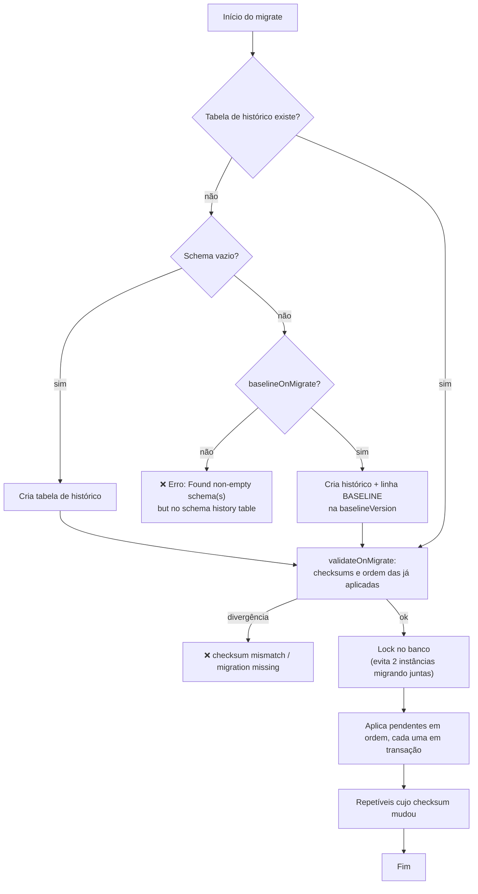
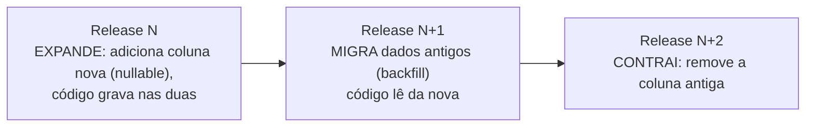

# Migrações de Banco de Dados (Flyway e Liquibase)

> **Resumo:** o esquema do banco evolui junto com o código, e precisa ser versionado, reproduzível e aplicado automaticamente. Flyway e Liquibase tratam migrações como código versionado, registram o que já foi aplicado e rodam no startup do Boot. Este arquivo explica o mecanismo, o fluxo para bancos legados e como fazer mudanças sem derrubar a aplicação.
> **Pré-requisitos:** [06-spring-data-jpa](06-spring-data-jpa.md) (por que `ddl-auto` não serve em produção), [07-spring-data-outros](07-spring-data-outros.md), [02-auto-configuracao](02-auto-configuracao.md), [10-testes-no-spring-boot](10-testes-no-spring-boot.md) (Testcontainers).
> **Versões:** Spring Boot 4.1.2, **Flyway 12.4.0** (versão resolvida pelo BOM do Boot 4.1.2), Java 25. Executado em `/tmp/validacao/s9`: migrações V1/V2 em H2 e em **PostgreSQL 17 real** (Testcontainers), `checksum mismatch`, banco legado com e sem baseline, migração repetível (`R__`), endpoint `flyway`. **Liquibase não foi executado.**

## 1. Definição

Uma **migração** é um script (SQL ou código) que leva o esquema de uma versão à seguinte. Uma ferramenta de migração mantém uma tabela de histórico no próprio banco ("quais scripts já rodaram, com qual checksum") e, ao iniciar, aplica apenas os pendentes, em ordem.

Problema que resolve: sem isso, o esquema é alterado à mão, cada ambiente (dev, homologação, produção) diverge, ninguém sabe qual SQL já foi rodado e o deploy depende de "avise o DBA". Com migrações, **o esquema é versionado no mesmo repositório do código** e a versão do código determina a versão do esquema.

| Ferramenta | Estilo | Formato |
|---|---|---|
| **Flyway** | scripts numerados, simples | SQL (e Java) |
| **Liquibase** | *changelog* declarativo e abstrato | XML, YAML, JSON ou SQL formatado |

Ambos têm auto-configuração no Boot (`spring-boot-starter-flyway`, `spring-boot-starter-liquibase`; os dois existem na 4.1.2, verificado no repositório Maven).

## 2. Conceitos fundamentais

### 2.1 Flyway: nomes de arquivo são a API

Por padrão em `classpath:db/migration`:

| Tipo | Nome | Regra |
|---|---|---|
| **Versionada** | `V1__create_orders.sql`, `V2__add_status.sql` | roda **uma vez**, em ordem de versão. `V` + versão + `__` (dois sublinhados) + descrição |
| **Repetível** | `R__view.sql` | roda de novo **sempre que o checksum muda**, depois de todas as versionadas (útil para views, funções) |
| **Undo** | `U1__...` | recurso pago, não será tratado aqui |
| Java | classe `V3__Backfill` (`BaseJavaMigration`) | para lógica que SQL não faz (transformar dados) |

### 2.2 A tabela de histórico

`flyway_schema_history` registra versão, descrição, tipo, checksum, quem/quando e sucesso. Executado, após rodar V1, V2 e uma repetível:

```text
installed_rank | version | description                          | type | success
-1             | null    | << Flyway Schema History table created >> | TABLE | true
1              | 1       | create orders | SQL | true
2              | 2       | add status    | SQL | true
3              | null    | view          | SQL | true     ← repetível: sem versão
```

O `checksum` do arquivo é guardado. **No startup seguinte, o Flyway recalcula o checksum de todos os arquivos versionados já aplicados e compara.** Se alguém editou um script que já rodou, a aplicação **não sobe**. Executado (editei `V1` depois de aplicada):

```text
Migration checksum mismatch for migration version 1
-> Applied to database : 1037291439
-> Resolved locally    : 1323027512
Either revert the changes to the migration, or run repair to update the schema history.
```

Isso é uma proteção, não um incômodo: significa que o banco de produção e o arquivo no repositório divergiriam em silêncio. Regra: **migração aplicada é imutável.** Correção é uma migração nova.

### 2.3 Liquibase em resumo

Um *changelog* (`db/changelog/db.changelog-master.yaml`) lista *changesets*; cada changeset é identificado por `id + author + caminho` e guardado em `DATABASECHANGELOG`. Vantagens: abstração entre bancos (`createTable` gera SQL do dialeto), `rollback` declarável, `contexts`/`labels`. Custo: mais verboso, e a abstração vaza quando se precisa de recursos específicos do banco. ⚠️ VERIFICAR o caminho padrão do changelog e os nomes de propriedades `spring.liquibase.*` no 4.1 (não executado).

### 2.4 Integração com o Boot

A auto-configuração (`FlywayAutoConfiguration`, condicional a `Flyway` no classpath e a um `DataSource`) cria um bean `Flyway` e um `FlywayMigrationInitializer`, que chama `migrate()` **antes** de qualquer bean que dependa do `DataSource` ser usado (o `EntityManagerFactory` do JPA, por exemplo, é ordenado depois do Flyway). Por isso, no teste executado, a tabela `orders` já existia quando o `JdbcClient` rodou.

## 3. Como funciona por dentro

### 3.1 O algoritmo do `migrate()`



Pontos importantes:

- **Lock:** quando duas instâncias sobem juntas (deploy com várias réplicas), uma obtém um lock no banco (via a tabela de histórico ou lock de aplicação, conforme o banco) e a outra espera. Não corrompe, mas a segunda instância pode demorar no startup.
- **Transação por migração:** em bancos com DDL transacional (PostgreSQL), uma migração que falha é revertida inteira. Em bancos sem DDL transacional (MySQL, Oracle), um script com vários comandos pode ficar **meio aplicado**, e a migração fica marcada como falha, exigindo `repair` e correção manual.
- **Ordem:** por número de versão (`V2` < `V10`, comparação numérica, não de texto). Um `V1.5` entre `V1` e `V2` é possível; um `V1.5` criado *depois* de `V2` aplicado é recusado por padrão (`outOfOrder=false`).

### 3.2 Banco legado: baseline (executado)

Banco **já existente**, sem tabela de histórico, com uma tabela `legacy`. Subindo a aplicação com Flyway padrão:

```text
Caused by: org.flywaydb.core.api.FlywayException:
Found non-empty schema(s) "PUBLIC" but no schema history table.
Use baseline() or set baselineOnMigrate to true to initialize the schema history table.
```

O Flyway se recusa a presumir o estado de um esquema desconhecido. A saída é declarar "a partir de agora este banco está na versão X":

```yaml
spring:
  flyway:
    baseline-on-migrate: true
    baseline-version: 0        # migrações V1, V2... serão aplicadas por cima
```

Executado: o histórico ficou `1 | 0 | << Flyway Baseline >> | BASELINE`, seguido de `V1` e `V2` aplicadas. Se o banco legado já tem o esquema correspondente a `V1`, use `baseline-version: 1` para que `V1` seja considerada já aplicada. **`baseline-on-migrate` em produção é arriscado se ligado por engano em um banco que devia estar vazio ou já gerenciado:** ele mascara o erro "schema não vazio sem histórico". Use-o uma vez, na adoção, e depois remova.

### 3.3 Como o Hibernate `ddl-auto` entra

`spring.jpa.hibernate.ddl-auto=update` compara entidades e esquema e emite `ALTER`s. **Não rastreia histórico, não remove colunas, não renomeia (cria nova e deixa a antiga), e não é reproduzível.** Em produção: `none` ou `validate` (valida que o esquema bate com as entidades, mas não altera). Combinação saudável: Flyway altera, Hibernate `validate` confere. Visto em [06-spring-data-jpa](06-spring-data-jpa.md).

## 4. Evolução histórica

| Ano | Marco |
|---|---|
| 2010 | Flyway (Axel Fontaine) e Liquibase (2006) popularizam migrações versionadas |
| Boot 1.1 (2014) | auto-configuração de Flyway e Liquibase |
| Flyway 10 (2023) | suporte a cada banco passa a módulos separados (`flyway-database-postgresql`, etc.) |
| Boot 3.x | `FlywayConfigurationCustomizer`; suporte a Flyway 9→10 |
| Boot 4.0 | modularização: `spring-boot-flyway` com `org.springframework.boot.flyway.autoconfigure`; `spring-boot-starter-flyway` obrigatório (antes bastava `flyway-core`) |

⚠️ VERIFICAR datas e o estado dos módulos. **Atenção na migração para Flyway 10+/Boot 4:** para PostgreSQL é preciso a dependência `org.flywaydb:flyway-database-postgresql` (em `s9` ela foi declarada como `optional` e o BOM resolveu a versão 12.4.0). Sem o módulo do banco, o erro é `Unsupported Database` / `No database found to handle jdbc:postgresql:...`. Para H2 o suporte já vem no `flyway-core`. Evolução geral do Boot: [01 §4](01-o-que-e-spring-boot.md).

## 5. Exemplos práticos

### 5.1 Configuração mínima

```xml
<dependency>
  <groupId>org.springframework.boot</groupId>
  <artifactId>spring-boot-starter-flyway</artifactId>
</dependency>
<dependency>                             <!-- módulo do banco (Flyway 10+) -->
  <groupId>org.flywaydb</groupId>
  <artifactId>flyway-database-postgresql</artifactId>
</dependency>
```

```text
src/main/resources/db/migration/
├── V1__create_orders.sql
└── V2__add_status.sql
```

```sql
-- V1__create_orders.sql
create table orders (
    id       bigint        primary key,
    customer varchar(80)   not null,
    total    decimal(12,2) not null
);

-- V2__add_status.sql
alter table orders add column status varchar(20) default 'NEW' not null;
insert into orders(id, customer, total, status) values (1, 'Ana', 100.00, 'NEW');
```

Executado: com essas migrações e `GET /actuator/flyway` ([09](09-actuator-e-observabilidade.md)):

```json
{"contexts":{"application":{"flywayBeans":{"flyway":{"migrations":[
  {"version":"1","description":"create orders","script":"V1__create_orders.sql","state":"SUCCESS","installedRank":1},
  {"version":"2","description":"add status","script":"V2__add_status.sql","state":"SUCCESS","installedRank":2}]}}}}}
```

### 5.2 Testar as migrações contra o banco de produção (executado)

Já mostrado em [10 §5.5](10-testes-no-spring-boot.md): o `@SpringBootTest` com `@Container @ServiceConnection PostgreSQLContainer("postgres:17-alpine")` rodou V1 e V2 no PostgreSQL real e retornou `PostgreSQL 17.11` e `flyway rows=1`. É o teste mais valioso desta área: **valida o SQL no banco real, a cada build**, e pega diferenças que o H2 esconde (`ALTER ... ADD COLUMN ... DEFAULT ... NOT NULL` tem custos e sintaxes diferentes por banco).

### 5.3 Migração repetível (executado)

```sql
-- R__view.sql
create or replace view v_orders as select id, customer from orders;
```

Executado: aplicada após V1 e V2 (`installed_rank 3`, versão `null`). Se o arquivo mudar, roda de novo; se não mudar, é ignorada. Use apenas para objetos que podem ser recriados sem perda (views, funções, *procedures*), nunca para tabelas.

### 5.4 Migração em Java

```java
// db/migration/V3__NormalizeCustomerNames.java
public class V3__NormalizeCustomerNames extends BaseJavaMigration {
    @Override
    public void migrate(Context context) throws Exception {
        try (var st = context.getConnection().createStatement()) {
            st.executeUpdate("update orders set customer = trim(customer)");
        }
    }
}
```

<!-- não compilado -->

Use quando for preciso lógica (chamada a biblioteca, transformação complexa). Para volumes grandes, faça em lotes.

### 5.5 Mudanças sem derrubar: expandir e contrair

Em deploy com várias réplicas (rolling update), por alguns minutos **o código antigo e o novo convivem com o mesmo banco**. Uma migração que quebra o código antigo derruba a produção. O padrão é **expand/contract** em releases diferentes:



Exemplo: renomear `customer` para `customer_name`.
1. N: `ALTER TABLE ADD customer_name`, código escreve em ambas e lê de `customer`.
2. N+1: *backfill* `UPDATE ... SET customer_name = customer`, código lê de `customer_name`.
3. N+2: `ALTER TABLE DROP customer`.

Regras que decorrem: adicione coluna **nullable ou com default**, nunca `NOT NULL` sem default; não renomeie nem remova na mesma release que muda o código; crie índices com `CONCURRENTLY` (PostgreSQL) para não travar escrita. ⚠️ `CREATE INDEX CONCURRENTLY` não roda dentro de transação: em Flyway use `-- flyway:executeInTransaction=false` ⚠️ VERIFICAR a sintaxe do script config.

### 5.6 Testes e dados de desenvolvimento

Separe migrações de **esquema** (sempre) de **dados de exemplo** (só dev): `spring.flyway.locations=classpath:db/migration,classpath:db/dev` num perfil. Nunca rode dados de teste em produção por acidente.

## 6. Configurações e anotações relevantes

| Propriedade | Para que serve | Exemplo |
|---|---|---|
| `spring.flyway.enabled` | liga/desliga | `false` em certos testes |
| `spring.flyway.locations` | onde procurar | `classpath:db/migration` |
| `spring.flyway.baseline-on-migrate` | permite adotar banco existente | `true` (uma vez) |
| `spring.flyway.baseline-version` | versão do baseline | `0` ou `1` |
| `spring.flyway.validate-on-migrate` | valida checksums antes (padrão ligado) | `true` |
| `spring.flyway.out-of-order` | aceita versão menor que a última aplicada | `false` (padrão) |
| `spring.flyway.clean-disabled` | bloqueia `clean` (que apaga tudo) | padrão `true` (confirmado nos metadados do 4.1.2) |
| `spring.flyway.url`, `.user`, `.password` | usuário de migração diferente do da aplicação | ver §8 |
| `spring.flyway.placeholders.*` | substituição `${chave}` nos scripts | |
| `spring.jpa.hibernate.ddl-auto` | comportamento do Hibernate | `validate` ou `none` |
| `spring.liquibase.change-log` | changelog mestre | ⚠️ VERIFICAR o padrão |
| `FlywayConfigurationCustomizer` | ajustes programáticos | bean |
| `FlywayMigrationStrategy` | controle total do momento do `migrate()` ⚠️ VERIFICAR existência no 4.x | `repair()` antes de `migrate()` |

## 7. Quando usar e quando NÃO usar

**Use** migrações em qualquer aplicação com banco relacional em mais de um ambiente. **Flyway** quando SQL puro basta (maioria dos casos); **Liquibase** quando precisa suportar vários bancos com o mesmo changelog ou rollback declarativo.

**Não use** `ddl-auto=update/create` em produção. **Não** migre automaticamente no startup quando:

- o esquema é alterado por outro time/processo (DBA, outra aplicação) — separe a migração em um *job* do pipeline (o Flyway CLI ou um contêiner `init`);
- a migração é demorada (reindexar tabela grande): o startup passaria do tempo do probe de `readiness`/`liveness` e o orquestrador mataria a aplicação no meio.

**NoSQL** (Mongo): o esquema flexível não elimina migração de dados; use Mongock/Liquibase-Mongo ⚠️ VERIFICAR.

## 8. Erros comuns e boas práticas

1. **Editar migração já aplicada**: checksum mismatch (executado). Corrija com migração nova; `repair` só para erros de checksum conscientes.
2. **Nome com um sublinhado só** (`V1_create.sql`): o arquivo não é reconhecido como migração (ignorado) ou o erro é obscuro; são **dois**.
3. **Banco legado sem baseline**: `Found non-empty schema(s)` (executado, §3.2).
4. **`baseline-on-migrate=true` permanente**: mascara problemas.
5. **Esquecer `flyway-database-<banco>`** no Flyway 10+.
6. **Migração destrutiva sem expand/contract**: derruba o código antigo durante o deploy.
7. **`NOT NULL` sem default** em tabela grande: reescrita/trava.
8. **DDL e DML misturados em MySQL/Oracle** sem transação: falha parcial; mantenha migrações pequenas, de uma operação.
9. **Aplicação usando o mesmo usuário de banco que migra**: dê à aplicação só `SELECT/INSERT/UPDATE/DELETE`; use credenciais separadas para o Flyway (`spring.flyway.user/password`), para que um SQL injection não consiga `DROP TABLE`.
10. **`flyway.clean` em produção**: apaga o banco. Mantenha `clean-disabled=true`.
11. **Testar só com H2** quando produção é PostgreSQL (use Testcontainers, §5.2).
12. **Branches paralelas criando a mesma versão** (`V5` em duas branches): conflito na fusão; adote versões por timestamp (`V20261104_1530__...`) ou revise a numeração no merge.

## 9. Perguntas de revisão

1. Por que o Flyway recusa subir quando um script já aplicado é editado?
<details><summary>Resposta</summary>Ele compara o checksum do arquivo com o gravado em `flyway_schema_history`. Divergência significaria que o esquema real e o repositório não correspondem; é uma proteção. A correção é uma nova migração.</details>

2. O que acontece ao iniciar o Flyway contra um banco existente sem tabela de histórico?
<details><summary>Resposta</summary>Erro `Found non-empty schema(s) ... but no schema history table`. Resolve-se com baseline (`baseline-on-migrate` e `baseline-version`).</details>

3. Quando uma migração `R__` é reexecutada?
<details><summary>Resposta</summary>Quando o checksum do arquivo muda, sempre depois das versionadas.</details>

4. Por que se faz expand/contract em vez de renomear a coluna de uma vez?
<details><summary>Resposta</summary>Durante o rolling update versões antigas e novas do código convivem com o mesmo esquema; mudanças incompatíveis quebrariam a antiga.</details>

5. Por que testar migrações com Testcontainers em vez de H2?
<details><summary>Resposta</summary>H2 difere do banco real em dialeto, tipos e comportamento de DDL; o contêiner roda o SQL no mesmo banco de produção (executado com PostgreSQL 17).</details>

## 10. Referências oficiais

- Flyway Documentation: <https://documentation.red-gate.com/flyway>
- Liquibase: <https://docs.liquibase.com>
- Spring Boot, Database Initialization / Migration: <https://docs.spring.io/spring-boot/how-to/data-initialization.html> ⚠️ VERIFICAR o caminho
- Padrão "parallel change" (expand/contract): <https://martinfowler.com/bliki/ParallelChange.html>
- Anterior: [11-cache-agendamento-e-async](11-cache-agendamento-e-async.md) · Próximo: [13-empacotamento-e-deploy](13-empacotamento-e-deploy.md)
