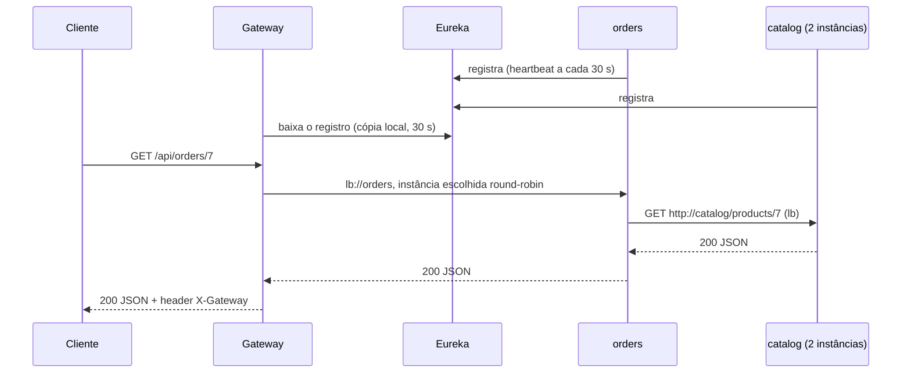

# Spring Cloud: Visão Geral

> **Resumo:** Spring Cloud não é um framework único, e sim um conjunto de projetos que resolvem problemas recorrentes de sistemas distribuídos (configuração central, descoberta de serviços, roteamento, resiliência, mensageria, rastreamento) em cima do Spring Boot. Este arquivo explica o que ele é por dentro, como as versões se combinam e apresenta o laboratório usado nos arquivos 02 a 05.
> **Pré-requisitos:** [01-o-que-e-spring-boot](../03-spring-boot/01-o-que-e-spring-boot.md), [02-auto-configuracao](../03-spring-boot/02-auto-configuracao.md), [03-configuracao-externalizada](../03-spring-boot/03-configuracao-externalizada.md), [09-actuator-e-observabilidade](../03-spring-boot/09-actuator-e-observabilidade.md).
> **Versões:** Spring Cloud **2025.1.x "Oakwood"** (BOM 2025.1.4, publicado em 2026-10-22 no Maven Central) com Spring Boot 4.1.2, Framework 7.0.10, Java 25. Validado em `/tmp/validacao/s10` (5 aplicações rodando juntas).

## 1. Definição

**Spring Cloud** é um guarda-chuva de projetos que fornece, para aplicações Boot, as ferramentas típicas de uma arquitetura distribuída. Cada projeto isola um problema e oferece uma **abstração** (uma interface do Spring) mais uma ou mais **implementações** (Eureka, Consul, Kubernetes, etc.).

O problema que resolve vem de uma mudança de cenário. Em um monólito, chamar outro módulo é uma chamada de método: rápida, confiável, na mesma JVM. Em microsserviços, a chamada passa pela rede e herda as *falácias da computação distribuída*: a rede falha, tem latência, a topologia muda o tempo todo (instâncias sobem e descem), cada serviço tem sua configuração e seus segredos. Spring Cloud empacota as respostas padrão a essas perguntas:

| Pergunta | Resposta no Spring Cloud | Arquivo |
|---|---|---|
| Onde ficam as configurações de dezenas de serviços? | Config Server (e alternativas) | [02](02-config-server.md) |
| Como achar a instância de outro serviço se o IP muda? | Service Discovery + LoadBalancer | [03](03-service-discovery.md) |
| Como expor tudo por uma entrada única? | API Gateway | [04](04-api-gateway.md) |
| Como um serviço chama outro? | RestClient / HTTP Service Clients | [05](05-comunicacao-entre-servicos.md) |
| O que fazer quando o outro serviço está lento ou fora? | Circuit Breaker, Retry, Bulkhead | 06 (sessão 11) |
| Como propagar eventos sem acoplamento temporal? | Spring Cloud Stream / Bus | 07 (sessão 11) |
| Como seguir uma requisição por vários serviços? | Micrometer Tracing | 08 (sessão 11) |
| E se eu já uso Kubernetes? | Spring Cloud Kubernetes | 09 (sessão 11) |

## 2. Conceitos fundamentais

### 2.1 Release train: versões por calendário

Spring Cloud é composto por dezenas de módulos, cada um com versão própria. Para o usuário não ter de combiná-los à mão, existe um **BOM** (`spring-cloud-dependencies`) cuja versão é o **release train**, nomeado por ano e mês: `2025.1.4` significa ciclo "2025.1" (nome "Oakwood"), terceira correção após o GA. O BOM fixa a versão de cada módulo.

Dos metadados do Maven Central e da página do projeto (consultados em 2026-11-04):

| Release train | Spring Boot | Situação |
|---|---|---|
| **2025.1.x "Oakwood"** | 4.0.x e 4.1.x (4.1 a partir de 2025.1.2) | atual; 2025.1.4 é a mais recente |
| 2025.0.x "Northfields" | 3.5.x | fim de vida |
| 2024.0.x "Moorgate" | 3.4.x | fim de vida |
| 2023.0.x "Leyton" | 3.2.x, 3.3.x | fim de vida |
| 2026.0.0-RC1 | 4.2.0-RC1 | candidata a lançamento; Boot 4.2 também ainda não é GA |

Dentro de 2025.1.4 os módulos principais estão na linha **5.0.x**: Commons 5.0.4, Config 5.0.4, Gateway 5.0.x, Netflix (Eureka) 5.0.x, OpenFeign 5.0.x. Eles seguem a numeração do Boot (módulos 5.x ↔ Boot 4). Na linha seguinte (2026.0) os módulos pulam para 5.1.

Uso no Maven:

```xml
<properties><spring-cloud.version>2025.1.4</spring-cloud.version></properties>

<dependencyManagement>
  <dependencies>
    <dependency>
      <groupId>org.springframework.cloud</groupId>
      <artifactId>spring-cloud-dependencies</artifactId>
      <version>${spring-cloud.version}</version>
      <type>pom</type>
      <scope>import</scope>
    </dependency>
  </dependencies>
</dependencyManagement>
```

> **Atenção:** a combinação Cloud ↔ Boot não é livre. Um train de Boot 3.x não funciona em Boot 4 (Jackson 3, Framework 7, `jakarta.*` e pacotes renomeados). Confira a tabela antes de atualizar o Boot. Neste laboratório o BOM 2025.1.4 declara internamente `spring-boot.version` 4.0.9, mas o conjunto foi validado rodando com o parent Boot 4.1.2, como a página do projeto prevê.

### 2.2 O que é abstração e o que é implementação

O módulo `spring-cloud-commons` define as interfaces; os demais projetos as implementam:

| Abstração (Commons) | O que representa | Implementações |
|---|---|---|
| `DiscoveryClient` / `ReactiveDiscoveryClient` | "liste as instâncias do serviço X" | Eureka, Consul, ZooKeeper, Kubernetes, `SimpleDiscoveryClient` (lista estática) |
| `ServiceRegistry` / `Registration` | "registre esta instância" | idem |
| `LoadBalancerClient` / `ReactiveLoadBalancer` | "escolha uma instância" | Spring Cloud LoadBalancer (round-robin, aleatório, zona, hints) |
| `CircuitBreaker` / `CircuitBreakerFactory` | "execute com proteção contra falha" | Resilience4j (e outros via adaptador) |
| `@RefreshScope` | "reconstrua este bean se a configuração mudar" | `spring-cloud-context` |

Por isso, trocar Eureka por Consul costuma ser uma troca de *starter* e de algumas propriedades, sem reescrever o código que usa `lb://servico` ou `DiscoveryClient`.

### 2.3 Mapa dos projetos

Segundo a página oficial (<https://spring.io/projects/spring-cloud>), os projetos com descrição própria são:

| Projeto | Papel | Neste material |
|---|---|---|
| **Config** | configuração externa centralizada, com Git como armazenamento | [02](02-config-server.md) |
| **Netflix (Eureka)** | registro e descoberta de serviços | [03](03-service-discovery.md) |
| **Consul**, **Zookeeper** | descoberta e configuração com HashiCorp Consul / Apache ZooKeeper | citados em 03 |
| **Gateway** | roteador programável (API Gateway) | [04](04-api-gateway.md) |
| **OpenFeign** | cliente HTTP declarativo | [05](05-comunicacao-entre-servicos.md) (em modo "feature complete") |
| **Circuit Breaker** | abstração de disjuntor | 06 |
| **Stream**, **Bus** | mensageria orientada a eventos; propagação de eventos de configuração | 07 |
| **Kubernetes** | descoberta e configuração sobre a API do Kubernetes | 09 |
| **Function** | lógica de negócio como funções, portáveis para serverless | [05-outros-projetos](../05-outros-projetos-spring/) |
| **Task** | microsserviços de curta duração (processamento finito) | idem |
| **Contract**, **Vault**, **Commons** | contratos de API entre serviços; integração com HashiCorp Vault; abstrações comuns | citados quando relevantes |

A página lista ainda Azure, Alibaba, AWS, GCP e Open Service Broker como integrações com provedores. Alguns projetos históricos **não** aparecem mais: Ribbon, Hystrix e Zuul (substituídos por LoadBalancer, Resilience4j e Gateway) e Sleuth (substituído por Micrometer Tracing, ver 08).

## 3. Como funciona por dentro

### 3.1 Tudo é auto-configuração

Cada starter do Spring Cloud é um conjunto de auto-configurações do Boot, como visto em [02-auto-configuracao](../03-spring-boot/02-auto-configuracao.md). Adicionar `spring-cloud-starter-netflix-eureka-client` ao classpath ativa o registro automático; `spring-cloud-starter-loadbalancer` ativa o balanceamento do `@LoadBalanced`. Não há agente nem servidor mágico: são beans condicionais e processadores que mexem no `Environment` e nos clientes HTTP.

### 3.2 Configuração externa: `config.import` no lugar do bootstrap

Antes do Boot 2.4, Spring Cloud usava um **contexto de bootstrap**: um `ApplicationContext` pai, criado antes do principal, só para buscar configuração remota (arquivo `bootstrap.yml`). Isso duplicava a infraestrutura de contexto e tornava a ordem de carga difícil de entender. Desde o Boot 2.4, a carga é feita pelo mecanismo `spring.config.import` ([03-configuracao-externalizada](../03-spring-boot/03-configuracao-externalizada.md)): o Config Client é um `ConfigDataLoader` que busca as propriedades no servidor e as insere como `PropertySource`. Nada de `bootstrap.yml` neste laboratório. O starter `spring-cloud-starter-bootstrap` existe (versão 5.x), mas só serve para quem ainda depende do modelo antigo.

### 3.3 `@RefreshScope`

`@RefreshScope` registra um **escopo de bean** personalizado (como `singleton` e `prototype`, ver [04-ciclo-de-vida-e-escopos](../02-spring-core/04-ciclo-de-vida-e-escopos.md)). Beans nesse escopo são entregues por um **proxy** ([07-aop-e-proxies](../02-spring-core/07-aop-e-proxies.md)); o objeto real fica em cache. Quando ocorre um *refresh*, o cache do escopo é limpo e a próxima chamada ao proxy recria o bean com o `Environment` novo. Detalhes e experimento em [02](02-config-server.md).

### 3.4 Anatomia de uma chamada entre serviços



O ponto central: ninguém sabe o endereço de ninguém em tempo de compilação. Os nomes lógicos (`orders`, `catalog`) são resolvidos em IP:porta a cada chamada pela combinação *DiscoveryClient + LoadBalancer*.

## 4. Evolução histórica

Datas de memória, marcadas para revisão (⚠️ VERIFICAR).

- **2015:** Spring Cloud nasce com a primeira geração baseada no **Netflix OSS**: Eureka (descoberta), Ribbon (balanceamento), Hystrix (disjuntor), Zuul (gateway), Feign (cliente declarativo).
- **2018:** Netflix coloca Hystrix, Ribbon e Zuul 1 em modo de manutenção. Surgem **Spring Cloud Gateway** (WebFlux), **Spring Cloud LoadBalancer** e a abstração `CircuitBreaker` com Resilience4j.
- **2020:** os nomes de trains de Londres (Hoxton etc.) são trocados por **versionamento por calendário** (`2020.0.0`, "Ilford"). Ribbon, Hystrix e Zuul são removidos do train.
- **2022 (Boot 3):** **Sleuth** sai; o rastreamento passa a ser **Micrometer Tracing**.
- **2025 (train 2025.1):** acompanha o Boot 4: Jackson 3, JSpecify, Framework 7. O Gateway ganha dois sabores (WebFlux e Web MVC) e propriedades renomeadas, o OpenFeign é declarado *feature-complete* e os **HTTP Service Clients** do Framework 7 ganham integração direta com o LoadBalancer.

Veja o contexto de Java e Boot em [00-evolucao-do-java](../01-java/00-evolucao-do-java.md) e [01-o-que-e-spring-boot](../03-spring-boot/01-o-que-e-spring-boot.md).

## 5. Exemplos práticos

### 5.1 O laboratório dos arquivos 02 a 05

Cinco aplicações Boot 4.1.2 (módulos Maven irmãos), todas sobre o train 2025.1.4. O domínio segue a decisão da base ([PROGRESSO](../PROGRESSO.md)): **pedidos**. `orders` chama `catalog` para obter dados do produto.

| Módulo | Porta | Starters principais | Papel |
|---|---|---|---|
| `config-server` | 8888 | `spring-cloud-config-server` | serve configuração a partir de um repositório Git local |
| `eureka-server` | 8761 | `spring-cloud-starter-netflix-eureka-server` | registro de serviços |
| `catalog` | aleatória | webmvc, `spring-cloud-starter-config`, `...eureka-client` | `GET /products/{id}` |
| `orders` | aleatória | webmvc, `...eureka-client`, `...loadbalancer`, `spring-boot-starter-restclient` | `GET /orders/{id}`, chama `catalog` |
| `gateway` (WebFlux) | 8080 | `spring-cloud-starter-gateway-server-webflux`, `...eureka-client` | entrada única |
| `gateway-mvc` (Web MVC) | 8090 | `spring-cloud-starter-gateway-server-webmvc` | mesma ideia no stack Servlet |

Estrutura do POM pai (resumida):

```xml
<parent>
  <groupId>org.springframework.boot</groupId>
  <artifactId>spring-boot-starter-parent</artifactId>
  <version>4.1.2</version>
</parent>
<properties>
  <java.version>25</java.version>
  <spring-cloud.version>2025.1.4</spring-cloud.version>
</properties>
```

Aplicação mínima com Eureka server, para dar a dimensão do trabalho:

```java
@SpringBootApplication
@EnableEurekaServer
public class EurekaApp {
    public static void main(String[] args) { SpringApplication.run(EurekaApp.class, args); }
}
```

```yaml
server.port: 8761
eureka.client:
  register-with-eureka: false   # o servidor não se registra em si mesmo
  fetch-registry: false
```

### 5.2 Subindo e conferindo

Com os jars gerados por `mvn package`, na ordem **config-server → eureka-server → catalog (×2) → orders → gateway**, o registro do Eureka (`GET localhost:8761/eureka/apps`, com `Accept: application/json`) mostrou no teste as aplicações `CATALOG` (duas instâncias `UP`), `ORDERS` e `GATEWAY`. Uma chamada ponta a ponta:

```text
$ curl -i localhost:8080/api/orders/1
HTTP/1.1 200 OK
X-Gateway: s10
{"product":{"name":"Product-1","currency":"BRL","instancePort":"34725","id":1,"discount":5},"orderId":1}
```

A ordem de subida não é obrigatória (clientes tentam de novo), mas o `catalog` depende do Config Server no *startup* (ver [02](02-config-server.md)).

## 6. Configurações e anotações relevantes

| Item | Para que serve | Exemplo |
|---|---|---|
| `spring-cloud-dependencies` (BOM) | fixa versões de todos os módulos | ver §2.1 |
| `spring.application.name` | nome lógico do serviço, usado por Config, Eureka, LoadBalancer e tracing | `spring.application.name: catalog` |
| `spring.config.import` | carrega configuração remota | `optional:configserver:http://localhost:8888` |
| `@RefreshScope` | recria o bean quando a configuração é atualizada | em um `@RestController` com `@Value` |
| `@LoadBalanced` | marca um cliente HTTP para resolver nomes lógicos | em `RestClient.Builder` |
| `spring.cloud.<projeto>.*` | prefixo dos módulos | `spring.cloud.loadbalancer.cache.ttl` |
| `spring.cloud.compatibility-verifier.enabled` | verificador de compatibilidade Cloud ↔ Boot na inicialização ⚠️ VERIFICAR no 5.0 | `false` desliga |

## 7. Quando usar e quando NÃO usar

**Use Spring Cloud quando:**
- você tem vários serviços Boot, **fora** do Kubernetes (ou em VMs/ECS), e precisa de descoberta, configuração central e gateway prontos;
- quer trocar de implementação (Eureka ↔ Consul) sem reescrever o código;
- quer um conjunto coerente com o resto do ecossistema (Actuator, Micrometer, Security).

**Não use (ou use menos) quando:**
- você tem **um monólito** que atende bem. Microsserviços trocam complexidade de código por complexidade operacional; é decisão de organização, não de moda. Veja o padrão *Monolith First* e o [Modulith](../05-outros-projetos-spring/);
- a plataforma já resolve o problema: no **Kubernetes** a descoberta é DNS (`Service`), a configuração é `ConfigMap`/`Secret`, o balanceamento é do `kube-proxy` ou do *mesh*. Rodar Eureka e Config Server dentro do Kubernetes é, em geral, redundância. O módulo Kubernetes do Spring Cloud ([09](09-spring-cloud-e-kubernetes.md)) existe para esse caso;
- poucos serviços: uma lista estática de URLs em propriedades já basta.

## 8. Erros comuns e boas práticas

- **Misturar trains e versões do Boot.** Fixe o BOM e atualize Cloud e Boot juntos, conforme a tabela de compatibilidade.
- **Copiar tutoriais de Boot 2/3.** `@EnableDiscoveryClient` é opcional há anos, `bootstrap.yml` não é necessário e `spring-cloud-starter-gateway` (sem sufixo) é a linha 4.x para Boot 3. No train atual os starters do Gateway são `...-gateway-server-webflux` e `...-gateway-server-webmvc` (confirmado no Maven Central).
- **Não definir `spring.application.name`.** Sem ele, Config Client busca a aplicação `application`, o Eureka registra como `UNKNOWN` e os logs/traces perdem identidade.
- **Tratar o que é infraestrutura como código de negócio.** Cada peça (Eureka, Config Server, Gateway) é um serviço a mais para operar, monitorar e tornar redundante.
- **Esquecer que tudo é eventualmente consistente.** Registro, cache de instâncias e refresh de configuração têm atrasos medidos em dezenas de segundos (números reais em [03](03-service-discovery.md)).

## 9. Perguntas de revisão

1. Qual a diferença entre uma abstração e uma implementação no Spring Cloud? Dê um exemplo.
<details><summary>Resposta</summary>A abstração é uma interface do <code>spring-cloud-commons</code> (<code>DiscoveryClient</code>, <code>LoadBalancerClient</code>, <code>CircuitBreaker</code>); a implementação é um projeto concreto (Eureka, Consul, Kubernetes). O código de negócio usa o nome lógico <code>lb://catalog</code> e independe da implementação.</details>

2. O que significa o número `2025.1.4` e por que não existe uma "versão do Spring Cloud" única nos JARs?
<details><summary>Resposta</summary>É o release train (ano.ciclo.correção); o BOM fixa a versão de dezenas de módulos que têm numeração própria (por exemplo, Config 5.0.4). Importa-se o BOM e omitem-se as versões dos starters.</details>

3. Por que o <code>bootstrap.yml</code> deixou de ser necessário?
<details><summary>Resposta</summary>Desde o Boot 2.4 existe <code>spring.config.import</code>; o Config Client é um <code>ConfigDataLoader</code> que injeta o <code>PropertySource</code> remoto no <code>Environment</code>, sem o contexto de bootstrap separado.</details>

4. Como o <code>@RefreshScope</code> permite mudar a configuração sem reiniciar?
<details><summary>Resposta</summary>É um escopo de bean com proxy: o objeto real fica em cache; ao dispararem o refresh, o cache é limpo e a chamada seguinte recria o bean lendo o <code>Environment</code> atualizado.</details>

5. Em que situação Eureka e Config Server são redundantes?
<details><summary>Resposta</summary>Dentro do Kubernetes, onde Service/DNS fazem descoberta e balanceamento, e ConfigMap/Secret fazem a configuração. Aí se usa Spring Cloud Kubernetes ou nenhum projeto de descoberta.</details>

## 10. Referências oficiais

- Spring Cloud (projeto, trains e subprojetos): <https://spring.io/projects/spring-cloud>
- Release notes 2025.1: <https://github.com/spring-cloud/spring-cloud-release/wiki/Spring-Cloud-2025.1-Release-Notes>
- Spring Cloud Commons (referência): <https://docs.spring.io/spring-cloud-commons/reference/>
- Microservices patterns: <https://microservices.io>
- The Twelve-Factor App: <https://12factor.net>
- Anterior: [13-empacotamento-e-deploy](../03-spring-boot/13-empacotamento-e-deploy.md) · Próximo: [02-config-server](02-config-server.md)
