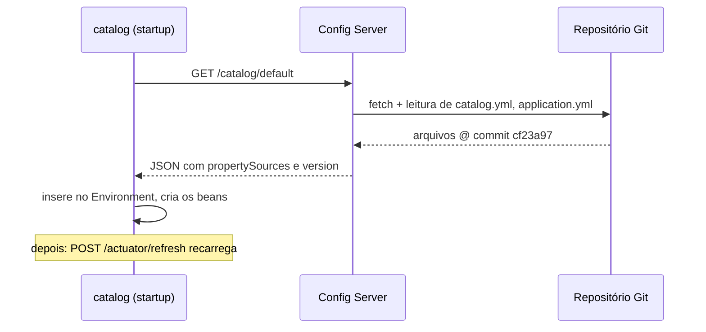

# Config Server: Configuração Centralizada

> **Resumo:** o Spring Cloud Config Server serve propriedades a várias aplicações a partir de um repositório (normalmente Git), e o Config Client as incorpora ao `Environment` na inicialização. Aqui estão o fluxo completo, a ordem de resolução por aplicação/perfil/label, o `@RefreshScope` e os comportamentos de falha, tudo executado.
> **Pré-requisitos:** [01-visao-geral](01-visao-geral.md), [03-configuracao-externalizada](../03-spring-boot/03-configuracao-externalizada.md), [05-configuracao](../02-spring-core/05-configuracao.md), [04-ciclo-de-vida-e-escopos](../02-spring-core/04-ciclo-de-vida-e-escopos.md).
> **Versões:** Spring Cloud Config 5.0.4 (train 2025.1.4), Boot 4.1.2, Java 25. Executado em `/tmp/validacao/s10`: backend Git local, perfis, client com `optional:` e sem, `@RefreshScope` com `/actuator/refresh`, servidor fora do ar. **Não executados:** criptografia `{cipher}`, Spring Cloud Bus, backends Vault/JDBC/S3, autenticação do servidor.

## 1. Definição

Com dezenas de serviços, cada um empacotando seu `application.yml`, mudar um valor (URL de um sistema, limite, *feature flag*) exige reconstruir e redeployar. O **Config Server** resolve isso colocando a configuração **fora** do artefato, em um lugar versionado e auditável. Ele é uma aplicação Boot comum que expõe uma API HTTP; o **Config Client** é uma biblioteca (`spring-cloud-starter-config`) que consulta essa API ao iniciar.

Isso aplica o fator III do [12-factor](https://12factor.net) ("config no ambiente") com um passo a mais: o repositório Git dá histórico, revisão por *pull request* e *rollback* da configuração, algo que variáveis de ambiente soltas não dão.

## 2. Conceitos fundamentais

### 2.1 Os três eixos: aplicação, perfil e label

Toda consulta é identificada por `{application}`, `{profile}` e `{label}`:

| Eixo | Vem de | No backend Git |
|---|---|---|
| `application` | `spring.application.name` do cliente | prefixo do arquivo: `catalog.yml`, `catalog-prod.yml` |
| `profile` | `spring.profiles.active` do cliente | sufixo do arquivo |
| `label` | `spring.cloud.config.label` | **branch, tag ou commit** |

A API tem a forma `GET /{application}/{profile}[/{label}]`. Também existem `/{application}-{profile}.yml` e `/{label}/{application}-{profile}.yml`, que devolvem o arquivo já mesclado.

### 2.2 Ordem de resolução

Para o cliente `catalog` com perfil `prod`, o servidor monta uma lista de *property sources*, da maior para a menor precedência. Resultado real do laboratório (`curl localhost:8888/catalog/prod`):

```json
{"name":"catalog","profiles":["prod"],"label":null,
 "version":"cf23a97f88fcfdf08cc43d2a59af896d7c5af79b","state":"",
 "propertySources":[
  {"name":"file:///tmp/validacao/s10/config-repo/catalog-prod.yml","source":{"catalog.discount":20}},
  {"name":"file:///tmp/validacao/s10/config-repo/catalog.yml","source":{"catalog.discount":5}},
  {"name":"file:///tmp/validacao/s10/config-repo/application.yml","source":{"shop.currency":"BRL"}}]}
```

Leitura: `catalog-prod.yml` vence `catalog.yml`, que vence `application.yml`. O **`application.yml`** do repositório é global: vale para todos os clientes (aqui, `shop.currency`). O campo `version` é o *SHA do commit* servido, útil para saber exatamente o que a instância carregou. `label` aparece `null` porque usamos o `default-label` do servidor.

Essa lista é só uma entrada para o `Environment` do cliente. Por cima dela ainda valem as fontes de maior precedência do Boot (argumentos de linha de comando, variáveis de ambiente), como em [03-configuracao-externalizada](../03-spring-boot/03-configuracao-externalizada.md).

### 2.3 Backends

| Backend | Quando | Observação |
|---|---|---|
| **Git** (padrão) | quase sempre | histórico, branches, PR. Usado no laboratório |
| `native` (sistema de arquivos) | desenvolvimento, testes | sem versionamento |
| Vault, JDBC, Redis, S3, AWS Secrets Manager, etc. | segredos, ambientes sem Git | ⚠️ VERIFICAR a lista e os nomes dos perfis na referência do 5.0; não executados |

Segredos reais não devem ficar em texto puro no Git. Opções: criptografia de valores (`{cipher}...`) pelo próprio servidor, ou Vault.

## 3. Como funciona por dentro

### 3.1 No servidor

`@EnableConfigServer` importa uma configuração que registra um `EnvironmentController` (os endpoints REST) e um `EnvironmentRepository`. Para o backend Git, o repositório clona a URL numa pasta temporária local e, **a cada requisição**, faz *fetch*, posiciona-se no `label` pedido, lê os arquivos que casam com `{application}` e `{profile}` e devolve a lista de `PropertySource`. O servidor não guarda estado de aplicação: reiniciar é seguro, e vários servidores atrás de um balanceador servem o mesmo repositório.

### 3.2 No cliente: `ConfigDataLoader`

O Boot, ao montar o `Environment`, processa `spring.config.import` antes de criar o `ApplicationContext`. O prefixo `configserver:` é tratado por um `ConfigDataLocationResolver`/`ConfigDataLoader` do Spring Cloud (`ConfigServerConfigDataLoader`, visto no *stack trace* abaixo) que faz o HTTP para o servidor e insere as propriedades como fontes do `Environment`. É por isso que `@Value("${catalog.discount}")` funciona num bean comum: quando ele é criado, a propriedade já está no `Environment`. Veja a posição desse passo em [01-o-que-e-spring-boot](../03-spring-boot/01-o-que-e-spring-boot.md) (sequência do `SpringApplication.run`).



### 3.3 `@RefreshScope` na prática

O refresh **não é automático**. Alguém precisa chamar `POST /actuator/refresh` na instância (o endpoint exige estar exposto, ver [09-actuator](../03-spring-boot/09-actuator-e-observabilidade.md)). Ao ser chamado, o cliente busca o ambiente de novo no servidor, calcula quais chaves mudaram, publica um `EnvironmentChangeEvent` (que também faz o rebind de `@ConfigurationProperties`) e invalida o `RefreshScope`. A resposta do endpoint lista as chaves alteradas.

## 4. Evolução histórica

O Config Server surgiu nos primeiros trains (2015) como a peça de "configuração centralizada" da pilha Netflix/Spring, ao lado do Eureka. A mudança mais importante para o usuário foi a saída do `bootstrap.yml`: antes do Boot 2.4, o cliente precisava de um contexto de bootstrap só para chegar ao servidor (`spring.cloud.config.uri`); hoje basta `spring.config.import`. Em ambientes Kubernetes, `ConfigMap` e `Secret` assumiram boa parte desse papel (ver [09](09-spring-cloud-e-kubernetes.md)). Visão geral em [01](01-visao-geral.md).

## 5. Exemplos práticos

### 5.1 Repositório de configuração

```text
config-repo/            (git init -b main; um commit)
├── application.yml     shop.currency: BRL
├── catalog.yml         catalog.discount: 5
└── catalog-prod.yml    catalog.discount: 20
```

### 5.2 O servidor

```java
@SpringBootApplication
@EnableConfigServer
public class ConfigServerApp {
    public static void main(String[] args) { SpringApplication.run(ConfigServerApp.class, args); }
}
```

```yaml
server.port: 8888
spring.cloud.config.server.git:
  uri: file:///tmp/validacao/s10/config-repo   # em produção: URL https/ssh do repositório
  default-label: main
```

Dependência: `org.springframework.cloud:spring-cloud-config-server`.

### 5.3 O cliente com refresh

```yaml
spring:
  application.name: catalog
  config.import: "optional:configserver:http://localhost:8888"
server.port: ${PORT:0}
management.endpoints.web.exposure.include: health,refresh,env
```

```java
@RestController
@RefreshScope
class ProductController {
    @Value("${catalog.discount}") int discount;          // vem do Config Server
    @Value("${shop.currency}") String currency;          // do application.yml global
    @Value("${local.server.port}") String port;          // porta real (veja o aviso abaixo)

    @GetMapping("/products/{id}")
    Map<String, Object> get(@PathVariable long id) {
        return Map.of("id", id, "name", "Product-" + id,
                      "discount", discount, "currency", currency, "instancePort", port);
    }
}
```

> **Armadilha confirmada:** com `server.port=0`, `@Value("${server.port}")` devolve `"0"`, não a porta real. Use `local.server.port`, definido depois que o servidor web sobe.

### 5.4 Experimento: refresh afeta uma instância por vez

Duas instâncias do `catalog`. Alterei `catalog.discount` de 5 para 7 no repositório (novo commit) e chamei o refresh numa só:

```text
(antes)    2× discount 5 na porta 45357,  2× discount 5 na porta 34725
POST localhost:34725/actuator/refresh   →   ["config.client.version","catalog.discount"]
(depois)   2× discount 5 na porta 45357,  2× discount 7 na porta 34725
```

Conclusões: (1) o refresh é **por instância**; as outras seguem com o valor antigo até também serem atualizadas (daí o Spring Cloud Bus, em [07](07-mensageria.md), que propaga o evento); (2) a resposta mostra `config.client.version` (o SHA mudou) e a chave alterada; (3) a requisição via gateway alternava entre instâncias com valores diferentes enquanto o refresh não era feito, um estado inconsistente típico que precisa de processo.

### 5.5 Experimento: servidor fora do ar

Parei o Config Server e subi uma nova instância do `catalog`:

- **Com `optional:configserver:...`**: a aplicação tenta, não consegue, **ignora** e segue. Mas o bean com `@Value("${catalog.discount}")` falhou ao ser criado: `PlaceholderResolutionException: Could not resolve placeholder 'catalog.discount'`. O `optional:` só adia o erro para o primeiro uso, e a mensagem não aponta para o servidor.
- **Sem `optional:` (`spring.config.import=configserver:...`)**: a aplicação nem inicia, com `ConfigClientFailFastException: Could not locate PropertySource and the resource is not optional, failing`.

Regra: em produção prefira **sem** `optional:` (falha rápida e clara), com um Config Server redundante; use `optional:` em desenvolvimento e testes, junto de valores-padrão nos `@Value` (`${catalog.discount:0}`) ou em `@ConfigurationProperties` com `@DefaultValue`.

### 5.6 Diagnóstico: de onde veio este valor?

Quando um valor "não é o esperado", siga a cadeia do mais próximo ao mais distante:

1. **No cliente:** `GET /actuator/env/catalog.discount` (com `env` exposto) mostra o valor final e **qual `PropertySource`** o forneceu (por exemplo, `configserver:file:///.../catalog.yml`). Valores de chaves sensíveis aparecem mascarados ([09](../03-spring-boot/09-actuator-e-observabilidade.md)).
2. **No servidor:** `curl localhost:8888/catalog/prod` devolve exatamente o que seria enviado, na ordem de precedência (§2.2), com o `version` (SHA).
3. **No repositório:** `git log -- catalog-prod.yml` mostra quem mudou e quando. É a vantagem de ter configuração em Git.
4. **Nos argumentos e variáveis de ambiente:** eles têm precedência sobre o que vem do servidor. Se `CATALOG_DISCOUNT=1` estiver definida no ambiente, ela vence.

O servidor também expõe os arquivos já mesclados, em `/{application}-{profile}.yml` e `/{application}-{profile}.properties` ⚠️ VERIFICAR o formato exato na referência do 5.0 (não executado). São úteis para ferramentas que não são clientes Spring.

### 5.7 Segurança do próprio servidor (descrição)

Um Config Server sem Spring Security responde a qualquer um na rede. O padrão é proteger com HTTP Basic (ou OAuth2) via `spring-boot-starter-security` e informar as credenciais no cliente (`spring.cloud.config.username`/`password`, ou embutidas na URL do `config.import`). Nenhuma dessas configurações foi executada aqui; ver [08-spring-security](../03-spring-boot/08-spring-security.md) para a base e a referência do Config para os nomes exatos. Em ambientes com segredos, combine: Git privado (credenciais do servidor), TLS entre cliente e servidor e valores `{cipher}` ou Vault.

### 5.8 Como organizar o repositório

| Estratégia | Estrutura | Quando |
|---|---|---|
| **Um repositório, arquivos por aplicação** (usada no laboratório) | `application.yml`, `catalog.yml`, `catalog-prod.yml`... | começo; poucas equipes |
| **Subpasta por aplicação** | `catalog/application.yml` com `search-paths` | muitos serviços; pastas por equipe |
| **Um repositório por equipe/serviço** | padrões de URI com `{application}` ⚠️ VERIFICAR | autonomia e permissões distintas |
| **Branch/tag por ambiente ou release** | `label` = `release-1.2` | precisa fixar a versão exata de configuração de cada deploy |

Duas regras que evitam incidentes: (1) valores **comuns** no `application.yml`, valores por ambiente em `*-prod.yml`, nunca duplicados; (2) o repositório deve ser tratado como código de produção, com revisão obrigatória e pipeline que valide o YAML antes do merge.

### 5.9 Descoberta do próprio Config Server

Em vez de fixar `http://localhost:8888`, o cliente pode localizar o servidor pelo Eureka (`spring.cloud.config.discovery.enabled=true`, com o servidor registrado como `configserver`) ⚠️ VERIFICAR as propriedades no 5.0, não executado. Cuidado com a ordem: o cliente precisa falar com o Eureka **antes** de ter a configuração, o que reintroduz um acoplamento de inicialização. Em muitas equipes, uma URL fixa atrás de um balanceador é mais simples e previsível.

## 6. Configurações e anotações relevantes

| Item | Para que serve | Exemplo |
|---|---|---|
| `@EnableConfigServer` | habilita o servidor | na classe principal |
| `spring.cloud.config.server.git.uri` | repositório | `file:///...` ou `https://...` |
| `spring.cloud.config.server.git.default-label` | branch padrão do servidor | `main` |
| `spring.cloud.config.server.git.search-paths` | subpastas para procurar arquivos (aceita `{application}`) | `search-paths: '{application}'` ⚠️ VERIFICAR |
| `spring.config.import` | liga o cliente ao servidor | `optional:configserver:http://localhost:8888` |
| `spring.cloud.config.label` | branch/tag/commit pedido pelo cliente | `release-1.2` |
| `spring.cloud.config.name` | nome diferente de `spring.application.name` | `spring.cloud.config.name: catalog` |
| `@RefreshScope` | bean recriado no refresh | em controller/serviço |
| `POST /actuator/refresh` | dispara o refresh na instância | exige `management.endpoints.web.exposure.include=refresh` |
| `{cipher}texto` | valor cifrado, decifrado pelo servidor | ⚠️ não executado; ver referência |

## 7. Quando usar e quando NÃO usar

**Use quando:** muitos serviços Boot fora do Kubernetes, precisando de configuração versionada, perfis por ambiente e troca sem rebuild.

**Evite quando:**
- você já está no Kubernetes: `ConfigMap`/`Secret` (montados como arquivos ou variáveis) e o módulo Spring Cloud Kubernetes dispensam um servidor extra;
- são poucos serviços e poucas mudanças: variáveis de ambiente e `configtree` ([03-configuracao-externalizada](../03-spring-boot/03-configuracao-externalizada.md)) bastam;
- o dado é um **segredo de alto valor**: prefira Vault ou o gerenciador de segredos da nuvem, e não o Git;
- você espera *mudar configuração em produção sem processo*: o Git com revisão é exatamente o contrário de editar valores "ao vivo". Para *feature flags* dinâmicas, use uma ferramenta própria.

## 8. Erros comuns e boas práticas

- **Dependência de disponibilidade no startup.** O Config Server vira um ponto crítico: se cair, novas instâncias não sobem (§5.5). Rode mais de uma réplica e considere falhar rápido.
- **Achar que o refresh é global.** É por instância (§5.4). Use Bus, automação ou reinicialização gradual.
- **`@RefreshScope` em tudo.** O proxy tem custo, e beans de infraestrutura (pool de conexões, `DataSource`) não devem ser recriados no meio da execução. Prefira `@ConfigurationProperties` (rebind) para valores simples ⚠️ VERIFICAR o comportamento em beans que copiam valores no construtor.
- **Segredos em texto puro no repositório.** Use cifragem ou Vault, e restrinja o acesso ao repositório e ao servidor (por padrão o servidor, como qualquer app Boot, não tem autenticação sem o Security).
- **Misturar o nome do arquivo com o `spring.application.name`.** Se o serviço se chama `catalog-service` e o arquivo `catalog.yml`, o cliente não encontra nada e **não há erro** (só a lista vazia). Confira com `curl /{app}/{profile}`.
- **Config Server sem saber o que o cliente carregou.** Use o campo `version` (SHA) e o endpoint `/actuator/env` do cliente para auditar. Os valores sensíveis são mascarados.

## 9. Perguntas de revisão

1. O que são `application`, `profile` e `label` numa consulta ao Config Server, e como o backend Git os usa?
<details><summary>Resposta</summary>Aplicação (<code>spring.application.name</code>) escolhe o prefixo do arquivo; perfil, o sufixo (<code>catalog-prod.yml</code>); label, a branch/tag/commit. O <code>application.yml</code> do repositório vale para todos.</details>

2. Em `catalog.yml` há `discount: 5` e em `catalog-prod.yml` há `discount: 20`. Qual valor o cliente com perfil `prod` recebe?
<details><summary>Resposta</summary>20: a fonte mais específica (aplicação + perfil) tem precedência. A resposta lista as fontes nessa ordem.</details>

3. Qual a diferença de comportamento, com o servidor fora do ar, entre `optional:configserver:` e `configserver:`?
<details><summary>Resposta</summary>Com <code>optional:</code> a aplicação sobe e só falha onde a propriedade é usada (<code>PlaceholderResolutionException</code>); sem <code>optional:</code> não inicia (<code>ConfigClientFailFastException</code>).</details>

4. Por que chamar o refresh numa instância não muda as demais?
<details><summary>Resposta</summary>O endpoint <code>/actuator/refresh</code> atua só no processo que o recebe; cada instância mantém o seu <code>Environment</code>. A propagação exige o Bus ou automação.</details>

5. Por que `@Value("${server.port}")` é inadequado com porta aleatória?
<details><summary>Resposta</summary>Com <code>server.port=0</code> a propriedade continua <code>0</code>; a porta real fica em <code>local.server.port</code>, definida após o servidor web iniciar.</details>

## 10. Referências oficiais

- Spring Cloud Config (referência): <https://docs.spring.io/spring-cloud-config/reference/>
- `spring.config.import` no Boot: <https://docs.spring.io/spring-boot/reference/features/external-config.html>
- Spring Cloud Bus: <https://docs.spring.io/spring-cloud-bus/reference/>
- HashiCorp Vault: <https://developer.hashicorp.com/vault>
- Anterior: [01-visao-geral](01-visao-geral.md) · Próximo: [03-service-discovery](03-service-discovery.md)
