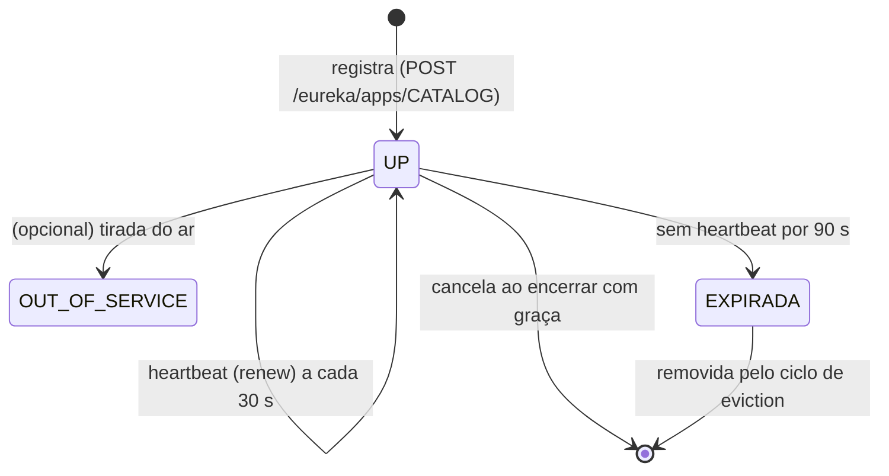

# Service Discovery: Eureka e LoadBalancer

> **Resumo:** em um ambiente onde instâncias sobem e descem, endereços fixos não funcionam. Descoberta de serviços é o mecanismo pelo qual cada instância se registra por um nome lógico e os clientes o resolvem em um endereço a cada chamada. Aqui: Eureka por dentro, os atrasos reais medidos (que explicam muito "bug" de produção) e uma armadilha de configuração que quebra o próprio registro.
> **Pré-requisitos:** [01-visao-geral](01-visao-geral.md), [02-config-server](02-config-server.md), [02-ioc-e-injecao-de-dependencia](../02-spring-core/02-ioc-e-injecao-de-dependencia.md).
> **Versões:** Spring Cloud Netflix (Eureka) 5.0.3/5.0.4 e Spring Cloud LoadBalancer (em Commons 5.0.4), train 2025.1.4, Boot 4.1.2. Executado em `/tmp/validacao/s10`: Eureka server, 4 aplicações registradas, round-robin, morte abrupta de instância com medição, `RestClient` balanceado. **Não executados:** Eureka em cluster (peers), self-preservation acionada, Consul, ZooKeeper.

## 1. Definição

**Descoberta de serviços** (*service discovery*) é um **registro** de "quem está rodando e onde", mantido dinamicamente. Há três papéis:

- **Registro** (*registry*): o banco de dados de instâncias (aqui, o Eureka Server);
- **Registro de instância** (*registration*): cada serviço informa "sou o `catalog`, em 10.0.0.4:34725, estou vivo";
- **Descoberta** (*lookup*): um cliente consulta "quais instâncias do `catalog` existem?" e escolhe uma.

Problema que resolve: em nuvem e contêineres, IPs e portas são efêmeros (escala automática, redeploys, falhas). Configurar `http://10.0.0.4:8081` na mão é inviável. O cliente passa a usar um **nome lógico** (`catalog`).

Há dois modelos:

| Modelo | Quem escolhe a instância | Exemplo |
|---|---|---|
| **Client-side** | o cliente consulta o registro e decide | Eureka + Spring Cloud LoadBalancer |
| **Server-side** | um intermediário recebe o nome e decide | Kubernetes `Service`, AWS ELB, um *mesh* |

## 2. Conceitos fundamentais

### 2.1 Eureka: AP, não CP

O Eureka (originado na Netflix) escolhe **disponibilidade** em vez de consistência (teorema CAP). Os servidores aceitam registros mesmo se não conseguem se sincronizar, e os clientes guardam uma **cópia local** do registro. Se o Eureka cair, os clientes seguem funcionando com a última cópia. O preço: o registro pode estar *desatualizado* (instâncias mortas aparecem como vivas).

### 2.2 O ciclo de vida de uma instância



Valores padrão lidos nos metadados das propriedades (Eureka client/server 5.0.3):

| Propriedade | Padrão | Papel |
|---|---|---|
| `eureka.instance.lease-renewal-interval-in-seconds` | **30** | intervalo do heartbeat |
| `eureka.instance.lease-expiration-duration-in-seconds` | **90** | sem heartbeat por esse tempo, a instância é elegível a ser removida |
| `eureka.client.registry-fetch-interval-seconds` | **30** | de quanto em quanto tempo o cliente baixa o registro |
| `eureka.server.response-cache-update-interval-ms` | **30000** | atualização do cache de resposta somente leitura do servidor |
| `eureka.server.response-cache-auto-expiration-in-seconds` | **180** | expiração do cache de resposta |
| `eureka.server.enable-self-preservation` | **true** | ver §3.3 |
| `eureka.server.renewal-percent-threshold` | **0.85** | limiar da autopreservação |

### 2.3 Dois lados do cliente

Um aplicativo Eureka client faz duas coisas independentes: **se registra** (`eureka.client.register-with-eureka`, padrão `true`) e **baixa o registro** (`eureka.client.fetch-registry`). O Eureka Server é, ele próprio, um cliente configurado para não fazer nenhuma das duas (`false`/`false`) quando está sozinho.

### 2.4 Camadas da resolução

Ao executar `GET http://catalog/products/1`, o nome `catalog` passa por três camadas:

1. **`DiscoveryClient`** (abstração de Commons; implementação Eureka): lista as instâncias de `CATALOG` a partir da cópia local do registro;
2. **Cache de instâncias do LoadBalancer**: guarda a lista por **35 s** (padrão, `spring.cloud.loadbalancer.cache.ttl`), com capacidade inicial 256. A documentação recomenda desativar esse cache quando o próprio `DiscoveryClient` já faz cache (como o Eureka), para não somar atrasos;
3. **Algoritmo** (`ServiceInstanceListSupplier` + `ReactiveLoadBalancer`): o padrão é `RoundRobinLoadBalancer`; existe também `RandomLoadBalancer`, preferência por zona, filtro por *hints* e *health check*.

## 3. Como funciona por dentro

### 3.1 O que o cliente Eureka faz

No `ApplicationContext`, o `EurekaAutoServiceRegistration` (um `SmartLifecycle`) registra a instância quando o contexto fica pronto e um agendador envia o heartbeat (renew) e baixa o *delta* do registro. Na parada do contexto, a instância é cancelada. Detalhes úteis:

- **Identidade da instância.** Por padrão o `instanceId` é `host:app:porta`. Com porta aleatória (`server.port=0`) todas as instâncias de uma mesma máquina colidiriam; por isso o laboratório define `eureka.instance.instance-id: ${spring.application.name}:${random.value}`. No registro apareceu `catalog:8d111ba5...` e `catalog:45596a91...`.
- **Porta real.** O cliente registra a porta depois do servidor web iniciar (`local.server.port`).
- **Saúde.** Por padrão o Eureka usa os heartbeats como saúde, não o `/actuator/health`. Existe a opção `eureka.client.healthcheck.enabled` para refletir o Actuator no registro ⚠️ VERIFICAR; mesmo assim ela só mostra o estado, não elimina o atraso dos caches.

### 3.2 A API REST do registro

É HTTP puro; dá para inspecionar com `curl`:

```text
$ curl -s -H 'Accept: application/json' localhost:8761/eureka/apps
... "app":"CATALOG" ... "instanceId":"catalog:8d111ba5..." ... "status":"UP" ...
```

O painel HTML está na raiz do servidor (`http://localhost:8761/`).

### 3.3 Autopreservação

Se o servidor deixar de receber heartbeats de muitas instâncias ao mesmo tempo (abaixo de 85% do esperado), ele supõe um problema **de rede** e para de expirar instâncias, para não esvaziar o registro por engano. É um comportamento deliberado do AP, e uma razão para o registro conter instâncias mortas. Em desenvolvimento aparece no painel um aviso sobre isso. Não foi acionada nos testes.

### 3.4 Quanto tempo uma instância morta continua recebendo tráfego?

Este é o experimento mais importante do arquivo. Matei uma das duas instâncias do `catalog` com `kill -9` (sem cancelar o registro) e fiz uma requisição a cada ~3 s via gateway, por 3 minutos:

```text
resultado: 39 respostas 200 e 21 respostas 500; último erro em 175 s após a morte
```

Durante quase três minutos, **mais de um terço** das chamadas falhou (21 de ~58 nesse intervalo; o round-robin continuava incluindo a instância morta, e a proporção varia conforme o momento em que cada cache expira). Soma dos atrasos: até **90 s** para o Eureka Server considerar a lease expirada, mais o ciclo de *eviction*, mais até **180 s** de cache de resposta do servidor (atualizado a cada 30 s), mais **30 s** de fetch do cliente, mais **35 s** de cache do LoadBalancer. Nenhum é um defeito: são os padrões de um sistema AP.

Consequências práticas:
- um encerramento **gracioso** (SIGTERM → `server.shutdown=graceful`, [13-empacotamento-e-deploy](../03-spring-boot/13-empacotamento-e-deploy.md)) cancela a lease e evita o problema; uma morte brusca (OOM-kill, queda de nó) não;
- o cliente **precisa** tratar falha: *retry* para chamadas idempotentes e disjuntor ([06](06-resiliencia.md)). Descoberta de serviços não é garantia de que a instância esteja viva;
- é possível reduzir (`lease-expiration-duration-in-seconds`, intervalos de fetch, `response-cache-*`), ao custo de mais tráfego e de falsos positivos.

## 4. Evolução histórica

O Eureka foi aberto pela Netflix em 2012 e integrado ao Spring Cloud no primeiro train (2015). O balanceamento do lado do cliente era do **Ribbon**, removido do train em 2020 (⚠️ VERIFICAR a data), substituído pelo **Spring Cloud LoadBalancer**. Em paralelo cresceram alternativas: **Consul** (HashiCorp), **ZooKeeper** e, sobretudo, a descoberta nativa do Kubernetes, que reduziu a necessidade do Eureka em contêineres. No train 2025.1, o cliente Eureka tem uma configuração de transporte baseada em `RestClient` (confirmado na auto-configuração; as variantes anteriores usavam Jersey e `RestTemplate` ⚠️ VERIFICAR o histórico). Contexto geral em [01](01-visao-geral.md).

## 5. Exemplos práticos

### 5.1 Servidor

```java
@SpringBootApplication
@EnableEurekaServer
public class EurekaApp { /* main */ }
```

```yaml
server.port: 8761
eureka.client:
  register-with-eureka: false
  fetch-registry: false
```

### 5.2 Cliente (catalog)

Basta a dependência `spring-cloud-starter-netflix-eureka-client` e o nome da aplicação. O endereço padrão do servidor é `http://localhost:8761/eureka/`; em outros ambientes:

```yaml
spring.application.name: catalog
eureka:
  client.service-url.defaultZone: http://eureka:8761/eureka/
  instance:
    instance-id: ${spring.application.name}:${random.value}   # necessário com server.port=0
    # prefer-ip-address: true     # registra o IP em vez do hostname (padrão: false)
```

`@EnableDiscoveryClient` não é necessário: a presença do starter já registra.

### 5.3 Balanceamento: duas instâncias, seis chamadas

Pelo `orders` (chamando `http://catalog/...`), seis requisições distribuíram-se exatamente 3 e 3 entre as duas instâncias do `catalog`:

```text
3 "instancePort":"34725"
3 "instancePort":"45357"
```

### 5.4 Armadilha confirmada: o builder `@LoadBalanced` quebra o próprio Eureka

A forma clássica de habilitar a resolução de nomes é um bean `RestClient.Builder` anotado:

```java
@Bean @LoadBalanced
RestClient.Builder lbBuilder() { return RestClient.builder(); }
```

No laboratório, com **só** esse bean, o `orders` **não conseguiu se registrar** e todas as chamadas via gateway deram 503. Log:

```text
ERROR ... DiscoveryClientServiceInstanceListSupplier : Exception occurred while retrieving instances for service localhost
BeanCurrentlyInCreationException: Error creating bean with name 'scopedTarget.eurekaClient': Requested bean is currently in creation ...
INFO ... RedirectingEurekaHttpClient : Request execution error. endpoint=DefaultEndpoint{ serviceUrl='http://localhost:8761/eureka/' ... No instances available for localhost
```

**Causa (verificada com `javap` na auto-configuração `DiscoveryClientOptionalArgsConfiguration$RestClientConfiguration`):** o cliente Eureka obtém seu `RestClient.Builder` por `ObjectProvider<RestClient.Builder>.getIfAvailable(...)`. O único builder do contexto era o balanceado, então o Eureka passou a tentar resolver `localhost` como se fosse um serviço, num círculo (o balanceador precisa do Eureka, que precisa do balanceador).

**Correção validada:** ter também um builder comum e primário. Quem injeta com `@LoadBalanced` continua recebendo o balanceado (o `@LoadBalanced` é um qualificador); o Eureka recebe o `@Primary`:

```java
@Bean @Primary
RestClient.Builder plainBuilder() { return RestClient.builder(); }

@Bean @LoadBalanced
RestClient.Builder lbBuilder() { return RestClient.builder(); }
```

Com isso o registro funcionou e o round-robin da §5.3 passou. A alternativa mais simples é não declarar builder algum e usar os HTTP Service Clients integrados ([05](05-comunicacao-entre-servicos.md)).

### 5.5 Lista estática (sem Eureka)

Para poucos serviços, o `SimpleDiscoveryClient` aceita uma lista nas propriedades e ainda funciona com `lb://`:

```yaml
spring.cloud.discovery.client.simple.instances.catalog:
  - uri: http://localhost:8081
  - uri: http://localhost:8082
```

⚠️ VERIFICAR a sintaxe exata no 5.0 (não executado neste laboratório).

## 6. Configurações e anotações relevantes

| Item | Para que serve | Exemplo |
|---|---|---|
| `spring-cloud-starter-netflix-eureka-server` / `-client` | servidor / cliente | dependências |
| `@EnableEurekaServer` | habilita o servidor | classe principal |
| `eureka.client.service-url.defaultZone` | URL(s) do Eureka; várias, separadas por vírgula, para peers | `http://eureka:8761/eureka/` |
| `eureka.client.register-with-eureka` / `fetch-registry` | se registra / baixa o registro | `false` no servidor único |
| `eureka.instance.instance-id` | identidade única da instância | `${spring.application.name}:${random.value}` |
| `eureka.instance.prefer-ip-address` | registrar IP em vez de hostname (padrão `false`) | `true` em redes sem DNS |
| `eureka.instance.lease-*` | heartbeat e expiração | §2.2 |
| `eureka.server.enable-self-preservation` | autopreservação (padrão `true`) | `false` só em testes |
| `spring.cloud.loadbalancer.cache.ttl` | cache de instâncias (padrão 35 s) | `5s` |
| `spring.cloud.loadbalancer.enabled` | liga/desliga o LoadBalancer | `false` |
| `spring.cloud.loadbalancer.health-check.*` | filtro de instâncias por health-check | indicado com `SimpleDiscoveryClient` |
| `spring.cloud.loadbalancer.zone` | zona do cliente (preferência de zona) | `zone-a` |
| `@LoadBalanced` | marca o cliente HTTP para resolver nomes lógicos | §5.4 |

## 7. Quando usar e quando NÃO usar

**Use Eureka (ou Consul) quando:** você roda em VMs, ECS ou ambientes sem descoberta nativa e quer client-side load balancing e nomes lógicos.

**Não use quando:**
- já está no **Kubernetes**: o `Service` já dá nome DNS e balanceamento; um Eureka dentro dele duplica a responsabilidade e os atrasos de §3.4 (ver [09](09-spring-cloud-e-kubernetes.md));
- tem poucos serviços e endereços estáveis;
- precisa de **consistência forte** sobre o registro (leader election, locks distribuídos): isso é caso para ZooKeeper/Consul/etcd, não para o Eureka;
- o tráfego de teste é pequeno e o custo operacional de um cluster Eureka não se paga.

## 8. Erros comuns e boas práticas

- **Confiar que "registrado" = "vivo".** Veja §3.4: até ~3 min de tráfego para instância morta. Combine com timeout, retry e disjuntor.
- **`@LoadBalanced RestClient.Builder` como único builder.** Quebra o Eureka (§5.4). Declare também um `@Primary` ou use HTTP Service Clients.
- **Porta aleatória sem `instance-id` único.** Instâncias da mesma máquina se sobrescrevem no registro.
- **Eureka Server único em produção.** É ponto de falha *para novos clientes*; em produção, 2 ou 3 réplicas se replicando (peers; não executado aqui).
- **Mudar apenas um dos números do §2.2.** Reduzir a expiração sem ajustar os caches não adianta; reduzi-la demais gera falsas remoções sob GC pause ou rede lenta.
- **Reiniciar em massa.** Com a autopreservação ativa, o registro pode manter instâncias já derrubadas; entenda o aviso do painel antes de "consertar".
- **Esquecer o encerramento gracioso.** Sem ele, cada deploy produz uma janela de erros para os clientes.

## 9. Perguntas de revisão

1. Qual a diferença entre descoberta client-side e server-side?
<details><summary>Resposta</summary>Client-side: o cliente consulta o registro e escolhe a instância (Eureka + LoadBalancer). Server-side: um intermediário (Kubernetes Service, ELB) recebe o nome e escolhe. No primeiro, a lógica de balanceamento vive no cliente.</details>

2. Por que o Eureka é considerado AP, e qual o efeito prático?
<details><summary>Resposta</summary>Prioriza disponibilidade: aceita registros e serve cópias mesmo se desatualizadas. Consequência: o registro pode listar instâncias mortas por até alguns minutos.</details>

3. Por que, no experimento, ainda houve erros por cerca de 175 s após o <code>kill -9</code>?
<details><summary>Resposta</summary>Soma de atrasos: expiração da lease (90 s), ciclo de eviction, cache de resposta do servidor (até 180 s, atualizado a cada 30 s), fetch do cliente (30 s) e cache de instâncias do LoadBalancer (35 s). Cada camada entrega a lista antiga.</details>

4. Por que um único bean <code>@LoadBalanced RestClient.Builder</code> impediu o <code>orders</code> de se registrar?
<details><summary>Resposta</summary>O cliente Eureka pega o <code>RestClient.Builder</code> do contexto (<code>getIfAvailable</code>); sendo o balanceado, tentou resolver o endereço do próprio Eureka como serviço, criando uma dependência circular. A correção é um builder <code>@Primary</code> comum ao lado dele.</details>

5. Para que serve a autopreservação?
<details><summary>Resposta</summary>Evitar que uma falha de rede faça o servidor expirar todas as instâncias; abaixo de 85% de renovações esperadas, ele para de remover instâncias.</details>

## 10. Referências oficiais

- Spring Cloud Netflix (Eureka): <https://docs.spring.io/spring-cloud-netflix/reference/>
- Spring Cloud Commons, Load Balancer: <https://docs.spring.io/spring-cloud-commons/reference/spring-cloud-commons/loadbalancer.html>
- Eureka (wiki do projeto original): <https://github.com/Netflix/eureka/wiki>
- Spring Cloud Consul / Kubernetes: <https://spring.io/projects/spring-cloud-consul>, <https://spring.io/projects/spring-cloud-kubernetes>
- Padrão *Service Discovery*: <https://microservices.io/patterns/microservices.html>
- Anterior: [02-config-server](02-config-server.md) · Próximo: [04-api-gateway](04-api-gateway.md)
