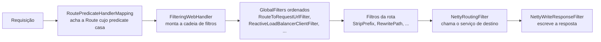

# API Gateway com Spring Cloud Gateway

> **Resumo:** o gateway é a porta de entrada única de uma arquitetura de serviços: recebe as requisições externas, decide para qual serviço enviar (rotas), e aplica preocupações transversais (autenticação, CORS, limites, cabeçalhos, correlação). Aqui: o modelo Route/Predicate/Filter, os dois sabores do Spring Cloud Gateway 5 (WebFlux e Web MVC) e experimentos executados com os dois.
> **Pré-requisitos:** [01-visao-geral](01-visao-geral.md), [03-service-discovery](03-service-discovery.md), [04-web-mvc](../03-spring-boot/04-web-mvc.md), [05-webflux-e-reativo](../03-spring-boot/05-webflux-e-reativo.md), [08-spring-security](../03-spring-boot/08-spring-security.md).
> **Versões:** Spring Cloud Gateway 5.0.x (train 2025.1.4), Boot 4.1.2, Java 25. Executado em `/tmp/validacao/s10`: `gateway` (WebFlux, YAML + `GlobalFilter`) e `gateway-mvc` (Web MVC, Java DSL + YAML), com `lb://`, `StripPrefix`, `RewritePath`, predicate de header, `default-filters`. **Não executados:** `RequestRateLimiter` (exige Redis), `CircuitBreaker`/`Retry` filters, `TokenRelay`, o endpoint `/actuator/gateway`, WebSocket, Proxy Exchange.

## 1. Definição

Um **API Gateway** é um servidor que fica entre os clientes (navegador, app, parceiros) e os serviços internos, expondo uma única origem pública. Problemas que resolve:

- os clientes não precisam conhecer a topologia interna (endereços, quantos serviços);
- preocupações **transversais** ficam em um só lugar: TLS, autenticação do token, CORS, rate limiting, logs de acesso, cabeçalhos de correlação;
- permite evoluir os serviços (dividir, trocar de nome, versionar) sem quebrar a URL pública.

**Spring Cloud Gateway** é a implementação do ecossistema Spring. Na versão atual existem três artefatos (conforme a página oficial, <https://docs.spring.io/spring-cloud-gateway/reference/index.html>):

| Sabor | Stack | Starter (confirmado no Maven Central) |
|---|---|---|
| **Server WebFlux** | reativo (Netty) | `spring-cloud-starter-gateway-server-webflux` |
| **Server Web MVC** | Servlet (Tomcat/Jetty) | `spring-cloud-starter-gateway-server-webmvc` |
| **Proxy Exchange** | biblioteca para repassar requisições dentro de um controller | `ProxyExchange` ⚠️ VERIFICAR o artefato |

> O starter `spring-cloud-starter-gateway` (sem sufixo) ainda existe no Maven Central, mas na linha 4.x para Boot 3. Não o use com Boot 4.

## 2. Conceitos fundamentais

### 2.1 Route, Predicate e Filter

| Conceito | O que é | Exemplo |
|---|---|---|
| **Route** | `id` + destino (`uri`) + predicates + filtros | rota `catalog` → `lb://catalog` |
| **Predicate** | condição sobre a requisição: casa ou não | `Path=/api/catalog/**`, `Header=X-Canary, true`, `Method=GET`, `Host=...` |
| **Filter** | altera a requisição (antes de enviar) e/ou a resposta (depois) | `StripPrefix=2`, `RewritePath=...`, `AddResponseHeader=...` |

A primeira rota cujos predicates **todos** casam é usada. As rotas são avaliadas na ordem (propriedade `order` da rota). O destino pode ser uma URL (`http://host:porta`), um nome lógico com balanceamento (`lb://catalog`, resolvido pela descoberta de [03](03-service-discovery.md)) ou um `forward:`.

### 2.2 Filtros globais, de rota e `default-filters`

- **Filtro de rota**: declarado na rota; só roda para ela.
- **`default-filters`**: lista aplicada a **todas** as rotas.
- **Filtro global** (`GlobalFilter`): um bean que participa de todas as rotas e é ordenado por `Ordered`. Os internos (como o que resolve `lb://`) também são globais.

### 2.3 Gateway não é lugar de regra de negócio

O gateway executa política de borda. Lógica de domínio, agregação de dados de vários serviços (o padrão *API Composition*) ou orquestração são responsabilidade de um serviço, ou de um BFF (*Backend for Frontend*) dedicado ([07-padroes-de-microsservicos](../06-padroes-de-projeto/07-padroes-de-microsservicos.md)).

## 3. Como funciona por dentro

### 3.1 O caminho de uma requisição no sabor WebFlux

Classes confirmadas no JAR `spring-cloud-gateway-server-webflux-5.0.4`:



1. `RoutePredicateHandlerMapping` é um `HandlerMapping` do WebFlux ([05-webflux](../03-spring-boot/05-webflux-e-reativo.md)): avalia os predicates de cada `Route` e guarda a rota escolhida no *exchange*.
2. `FilteringWebHandler` junta os filtros globais e os da rota, ordena e executa como **cadeia** (`GatewayFilterChain`), o mesmo modelo de `Filter` do Servlet.
3. `RouteToRequestUrlFilter` calcula a URL de destino; se for `lb://catalog`, o `ReactiveLoadBalancerClientFilter` pede uma instância ao LoadBalancer e troca o host/porta.
4. `NettyRoutingFilter` envia a requisição ao serviço com o cliente HTTP do Reactor Netty; `NettyWriteResponseFilter` devolve a resposta ao cliente.

Cada filtro tem uma fase "pré" (antes de `chain.filter(...)`) e uma "pós" (no `then(...)` do `Mono`).

### 3.2 Sabor Web MVC

No `gateway-server-webmvc` o modelo é o do **Spring MVC funcional** ([04-web-mvc](../03-spring-boot/04-web-mvc.md)): as rotas são `RouterFunction<ServerResponse>`. O handler `http()` repassa a requisição (via o cliente HTTP do Framework) e filtros "antes" (`BeforeFilterFunctions`), "depois" (`AfterFilterFunctions`) e de balanceamento (`LoadBalancerFilterFunctions.lb("catalog")`) compõem a cadeia. As rotas em YAML são convertidas em `RouterFunction` por um `BeanDefinitionRegistrar` (`GatewayMvcPropertiesBeanDefinitionRegistrar`).

Diferença que importa: o WebFlux usa poucos *event loops* e não bloqueia; o MVC usa uma thread por requisição, o que combina com **threads virtuais** ([12-concorrencia](../01-java/12-concorrencia.md)) e com equipes sem experiência reativa. Em ambos o gateway é I/O bound (repassa bytes).

## 4. Evolução histórica

- **Zuul 1 (Netflix):** gateway bloqueante, o primeiro do Spring Cloud. Entrou em manutenção; foi removido do train em 2020 (⚠️ VERIFICAR).
- **Spring Cloud Gateway (2018):** reescrito sobre o WebFlux, passou a ser a recomendação. Propriedades `spring.cloud.gateway.*`.
- **Gateway Server MVC (4.1, 2024):** versão equivalente para Servlet, no `spring-cloud-gateway-server-mvc` ⚠️ VERIFICAR o ano.
- **Gateway 5.0 (train 2025.1):** os dois sabores têm artefatos e propriedades próprios: `spring.cloud.gateway.server.webflux.*` e `spring.cloud.gateway.server.webmvc.*`. Os metadados do JAR confirmam os prefixos (`...server.webflux.routes`, `...default-filters`, `...discovery.locator.*`, `...globalcors`, `...httpclient.*`, `...filter.request-rate-limiter`; e `...server.webmvc.routes`, `...routes-map`). As propriedades antigas `spring.cloud.gateway.routes` são da linha 4.x.

Veja a evolução geral em [01](01-visao-geral.md).

## 5. Exemplos práticos

### 5.1 Gateway WebFlux em YAML

Dependências: `spring-cloud-starter-gateway-server-webflux` e `spring-cloud-starter-netflix-eureka-client` (para `lb://`).

```yaml
spring.application.name: gateway
server.port: 8080
spring.cloud.gateway.server.webflux:
  default-filters:
    - AddResponseHeader=X-Gateway, s10
  routes:
    - id: catalog
      uri: lb://catalog
      predicates: [ "Path=/api/catalog/**" ]
      filters: [ "StripPrefix=2" ]
    - id: orders
      uri: lb://orders
      predicates: [ "Path=/api/orders/**" ]
      filters: [ "StripPrefix=1" ]
    - id: legacy
      uri: lb://catalog
      predicates: [ "Path=/legacy/**", "Header=X-Canary, true" ]
      filters: [ "RewritePath=/legacy/(?<segment>.*), /$\\{segment}" ]
```

Resultados executados:

```text
GET /api/orders/1            → 200, X-Gateway: s10     (orders → catalog, round-robin)
GET /api/catalog/products/9  → 200                      (StripPrefix=2: /api/catalog/products/9 → /products/9)
GET /legacy/products/5       → 404                      (predicate Header não casou: nenhuma rota)
GET /legacy/products/5 + X-Canary: true → 200           (RewritePath: /legacy/products/5 → /products/5)
```

`StripPrefix=N` remove os N primeiros segmentos do caminho. `RewritePath` usa regex com grupos nomeados; no YAML o `$` precisa ser escrito como `$\{segment}` para o Spring não o tratar como placeholder.

### 5.2 Filtro global próprio (correlação)

```java
@Bean
GlobalFilter correlationId() { return new CorrelationFilter(); }

class CorrelationFilter implements GlobalFilter, Ordered {
    @Override
    public Mono<Void> filter(ServerWebExchange ex, GatewayFilterChain chain) {
        String id = ex.getRequest().getHeaders().getFirst("X-Correlation-Id");
        String cid = id != null ? id : UUID.randomUUID().toString();
        var mutated = ex.mutate().request(r -> r.header("X-Correlation-Id", cid)).build();
        mutated.getResponse().getHeaders().set("X-Correlation-Id", cid);
        return chain.filter(mutated);
    }
    @Override public int getOrder() { return Ordered.HIGHEST_PRECEDENCE; }
}
```

Executado: sem cabeçalho, a resposta traz um UUID (`X-Correlation-Id: e131e79b-...`); com `X-Correlation-Id: abc` na entrada, a resposta devolve `abc`. O cabeçalho também segue para o serviço de destino, onde pode ir para o log. O rastreamento completo é assunto de [08](08-tracing-distribuido.md), e este filtro é só uma versão manual da ideia.

### 5.3 Gateway Web MVC: Java DSL + YAML

Dependências: `spring-cloud-starter-gateway-server-webmvc`, `...eureka-client`, `...loadbalancer`.

```java
import static org.springframework.cloud.gateway.server.mvc.filter.BeforeFilterFunctions.stripPrefix;
import static org.springframework.cloud.gateway.server.mvc.filter.LoadBalancerFilterFunctions.lb;
import static org.springframework.cloud.gateway.server.mvc.filter.AfterFilterFunctions.addResponseHeader;
import static org.springframework.cloud.gateway.server.mvc.handler.GatewayRouterFunctions.route;
import static org.springframework.cloud.gateway.server.mvc.handler.HandlerFunctions.http;
import static org.springframework.web.servlet.function.RequestPredicates.path;

@Bean
RouterFunction<ServerResponse> catalogRoute() {
    return route("catalog")
        .route(path("/api/catalog/**"), http())
        .before(stripPrefix(2))
        .filter(lb("catalog"))
        .after(addResponseHeader("X-Gateway", "mvc"))
        .build();
}
```

```yaml
server.port: 8090
spring.cloud.gateway.server.webmvc.routes:
  - id: orders
    uri: lb://orders
    predicates: [ "Path=/api/orders/**" ]
    filters: [ "StripPrefix=1" ]
```

Executado: `GET :8090/api/catalog/products/3` → 200 com `X-Gateway: mvc` (rota Java); `GET :8090/api/orders/3` → 200 (rota YAML). As duas formas convivem no mesmo gateway.

### 5.4 Descoberta automática de rotas (locator)

`spring.cloud.gateway.server.webflux.discovery.locator.enabled=true` cria uma rota para cada serviço registrado (`/{serviceId}/**`). Conveniente em demonstrações, mas **expõe todos os serviços** sem decisão consciente. Em produção prefira rotas explícitas (como em §5.1). Não executado neste laboratório.

### 5.5 Ordem das rotas e rota "pega-tudo"

As rotas são avaliadas pela propriedade `order` (menor primeiro); sem ela, vale a ordem de declaração. Um erro típico é declarar uma rota genérica antes de uma específica:

```yaml
routes:
  - id: all          # ERRADO se vier primeiro: intercepta tudo que começa com /api
    uri: lb://catalog
    predicates: [ "Path=/api/**" ]
  - id: orders       # nunca será alcançada
    uri: lb://orders
    predicates: [ "Path=/api/orders/**" ]
```

A regra prática: **do mais específico para o mais genérico**, ou use `order` explicitamente. Nos testes, a combinação `Path` + `Header` do §5.1 (rota `legacy`) mostra o inverso: quando nenhuma rota casa, a resposta é 404 gerada pelo próprio gateway, sem que o serviço de destino seja consultado.

### 5.6 Como testar um gateway

- **Teste de rota isolado:** suba só o gateway com uma rota para `http://localhost:${porta}` (um servidor simulado, como `MockWebServer`/WireMock) em vez de `lb://`, e verifique caminho, cabeçalhos e status ⚠️ não executado.
- **Teste de contrato de política:** garanta que `X-Correlation-Id` sempre sai na resposta, que cabeçalhos internos não vazam e que rotas protegidas sem token retornam 401. São as regras que, se quebradas, só aparecem em produção.
- **Em Web MVC:** as rotas Java (`RouterFunction`) são beans comuns e podem ser testadas com `MockMvc`/`@SpringBootTest` ⚠️ não executado; as de YAML exigem o contexto completo.
- Para ver as rotas carregadas, exponha `gateway` em `management.endpoints.web.exposure.include` e consulte `/actuator/gateway/routes`. Sem essa exposição o endpoint retorna 404, como no teste ⚠️ restante não explorado.

## 6. Configurações e anotações relevantes

| Item | Para que serve | Exemplo |
|---|---|---|
| `spring.cloud.gateway.server.webflux.routes` / `.webmvc.routes` | lista de rotas | §5.1, §5.3 |
| `...default-filters` | filtros em todas as rotas | `AddResponseHeader=X-Gateway, s10` |
| Predicates | `Path`, `Method`, `Header`, `Host`, `Query`, `Cookie`, `After/Before/Between`, `RemoteAddr`, `Weight` | `Header=X-Canary, true` |
| Filtros de caminho | `StripPrefix`, `PrefixPath`, `SetPath`, `RewritePath` | `StripPrefix=2` |
| Filtros de cabeçalho | `AddRequestHeader`, `AddResponseHeader`, `RemoveRequestHeader`, ... | — |
| `RequestRateLimiter` | limite por chave (padrão com `redis-rate-limiter`) | exige Redis; não executado |
| `Retry`, `CircuitBreaker` | repetição e disjuntor na rota | ver [06](06-resiliencia.md) |
| `TokenRelay` | repassa o token OAuth2 ao serviço | ver [08-spring-security](../03-spring-boot/08-spring-security.md) |
| `...globalcors` | CORS global do gateway | ⚠️ VERIFICAR a estrutura exata |
| `...httpclient.*` | timeouts, pool, proxy, SSL do cliente | `connect-timeout`, `response-timeout` ⚠️ VERIFICAR |
| `...discovery.locator.*` | rotas automáticas por serviço registrado | §5.4 |
| `GlobalFilter` + `Ordered` | filtro global | §5.2 |
| `management.endpoints.web.exposure.include=gateway` | habilita `/actuator/gateway/routes` | por padrão retorna 404 (confirmado), não explorado |

## 7. Quando usar e quando NÃO usar

**Use um gateway quando:**
- há vários serviços atrás de uma origem pública e você precisa de política de borda centralizada (autenticação, CORS, limite de taxa, correlação);
- quer esconder a topologia interna e poder reorganizá-la.

**Evite (ou escolha outra ferramenta) quando:**
- há **um** serviço: o gateway só soma um salto de rede;
- precisa de um proxy reverso genérico, de alta vazão e TLS, sem lógica Java: **Nginx/Envoy/HAProxy** ou o *Ingress/Gateway API* do Kubernetes fazem melhor e gastam menos memória. Muitas arquiteturas usam os dois: Ingress na borda e Spring Cloud Gateway para política dependente de código;
- a regra é de **negócio** ou de agregação: crie um serviço/BFF;
- sua plataforma já oferece um gateway gerenciado (API Gateway da nuvem, Kong, Apigee) que cumpre o papel.

**WebFlux ou MVC?** WebFlux se a equipe já domina o modelo reativo ou há muito tráfego de longa duração (SSE, WebSocket, *streaming*). MVC com threads virtuais se a equipe prefere código imperativo e depuração simples. Funcionalidades nem sempre têm paridade entre os sabores: confira a lista de filtros de cada um ⚠️ VERIFICAR.

## 8. Erros comuns e boas práticas

- **Misturar propriedades de versões.** `spring.cloud.gateway.routes` (4.x) não é lido no 5.0; use `server.webflux`/`server.webmvc` conforme o starter.
- **Colocar `spring-boot-starter-web` junto do starter WebFlux** (ou vice-versa): o Boot escolhe o stack pelo classpath e o gateway não sobe como esperado. Cada sabor traz o seu stack.
- **Esquecer `StripPrefix`.** O serviço recebe `/api/catalog/products/9` e responde 404. Confira o caminho que chega ao destino.
- **Gateway como ponto único de falha e gargalo.** Rode várias réplicas atrás de um balanceador e meça. Defina *timeouts* (`httpclient.connect-timeout`, `response-timeout`) em vez de depender de padrões.
- **Segurança só na borda.** Validar o JWT no gateway é útil, mas os serviços internos também devem validar (defesa em profundidade), principalmente se alcançáveis por outro caminho.
- **Lógica pesada em `GlobalFilter`.** Em WebFlux, nunca bloqueie no filtro (nada de JDBC ou `Thread.sleep`).
- **Locator automático em produção** (§5.4) expõe serviços internos.
- **Registro eventual.** Rotas `lb://` herdam os atrasos de [03](03-service-discovery.md): instâncias mortas continuam sendo escolhidas por minutos (o experimento do arquivo 03 foi feito através deste gateway).

## 9. Perguntas de revisão

1. Qual a diferença entre predicate e filter?
<details><summary>Resposta</summary>Predicate decide se a rota se aplica à requisição (ex.: <code>Path</code>, <code>Header</code>); filter modifica a requisição antes do envio e/ou a resposta depois (ex.: <code>StripPrefix</code>, <code>AddResponseHeader</code>).</details>

2. O que acontece com <code>GET /api/catalog/products/9</code> na rota com <code>StripPrefix=2</code> e <code>lb://catalog</code>?
<details><summary>Resposta</summary>Os dois primeiros segmentos (<code>api</code>, <code>catalog</code>) são removidos e o <code>catalog</code> recebe <code>/products/9</code>, numa instância escolhida pelo LoadBalancer.</details>

3. Quais os dois sabores do Gateway Server e como se diferenciam nas propriedades e no modelo?
<details><summary>Resposta</summary>WebFlux (Netty, <code>spring.cloud.gateway.server.webflux.*</code>, <code>GlobalFilter</code>/<code>GatewayFilterChain</code>) e Web MVC (Servlet, <code>...server.webmvc.*</code>, <code>RouterFunction</code> com <code>before/after/filter</code>).</details>

4. Por que o locator de descoberta (<code>discovery.locator.enabled</code>) é arriscado em produção?
<details><summary>Resposta</summary>Cria rotas para todos os serviços registrados sem decisão explícita, expondo serviços internos ao exterior.</details>

5. Dê dois motivos para preferir Nginx/Ingress ao Spring Cloud Gateway.
<details><summary>Resposta</summary>Proxy reverso genérico de alta vazão com menor consumo de memória e sem necessidade de lógica Java; plataforma que já oferece Ingress/gateway gerenciado.</details>

## 10. Referências oficiais

- Spring Cloud Gateway (referência): <https://docs.spring.io/spring-cloud-gateway/reference/index.html>
- Release notes do train 2025.1: <https://github.com/spring-cloud/spring-cloud-release/wiki/Spring-Cloud-2025.1-Release-Notes>
- Padrões *API Gateway* e *Backends for Frontends*: <https://microservices.io/patterns/apigateway.html>
- Kubernetes Gateway API: <https://gateway-api.sigs.k8s.io>
- Anterior: [03-service-discovery](03-service-discovery.md) · Próximo: [05-comunicacao-entre-servicos](05-comunicacao-entre-servicos.md)
