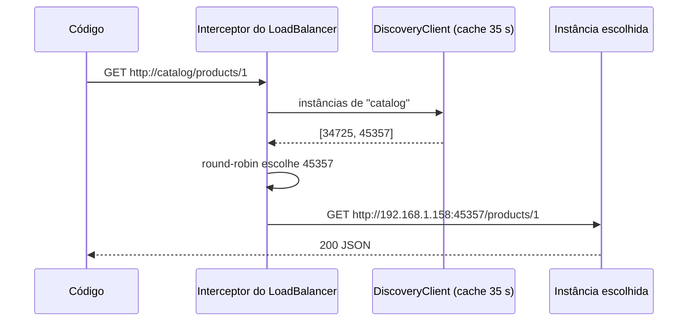

# Comunicação entre Serviços

> **Resumo:** como um serviço chama outro no Spring Cloud atual: `RestClient` balanceado, os **HTTP Service Clients** (interfaces declarativas do Framework 7 com integração nativa ao LoadBalancer), `WebClient` e o status do OpenFeign. Inclui o comportamento do balanceador, o que acontece quando uma instância morre e as decisões de projeto (síncrono vs assíncrono, contratos, tolerância a falhas).
> **Pré-requisitos:** [03-service-discovery](03-service-discovery.md), [04-api-gateway](04-api-gateway.md), [04-web-mvc](../03-spring-boot/04-web-mvc.md), [05-webflux-e-reativo](../03-spring-boot/05-webflux-e-reativo.md), [13-io-nio-e-http](../01-java/13-io-nio-e-http.md), [07-aop-e-proxies](../02-spring-core/07-aop-e-proxies.md).
> **Versões:** Spring Framework 7.0.10 (HTTP Service Clients: `@ImportHttpServices`), Spring Cloud Commons/LoadBalancer 5.0.4, Boot 4.1.2, Java 25. Executado em `/tmp/validacao/s10`: `RestClient` com `@LoadBalanced` + proxy via `HttpServiceProxyFactory`; HTTP Service Client com `@ImportHttpServices` (três variações de `base-url`); round-robin; falha de instância. **Não executados:** OpenFeign, `WebClient` balanceado, retry do LoadBalancer, hints/zona, Spring Cloud Contract.

## 1. Definição

Em microsserviços, "chamar outro serviço" é uma chamada de rede com nome lógico (`catalog`) que precisa ser resolvido em endereço, balanceado, com *timeout*, tratamento de erro e serialização. Duas famílias de comunicação existem:

| Estilo | Característica | Exemplos | Arquivo |
|---|---|---|---|
| **Síncrono** (requisição/resposta) | o chamador espera; acoplamento temporal | REST/HTTP, gRPC | este |
| **Assíncrono** (mensagens/eventos) | o chamador não espera; desacoplado no tempo | Kafka, RabbitMQ | [07](07-mensageria.md) |

Este arquivo cobre o primeiro. A pergunta de projeto vem antes da API: **toda chamada síncrona acopla a disponibilidade do chamador à do chamado**. Se `orders` depende de `catalog` para cada pedido e `catalog` cai, `orders` cai junto (ou degrada). Por isso as chamadas precisam de timeouts e proteção ([06](06-resiliencia.md)), e muitas devem virar eventos.

## 2. Conceitos fundamentais

### 2.1 Opções de cliente HTTP

| Cliente | Modelo | Estado no train 2025.1 |
|---|---|---|
| **`RestClient`** | bloqueante, API fluente (Framework 6.1+) | recomendado para código imperativo |
| **HTTP Service Client** (`@HttpExchange`) | interface Java vira cliente, por proxy; usa `RestClient` ou `WebClient` por baixo | recomendado; integração direta com LoadBalancer desde Cloud 5.0 |
| **`WebClient`** | reativo | para código reativo/streaming |
| **OpenFeign** | interface declarativa (anotações próprias do Feign) | projeto declarado **feature-complete**; recomenda migrar para HTTP Service Clients |
| **`RestTemplate`** | bloqueante, API antiga | modo de manutenção ⚠️ VERIFICAR cronograma de depreciação no Framework 7 |

Sobre o OpenFeign, o README do projeto (<https://github.com/spring-cloud/spring-cloud-openfeign>) diz que o projeto é tratado como *feature-complete*, recebendo só correções e pequenas contribuições, e sugere migrar para os **Spring HTTP Service Clients**. Ele ainda é publicado no train 2025.1 (versão 5.0.x), então códigos antigos continuam funcionando.

### 2.2 HTTP Service Clients: interface em vez de código

Você declara um contrato com anotações do Framework ([06-como-java-e-spring-conversam](../02-spring-core/06-como-java-e-spring-conversam.md) explica o mecanismo de proxy):

```java
interface CatalogClient {
    @GetExchange("/products/{id}")
    Map<String, Object> product(@PathVariable long id);
}
```

O Framework gera, em tempo de execução, um **proxy JDK** que traduz cada chamada em uma requisição HTTP (método, URL, corpo, cabeçalhos pelas anotações) e converte a resposta com os `HttpMessageConverter`s do Boot. O mesmo princípio dos repositórios do Spring Data ([06-spring-data-jpa](../03-spring-boot/06-spring-data-jpa.md)): interface + proxy.

A anotação `@HttpExchange` (e as atalhos `@GetExchange`, `@PostExchange`, `@PutExchange`, `@DeleteExchange`, `@PatchExchange`) vive em `org.springframework.web.service.annotation`.

### 2.3 Grupos e registro

`@ImportHttpServices(group = "catalog", types = CatalogClient.class)` (`org.springframework.web.service.registry`) registra a interface como bean e a associa a um **grupo**. Um grupo é uma configuração compartilhada de cliente (URL base, cabeçalhos, timeouts). No Boot 4 as propriedades são `spring.http.serviceclient.<grupo>.*`.

Regra do Spring Cloud LoadBalancer para o grupo (documentação do Commons 5.0.4, confirmada no teste):

| `spring.http.serviceclient.<grupo>.base-url` | Resultado |
|---|---|
| ausente | `http://<grupo>`, **balanceado** (o nome do grupo é o service id) |
| `lb://catalog` | balanceado |
| `http://catalog` | **não** balanceado: o nome é resolvido por DNS comum e falha |

## 3. Como funciona por dentro

### 3.1 O `@LoadBalanced`

Um `RestClient.Builder` (ou `RestTemplate`, ou `WebClient.Builder`) anotado com `@LoadBalanced` recebe um **interceptor** (`LoadBalancerInterceptor` no modo bloqueante; um `ExchangeFilterFunction` no `WebClient`). A cada requisição:



O interceptor lê o host da URI (`catalog`), consulta a lista de instâncias, escolhe uma, **reescreve** a URI para IP:porta e prossegue. O código de negócio nunca vê o endereço real. A lista vem do `DiscoveryClient` (Eureka, Kubernetes, lista estática) e é guardada num cache por 35 s ([03](03-service-discovery.md)).

### 3.2 A integração dos HTTP Service Clients

Commons 5.0.4 traz `LoadBalancerRestClientHttpServiceGroupConfigurer` (e a variante `...reactive.LoadBalancerWebClientHttpServiceGroupConfigurer`, para `WebClient`). Eles são configuradores de grupo: para cada grupo, ajustam o `RestClient` que será usado, adicionando o interceptor balanceado e a URL base `lb://`/`http://<grupo>`. Por isso não é necessário declarar um builder `@LoadBalanced` à mão, e se evita a armadilha de [03 §5.4](03-service-discovery.md).

### 3.3 O que o round-robin faz

`RoundRobinLoadBalancer` mantém um contador por service id e escolhe `(posição++) % N`. É "por processo cliente": cada instância de `orders` tem seu próprio contador, sem coordenação global. Em termos práticos, a carga se distribui bem a longo prazo mas não considera a carga real das instâncias (uma instância lenta recebe a mesma fatia).

## 4. Evolução histórica

1. **`RestTemplate` + Ribbon (2015):** `@LoadBalanced RestTemplate`, balanceamento do Netflix Ribbon.
2. **Feign (2015):** clientes declarativos integrados ao Ribbon e ao Hystrix.
3. **2018–2020:** Ribbon e Hystrix saem; entram LoadBalancer, `WebClient` e `RestClient` (6.1, 2023).
4. **Framework 6.0 (2022):** surgem as *HTTP interfaces* (`@HttpExchange`) com `HttpServiceProxyFactory`, uma versão genérica do que o Feign fazia. Registro manual.
5. **Framework 7.0 / Boot 4 / Cloud 2025.1:** registro simplificado por `@ImportHttpServices` e propriedades `spring.http.serviceclient.*`; o Spring Cloud ganha os configuradores de grupo; o OpenFeign é declarado *feature-complete*.

Datas aproximadas de memória (⚠️ VERIFICAR). Ver também [01](01-visao-geral.md).

## 5. Exemplos práticos

### 5.1 Forma manual: `@LoadBalanced RestClient.Builder` + `HttpServiceProxyFactory`

Código validado (serviço `orders`):

```java
@SpringBootApplication
public class OrdersApp {
    // Builder comum e primário: é o que o próprio cliente Eureka obtém (ver 03 §5.4)
    @Bean @Primary
    RestClient.Builder plainBuilder() { return RestClient.builder(); }

    @Bean @LoadBalanced
    RestClient.Builder lbBuilder() { return RestClient.builder(); }

    @Bean
    CatalogClient catalogClient(@LoadBalanced RestClient.Builder builder) {
        RestClient rc = builder.baseUrl("http://catalog").build();
        return HttpServiceProxyFactory.builderFor(RestClientAdapter.create(rc))
                .build()
                .createClient(CatalogClient.class);
    }
}
```

Resultado: `GET :8080/api/orders/1` retornou o pedido com o produto e a requisição se distribuiu entre as instâncias do `catalog` (3 e 3 em seis chamadas).

### 5.2 Forma atual: `@ImportHttpServices`

Dependências do `orders`: `spring-boot-starter-webmvc`, `spring-cloud-starter-netflix-eureka-client`, `spring-cloud-starter-loadbalancer` **e `spring-boot-starter-restclient`**.

```java
@SpringBootApplication
@ImportHttpServices(group = "catalog", types = CatalogClient.class)
public class OrdersApp { /* main */ }

interface CatalogClient {
    @GetExchange("/products/{id}")
    Map<String, Object> product(@PathVariable long id);
}

@RestController
class OrderController {
    private final CatalogClient catalog;
    OrderController(CatalogClient c) { this.catalog = c; }

    @GetMapping("/orders/{id}")
    Map<String, Object> get(@PathVariable long id) {
        return Map.of("orderId", id, "product", catalog.product(id));
    }
}
```

Sem nenhuma propriedade, a chamada saiu balanceada: quatro pedidos distribuídos 2 e 2 entre as instâncias `45357` e `46555`.

**Três tentativas reais, em ordem (útil para diagnosticar):**

| Tentativa | Configuração | Resultado | Causa |
|---|---|---|---|
| 1 | só `spring-boot-starter-webmvc` | `ResourceAccessException ... "/products/1": Target host is not specified` | o suporte do Boot a `spring.http.serviceclient.*` e ao `RestClient` do grupo está no módulo/starter `spring-boot-starter-restclient`, ausente do classpath ⚠️ VERIFICAR o nome do módulo; sem ele, o grupo fica sem URL base |
| 2 | + `spring-boot-starter-restclient`, `base-url: http://catalog` | `... "http://catalog/products/1": catalog: Temporary failure in name resolution` | `http://` explícito **não** é balanceado (§2.3) |
| 3 | `base-url: lb://catalog` (ou nenhuma propriedade) | 200, round-robin | — |

Lição: o nome do grupo vira o service id; deixe a propriedade de fora ou use `lb://`.

### 5.3 Quando o destino cai (ligação com o 03)

Com o `catalog` morto por `kill -9`, a chamada passou a falhar em parte das requisições durante cerca de 3 min (medido em [03 §3.4](03-service-discovery.md)). Esse teste passou pela rota `catalog` do gateway (resposta 500 do gateway ao conectar na instância morta); o caminho `orders` → `catalog` não foi exercitado com a instância caída. Pelo contrato do `RestClient`, a falha chega ao chamador como `ResourceAccessException` (conexão recusada) ou `HttpServerErrorException` (5xx), e sem tratamento vira 500 no `orders`. Em produção isso exige tratamento ou resiliência:

<!-- não compilado -->

```java
@GetMapping("/orders/{id}")
Map<String, Object> get(@PathVariable long id) {
    try {
        return Map.of("orderId", id, "product", catalog.product(id));
    } catch (ResourceAccessException | HttpServerErrorException e) {
        // degradação: pedido sem detalhes do produto (decisão de negócio)
        return Map.of("orderId", id, "product", Map.of("id", id, "unavailable", true));
    }
}
```

Esse tratamento manual dá lugar a `@Retryable`, `@ConcurrencyLimit` e disjuntores, vistos em [06-resiliencia](06-resiliencia.md) e em [11-cache-agendamento-e-async](../03-spring-boot/11-cache-agendamento-e-async.md).

### 5.4 Timeouts

O padrão do cliente HTTP escolhido pode não ter limite de tempo adequado. Defina sempre: propriedades como `spring.http.client.connect-timeout`/`read-timeout` ⚠️ VERIFICAR nome exato no Boot 4.1, por grupo em `spring.http.serviceclient.<grupo>.*`, ou na construção do `RestClient`. Sem timeout, uma instância lenta (não morta) consome todas as threads do chamador, o caminho clássico para falha em cascata.

### 5.5 OpenFeign (apenas descrição)

Código existente costuma ter `@EnableFeignClients` e `@FeignClient(name = "catalog")` sobre uma interface com `@GetMapping`. Não foi executado aqui. Para código novo, migre para §5.2. A migração é mecânica: troque a anotação da interface (`@GetExchange`), registre-a com `@ImportHttpServices` e mova a configuração do Feign (`spring.cloud.openfeign.client.config.*`) para `spring.http.serviceclient.*`.

## 6. Configurações e anotações relevantes

| Item | Para que serve | Exemplo |
|---|---|---|
| `@LoadBalanced` | cliente HTTP balanceado (`RestClient.Builder`, `RestTemplate`, `WebClient.Builder`) | §5.1 |
| `@ImportHttpServices(group, types)` | registra interfaces como beans em um grupo | §5.2 |
| `@HttpExchange` / `@GetExchange` / ... | contrato HTTP da interface | `@GetExchange("/products/{id}")` |
| `spring.http.serviceclient.<grupo>.base-url` | URL base do grupo (`lb://` para balancear) | `lb://catalog` |
| `spring.cloud.loadbalancer.cache.ttl` | cache de instâncias (padrão 35 s) | `5s` |
| `spring.cloud.loadbalancer.retry.enabled` | liga/desliga retry do LoadBalancer (global) | ⚠️ VERIFICAR o padrão e a semântica; não executado |
| `spring.cloud.loadbalancer.zone` | zona do cliente | `zone-a` |
| `spring.cloud.loadbalancer.hint.<serviceId>` / header `X-SC-LB-Hint` | escolher instâncias por *hint* de metadados | canário |
| `spring.cloud.loadbalancer.health-check.*` | filtra instâncias por health check | com `SimpleDiscoveryClient` |
| `spring.cloud.loadbalancer.enabled` | desativa o LoadBalancer | `false` |

## 7. Quando usar e quando NÃO usar

**Chamada síncrona entre serviços é adequada quando:**
- o chamador **precisa** da resposta para continuar (consulta de preço, validação de estoque);
- a latência é pequena e o destino é confiável, com timeout e proteção ([06](06-resiliencia.md)).

**Prefira eventos assíncronos quando:**
- o chamador só quer notificar ("pedido criado"): a mensageria desacopla disponibilidade ([07](07-mensageria.md));
- há cadeias longas de chamadas, onde o SLA multiplica (cada salto reduz a disponibilidade total);
- você precisa de consistência entre serviços sem transação distribuída: *Saga* ([07-padroes-de-microsservicos](../06-padroes-de-projeto/07-padroes-de-microsservicos.md)).

**Interface declarativa ou `RestClient` direto?** Interface se há muitas operações do mesmo serviço e você quer um contrato tipado e mockável; `RestClient` direto para chamadas pontuais ou quando precisa controlar cada detalhe.

## 8. Erros comuns e boas práticas

- **`http://` explícito no `base-url` do grupo** (§2.3): falha de DNS. Use `lb://` ou deixe em branco.
- **Faltar `spring-boot-starter-restclient`** (§5.2, tentativa 1): erro obscuro "Target host is not specified".
- **Compartilhar DTOs entre serviços via biblioteca comum:** acopla os deploys. Prefira contratos explícitos (OpenAPI) ou *consumer-driven contracts* com Spring Cloud Contract; replicar um DTO pequeno em cada lado costuma ser o menor mal.
- **Sem timeout:** uma instância lenta derruba o chamador (§5.4).
- **Retry em chamadas não idempotentes** (POST de pagamento): duplica efeitos. Só repita operações idempotentes ou use chave de idempotência.
- **Achar que o balanceador sabe a saúde:** o round-robin não consulta saúde; os atrasos de [03 §3.4](03-service-discovery.md) se aplicam.
- **Chamadas em laço (N+1 entre serviços):** 100 itens = 100 requisições. Ofereça operações em lote.
- **Esquecer propagação de contexto:** cabeçalhos de correlação/tracing precisam seguir de serviço em serviço. Com Micrometer Tracing e os clientes construídos pelo Boot isso é automático ([08](08-tracing-distribuido.md)); clientes criados com `new RestClient` direto fora do builder do Boot perdem a instrumentação.
- **Um cliente declarativo por tudo:** mantenha a interface fina; regras de negócio ficam em outra camada.

## 9. Perguntas de revisão

1. O que o `@LoadBalanced` faz em um `RestClient.Builder`?
<details><summary>Resposta</summary>Adiciona um interceptor que, a cada requisição, resolve o host lógico em uma lista de instâncias (DiscoveryClient + cache), escolhe uma (round-robin por padrão) e reescreve a URI para o endereço real.</details>

2. Por que <code>spring.http.serviceclient.catalog.base-url=http://catalog</code> falha, e qual a alternativa?
<details><summary>Resposta</summary>O LoadBalancer só aplica o balanceamento quando a URL é <code>lb://...</code> ou quando <code>base-url</code> está ausente (default <code>http://&lt;grupo&gt;</code> balanceado). Com <code>http://</code> explícito o nome é resolvido por DNS comum e dá "Temporary failure in name resolution". Use <code>lb://catalog</code> ou omita.</details>

3. Qual o status do OpenFeign e o que se recomenda para código novo?
<details><summary>Resposta</summary>Feature-complete (só correções); recomendação oficial: migrar para os Spring HTTP Service Clients (<code>@HttpExchange</code> + <code>@ImportHttpServices</code>).</details>

4. Por que chamadas síncronas encadeadas reduzem a disponibilidade?
<details><summary>Resposta</summary>A disponibilidade total é o produto das disponibilidades: se A depende de B e C com 99,9% cada, A fica próxima de 99,7% mesmo sendo perfeita. Por isso timeouts, degradação, disjuntores e, quando possível, eventos assíncronos.</details>

5. Quando um evento assíncrono é melhor que uma chamada REST?
<details><summary>Resposta</summary>Quando o chamador só precisa notificar, não depende da resposta, quer tolerar indisponibilidade do destino ou propagar a mesma informação a vários consumidores.</details>

## 10. Referências oficiais

- Spring Framework, HTTP Service Clients (REST Clients): <https://docs.spring.io/spring-framework/reference/integration/rest-clients.html> ⚠️ VERIFICAR o caminho exato
- Spring Cloud Commons, LoadBalancer: <https://docs.spring.io/spring-cloud-commons/reference/spring-cloud-commons/loadbalancer.html>
- Spring Cloud OpenFeign: <https://github.com/spring-cloud/spring-cloud-openfeign>
- Spring Cloud Contract: <https://spring.io/projects/spring-cloud-contract>
- Padrão *Remote Procedure Invocation* e *Saga*: <https://microservices.io/patterns/>
- Anterior: [04-api-gateway](04-api-gateway.md) · Próximo: [06-resiliencia](06-resiliencia.md) (Sessão 11)
