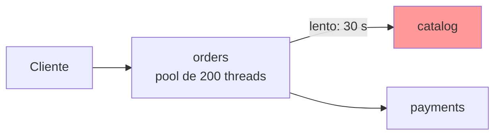
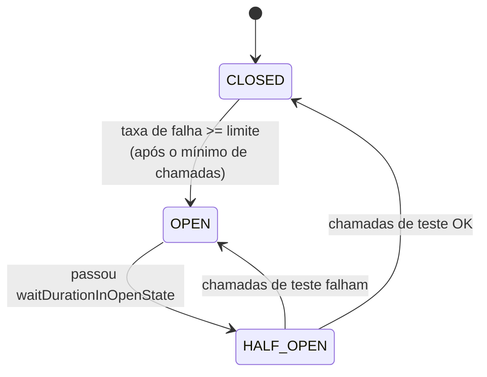
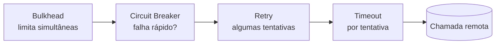

# Resiliência: Circuit Breaker, Retry, Timeout e Bulkhead

> **Resumo:** como impedir que a falha de um serviço derrube os que dependem dele. Cobre timeout, retry, circuit breaker, bulkhead e fallback, com a abstração `CircuitBreakerFactory` do Spring Cloud (implementada por Resilience4j) e os recursos de resiliência nativos do Spring Framework 7 (`@Retryable`, `@ConcurrencyLimit`).
> **Pré-requisitos:** [05-comunicacao-entre-servicos](05-comunicacao-entre-servicos.md), [03-service-discovery](03-service-discovery.md), [07-aop-e-proxies](../02-spring-core/07-aop-e-proxies.md), [12-concorrencia](../01-java/12-concorrencia.md), [11-cache-agendamento-e-async](../03-spring-boot/11-cache-agendamento-e-async.md).
> **Versões:** Spring Cloud 2025.1.4 (Circuit Breaker 5.0.3, Resilience4j 2.3.0 no repositório local), Spring Framework 7.0.10, Boot 4.1.2, Java 25. Executado em `/tmp/validacao/s11a`: `CircuitBreakerFactory` (fechado → aberto → half-open → fechado), timeout via `TimeLimiter`, `@ConcurrencyLimit` e `@Retryable`. **Não executados:** `@CircuitBreaker` por anotação do Resilience4j, `RateLimiter`, `Bulkhead` do Resilience4j, Spring Retry (biblioteca), métricas no Actuator, circuit breaker no Gateway.

## 1. Definição

**Resiliência** é a capacidade de um sistema continuar útil (mesmo que degradado) quando uma dependência falha ou fica lenta. Em microsserviços ela é obrigatória, porque cada chamada de rede pode:

1. falhar rápido (conexão recusada, 503);
2. falhar devagar (a dependência aceita a conexão e nunca responde);
3. falhar de forma intermitente (1 em cada 10 chamadas).

O caso 2 é o mais perigoso: as threads do chamador ficam presas esperando, o *pool* esgota, e o chamador deixa de atender **qualquer** requisição, inclusive as que nem usam a dependência lenta. É a **falha em cascata**.



Se `catalog` passar a responder em 30 s, cada requisição a `orders` prende uma thread por 30 s. Em segundos as 200 threads estão ocupadas e `payments` (saudável) também fica inacessível via `orders`.

Os padrões de resiliência são cinco, e se combinam:

| Padrão | Pergunta que responde | Efeito |
|---|---|---|
| **Timeout** | "Quanto tempo aceito esperar?" | libera a thread; transforma lentidão em erro |
| **Retry** | "Vale tentar de novo?" | absorve falhas transitórias |
| **Circuit Breaker** | "A dependência está tão ruim que nem devo tentar?" | falha imediata, poupa recursos e dá tempo de recuperação |
| **Bulkhead** | "Quantas chamadas simultâneas permito?" | isola o dano a uma parte dos recursos |
| **Fallback** | "O que devolvo quando falha?" | degradação controlada (cache, valor padrão, erro claro) |

## 2. Conceitos fundamentais

### 2.1 Timeout: a base de tudo

Sem timeout, nenhum dos outros padrões funciona (o retry nunca dispara, o circuit breaker nunca conta a falha). Todo cliente HTTP deve ter **dois** tempos:

- **connect timeout:** quanto esperar pelo estabelecimento da conexão;
- **read/response timeout:** quanto esperar pela resposta depois de enviada a requisição.

Em Boot 4 isso se configura nas propriedades do cliente HTTP ([05 §5.4](05-comunicacao-entre-servicos.md)). Os timeouts devem respeitar um **orçamento**: se o cliente do usuário desiste em 5 s, a soma de timeouts e retries internos precisa caber nisso. Ficar 3 × 10 s tentando uma chamada cujo resultado ninguém mais espera é desperdício.

### 2.2 Retry: só para o que é seguro repetir

Retry resolve falhas **transitórias** (reinício de instância, pico de latência, perda de pacote). Três cuidados:

1. **Idempotência.** Repetir um `GET` é seguro; repetir um `POST /orders` pode criar dois pedidos. Só faça retry de operações idempotentes ou protegidas por chave de idempotência.
2. **Backoff com jitter.** Tentar 3 vezes seguidas, sem pausa, multiplica a carga justamente quando a dependência está mal. Use espera crescente (exponencial) com aleatoriedade, para que milhares de clientes não retentem no mesmo instante (*thundering herd*).
3. **Amplificação.** Se `A` faz 3 tentativas a `B` e `B` faz 3 a `C`, `C` recebe 9 chamadas para 1 original. Retry em camadas múltiplas é uma bomba; faça retry em **um** nível (normalmente o mais perto do chamador final).

### 2.3 Circuit Breaker: a máquina de três estados

Inspirado no disjuntor elétrico. Ele observa as chamadas e, quando a taxa de falhas passa de um limite, **abre**: as chamadas seguintes falham imediatamente, sem tocar na rede.



- **CLOSED** (fechado): tudo passa; as chamadas são registradas numa janela deslizante (por contagem ou por tempo).
- **OPEN** (aberto): nada passa; lança `CallNotPermittedException` (ou chama o *fallback*) em microssegundos.
- **HALF_OPEN** (semiaberto): após uma espera, deixa passar um número pequeno de chamadas de teste. Se forem bem, volta a CLOSED; se falharem, reabre.

Valor prático: (a) o chamador não gasta threads nem tempo em algo que sabidamente está quebrado; (b) a dependência recebe menos carga e tem chance de se recuperar.

### 2.4 Bulkhead: compartimentos do navio

Limita quantas chamadas a uma dependência podem estar em andamento ao mesmo tempo. Se `catalog` trava, no máximo N threads ficam presas nele; as demais continuam livres para `payments`. Há duas formas: por **semáforo** (conta chamadas simultâneas na própria thread) e por **pool de threads dedicado** (isola também o contexto de execução, ao custo de uma troca de thread).

Com *virtual threads* ([12-concorrencia](../01-java/12-concorrencia.md)) o argumento a favor do pool dedicado enfraquece: threads são baratas, e o recurso escasso passa a ser a **dependência**, não a thread. O limite de concorrência por semáforo continua valendo.

### 2.5 Fallback

O que fazer quando a chamada falha ou o circuito está aberto:

| Estratégia | Exemplo | Cuidado |
|---|---|---|
| valor padrão | lista de recomendações vazia | só se a ausência for aceitável |
| cache | último preço conhecido | dado pode estar defasado; sinalize |
| serviço alternativo | segundo provedor de frete | custo e consistência |
| erro explícito | 503 com `Retry-After` | honesto, simples |

Um fallback que **mascara** erro sem ninguém perceber é um defeito. Registre métrica/log toda vez que ele for usado.

## 3. Como funciona por dentro

### 3.1 A abstração do Spring Cloud

O projeto **Spring Cloud Circuit Breaker** define uma interface neutra, de forma que o código não dependa da biblioteca:

```java
public interface CircuitBreakerFactory<CONF, CONFB> {
    CircuitBreaker create(String id);
    // + configureDefault(...), configure(...)
}
public interface CircuitBreaker {
    <T> T run(Supplier<T> toRun, Function<Throwable, T> fallback);
    <T> T run(Supplier<T> toRun);
}
```

Implementações: **Resilience4j** (blocante `Resilience4JCircuitBreakerFactory` e reativa `ReactiveResilience4JCircuitBreakerFactory`) e **Spring Retry**. (Hystrix e Sentinel não fazem mais parte do train: o Hystrix foi removido em 2020.) A escolha é pelo *starter*: `spring-cloud-starter-circuitbreaker-resilience4j` registra a fábrica.

No teste feito para este arquivo, `f.getClass().getSimpleName()` imprimiu `Resilience4JCircuitBreakerFactory`.

### 3.2 O que a implementação Resilience4j faz

`Resilience4JCircuitBreaker.run` compõe, por dentro, os decoradores do Resilience4j: o `TimeLimiter` roda o `Supplier` num `Future` (por padrão com um executor de *cached thread pool*), e o `CircuitBreaker` registra o resultado. Duas consequências:

1. **O código chamado roda em outra thread.** `ThreadLocal`, `SecurityContext`, MDC e a transação corrente **não** atravessam sozinhos. (O Spring Cloud oferece `ContextPropagator` para casos assim.)
2. **O timeout é imposto de fora.** Quando o `TimeLimiter` estoura, a chamada original pode continuar rodando em segundo plano (cancelamento por interrupção, "na medida do possível"). O ideal é que o cliente HTTP também tenha seu próprio timeout.

### 3.3 Janela deslizante

O Resilience4j mede a taxa de falha numa janela configurável:

- `COUNT_BASED`: as últimas N chamadas (`slidingWindowSize`);
- `TIME_BASED`: as chamadas dos últimos N segundos.

O circuito só avalia o limite depois de `minimumNumberOfCalls` chamadas; sem isso, 1 falha em 1 chamada daria 100% e abriria o circuito cedo demais. As chamadas lentas também podem contar (`slowCallDurationThreshold`, `slowCallRateThreshold`): uma dependência que responde em 8 s sem erro também é "doente".

### 3.4 Resiliência nativa do Framework 7

A partir do **Spring Framework 7.0** a resiliência básica passou a vir no próprio *core* (`org.springframework.resilience`), sem depender do Spring Retry. Anotações:

| Anotação | Pacote | O que faz |
|---|---|---|
| `@Retryable` | `org.springframework.resilience.annotation` | repete o método em caso de exceção (`maxRetries`, `delay`, `multiplier`, `jitter`, `includes`/`excludes`) |
| `@ConcurrencyLimit` | idem | limita chamadas concorrentes ao método (bulkhead por semáforo) |
| `@EnableResilientMethods` | idem | liga o processamento das duas anotações |

Funcionam como `@Transactional`/`@Cacheable`: por **proxy** ([07-aop-e-proxies](../02-spring-core/07-aop-e-proxies.md)), então valem `self-invocation` e a regra "chamada tem que passar pelo bean". Não há circuit breaker nativo no Framework: para isso use Resilience4j.

## 4. Evolução histórica

| Época | Marco |
|---|---|
| 2012 | Netflix Hystrix populariza o circuit breaker (livro *Release It!*, Michael Nygard, descreve o padrão desde 2007) |
| 2015–2019 | Spring Cloud Netflix: `@HystrixCommand`, Ribbon, Zuul |
| 2018 | Hystrix entra em modo de manutenção; Resilience4j surge como substituto leve, funcional, sem dependência de Archaius/RxJava |
| 2019–2020 | Spring Cloud Circuit Breaker (abstração) e remoção do Hystrix no train Ilford (2020.0) |
| 2025 | Spring Framework 7.0 incorpora `@Retryable`/`@ConcurrencyLimit` ao core ([01-o-que-e-spring](../02-spring-core/01-o-que-e-spring.md)) |

Datas aproximadas, de memória: ⚠️ VERIFICAR.

## 5. Exemplos práticos

### 5.1 Circuit breaker com a abstração do Spring Cloud

Dependência:

```xml
<dependency>
  <groupId>org.springframework.cloud</groupId>
  <artifactId>spring-cloud-starter-circuitbreaker-resilience4j</artifactId>
</dependency>
```

Configuração programática de um padrão para todos os circuitos:

```java
@Bean
Customizer<Resilience4JCircuitBreakerFactory> defaults() {
    return f -> f.configureDefault(id -> new Resilience4JConfigBuilder(id)
        .circuitBreakerConfig(CircuitBreakerConfig.custom()
            .slidingWindowSize(4)              // janela das últimas 4 chamadas
            .minimumNumberOfCalls(4)           // só avalia depois de 4
            .failureRateThreshold(50)          // >= 50% de falhas abre
            .waitDurationInOpenState(Duration.ofSeconds(2))
            .permittedNumberOfCallsInHalfOpenState(2)
            .build())
        .timeLimiterConfig(TimeLimiterConfig.custom()
            .timeoutDuration(Duration.ofMillis(300)).build())
        .build());
}
```

Uso no cliente de `catalog`:

```java
@Service
class CatalogGateway {
    private final CatalogClient client;          // HTTP Service Client (05)
    private final CircuitBreaker breaker;

    CatalogGateway(CatalogClient client, CircuitBreakerFactory<?, ?> factory) {
        this.client = client;
        this.breaker = factory.create("catalog");
    }

    Map<String, Object> product(long id) {
        return breaker.run(
            () -> client.product(id),
            ex -> Map.of("id", id, "name", "indisponível"));   // fallback
    }
}
```

### 5.2 O comportamento medido

Uma simulação do `catalog` (falha controlada por flag) executada contra a configuração acima. Saída real:

```text
chamada 1 -> FALLBACK(RuntimeException) (12 ms)
chamada 2 -> FALLBACK(RuntimeException) (0 ms)
chamada 3 -> FALLBACK(RuntimeException) (0 ms)
chamada 4 -> FALLBACK(RuntimeException) (2 ms)       <- 4 falhas: janela cheia, 100% >= 50%, ABRE
chamada 5 -> FALLBACK(CallNotPermittedException) (0 ms)
chamada 6 -> FALLBACK(CallNotPermittedException) (0 ms)
chamada 7 -> FALLBACK(CallNotPermittedException) (0 ms)
-- espera 2,2s (open -> half-open), catalog volta
chamada 8 -> produto                                 <- half-open: teste OK
chamada 9 -> produto                                 <- 2 testes OK: FECHA
chamada 10 -> produto
chamada 11 -> produto
-- catalog lento (1s) com timeout 300ms
chamada 12 -> FALLBACK(TimeoutException) (301 ms)
chamada 13 -> FALLBACK(TimeoutException) (300 ms)
```

Leitura: (1) até a 4ª chamada o erro real chega ao fallback, e cada chamada tentou a dependência; (2) a partir da 5ª o tipo muda para `CallNotPermittedException` e o tempo vai a ~0 ms: **o circuito aberto não toca na rede**; (3) o circuito voltou sozinho depois de 2 s; (4) a lentidão vira `TimeoutException` em ~300 ms em vez de 1 s (ou 30 s, num caso real).

Repare que o fallback recebe a exceção. Isso permite distinguir "circuito aberto" (resposta imediata, degradada) de "erro real".

### 5.3 Retry e limite de concorrência nativos (Framework 7)

```java
@Configuration
@EnableResilientMethods
class ResilienceConfig { }

@Service
class PriceService {

    // 3 tentativas extras, espera de 50 ms dobrando a cada falha
    @Retryable(maxRetries = 3, delay = 50, multiplier = 2)
    public String fetchPrice() { /* chamada remota */ return "..."; }

    // no máximo 2 execuções simultâneas
    @ConcurrencyLimit(2)
    public void generateReport() throws Exception { /* trabalho pesado */ }
}
```

Resultado medido: `@Retryable` falhou duas vezes e teve sucesso na terceira tentativa (`ok na tentativa 3`); `@ConcurrencyLimit(2)` com 6 virtual threads de 200 ms cada deu **máximo simultâneo = 2** e levou ~620 ms (3 ondas de 2). O excesso **espera** (bloqueia) em vez de ser rejeitado, o que importa para dimensionar timeouts.

> **Armadilha reproduzida:** o bean que recebe essas anotações é proxiado por CGLIB. Ler um **campo** do bean proxiado de fora (`s.max.get()`) deu `NullPointerException`, porque o proxy não executa o construtor/inicializadores do alvo. Exponha estado por **métodos** ([07-aop-e-proxies](../02-spring-core/07-aop-e-proxies.md)).

### 5.4 Combinando padrões: a ordem importa

Uma chamada resiliente costuma ser composta de fora para dentro:



Se o **retry** ficar *fora* do circuit breaker, cada tentativa conta como uma chamada para a janela e o circuito reage mais rápido; se ficar *dentro*, o breaker enxerga só o resultado final (após todas as tentativas). Não há ordem universalmente certa: a escolha muda a sensibilidade do breaker. O que não pode faltar é o timeout **por tentativa**.

### 5.5 Resilience4j por anotação e propriedades (apenas descrição)

O Resilience4j também oferece anotações (`@CircuitBreaker`, `@Retry`, `@Bulkhead`, `@RateLimiter`, `@TimeLimiter`) e configuração por `application.yml` (`resilience4j.circuitbreaker.instances.<nome>.*`) por meio de módulos próprios do projeto Resilience4j (`resilience4j-spring-boot3` era o artefato para Boot 3). ⚠️ VERIFICAR qual artefato do Resilience4j corresponde ao Boot 4/Framework 7; **não executado** aqui. A abstração do Spring Cloud usada no 5.1 dispensa esses módulos.

### 5.6 Circuit breaker no Gateway

O Spring Cloud Gateway tem o filtro `CircuitBreaker` (com fallback para uma URI interna) para proteger rotas inteiras, usando a mesma abstração. **Não executado** ([04-api-gateway](04-api-gateway.md)).

## 6. Configurações e anotações relevantes

| Item | Para que serve | Exemplo |
|---|---|---|
| `CircuitBreakerFactory#create(id)` | cria/recupera um circuito pelo nome | `factory.create("catalog")` |
| `CircuitBreaker#run(supplier, fallback)` | executa protegido, com fallback | ver 5.1 |
| `Customizer<Resilience4JCircuitBreakerFactory>` | configuração programática (padrão ou por id) | `f.configureDefault(...)` |
| `slidingWindowSize` / `slidingWindowType` | tamanho e tipo da janela | `COUNT_BASED`, 4 |
| `minimumNumberOfCalls` | chamadas mínimas antes de avaliar | 4 |
| `failureRateThreshold` | % de falhas que abre o circuito | 50 |
| `waitDurationInOpenState` | tempo em OPEN antes do half-open | 2 s |
| `permittedNumberOfCallsInHalfOpenState` | chamadas de teste | 2 |
| `slowCallDurationThreshold` / `slowCallRateThreshold` | trata lentidão como falha | 2 s / 80 |
| `TimeLimiterConfig#timeoutDuration` | timeout imposto pelo Resilience4j | 300 ms |
| `@EnableResilientMethods` | ativa `@Retryable`/`@ConcurrencyLimit` no Framework 7 | classe `@Configuration` |
| `@Retryable(maxRetries, delay, multiplier, jitter, includes, excludes)` | retry declarativo | `@Retryable(maxRetries = 3, delay = 50, multiplier = 2)` |
| `@ConcurrencyLimit(n)` | máximo de execuções simultâneas | `@ConcurrencyLimit(2)` |

Nomes e atributos de `@Retryable` conferidos em [11-cache-agendamento-e-async](../03-spring-boot/11-cache-agendamento-e-async.md); `jitter`, `includes` e `excludes` ⚠️ VERIFICAR no Javadoc do 7.0.

## 7. Quando usar e quando NÃO usar

| Situação | Recomendação |
|---|---|
| Chamada síncrona entre serviços | **sempre** timeout; circuit breaker nas dependências não críticas ou instáveis |
| Operação idempotente, falha transitória provável | retry com backoff e limite baixo (2–3) |
| Dependência compartilhada por muitos fluxos | bulkhead/limite de concorrência |
| Operação **não idempotente** (cobrança, criação) | **sem** retry automático, a menos que haja chave de idempotência |
| Dependência essencial sem alternativa | breaker só para falhar rápido; o fallback é erro claro (503) |
| Mensageria | outro conjunto de ferramentas: reentrega, DLQ ([07](07-mensageria.md)) |
| Já está em Kubernetes com service mesh | o mesh (Istio/Linkerd) pode aplicar timeout, retry e *outlier detection*; evite duplicar a política nos dois lugares |

## 8. Erros comuns e boas práticas

- **Sem timeout.** Retry, breaker e fallback são inúteis sem ele.
- **Retry sem backoff** ou em várias camadas (9 chamadas para 1). Defina em quem fica a responsabilidade.
- **Retry em operação não idempotente** → pedidos duplicados.
- **Fallback que esconde falha.** Sempre registre quando ele é acionado e exponha métrica.
- **Um único circuito para tudo.** Use um circuito **por dependência** (ou por operação), senão a falha de uma rota abre o circuito de todas.
- **Parâmetros copiados sem medição.** `slidingWindowSize` baixo reage rápido e oscila; alto é estável e lento. Ajuste com o tráfego real.
- **Esquecer a thread do TimeLimiter.** O código protegido roda em outra thread: `ThreadLocal`/MDC/segurança não vão junto sem propagação.
- **Tratar `CallNotPermittedException` como erro 500 genérico.** É um estado esperado; responda 503 com mensagem clara.
- **Ler campo de bean proxiado** (visto em 5.3). Use métodos.
- **Testar só o caminho feliz.** Simule falha e lentidão (flag, WireMock, Toxiproxy) como no exemplo 5.2.

## 9. Perguntas de revisão

1. Por que uma dependência **lenta** é mais perigosa que uma dependência **fora do ar**?
<details><summary>Resposta</summary>Uma dependência fora do ar costuma falhar rápido (conexão recusada) e libera a thread. A lenta mantém threads presas até o timeout (ou para sempre sem timeout), esgota o pool e derruba também as rotas que não usam a dependência.</details>

2. Descreva os três estados do circuit breaker e as transições.
<details><summary>Resposta</summary>CLOSED: chamadas passam e são contadas. Se a taxa de falha ≥ limite (após o mínimo de chamadas), vai a OPEN: chamadas falham imediatamente. Após <code>waitDurationInOpenState</code>, vai a HALF_OPEN: poucas chamadas de teste; se bem-sucedidas, volta a CLOSED; se falharem, reabre.</details>

3. Por que retry em várias camadas é perigoso?
<details><summary>Resposta</summary>As tentativas se multiplicam: 3 tentativas em A e 3 em B geram 9 chamadas ao serviço final. Isso agrava a sobrecarga que provavelmente causou a falha. Retry deve existir em um nível só, com backoff e jitter.</details>

4. O que acontece com `ThreadLocal` e `SecurityContext` dentro de `CircuitBreaker.run` do Resilience4j?
<details><summary>Resposta</summary>O código roda em outra thread (por causa do <code>TimeLimiter</code>), então o contexto da thread chamadora não está disponível, a menos que seja propagado (por exemplo com <code>ContextPropagator</code>).</details>

5. Qual a diferença entre <code>@ConcurrencyLimit</code> e um circuit breaker?
<details><summary>Resposta</summary><code>@ConcurrencyLimit</code> limita quantas execuções simultâneas existem (o excedente espera); não observa falhas. O circuit breaker observa o resultado das chamadas e, com muitas falhas, passa a recusar tudo por um tempo. Resolvem problemas diferentes e se combinam.</details>

## 10. Referências oficiais

- Spring Cloud Circuit Breaker: <https://docs.spring.io/spring-cloud-circuitbreaker/reference/>
- Resilience4j: <https://resilience4j.readme.io/> ⚠️ VERIFICAR (documentação oficial do projeto)
- Spring Framework, Resilience (`@Retryable`, `@ConcurrencyLimit`): <https://docs.spring.io/spring-framework/reference/> ⚠️ VERIFICAR o caminho exato
- Padrão *Circuit Breaker*: <https://microservices.io/patterns/reliability/circuit-breaker.html>
- Martin Fowler, *CircuitBreaker*: <https://martinfowler.com/bliki/CircuitBreaker.html>
- Anterior: [05-comunicacao-entre-servicos](05-comunicacao-entre-servicos.md) · Próximo: [07-mensageria](07-mensageria.md)
