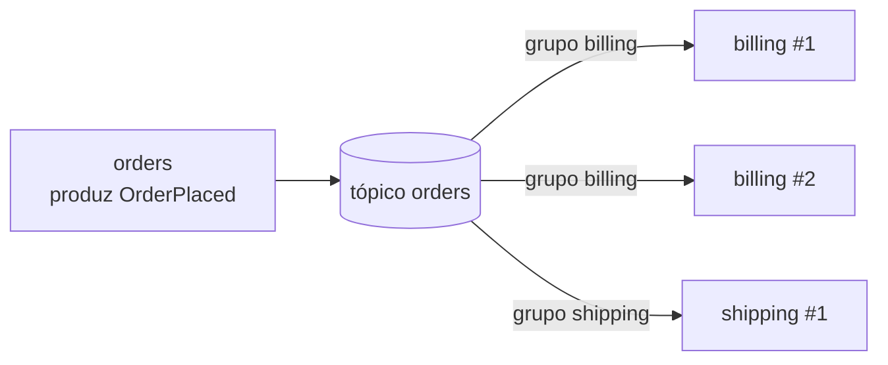
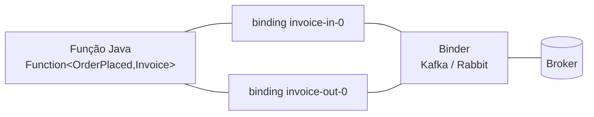

# Mensageria com Spring Cloud Stream (Kafka e RabbitMQ)

> **Resumo:** comunicação assíncrona entre serviços por meio de um *broker*. O Spring Cloud Stream expõe o broker como funções Java (`Supplier`, `Function`, `Consumer`) ligadas a *bindings*, e um *binder* traduz isso para Kafka, RabbitMQ e outros. O arquivo explica o modelo, as garantias de entrega, retry/DLQ e o que não é automático (idempotência, atomicidade com o banco).
> **Pré-requisitos:** [05-comunicacao-entre-servicos](05-comunicacao-entre-servicos.md), [06-resiliencia](06-resiliencia.md), [09-programacao-funcional](../01-java/09-programacao-funcional.md), [09-transacoes](../02-spring-core/09-transacoes.md), [08-eventos-validacao-e-conversao](../02-spring-core/08-eventos-validacao-e-conversao.md).
> **Versões:** Spring Cloud Stream 5.0.4 (train 2025.1.4), Spring Boot 4.1.2, Spring Framework 7.0.10, Java 25; broker Kafka (`apache/kafka:latest`, imagem de 2026-06) e RabbitMQ 4 (`rabbitmq:4-management-alpine`) em Docker. Executado em `/tmp/validacao/s11b`: `Function` + `Consumer` + `StreamBridge` sobre Kafka; retry e DLQ; o **mesmo código** trocando para o binder RabbitMQ. **Não executados:** Spring Kafka/Spring AMQP diretos, particionamento por chave, múltiplas instâncias do mesmo grupo, Kafka Streams binder, Outbox, schema registry.

## 1. Definição

**Mensageria** é a comunicação em que o emissor entrega uma mensagem a um intermediário (o *broker*) e segue em frente; um ou mais receptores a processam depois. Em relação à chamada síncrona de [05](05-comunicacao-entre-servicos.md):

| Aspecto | Síncrono (REST) | Assíncrono (mensagem) |
|---|---|---|
| Acoplamento temporal | chamador espera o chamado | chamador não espera nem precisa que o receptor esteja no ar |
| Acoplamento de conhecimento | sabe **quem** chamar | sabe **o que** aconteceu (um evento num tópico) |
| Falha do destino | propaga ao chamador ([06](06-resiliencia.md)) | a mensagem fica no broker até ser consumida |
| Resposta | imediata | indireta (outro evento) |
| Complexidade operacional | baixa | maior: broker, ordenação, duplicatas, consistência eventual |

Dois vocabulários aparecem e convém separar:

- **Comando** ("cobrar pedido 7"): dirigido a um destinatário, espera-se que um serviço o execute.
- **Evento** ("pedido 7 foi criado"): fato passado, publicado sem saber quem escuta; zero ou mais interessados.

## 2. Conceitos fundamentais

### 2.1 Os dois modelos de broker

| | **Fila** (RabbitMQ, modelo AMQP) | **Log distribuído** (Kafka) |
|---|---|---|
| Unidade | mensagem na fila; removida após o *ack* | registro num **log** particionado; retido por tempo/tamanho |
| Roteamento | *exchange* → *binding* → fila (direct, topic, fanout) | tópico → partições |
| Vários consumidores | cada fila recebe uma cópia; consumidores de uma fila competem | cada **grupo** lê o tópico inteiro; dentro do grupo, cada partição vai a um consumidor |
| Reler mensagens antigas | não (já foi consumida) | sim (reposicionar o *offset*) |
| Ordem | por fila, enquanto houver um consumidor | **por partição** |
| Ponto forte | roteamento flexível, baixa latência por mensagem | alta vazão, replay, *event streaming* |

### 2.2 Consumer group

Conceito central nos dois modelos do Stream. Instâncias que compartilham o mesmo `group` formam **um consumidor lógico**: cada mensagem é entregue a **uma** instância do grupo. Grupos distintos recebem **cada um** todas as mensagens.



`billing #1` e `#2` dividem as mensagens (escala horizontal); `shipping` recebe todas (outro interessado). Um consumidor **sem grupo** é "anônimo": recebe só mensagens publicadas depois que subiu, e some quando cai. Em produção, defina sempre o grupo.

### 2.3 O modelo do Spring Cloud Stream



- **Função** (`java.util.function`): o código de negócio. Um `Consumer<T>` só consome; um `Supplier<T>` produz periodicamente; um `Function<T,R>` consome e produz.
- **Binding:** o nome ligando a função a um destino. Por convenção: `<função>-in-<índice>` e `<função>-out-<índice>`. Uma função `invoice` tem `invoice-in-0` e `invoice-out-0`.
- **Destination:** tópico (Kafka) ou exchange (Rabbit) que o binding usa. É a propriedade `destination`.
- **Binder:** a implementação para um broker específico. O código não importa classe de Kafka ou Rabbit; trocar o broker é trocar a dependência e a configuração.
- **`StreamBridge`:** quando a produção é imperativa (um controller que publica após receber uma requisição), `bridge.send("orders-out", payload)`.

## 3. Como funciona por dentro

### 3.1 Da função à mensagem

O Stream se apoia em duas bibliotecas: o **Spring Cloud Function** (descobre e compõe as funções; `spring.cloud.function.definition` lista quais ligar) e o **Spring Integration** (canais e *adapters* de entrada/saída). Para cada binding ele cria:

1. um canal (`MessageChannel`);
2. um adapter do binder (para Kafka, `KafkaMessageDrivenChannelAdapter` sobre um `KafkaMessageListenerContainer` do Spring Kafka; para Rabbit, o equivalente do Spring AMQP);
3. um conversor de mensagem, que usa o `contentType` (padrão `application/json`) para transformar `byte[]` ↔ objeto Java.

O log do teste mostra exatamente isso: `KafkaMessageDrivenChannelAdapter started`, `billing: partitions assigned: [orders-0]`. Ou seja, **o Stream é uma camada fina sobre Spring Kafka/Spring AMQP + Spring Integration**; os conceitos e as propriedades nativas continuam existindo (`spring.cloud.stream.kafka.*`, `spring.cloud.stream.rabbit.*`).

### 3.2 O que o binder provisiona

Ao subir, o binder cria o que falta: tópico Kafka (partições e réplicas configuráveis), ou exchange + fila + *binding* no Rabbit. Medido com os mesmos bindings:

| Elemento | Kafka | RabbitMQ |
|---|---|---|
| `destination: orders` | tópico `orders` (1 partição por padrão) | exchange `orders` do tipo `topic` |
| `group: billing` | consumer group `billing` | fila `orders.billing` ligada ao exchange |
| DLQ | tópico `orders-billing-dlq` (nome definido por `dlq-name`) | fila `orders.billing.dlq` |

Nota do teste: o Stream traz o **Spring WebFlux** de forma transitiva (`spring-boot-webflux`, `reactor-netty-http` no JAR, verificado); a aplicação de teste, sem nenhuma dependência web declarada, subiu um **Netty na porta 8080**. Se o serviço não deve expor HTTP, defina `spring.main.web-application-type=none`.

### 3.3 Entrega, ack e as três garantias

| Semântica | Significado | Como ocorre |
|---|---|---|
| *at-most-once* | pode perder, nunca duplica | ack antes de processar |
| **at-least-once** | nunca perde, pode duplicar | ack **depois** de processar; falha antes do ack → reentrega |
| *exactly-once* | processada uma vez | só dentro de um sistema fechado (ex.: Kafka transações *consume-process-produce*); entre sistemas diferentes é efeito de at-least-once + idempotência |

O padrão do Stream com o binder Kafka é **at-least-once**: o *offset* só é confirmado quando o handler termina sem erro. Consequência prática: **todo consumidor precisa ser idempotente** (processar duas vezes a mesma mensagem não pode causar efeito duplo), por exemplo guardando o `eventId` já tratado, ou usando operações naturalmente idempotentes (`UPSERT`).

### 3.4 Retry e DLQ

Se a função lança exceção, o Stream por padrão tenta de novo localmente (`consumer.max-attempts`, padrão 3, com `back-off-*`). Esgotadas as tentativas:

- sem DLQ configurada: a mensagem é descartada com log de erro (Kafka segue o próximo *offset*; o evento se perde);
- com DLQ (`enable-dlq` no Kafka, `auto-bind-dlq` no Rabbit): a mensagem vai a uma fila/tópico de "mensagens mortas", com cabeçalhos que explicam a falha, para inspeção e reprocessamento.

Saída real do teste (pedido 2 falha sempre, `max-attempts: 3`, `back-off-initial-interval: 200`):

```text
tentativa 1 do pedido 2 -> exceção
[audit ...] Invoice[orderId=1, ...]
tentativa 2 do pedido 2 -> exceção
tentativa 3 do pedido 2 -> exceção
ERROR ... Retry policy for operation '...' exhausted; aborting execution
[audit ...] Invoice[orderId=3, ...]
```

Duas observações. (1) O pedido 3 foi processado **depois** da falha do 2: com DLQ, uma mensagem "venenosa" não bloqueia a partição. (2) A exceção `org.springframework.core.retry.RetryException` indica que o mecanismo de retry agora é o do **core do Framework 7**, em vez da biblioteca Spring Retry ([06 §3.4](06-resiliencia.md)).

Cabeçalhos da mensagem na DLQ do Kafka (lidos com `kafka-console-consumer`): `x-original-topic: orders`, `x-original-partition`, `x-original-offset`, `x-original-timestamp`, `x-exception-fqcn`, `x-exception-message`, `x-exception-stacktrace`, `x-original-timestamp-type` (lista completa observada no teste).

### 3.5 Ordem e partições (Kafka)

A ordem é garantida **dentro de uma partição**. Para que eventos do mesmo pedido cheguem em ordem, devem ir à mesma partição, isto é, ter a mesma **chave**. O Stream configura isso com `producer.partition-key-expression` (ex.: `headers['orderId']`) e `partition-count`. Mais partições = mais consumidores paralelos úteis, mas o paralelismo máximo de um grupo é o número de partições. **Não executado** aqui; descrito pela documentação.

## 4. Evolução histórica

| Época | Marco |
|---|---|
| 2007 | RabbitMQ (AMQP 0-9-1); JMS já era o padrão Java EE de filas |
| 2011 | Kafka nasce no LinkedIn (open source), log distribuído |
| 2016 | Spring Cloud Stream 1.0, com `@EnableBinding`, `@StreamListener`, `@Input`/`@Output` |
| 2019 | modelo **funcional** (`Function`/`Consumer`/`Supplier`) introduzido e passa a ser o recomendado (Stream 3.x) |
| 2021–2022 | modelo anotado **removido** (Stream 4.0, junto com o Boot 3) |
| 2025 | Stream 5.0 no train 2025.1: Boot 4, Framework 7 e retry do core |

Datas de memória: ⚠️ VERIFICAR. Código antigo com `@EnableBinding`/`@StreamListener` **não compila** nas versões atuais; migrar para beans funcionais.

## 5. Exemplos práticos

### 5.1 Projeto mínimo: dependências

```xml
<dependency>
  <groupId>org.springframework.cloud</groupId>
  <artifactId>spring-cloud-stream-binder-kafka</artifactId>
</dependency>
<!-- ou spring-cloud-stream-binder-rabbit; com os dois, defina default-binder -->
```

### 5.2 Processador + consumidor + produção imperativa

Domínio do sistema de pedidos: o serviço de pedidos publica `OrderPlaced`; `billing` gera `Invoice`; `audit` registra.

```java
@SpringBootApplication
public class App {

    record OrderPlaced(long orderId, String customer, long cents) {}
    record Invoice(long orderId, String text) {}

    // Lê de "orders", escreve em "invoices"
    @Bean
    Function<OrderPlaced, Invoice> invoice() {
        return o -> new Invoice(o.orderId(),
            "NF para " + o.customer() + " R$" + o.cents() / 100.0);
    }

    // Só consome "invoices"
    @Bean
    Consumer<Invoice> audit() {
        return i -> System.out.println("[audit] " + i);
    }

    // Publicação imperativa (por exemplo, dentro de um controller/serviço)
    @Bean
    CommandLineRunner send(StreamBridge bridge) {
        return args -> bridge.send("orders-out", new OrderPlaced(1, "ana", 1000));
    }
}
```

```yaml
spring:
  cloud:
    function:
      definition: invoice;audit        # quais funções ligar (separadas por ;)
    stream:
      default-binder: kafka
      bindings:
        invoice-in-0:  { destination: orders,   group: billing }
        invoice-out-0: { destination: invoices }
        audit-in-0:    { destination: invoices, group: audit }
        orders-out:    { destination: orders }     # StreamBridge: nome livre
      kafka:
        binder:
          brokers: localhost:9092
```

Saída real:

```text
enviado 1 ok=true
[audit KafkaConsumerDestination{...}.container-0-C-1] Invoice[orderId=1, text=NF para ana R$10.0]
```

Veja que `orders-out` não é uma função: é um nome livre usado pelo `StreamBridge`, e o binding é criado sob demanda.

### 5.3 Retry e DLQ

```yaml
spring.cloud.stream:
  bindings:
    invoice-in-0:
      destination: orders
      group: billing
      consumer: { max-attempts: 3, back-off-initial-interval: 200 }
  kafka:
    bindings:
      invoice-in-0:
        consumer: { enable-dlq: true, dlq-name: orders-billing-dlq }
```

Para o Rabbit, o equivalente é `spring.cloud.stream.rabbit.bindings.invoice-in-0.consumer.auto-bind-dlq=true`. Resultado verificado: fila `orders.billing.dlq` com 1 mensagem (o pedido 2) e fila `orders.billing` vazia.

### 5.4 Trocar de broker sem mudar o código

Mesmo JAR, mesmos beans e bindings, executado com `--spring.cloud.stream.default-binder=rabbit`: a saída do `audit` foi idêntica, e o broker passou a ter o exchange `orders` (topic), o exchange `invoices`, as filas `orders.billing` e `invoices.audit` e a DLQ. A abstração cobre o essencial; **recursos específicos** (partições, *compaction*, *routing keys*, prioridade) continuam por propriedades de cada binder, e aí o código deixa de ser portável de fato.

### 5.5 Consistência entre banco e broker: Outbox (descrição)

Problema do *dual write*: salvar o pedido no banco **e** publicar `OrderPlaced` são duas operações em dois sistemas, sem transação comum. Se o commit ocorre e a publicação falha, o evento se perde; se publica e o commit falha, publica-se um evento falso.

Solução: o padrão **Transactional Outbox**. Na mesma transação do banco, grava-se o pedido **e** uma linha numa tabela `outbox`. Um processo separado (um *poller* ou *CDC*, como o Debezium) lê a tabela e publica no broker, marcando como enviado. A entrega é at-least-once, então o consumidor deve ser idempotente. Detalhes no arquivo de padrões ([07-padroes-de-microsservicos](../06-padroes-de-projeto/07-padroes-de-microsservicos.md)). **Não executado.**

## 6. Configurações e anotações relevantes

| Propriedade / API | Para que serve | Exemplo |
|---|---|---|
| `spring.cloud.function.definition` | funções a ligar a bindings | `invoice;audit` |
| `spring.cloud.stream.bindings.<b>.destination` | tópico/exchange | `orders` |
| `...bindings.<b>.group` | consumer group (fila durável) | `billing` |
| `...bindings.<b>.content-type` | formato (padrão JSON) | `application/json` |
| `...bindings.<b>.consumer.max-attempts` | tentativas locais antes de desistir | `3` |
| `...bindings.<b>.consumer.back-off-initial-interval` | espera inicial entre tentativas (ms) | `200` |
| `...bindings.<b>.consumer.concurrency` | threads por binding | `2` |
| `...bindings.<b>.producer.partition-key-expression` | chave para particionar | `headers['orderId']` |
| `spring.cloud.stream.default-binder` | binder padrão se houver mais de um | `kafka` |
| `spring.cloud.stream.kafka.binder.brokers` | endereços do Kafka | `localhost:9092` |
| `spring.cloud.stream.kafka.bindings.<b>.consumer.enable-dlq` / `dlq-name` | DLQ no Kafka | `true` / `orders-billing-dlq` |
| `spring.cloud.stream.rabbit.bindings.<b>.consumer.auto-bind-dlq` | DLQ no Rabbit | `true` |
| `StreamBridge#send(binding, payload)` | publicar imperativamente | ver 5.2 |
| `spring.main.web-application-type` | desligar o servidor web | `none` |

Propriedades do binder (`partition-key-expression`, `concurrency`) conferidas pela documentação, não executadas.

## 7. Quando usar e quando NÃO usar

| Situação | Recomendação |
|---|---|
| Notificar vários serviços de um fato ("pedido criado") | evento + mensageria |
| Trabalho demorado que o usuário não espera | fila de tarefas |
| Absorver picos de carga (buffer entre serviços) | broker |
| Integrar sistemas com disponibilidades diferentes | mensageria |
| Precisa da resposta agora, para continuar o fluxo | chamada síncrona (com [resiliência](06-resiliencia.md)) |
| Consistência imediata e forte entre dois serviços | mensageria **não** dá isso (é eventual) |
| Equipe pequena, um único serviço, sem necessidade de desacoplar | **evite**: um broker é mais uma peça a operar |
| Só quer eventos dentro de uma aplicação | `ApplicationEventPublisher` ([08](../02-spring-core/08-eventos-validacao-e-conversao.md)) ou Spring Modulith |

**Stream vs Spring Kafka/Spring AMQP direto:** o Stream vale pelo modelo uniforme, pela troca de broker e pela configuração declarativa. Quando o time usa só Kafka e precisa de controle fino (transações, `ConsumerRebalanceListener`, `@KafkaListener` com tudo), usar o Spring Kafka diretamente costuma ser mais claro; é uma escolha legítima e muito comum.

## 8. Erros comuns e boas práticas

- **Não definir `group`.** O consumidor vira anônimo: perde mensagens enquanto estiver fora e, com réplicas, cada uma recebe a sua cópia (processamento duplicado).
- **Consumidor não idempotente** sob at-least-once → efeitos duplicados (duas cobranças). Guarde o id do evento.
- **Sem DLQ.** Uma mensagem inválida some após as tentativas (ou bloqueia a partição). Configure DLQ e monitore-a.
- **Retry infinito em erro permanente.** Erros de dados (JSON inválido, regra de negócio) não se resolvem com retry; mande direto à DLQ. Reserve o retry a falhas transitórias.
- **Publicar após commit sem Outbox** (dual write) → eventos perdidos ou fantasmas.
- **Eventos como "DTOs de tabela".** Exponha fatos do domínio estáveis e versionados (`OrderPlaced` v1), não a estrutura interna. Mudanças incompatíveis exigem versionamento ou *schema registry* (Avro/Protobuf/JSON Schema).
- **Esperar ordem global.** Só há ordem por partição (Kafka) ou por fila com um consumidor (Rabbit).
- **Ligar duas dependências de binder sem `default-binder`.** O Stream não sabe qual usar e falha na inicialização.
- **Confiar que `ok=true` do `StreamBridge` é entrega ao consumidor.** Só indica que a mensagem foi aceita para envio; o consumo é outro assunto.
- **Mensagens grandes** no broker. Envie uma referência (URL/id) e deixe o conteúdo em armazenamento.

## 9. Perguntas de revisão

1. O que é um *consumer group* e o que muda quando dois grupos leem o mesmo tópico?
<details><summary>Resposta</summary>Instâncias do mesmo grupo dividem as mensagens (cada mensagem vai a uma delas), o que permite escalar horizontalmente. Grupos diferentes recebem, cada um, todas as mensagens. Por isso <code>billing</code> e <code>shipping</code> processam todos os pedidos, mas as réplicas de <code>billing</code> dividem o trabalho.</details>

2. Qual a garantia de entrega padrão e que cuidado ela impõe ao consumidor?
<details><summary>Resposta</summary>At-least-once: a confirmação (ack/offset) só ocorre após o processamento. Uma falha antes do ack causa reentrega, então a mensagem pode chegar mais de uma vez. O consumidor deve ser idempotente.</details>

3. O que acontece com uma mensagem que falha em todas as tentativas, com e sem DLQ?
<details><summary>Resposta</summary>Sem DLQ ela é descartada após logar o erro (o consumo segue adiante). Com DLQ ela é enviada a um tópico/fila de mensagens mortas, com cabeçalhos <code>x-exception-*</code> e <code>x-original-*</code>, para análise e reprocessamento, sem bloquear as seguintes.</details>

4. Por que o padrão Outbox existe?
<details><summary>Resposta</summary>Para evitar o dual write: gravar no banco e publicar no broker não é atômico. Grava-se o evento numa tabela <code>outbox</code> na mesma transação do dado de negócio, e outro processo publica depois (at-least-once).</details>

5. Como o Spring Cloud Stream permite trocar o Kafka pelo RabbitMQ, e onde essa portabilidade acaba?
<details><summary>Resposta</summary>O código usa apenas funções Java e bindings; o binder (dependência + propriedades) adapta ao broker. Acaba nos recursos específicos (partições, routing keys, compaction, prioridade), que dependem de propriedades de cada binder.</details>

## 10. Referências oficiais

- Spring Cloud Stream: <https://docs.spring.io/spring-cloud-stream/reference/>
- Spring Cloud Function: <https://docs.spring.io/spring-cloud-function/reference/>
- Spring for Apache Kafka: <https://docs.spring.io/spring-kafka/reference/>
- Spring AMQP: <https://docs.spring.io/spring-amqp/reference/>
- Apache Kafka: <https://kafka.apache.org/documentation/>
- RabbitMQ: <https://www.rabbitmq.com/docs>
- Padrões *Transactional Outbox*, *Saga*, *Event-driven architecture*: <https://microservices.io/patterns/>
- Anterior: [06-resiliencia](06-resiliencia.md) · Próximo: [08-tracing-distribuido](08-tracing-distribuido.md)
