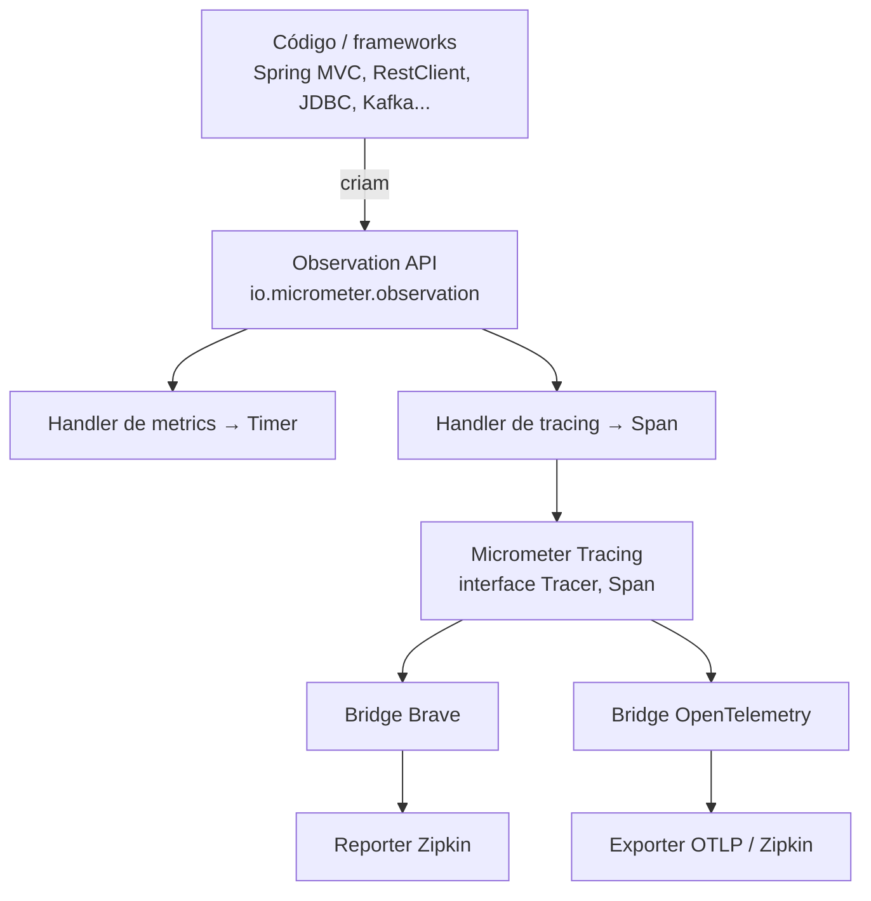

# Tracing Distribuído: Micrometer Tracing, OpenTelemetry e Zipkin

> **Resumo:** como seguir **uma** requisição por vários serviços. Cobre trace, span e propagação de contexto, a Observation API do Micrometer, as duas famílias de bridge (Brave/Zipkin e OpenTelemetry) e a correlação com logs. Substitui o Spring Cloud Sleuth.
> **Pré-requisitos:** [09-actuator-e-observabilidade](../03-spring-boot/09-actuator-e-observabilidade.md), [05-comunicacao-entre-servicos](05-comunicacao-entre-servicos.md), [04-web-mvc](../03-spring-boot/04-web-mvc.md), [07-aop-e-proxies](../02-spring-core/07-aop-e-proxies.md).
> **Versões:** Spring Boot 4.1.2 (Micrometer Tracing, `spring-boot-starter-zipkin` baseado em Brave, `spring-boot-starter-opentelemetry`), Java 25. Executado em `/tmp/validacao/s11c`: dois serviços (`orders` → `catalog`) com `spring-boot-starter-zipkin` enviando a um Zipkin real (Docker `openzipkin/zipkin`): spans, `traceId` nos logs, propagação por `traceparent` e `b3`, `Observation` manual. **Não executados:** exportação OTLP com o `spring-boot-starter-opentelemetry` (só verificadas as dependências do starter), `@Observed`/`@NewSpan`, baggage, mensageria instrumentada, amostragem em produção.

## 1. Definição

Em um monólito, um *stack trace* e um log mostram o que aconteceu numa requisição. Com microsserviços, uma ação do usuário ("ver pedido 7") atravessa gateway, `orders` e `catalog`, cada um com seu log em uma máquina. Perguntas como "por que essa requisição levou 3 s?" ou "qual serviço falhou?" ficam sem resposta se não houver um **identificador comum** e **medição de tempo por etapa**. Tracing distribuído é isso.

Vocabulário:

| Termo | Significado |
|---|---|
| **Trace** | a história inteira de uma requisição; identificada por um `traceId` único |
| **Span** | uma etapa dentro do trace (uma chamada HTTP, uma query, um método); tem `spanId`, início, duração, tags |
| **Parent span** | o span que originou outro; formam uma **árvore** |
| **Propagação de contexto** | transportar `traceId`/`spanId` de um processo ao seguinte (em cabeçalhos HTTP ou mensagens) |
| **Amostragem** (*sampling*) | decidir quais traces serão registrados (100% é caro em tráfego alto) |
| **Baggage** | pares chave-valor que viajam junto com o contexto (ex.: `tenantId`) |

Os três pilares da observabilidade são **logs**, **métricas** e **traces**; o trace é o que liga os dois outros a uma requisição específica.

## 2. Conceitos fundamentais

### 2.1 Anatomia de um trace

Medido nos dois serviços de teste (uma chamada `GET /orders/7`):

```text
traceId 6aebb36f…
└─ orders   SERVER  http get /orders/{id}          306 ms
   └─ orders   CLIENT  http get                       234 ms
      └─ catalog  SERVER  http get /products/{id}       104 ms
         └─ catalog  (interno) catalog.lookup             52 ms
```

```mermaid
sequenceDiagram
    participant U as Cliente
    participant O as orders
    participant C as catalog
    participant Z as Zipkin
    U->>O: GET /orders/7
    Note over O: abre span SERVER (traceId novo)
    O->>C: GET /products/7 + cabeçalho traceparent
    Note over C: lê o cabeçalho; abre span SERVER<br/>com o MESMO traceId
    C-->>O: 200
    O-->>U: 200
    O--)Z: envia spans (assíncrono)
    C--)Z: envia spans (assíncrono)
```

Cada serviço envia seus spans **separadamente** e **depois** (assíncrono) ao coletor, que os reúne pelo `traceId`. O tempo do span CLIENT (234 ms) é maior que o do SERVER correspondente (104 ms): a diferença é rede, serialização e *overhead* do cliente. É assim que o tracing mostra **onde** a latência está.

### 2.2 Propagação de contexto

O contexto precisa atravessar a fronteira de processo. Por HTTP, vai em cabeçalhos; os formatos mais comuns:

| Formato | Cabeçalho | Observação |
|---|---|---|
| **W3C Trace Context** | `traceparent: 00-<traceId>-<spanId>-<flags>` | padrão do W3C; é o padrão do Boot atual |
| **B3** (Zipkin) | `b3: <traceId>-<spanId>-<sampled>` (ou `X-B3-*`) | formato histórico do Zipkin |

Teste feito: uma chamada direta ao `catalog` com `traceparent: 00-0af7651916cd43dd8448eb211c80319c-…-01` fez o log do `catalog` mostrar o `traceId` `0af7651916cd43dd8448eb211c80319c`; outra, com `b3: 0af7…319d-…-1`, também foi aceita (log com `…319d`). Ou seja, o serviço **consumiu** os dois formatos. O formato **emitido** é configurado em `management.tracing.propagation.produce` ⚠️ VERIFICAR nomes exatos das propriedades de propagação no Boot 4.1.

### 2.3 Observation API: instrumentar uma vez, obter três sinais

Desde o Spring Framework 6 / Boot 3, a instrumentação passa pela **Observation API** do Micrometer (`io.micrometer.observation`). Uma *observation* é "algo que aconteceu e que vale medir"; *handlers* a transformam em **métrica** (timer), **span** (tracing) e **log**. Quem escreve o código (ou o próprio Spring, no `RestClient`, no MVC, em JDBC etc.) cria a observation uma única vez; a configuração decide o que exportar.

Isso resolve o problema do **Sleuth**: instrumentação dependente de uma biblioteca de tracing específica. Com a Observation API, o código não conhece Brave nem OpenTelemetry.

## 3. Como funciona por dentro

### 3.1 As camadas



- **Micrometer Tracing** é uma *fachada* (`Tracer`, `Span`, `Propagator`) independente de implementação, na mesma ideia do SLF4J para logs.
- O **bridge** liga a fachada à biblioteca real: **Brave** (do Zipkin) ou **OpenTelemetry** (padrão da CNCF).
- O **exportador** envia ao backend (Zipkin, Jaeger, Tempo, um Collector OTLP, fornecedores de APM).

### 3.2 Como o Spring injeta o trace nas chamadas

O Boot registra *ObservationConventions* e *customizers* nos pontos de entrada/saída:

- **Entrada HTTP (MVC):** um filtro/observation abre o span SERVER; se houver `traceparent`/`b3`, usa o `traceId` recebido, senão cria um.
- **Saída HTTP:** os clientes criados a partir do `RestClient.Builder`/`RestTemplateBuilder`/`WebClient.Builder` **do Boot** recebem um interceptor de observation, que abre o span CLIENT e **escreve o cabeçalho** na requisição.
- **Logs:** o span corrente é colocado no **MDC** (`traceId`, `spanId`); o padrão de log do Boot inclui `[traceId-spanId]` quando há tracing no classpath. Linha real do teste:

```text
INFO 93263 --- [orders]  [nio-8081-exec-1] [6aebb36f…cc87b-d0358a5f906cc87b] app.Ctl : buscando pedido 7
INFO 93262 --- [catalog] [nio-8082-exec-1] [6aebb36f…cc87b-77c7e5ea3e05b27b] app.Ctl : produto 7
```

O mesmo `traceId` nos dois serviços permite buscar uma requisição inteira em qualquer ferramenta de logs centralizados com um único filtro.

### 3.3 O contexto fica numa `ThreadLocal`

O span corrente vive no contexto da thread (via MDC/`ThreadLocal`, ou `Context` do OpenTelemetry). Daí as consequências já conhecidas de [12-concorrencia](../01-java/12-concorrencia.md) e [05-webflux](../03-spring-boot/05-webflux-e-reativo.md):

- trocar de thread (`@Async`, `CompletableFuture`, um `ExecutorService` próprio) **perde** o contexto, a menos que o executor seja instrumentado (o Boot instrumenta o `TaskExecutor` que ele mesmo configura, ⚠️ VERIFICAR para `@Async` no 4.1);
- no modelo reativo, o contexto viaja pelo `Context` do Reactor, com a propagação automática ligada via `Hooks`/`context-propagation`.

### 3.4 Amostragem

Gerar e exportar 100% dos traces em sistemas de alto tráfego é caro. A decisão de amostrar é tomada **na origem** (o primeiro serviço) e propagada no flag `sampled` do cabeçalho, para que o trace seja completo ou inexistente, nunca pela metade. No Boot: `management.tracing.sampling.probability` (padrão **0.1**, ou seja, 10%, ⚠️ VERIFICAR). Nos testes usamos `1.0` para ver tudo.

## 4. Evolução histórica

| Época | Marco |
|---|---|
| 2010 | Paper do **Google Dapper** descreve o tracing distribuído |
| 2012 | Twitter publica o **Zipkin**; o formato B3 vem dele |
| 2016–2022 | **Spring Cloud Sleuth** instrumenta aplicações Spring (Brave por baixo) |
| 2019 | OpenTracing + OpenCensus se fundem no **OpenTelemetry** |
| 2022 | Spring Boot 3 / Framework 6: **Micrometer Tracing** e Observation API **substituem o Sleuth**, que deixa de ser mantido no train 2022.0 |
| 2023+ | OpenTelemetry vira o padrão de fato; Boot passa a ter suporte direto a OTLP |
| 2025 | Boot 4: starters dedicados (`-zipkin`, `-opentelemetry`), módulos separados |

Datas de memória: ⚠️ VERIFICAR. Importante: projetos com `spring-cloud-starter-sleuth` **não migram sozinhos**; as propriedades `spring.sleuth.*` deixam de existir.

## 5. Exemplos práticos

### 5.1 Dois serviços com Zipkin (Brave)

Dependências em cada serviço (Boot 4.1):

```xml
<dependency><groupId>org.springframework.boot</groupId><artifactId>spring-boot-starter-actuator</artifactId></dependency>
<dependency><groupId>org.springframework.boot</groupId><artifactId>spring-boot-starter-zipkin</artifactId></dependency>
```

O `spring-boot-starter-zipkin` traz `micrometer-tracing-bridge-brave` e o módulo `spring-boot-zipkin` (verificado no POM do 4.1.2).

```yaml
spring.application.name: orders        # o nome vira o "serviço" no Zipkin
management:
  tracing.sampling.probability: 1.0    # só para estudo
  zipkin.tracing.export.endpoint: http://localhost:9411/api/v2/spans
```

Subir o Zipkin: `docker run -d -p 9411:9411 openzipkin/zipkin`. O controller de `orders` chama `catalog` usando o `RestClient.Builder` **injetado** (não `RestClient.create()`):

```java
@RestController
class Ctl {
    private final RestClient http;
    Ctl(RestClient.Builder builder) {                      // builder do Boot = instrumentado
        this.http = builder.baseUrl("http://localhost:8082").build();
    }
    @GetMapping("/orders/{id}")
    Map<String, Object> order(@PathVariable long id) {
        var p = http.get().uri("/products/{id}", id).retrieve().body(Map.class);
        return Map.of("orderId", id, "product", p);
    }
}
```

Depois de `curl localhost:8081/orders/7`, a API do Zipkin (`/api/v2/traces?serviceName=orders`) devolveu os 4 spans da seção 2.1, todos com o mesmo `traceId`, e a interface web em `http://localhost:9411` os mostra como linha do tempo.

### 5.2 Span manual com a Observation API

```java
@GetMapping("/products/{id}")
Map<String, Object> product(@PathVariable long id) {
    return Observation.createNotStarted("catalog.lookup", registry)   // ObservationRegistry injetado
        .lowCardinalityKeyValue("kind", "db")
        .observe(() -> loadProduct(id));                                // vira span + timer
}
```

O span `catalog.lookup` apareceu como filho do SERVER `catalog` (52 ms, por causa do `sleep(50)` do teste). Regra de tags: **baixa cardinalidade** (`lowCardinalityKeyValue`) vai para métricas e spans; valores com milhões de possibilidades (id de usuário) usam `highCardinalityKeyValue` e só vão para o trace, senão o armazenamento de métricas explode.

### 5.3 OpenTelemetry (OTLP)

O caminho alternativo é `spring-boot-starter-opentelemetry`, que no 4.1.2 depende de (conferido no POM): `micrometer-tracing-bridge-otel`, `opentelemetry-exporter-otlp`, `micrometer-registry-otlp` e módulos `spring-boot-opentelemetry` e `spring-boot-micrometer-tracing-opentelemetry`. Isso exporta **traces e métricas** em OTLP para um *OpenTelemetry Collector* (que depois encaminha a Tempo, Jaeger, Zipkin, etc.). O endpoint é configurado em propriedades `management.opentelemetry.*`/`management.otlp.*` ⚠️ VERIFICAR nomes exatos. **Não executado.**

Escolha prática:

| Critério | Brave + Zipkin | OpenTelemetry + OTLP |
|---|---|---|
| Simplicidade para estudo | maior (um contêiner) | exige Collector/backend OTLP |
| Padrão do mercado | legado, estável | **padrão da indústria** |
| Interoperabilidade (APMs, Tempo, Jaeger) | via adaptadores | nativa |
| Instrumentação automática por *agent* Java | não | sim (OTel Java agent) |

Projeto novo: OpenTelemetry. Quem já tem Zipkin em produção: Brave continua suportado.

### 5.4 Spring Cloud Gateway e Spring Cloud LoadBalancer

O Gateway e o LoadBalancer também são observáveis pela Observation API. Para que o trace **continue** através do gateway, ele precisa receber e reenviar o `traceparent`, o que o Boot faz se o tracing estiver no classpath do gateway. **Não executado** ([04-api-gateway](04-api-gateway.md)).

## 6. Configurações e anotações relevantes

| Item | Para que serve | Exemplo |
|---|---|---|
| `spring-boot-starter-zipkin` | tracing com Brave + exportador Zipkin | dependência |
| `spring-boot-starter-opentelemetry` | tracing/métricas OpenTelemetry (OTLP) | dependência |
| `management.tracing.sampling.probability` | fração de traces registrados | `1.0` (estudo), `0.1` (produção típica) |
| `management.zipkin.tracing.export.endpoint` | URL de envio ao Zipkin | `http://localhost:9411/api/v2/spans` |
| `management.tracing.propagation.*` | formatos de propagação | W3C / B3 ⚠️ VERIFICAR |
| `spring.application.name` | nome do serviço nos traces e logs | `orders` |
| `ObservationRegistry` | criar observations manuais | `Observation.createNotStarted(...)` |
| `Tracer` (`io.micrometer.tracing`) | acessar o span atual | `tracer.currentSpan().context().traceId()` |
| `@Observed` | observar um método (precisa de AOP) | `@Observed(name = "x")` ⚠️ VERIFICAR |
| `logging.pattern.correlation` | trecho `[traceId-spanId]` dos logs | padrão do Boot |

O `@Observed` exige o aspecto `ObservedAspect` e `spring-boot-starter-aspectj` (o starter existe no 4.1.2, o build do teste o resolveu); **o uso da anotação não foi executado**.

## 7. Quando usar e quando NÃO usar

| Situação | Recomendação |
|---|---|
| Mais de 2–3 serviços encadeados | tracing é essencial |
| Diagnóstico de latência e de falhas parciais | trace + log correlacionado |
| Monólito único | `traceId` em logs ainda ajuda, mas o exportador é opcional |
| Dados sensíveis em tags/baggage | **não** coloque (CPF, tokens): vão a sistemas externos |
| Tráfego muito alto, orçamento limitado | amostragem baixa + amostragem por cauda (*tail sampling*) no Collector |
| Ambiente com service mesh | o mesh gera spans de rede; combine com os da aplicação, sem duplicar |

Tracing **complementa**, não substitui, logs e métricas: métricas dizem *que* algo está lento, o trace diz *onde*, o log diz *por quê*.

## 8. Erros comuns e boas práticas

- **Cliente HTTP criado com `new`/`create()`** em vez do builder do Boot: sem interceptor, o trace **quebra** na chamada (o serviço seguinte abre um `traceId` novo).
- **Perder contexto ao trocar de thread** (`@Async` mal configurado, `ExecutorService` próprio). Use executores instrumentados ([12](../01-java/12-concorrencia.md)).
- **`sampling.probability=1.0` em produção** sob carga: custo alto de CPU, rede e armazenamento.
- **Tags de alta cardinalidade como baixa** → explosão de séries de métricas.
- **Dados pessoais em tags/baggage** → vazam para APMs.
- **Esquecer `spring.application.name`**: todos os serviços aparecem como `application`.
- **Misturar formatos de propagação** entre serviços (um só em B3, outro só em W3C): o trace se parte. Padronize, ou ative os dois no consumo.
- **Não fechar o círculo com os logs.** Confirme que o padrão de log contém o `traceId` e que a ferramenta de logs permite filtrá-lo.
- **Exportar de forma síncrona.** Os reporters padrão são assíncronos; se o Zipkin cair, os spans são perdidos, mas a aplicação não deve parar. Verifique logs de falha de envio.

## 9. Perguntas de revisão

1. Qual a diferença entre trace e span, e como se relacionam?
<details><summary>Resposta</summary>Trace é a história completa de uma requisição (um <code>traceId</code>); span é uma etapa dentro dela (com <code>spanId</code>, duração e tags). Os spans formam uma árvore pelo <code>parentId</code> e todos compartilham o <code>traceId</code>.</details>

2. Como o contexto passa de <code>orders</code> para <code>catalog</code>?
<details><summary>Resposta</summary>O cliente HTTP instrumentado (builder do Boot) escreve o cabeçalho <code>traceparent</code> (W3C) ou <code>b3</code> com o <code>traceId</code> e o <code>spanId</code> corrente; o servidor lê o cabeçalho e abre um span filho com o mesmo <code>traceId</code>.</details>

3. O que substituiu o Spring Cloud Sleuth e qual vantagem do novo modelo?
<details><summary>Resposta</summary>Micrometer Tracing + Observation API (Boot 3+). A instrumentação é feita uma vez via Observation API, independente da implementação; um bridge escolhe Brave ou OpenTelemetry, e as mesmas observations geram métricas, spans e logs.</details>

4. Por que um <code>RestClient</code> criado com <code>RestClient.create()</code> "quebra" o trace?
<details><summary>Resposta</summary>Porque não passou pelo <code>RestClient.Builder</code> configurado pelo Boot, que traz o interceptor de observation. Sem ele, o cabeçalho de propagação não é enviado e o serviço seguinte inicia um trace novo.</details>

5. Por que a amostragem é decidida no primeiro serviço e propagada?
<details><summary>Resposta</summary>Para que o trace seja completo ou inexistente. Se cada serviço decidisse por conta própria, traces ficariam pela metade. O flag <code>sampled</code> no cabeçalho informa os demais.</details>

## 10. Referências oficiais

- Spring Boot, Tracing: <https://docs.spring.io/spring-boot/reference/actuator/tracing.html> ⚠️ VERIFICAR o caminho exato
- Micrometer Tracing: <https://docs.micrometer.io/tracing/reference/>
- Micrometer Observation: <https://docs.micrometer.io/micrometer/reference/observation.html>
- OpenTelemetry: <https://opentelemetry.io/docs/>
- Zipkin: <https://zipkin.io/>
- W3C Trace Context: <https://www.w3.org/TR/trace-context/>
- Padrão *Distributed tracing*: <https://microservices.io/patterns/observability/distributed-tracing.html>
- Anterior: [07-mensageria](07-mensageria.md) · Próximo: [09-spring-cloud-e-kubernetes](09-spring-cloud-e-kubernetes.md)
