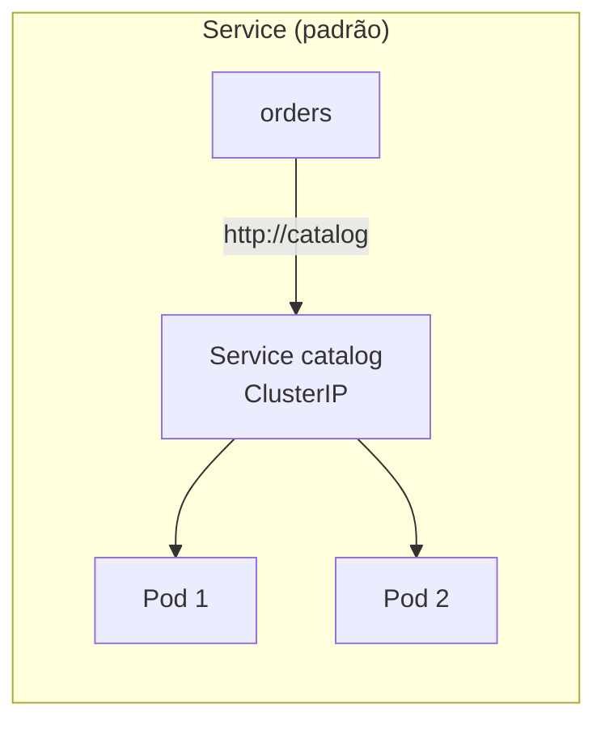

# Spring Cloud e Kubernetes

> **Resumo:** o Kubernetes já entrega boa parte do que o Spring Cloud resolveu para a era das VMs (descoberta, balanceamento, configuração, auto-recuperação). Este arquivo mostra o que a plataforma faz sozinha, o que o **Spring Cloud Kubernetes** adiciona (ConfigMap/Secret como propriedades, discovery pela API, reload) e como decidir entre as duas abordagens.
> **Pré-requisitos:** [01-visao-geral](01-visao-geral.md), [02-config-server](02-config-server.md), [03-service-discovery](03-service-discovery.md), [06-resiliencia](06-resiliencia.md), [13-empacotamento-e-deploy](../03-spring-boot/13-empacotamento-e-deploy.md), [09-actuator-e-observabilidade](../03-spring-boot/09-actuator-e-observabilidade.md).
> **Versões:** Spring Cloud Kubernetes 5.0.4 (train 2025.1.4), Boot 4.1.2, Java 25, imagem `eclipse-temurin:25-jre`, Kubernetes **v1.34.1** (k3s em Docker, nó único). Executado em `/tmp/validacao/s11d`: ConfigMap, Secret, reload por polling, `DiscoveryClient` pela API, probes, RBAC ausente e presente, Service/Deployment com 2 réplicas. **Não executados:** biblioteca Fabric8 (só a cliente oficial `client`), Discovery Server, Configuration Watcher, leader election, Istio, Helm, `LoadBalancer` do Spring Cloud em modo `POD`, Ingress, HPA.

## 1. Definição

Os componentes do Spring Cloud estudados até aqui (Eureka, Config Server, LoadBalancer do cliente, Gateway) nasceram quando não existia uma plataforma que os fornecesse. O **Kubernetes** (K8s) é essa plataforma: orquestra contêineres e oferece de fábrica quase tudo:

| Necessidade | Spring Cloud clássico | Kubernetes nativo | Spring Cloud Kubernetes |
|---|---|---|---|
| Registro e descoberta | Eureka | **Service** + DNS (`http://catalog`) | `DiscoveryClient` lendo a API do K8s |
| Balanceamento | LoadBalancer no cliente (round-robin) | **kube-proxy** no ClusterIP (por conexão) | pode balancear no cliente, por Pod |
| Configuração central | Config Server | **ConfigMap** / **Secret** | ConfigMap/Secret viram `PropertySource` |
| Atualização de config | `/actuator/refresh` / Bus | reiniciar Pods (rollout) | reload automático (polling/eventos) |
| Saúde | health + Eureka heartbeat | **probes** liveness/readiness | integra Actuator às probes |
| Auto-recuperação, escala | — | Deployment, ReplicaSet, HPA | — |
| Gateway/entrada | Spring Cloud Gateway | Ingress / Gateway API | — |

A pergunta de arquitetura: **usar o Spring Cloud tradicional, o Spring Cloud Kubernetes ou somente Kubernetes puro?** A seção 7 responde.

## 2. Conceitos fundamentais

### 2.1 Os objetos de K8s que importam para uma aplicação Spring

- **Pod:** a menor unidade; um ou mais contêineres, com IP próprio. Efêmero: morre e volta com outro IP.
- **Deployment / ReplicaSet:** mantém N réplicas do Pod e executa *rolling updates*.
- **Service:** nome DNS estável + IP virtual (ClusterIP) que balanceia entre os Pods selecionados por *label*. É o "registro de serviços" do K8s.
- **ConfigMap / Secret:** dados de configuração; entram no Pod como variáveis de ambiente, arquivos montados ou (com Spring Cloud Kubernetes) lidos pela API.
- **ServiceAccount + RBAC (Role/RoleBinding):** a identidade do Pod e o que ela pode fazer na API do cluster.
- **Probes:** `liveness` (reiniciar se travou), `readiness` (receber tráfego?) e `startup`.

### 2.2 O que o Spring Boot já faz sem biblioteca extra

1. **Configuração por variável de ambiente e arquivos montados.** Um ConfigMap exposto como variáveis (`SPRING_DATASOURCE_URL`) ou como arquivo em `/config/application.yaml` entra na ordem normal de precedência ([03-configuracao-externalizada](../03-spring-boot/03-configuracao-externalizada.md)), inclusive `spring.config.import=optional:configtree:/etc/secrets/` para Secrets montados como arquivos.
2. **Probes.** Em K8s o Boot detecta o ambiente (variáveis `KUBERNETES_SERVICE_HOST`, da documentação; no teste a propriedade foi ligada explicitamente) e habilita os grupos `liveness` e `readiness` do Actuator ([09-actuator](../03-spring-boot/09-actuator-e-observabilidade.md)).
3. **Graceful shutdown.** `server.shutdown=graceful` para encerrar sem derrubar requisições, combinado ao `preStop`/`terminationGracePeriodSeconds` do Pod.
4. **Chamadas entre serviços** pelo nome do Service: `RestClient` apontando para `http://catalog`, sem Eureka e sem LoadBalancer do Spring ([05](05-comunicacao-entre-servicos.md)).

Nada disso exige dependência de Spring Cloud. É o caminho recomendado como ponto de partida.

### 2.3 O que o Spring Cloud Kubernetes adiciona

| Módulo | Função |
|---|---|
| **Config** (`...-config`) | lê ConfigMaps e (opcionalmente) Secrets **pela API** e os registra como `PropertySource`, com perfis e *reload* |
| **Discovery** (`...-discovery`) | implementa `DiscoveryClient` sobre Services/Endpoints |
| **LoadBalancer** | balanceamento no cliente entre Pods (modo `POD`) ou usando o ClusterIP (modo `SERVICE`) |
| **Configuration Watcher** | serviço separado que observa mudanças e chama o `/actuator/refresh` das aplicações |
| **Discovery Server** | serviço que centraliza a leitura da API, para as aplicações não precisarem de RBAC |
| **Leader election** | eleição de líder entre réplicas usando recursos do K8s |

Há duas implementações do cliente da API: **Fabric8** (`...-fabric8-*`) e o **cliente Java oficial do Kubernetes** (`...-client-*`). Os exemplos aqui usam a segunda.

## 3. Como funciona por dentro

### 3.1 Config: da API ao `Environment`

Com `spring.config.import=optional:kubernetes:` o Boot dispara, durante a montagem do `Environment` ([05-configuracao](../02-spring-core/05-configuracao.md), [02-config-server §3](02-config-server.md)), o *loader* do Spring Cloud Kubernetes. Ele:

1. descobre o **namespace** (arquivo montado em `/var/run/secrets/kubernetes.io/serviceaccount/namespace`) e o token da ServiceAccount;
2. chama a API (`GET /api/v1/namespaces/<ns>/configmaps`) e seleciona o ConfigMap cujo nome é `spring.application.name` (padrão), ou os de `spring.cloud.kubernetes.config.name`/`sources`;
3. converte as chaves em propriedades: uma chave terminada em `.yaml`/`.yml`/`.properties` é interpretada como arquivo; as demais viram propriedades simples;
4. registra um `PropertySource` por ConfigMap/Secret.

Consequência: a aplicação precisa de **permissão RBAC** para `get/list/watch` dessas coisas. Sem ela, nada de configuração é lido (o `optional:` evita falha na partida) e, no teste, o log mostrou o erro explícito:

```text
ERROR ... ReflectorRunnable : class ...V1Service#Reflector loop failed unexpectedly
HTTP response body: {... "message":"services is forbidden: User \"system:serviceaccount:default:default\"
  cannot list resource \"services\" in API group \"\" in the namespace \"default\"" ...}
```

### 3.2 Reload

O reload **não é imediato por padrão**: `spring.cloud.kubernetes.reload.enabled=true` liga um detector, e a estratégia (`strategy`) define o efeito:

| `strategy` | Efeito |
|---|---|
| `refresh` (padrão) | atualiza o `Environment` e os beans `@ConfigurationProperties`/`@RefreshScope` ([01 §3](01-visao-geral.md)) |
| `restart_context` | reinicia o `ApplicationContext` inteiro |
| `shutdown` | encerra a JVM, para o K8s recriar o Pod |

E o **modo** de detecção (`mode`): `event` (padrão; observa a API, exige `watch`) ou `polling` (consulta a cada `period`, padrão 15 s). Defaults conferidos no metadado do JAR; `reload.enabled` é `false` por padrão. Segredos só são monitorados com `monitoring-secrets=true`.

### 3.3 Discovery: o que a API devolve

O `KubernetesClientDiscoveryClient` mantém *informers* (cache local alimentado por *watch*) de **Services** e **Endpoints**. Log real da partida: `Waiting for the cache of informers to be fully loaded… Cache fully loaded (total 3 services), discovery client is now available`. Um `getInstances("catalog")` devolve, por padrão, **uma instância por Service**, com o IP do ClusterIP e metadados como `type: ClusterIP`; o balanceamento fica com o kube-proxy. Para ver cada Pod (para balancear no cliente) usa-se o modo `POD` do LoadBalancer, ou `spring.cloud.kubernetes.discovery.use-endpoint-slices` (padrão `false`; usa EndpointSlices em vez de Endpoints, e por isso o `Role` do 5.3 inclui `endpointslices`).

### 3.4 Dois jeitos de balancear



O balanceamento por **conexão** do kube-proxy tem uma armadilha: conexões HTTP/2 e gRPC de vida longa (e *keep-alive* agressivo) ficam presas a um Pod, e a carga **não** se distribui entre requisições. Soluções: Service *headless* + balanceamento no cliente, ou um *service mesh*/proxy L7.

## 4. Evolução histórica

| Época | Marco |
|---|---|
| 2014 | Kubernetes liberado pelo Google (1.0 em 2015) |
| 2016–2017 | Spring Cloud Kubernetes surge como projeto da comunidade (Red Hat) |
| 2020 | Spring Cloud Kubernetes entra no release train oficial; Hystrix/Ribbon saem ([06](06-resiliencia.md)) |
| 2020+ | Boot 2.3 adiciona probes e *graceful shutdown* nativos |
| 2022 | Spring Cloud Kubernetes 3.0 (Boot 3): Fabric8 e cliente oficial como módulos paralelos |
| 2025 | Spring Cloud Kubernetes 5.0 no train 2025.1 (Boot 4, Framework 7) |

Datas de memória: ⚠️ VERIFICAR.

## 5. Exemplos práticos

Domínio: o serviço `orders` lê configuração e descobre `catalog`. Cluster de teste: k3s (Kubernetes 1.34.1) num contêiner Docker privilegiado, com `kubectl` por `docker exec`.

### 5.1 Dependências

```xml
<dependency>
  <groupId>org.springframework.cloud</groupId>
  <artifactId>spring-cloud-starter-kubernetes-client-config</artifactId>
</dependency>
<dependency>
  <groupId>org.springframework.cloud</groupId>
  <artifactId>spring-cloud-starter-kubernetes-client</artifactId>   <!-- discovery pela API -->
</dependency>
```

> **Achado:** o starter `spring-cloud-starter-kubernetes-discoveryclient` **não** é o discovery pela API: é o cliente do **Discovery Server** e falha na partida com `DiscoveryServerUrlInvalidException: 'spring.cloud.kubernetes.discovery.discovery-server-url' must be specified and be a valid URL`. Para ler a API diretamente use `...-client` (ou `...-client-all`, que inclui config, discovery e loadbalancer; verificado nos POMs 5.0.4).

### 5.2 Código e configuração

```java
@RestController
@RefreshScope
class Ctl {
    @Value("${greeting:default-do-codigo}") String greeting;
    @Value("${db.password:sem-senha}") String pwd;
    private final DiscoveryClient dc;
    Ctl(DiscoveryClient dc) { this.dc = dc; }

    @GetMapping("/cfg")
    Map<String, String> cfg() {
        return Map.of("greeting", greeting, "pwdLength", String.valueOf(pwd.length()),
                      "pod", System.getenv().getOrDefault("HOSTNAME", "?"));
    }
    @GetMapping("/services")
    List<String> services() { return dc.getServices(); }
}
```

```yaml
spring:
  application.name: orders
  config.import: "optional:kubernetes:"
  cloud.kubernetes:
    reload: { enabled: true, mode: polling, period: 5000 }
management:
  endpoint.health.probes.enabled: true
server.shutdown: graceful
```

### 5.3 Manifests (resumo)

```yaml
apiVersion: v1
kind: ConfigMap
metadata: { name: orders }            # mesmo nome de spring.application.name
data:
  application.yaml: |
    greeting: ola-do-configmap
---
apiVersion: v1
kind: Secret
metadata: { name: orders }
stringData: { db.password: super-secreta }
---
apiVersion: apps/v1
kind: Deployment
metadata: { name: orders }
spec:
  replicas: 2
  selector: { matchLabels: { app: orders } }
  template:
    metadata: { labels: { app: orders } }
    spec:
      containers:
      - name: orders
        image: orders-k8s:1
        ports: [{ containerPort: 8080 }]
        readinessProbe: { httpGet: { path: /actuator/health/readiness, port: 8080 } }
        livenessProbe:  { httpGet: { path: /actuator/health/liveness,  port: 8080 }, initialDelaySeconds: 20 }
---
apiVersion: v1
kind: Service
metadata: { name: orders }
spec: { selector: { app: orders }, ports: [{ port: 80, targetPort: 8080 }] }
```

RBAC mínimo (sem ele, ver 3.1):

```yaml
apiVersion: rbac.authorization.k8s.io/v1
kind: Role
metadata: { name: spring-cloud-reader }
rules:
- apiGroups: [""]
  resources: ["configmaps", "secrets", "services", "endpoints", "pods"]
  verbs: ["get", "list", "watch"]
- apiGroups: ["discovery.k8s.io"]
  resources: ["endpointslices"]
  verbs: ["get", "list", "watch"]
---
apiVersion: rbac.authorization.k8s.io/v1
kind: RoleBinding
metadata: { name: spring-cloud-reader }
subjects: [{ kind: ServiceAccount, name: default, namespace: default }]
roleRef: { kind: Role, name: spring-cloud-reader, apiGroup: rbac.authorization.k8s.io }
```

Em produção, prefira uma ServiceAccount dedicada e verbos/recursos mínimos (o exemplo usa a `default` por simplicidade).

### 5.4 O que foi observado

1. **Sem RBAC:** os Pods ficaram sem `READY`/reiniciando, com os erros `forbidden` do 3.1. Depois do `Role`/`RoleBinding`: 0 erros e `1/1 Running`. (Cada Pod `orders` registrou 1 reinício durante essa fase; a causa provável é a liveness com `initialDelaySeconds: 20` disparando enquanto a aplicação ainda lutava contra o RBAC, mas não foi isolada. Use `startupProbe` para partidas lentas.)
2. **ConfigMap:** `GET /cfg` (via Service, 4 chamadas) devolveu `greeting: ola-do-configmap`, alternando entre os dois Pods (`pod` diferente): o kube-proxy balanceou.
3. **Discovery:** `GET /services` → `["orders","kubernetes","catalog"]`; `GET /instances/catalog` → uma instância `10.42.0.7:8080` com metadado `ClusterIP`. Perceba que o próprio Service `kubernetes` do cluster aparece.
4. **Reload:** após `kubectl patch configmap orders …` com `greeting: mudou-sem-reiniciar`, em ~12 s as respostas passaram a mostrar o novo valor, **sem reiniciar os Pods** (`@RefreshScope` + polling de 5 s).
5. **Secret:** `pwdLength` continuou `9` (= `sem-senha`, o valor padrão): o Secret **não foi lido**. Tentativas com `SPRING_CLOUD_KUBERNETES_SECRETS_ENABLE_API` (e `ENABLEAPI`) não tiveram efeito, porque essa propriedade não existe mais. A correta, pelo metadado do JAR, é `spring.cloud.kubernetes.secrets.enabled` (padrão `false`). Com `SPRING_CLOUD_KUBERNETES_SECRETS_ENABLED=true`, `pwdLength` passou a `13` (`super-secreta`).

> **Segurança:** o motivo de Secrets virem desligados é que lê-los pela API exige RBAC sobre `secrets` e os mantém no `Environment` (podem aparecer em `/actuator/env`, mascarados, e em *heap dumps*). A alternativa mais segura e mais simples é **montar o Secret como arquivo** e usar `configtree:` ([03-configuracao-externalizada](../03-spring-boot/03-configuracao-externalizada.md)).

### 5.5 Dockerfile e imagem

O mesmo `Dockerfile` de [13-empacotamento-e-deploy](../03-spring-boot/13-empacotamento-e-deploy.md) (`eclipse-temurin:25-jre`, JAR copiado) foi usado; a imagem foi carregada no k3s com `docker save | ctr images import` e `imagePullPolicy: Never`. Em ambiente real a imagem vem de um *registry*.

## 6. Configurações e anotações relevantes

| Propriedade / objeto | Para que serve | Exemplo |
|---|---|---|
| `spring.config.import=optional:kubernetes:` | ativa a leitura de ConfigMap/Secret pela API | ver 5.2 |
| `spring.cloud.kubernetes.config.name` / `sources` / `namespace` | quais ConfigMaps ler | `name: orders-config` |
| `spring.cloud.kubernetes.config.enabled` | liga/desliga o config (padrão `true`) | `false` |
| `spring.cloud.kubernetes.secrets.enabled` | **liga** a leitura de Secrets (padrão `false`) | `true` |
| `spring.cloud.kubernetes.secrets.name` / `sources` | quais Secrets | `name: orders-secret` |
| `spring.cloud.kubernetes.reload.enabled` | liga o reload | `true` |
| `spring.cloud.kubernetes.reload.mode` / `period` | `event` ou `polling`; intervalo | `polling` / `5000` |
| `spring.cloud.kubernetes.reload.strategy` | `refresh`, `restart_context`, `shutdown` | `refresh` |
| `spring.cloud.kubernetes.reload.monitoring-secrets` | monitorar Secrets | `true` |
| `spring.cloud.kubernetes.discovery.all-namespaces` | descobrir em todos os namespaces | `false` |
| `spring.cloud.kubernetes.discovery.discovery-server-url` | URL do Discovery Server (só no starter `discoveryclient`) | `http://disco:8761` |
| `management.endpoint.health.probes.enabled` | grupos liveness/readiness | `true` |
| `server.shutdown` | encerramento gracioso | `graceful` |
| Role/RoleBinding | permissão da ServiceAccount | ver 5.3 |

## 7. Quando usar e quando NÃO usar

| Cenário | Recomendação |
|---|---|
| Aplicação nova em K8s, poucos serviços | **K8s puro**: Service + DNS, ConfigMap/Secret como env/arquivo, probes. Sem Eureka, sem Config Server |
| Quer ler config sem recompilar/reiniciar e já está em K8s | Spring Cloud Kubernetes Config com `reload` (ou `configtree` + rollout) |
| Precisa de *Feature flags*/refresh frequente por serviço | reload do Spring Cloud Kubernetes ou Configuration Watcher |
| Migração gradual de VMs (Eureka) para K8s | manter Eureka durante a transição; migrar serviço a serviço para Service/DNS |
| Roteamento complexo, mTLS, *retry*/timeout uniformes entre linguagens | **service mesh** (Istio/Linkerd) em vez de reimplementar em cada app |
| Aplicações fora de K8s (VMs, on-premises) | Spring Cloud clássico (Eureka/Consul, Config Server) |
| Sem RBAC sobre a API (clusters restritos) | Discovery Server, ou evitar a dependência da API usando só env/arquivos |

Regra prática: **use a plataforma primeiro**; adicione Spring Cloud Kubernetes só para o que ela não faz bem (reload de propriedades sem rollout, descoberta por Pod).

## 8. Erros comuns e boas práticas

- **Esquecer o RBAC** → `forbidden`, config vazia, discovery quebrado. É o erro nº 1 (reproduzido em 5.4).
- **Starter errado** (`discoveryclient` em vez de `client`) → falha na partida (5.1).
- **Achar que Secrets são lidos por padrão.** São desligados; habilite com `spring.cloud.kubernetes.secrets.enabled` ou monte como arquivo.
- **Usar o nome da propriedade de versões antigas** (`enable-api`) → ignorado silenciosamente. Confira o metadado do JAR (`META-INF/spring-configuration-metadata.json`).
- **Reload sem `@RefreshScope`/`@ConfigurationProperties`.** Beans comuns com `@Value` não mudam depois de criados.
- **Reload em produção sem controle.** Uma mudança errada no ConfigMap atinge todos os Pods em segundos. Prefira *rollout* controlado para mudanças arriscadas.
- **Liveness agressiva.** Uma liveness que depende de banco/outros serviços reinicia Pods saudáveis durante uma falha externa. Liveness mede só "a JVM está viva"; dependências entram na readiness.
- **Sem limites de memória** ou JVM sem noção de contêiner ([02-jvm-por-dentro](../01-java/02-jvm-por-dentro.md)): o Pod morre por OOM do cgroup sem erro de heap.
- **Confiar no kube-proxy para gRPC/HTTP2.** Conexões longas não balanceiam por requisição (3.4).
- **Duplicar resiliência** na aplicação e no mesh ([06](06-resiliencia.md)): retries multiplicados.
- **Namespace diferente do esperado.** O config e o discovery usam o namespace do Pod; para outro, configure `namespace`/`all-namespaces` e RBAC correspondente.

## 9. Perguntas de revisão

1. Que papéis do Eureka e do Config Server o Kubernetes já cumpre sozinho?
<details><summary>Resposta</summary>Registro e descoberta: o <b>Service</b> (DNS + ClusterIP + balanceamento do kube-proxy). Configuração: <b>ConfigMap</b> e <b>Secret</b>, consumidos por variáveis de ambiente ou arquivos montados.</details>

2. Por que a aplicação precisa de RBAC para usar o Spring Cloud Kubernetes Config/Discovery?
<details><summary>Resposta</summary>Porque a leitura é feita pela API do cluster, e a ServiceAccount do Pod só pode fazer o que o Role permite. Sem <code>get/list/watch</code> em configmaps/services/endpoints, a API responde "forbidden" e nada é carregado.</details>

3. O Secret não foi carregado e o valor padrão apareceu. Qual a causa mais provável e a solução?
<details><summary>Resposta</summary>A leitura de Secrets pela API é desligada por padrão. Habilite <code>spring.cloud.kubernetes.secrets.enabled=true</code> (e dê RBAC em <code>secrets</code>), ou, preferivelmente, monte o Secret como arquivo e use <code>configtree:</code>.</details>

4. O que o <code>reload</code> com estratégia <code>refresh</code> atualiza e o que não atualiza?
<details><summary>Resposta</summary>Atualiza o <code>Environment</code> e os beans <code>@RefreshScope</code>/<code>@ConfigurationProperties</code>. Beans comuns com <code>@Value</code> já construídos mantêm o valor antigo; para eles use <code>restart_context</code>/<code>shutdown</code> ou um novo rollout.</details>

5. Por que o balanceamento do Service pode falhar com gRPC/HTTP2?
<details><summary>Resposta</summary>O kube-proxy decide o Pod por <b>conexão</b>. Em HTTP/2 uma conexão carrega muitas requisições, que ficam todas no mesmo Pod. Soluciona-se com Service headless + balanceamento no cliente, ou um proxy/mesh L7.</details>

## 10. Referências oficiais

- Spring Cloud Kubernetes: <https://docs.spring.io/spring-cloud-kubernetes/reference/>
- Spring Boot, Kubernetes probes e graceful shutdown: <https://docs.spring.io/spring-boot/reference/> ⚠️ VERIFICAR o caminho exato
- Kubernetes: <https://kubernetes.io/docs/home/>
- Kubernetes, RBAC: <https://kubernetes.io/docs/reference/access-authn-authz/rbac/>
- Projeto Spring Cloud Kubernetes: <https://spring.io/projects/spring-cloud-kubernetes>
- Padrões *Service Discovery* e *Externalized configuration*: <https://microservices.io/patterns/>
- Anterior: [08-tracing-distribuido](08-tracing-distribuido.md) · Próximo: [../05-outros-projetos-spring/](../05-outros-projetos-spring/) (Sessão 12)
