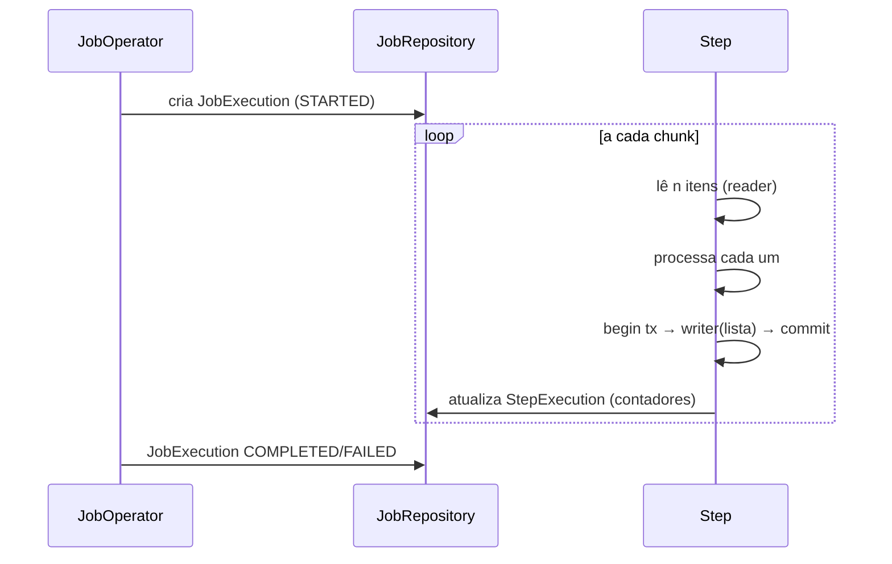

# Spring Batch

> **Resumo:** framework para processamento em lote: ler milhões de registros, transformar e gravar em *chunks*, com transação por bloco, reinício após falha e metadados de execução. Resolve o que um `for` com `@Transactional` não resolve: retomada, skip/retry, paralelismo e auditoria.
> **Pré-requisitos:** [09-transacoes](../02-spring-core/09-transacoes.md), [01-o-que-e-spring-boot](../03-spring-boot/01-o-que-e-spring-boot.md).
> **Versões:** Spring Batch **6.0.6** (BOM do Boot 4.1.2), Java 25. Exemplo executado em `/tmp/validacao/s12/a` (H2).

## 1. Definição

Um **Job** é composto por **Steps**. O step mais comum é orientado a *chunk*: `ItemReader` lê item a item, `ItemProcessor` transforma, `ItemWriter` grava uma lista de itens por transação. O **JobRepository** persiste o estado (execuções, parâmetros, contadores) para que um job falho seja reiniciado de onde parou.

## 2. Conceitos fundamentais

| Conceito | Papel |
|---|---|
| `Job` / `Step` | fluxo e etapas; um step pode ser *chunk* ou *tasklet* (uma ação só) |
| `JobInstance` | Job + parâmetros de identificação (ex.: data de referência). Mesma instância já concluída não roda de novo |
| `JobExecution` / `StepExecution` | uma tentativa de executar; guarda status, contadores (`read/write/commit/skip`) |
| `chunk(n)` | commit a cada n itens |
| Skip / Retry | tolerar itens ruins ou falhas transitórias sem derrubar o job |
| Partitioning / multi-thread | paralelismo dentro de um step |

## 3. Como funciona por dentro



A transação do chunk é o que garante a reinicialização: em falha, o chunk corrente sofre rollback e o repositório sabe quantos chunks foram confirmados.

## 4. Evolução histórica

Vem de 2007/2008 (colaboração Accenture/SpringSource); a versão 4 saiu em 2018 e a 5 acompanhou o Boot 3 (Jakarta). A **6.0** (acompanha Framework 7), segundo o "What's New" da documentação oficial: `JobOperator` passa a estender `JobLauncher` e `JobRepository` estende `JobExplorer`; `@EnableBatchProcessing` mantém só configurações comuns, com `@EnableJdbcJobRepository`/`@EnableMongoJobRepository` para o repositório; `DefaultBatchConfiguration` usa por padrão um repositório *resourceless* (sem banco); nova `ChunkOrientedStep`; retry passa a usar o do Framework 7 (não mais o Spring Retry); Jackson 3 é o padrão; APIs deprecadas foram removidas. Veja [evolução do Spring](../02-spring-core/01-o-que-e-spring.md). ⚠️ VERIFICAR datas de 2007/2018 (de memória).

Observado na validação: as classes de infraestrutura mudaram de pacote no 6.0: `ItemReader`, `ItemWriter` e `ListItemReader` estão em `org.springframework.batch.infrastructure.item[.support]`; `Job`/`JobExecution` em `org.springframework.batch.core.job`; `Step` em `org.springframework.batch.core.step`.

## 5. Exemplos práticos

Dependências: `spring-boot-starter-batch` e um banco (H2 no teste; PostgreSQL em produção). Job de faturamento mínimo (executado, saída `COMPLETED`, 3 commits para 5 itens com `chunk(2)`):

```java
@Configuration
public class BatchConfig {
  @Bean ItemReader<Integer> reader() { return new ListItemReader<>(List.of(1, 2, 3, 4, 5)); }

  @Bean Step step(JobRepository repo) {
    return new StepBuilder("totalize", repo).<Integer, String>chunk(2)
        .reader(reader())
        .processor(i -> "order-" + (i * 10))
        .writer(items -> System.out.println(items.getItems()))   // Chunk<String>
        .build();
  }

  @Bean Job job(JobRepository repo, Step step) {
    return new JobBuilder("billing", repo).start(step).build();
  }
}
```

Saída observada: `[order-10, order-20]`, `[order-30, order-40]`, `[order-50]`. Execução programática (no teste):

```java
@Autowired JobOperator op; @Autowired Job job;
JobExecution e = op.start(job, new JobParametersBuilder().addString("d", "1").toJobParameters());
```

No Boot, jobs rodam na inicialização por padrão; desligue com `spring.batch.job.enabled=false` (usado no teste) quando quiser disparar por agendador ou API. Leitores/escritores prontos: `JdbcCursorItemReader`, `JdbcPagingItemReader`, `FlatFileItemReader`, `JdbcBatchItemWriter`, entre outros. ⚠️ VERIFICAR nomes no 6.0 (pacotes `infrastructure`).

## 6. Configurações e anotações relevantes

| Item | Para que serve | Exemplo |
|---|---|---|
| `spring.batch.job.enabled` | roda jobs no startup | `false` |
| `spring.batch.job.name` | qual job rodar no startup | `billing` |
| `spring.batch.jdbc.initialize-schema` | cria tabelas `BATCH_*` | `embedded`/`always`/`never` ⚠️ VERIFICAR |
| `@EnableBatchProcessing` | personaliza infraestrutura (6.0) | `taskExecutorRef` |
| `@EnableJdbcJobRepository` | repositório JDBC (6.0) | `dataSourceRef` |
| `chunk(n)` | tamanho da transação | `chunk(1000)` |

## 7. Quando usar e quando NÃO usar

- Use: cargas noturnas, ETL, conciliação, geração em massa, qualquer trabalho que precise **reiniciar** e ser auditado.
- Não use: tarefa simples e curta (basta `@Scheduled`), fluxo contínuo de eventos (use [Stream](../04-spring-cloud/07-mensageria.md)/Kafka), ou quando o próprio banco faz melhor (um `INSERT ... SELECT`).

## 8. Erros comuns e boas práticas

- Reexecutar o mesmo job com os mesmos parâmetros: `JobInstanceAlreadyCompleteException`. Inclua um parâmetro identificador (data, id).
- Itens não *thread-safe* em step multi-thread (cursores JDBC); prefira *paging*.
- Chunk gigante estoura memória e transação; chunk 1 anula o ganho.
- Tornar o processamento **idempotente**: reinício reprocessa o chunk que falhou.
- Em Kubernetes, uma execução por pod/`Job` do K8s; cuidado com dois pods iniciando o mesmo job.

## 9. Perguntas de revisão

1. Por que o chunk é a unidade de transação?
<details><summary>Resposta</summary>Equilibra desempenho e recuperação: commit por item é caro; um commit só perde tudo na falha. Com chunk, o rollback afeta só o bloco corrente e o repositório permite retomar.</details>

2. O que identifica uma `JobInstance`?
<details><summary>Resposta</summary>O nome do job mais os parâmetros de identificação. Mesmos valores = mesma instância; se já concluída, não executa de novo.</details>

3. Para que serve o `JobRepository`?
<details><summary>Resposta</summary>Guarda execuções, parâmetros e contadores; é o que torna possível reiniciar e auditar.</details>

4. Qual a diferença entre tasklet e chunk?
<details><summary>Resposta</summary>Tasklet executa uma ação única (apagar arquivos, chamar procedimento); chunk faz leitura-processamento-escrita em blocos transacionais.</details>

5. Quando um `@Scheduled` basta?
<details><summary>Resposta</summary>Quando não há necessidade de reinício, skip/retry, auditoria nem grande volume.</details>

## 10. Referências oficiais

- Documentação: <https://docs.spring.io/spring-batch/reference/>
- Novidades do 6.0: <https://docs.spring.io/spring-batch/reference/whatsnew.html>
- Projeto: <https://spring.io/projects/spring-batch>

Voltar: [README](README.md) · Próximo: [02-spring-integration](02-spring-integration.md)
