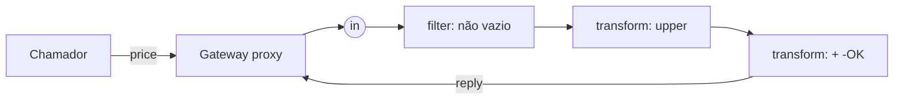

# Spring Integration

> **Resumo:** implementação em Spring dos *Enterprise Integration Patterns* (EIP): mensagens, canais, filtros, transformadores, roteadores e adaptadores (arquivo, HTTP, JMS, Kafka, AMQP, FTP...). Serve para montar fluxos de integração declarativos, dentro ou entre aplicações.
> **Pré-requisitos:** [08-eventos-validacao-e-conversao](../02-spring-core/08-eventos-validacao-e-conversao.md), [07-mensageria](../04-spring-cloud/07-mensageria.md).
> **Versões:** Spring Integration **7.1.2** (BOM do Boot 4.1.2), Java 25. Exemplo executado em `/tmp/validacao/s12/a`.

## 1. Definição

Tudo é uma `Message<T>` (payload + headers) que trafega por `MessageChannel`s entre *endpoints*. Um **fluxo** liga origem → passos → destino. O livro *Enterprise Integration Patterns* (Hohpe e Woolf) dá o vocabulário: Pipes and Filters, Content-Based Router, Splitter, Aggregator, Message Translator etc.

## 2. Conceitos fundamentais

| Conceito | Papel |
|---|---|
| `Message` | payload + headers (id, timestamp, correlação) |
| `DirectChannel` | ponto a ponto, síncrono, na thread do chamador |
| `QueueChannel` / `ExecutorChannel` | assíncronos |
| `PublishSubscribeChannel` | difusão |
| Endpoints | `filter`, `transform`, `route`, `split`, `aggregate`, `handle`, `enrich` |
| Adaptadores | ligam o mundo externo: *inbound* (traz mensagens) e *outbound* (envia) |
| `@MessagingGateway` | interface Java que esconde o envio de mensagens |

## 3. Como funciona por dentro

O DSL Java (`IntegrationFlow`) registra beans (canais anônimos e *endpoints*) no contexto. `@MessagingGateway` gera um **proxy JDK** ([07-aop-e-proxies](../02-spring-core/07-aop-e-proxies.md)) que transforma a chamada do método em `Message` enviada ao canal de entrada; o resultado volta pelo canal de resposta (`replyChannel` no header). Em canais `DirectChannel` tudo roda na thread do chamador, por isso uma exceção volta como exceção do método.



## 4. Evolução histórica

Criado em 2008/2009 como projeto do portfólio Spring, inicialmente em XML; a configuração por anotações e o DSL Java (antes um projeto à parte) foram incorporados nas versões 4.x e 5.x; suporte a reativo (`Flux`) veio depois. A versão 7 acompanha o Framework 7. ⚠️ VERIFICAR datas e versões históricas (de memória).

## 5. Exemplos práticos

Fluxo filtra, transforma e responde. Código executado (saída `ABC-OK`):

```java
@MessagingGateway(defaultRequestChannel = "in")
interface Pricing { String price(String order); }

@Configuration @EnableIntegration @IntegrationComponentScan
class Cfg {
  @Bean IntegrationFlow flow() {
    return IntegrationFlow.from("in")
        .filter(String.class, s -> !s.isBlank())
        .transform(String.class, String::toUpperCase)
        .<String, String>transform(s -> s + "-OK")
        .get();
  }
}
// pricing.price("abc") -> "ABC-OK"
```

Imports: `org.springframework.integration.dsl.*`, `org.springframework.integration.annotation.MessagingGateway`, `org.springframework.integration.annotation.IntegrationComponentScan` e `org.springframework.integration.config.EnableIntegration`. Dependência: `spring-boot-starter-integration`, mais o módulo do adaptador (`spring-integration-file`, `-http`, `-kafka`, ...). Adaptadores NÃO foram executados.

## 6. Configurações e anotações relevantes

| Item | Para que serve | Exemplo |
|---|---|---|
| `@EnableIntegration` | ativa a infraestrutura | na configuração |
| `@IntegrationComponentScan` | detecta `@MessagingGateway` | — |
| `IntegrationFlow` | fluxo em DSL Java | `.from("in").transform(...)` |
| `@ServiceActivator` | método vira handler de canal | `@ServiceActivator(inputChannel="in")` |
| `.channel(c -> c.queue())` | canal assíncrono | em um passo do fluxo |

## 7. Quando usar e quando NÃO usar

- Use: integrar vários sistemas/protocolos legados, roteamento por conteúdo, agregar mensagens, fluxos de arquivos/FTP/JMS.
- Não use: simples consumo de um tópico Kafka (Spring Kafka ou [Cloud Stream](../04-spring-cloud/07-mensageria.md) bastam), nem como "framework de eventos" interno ([eventos do Spring](../02-spring-core/08-eventos-validacao-e-conversao.md) ou [Modulith](03-spring-modulith.md)). Ele traz um vocabulário próprio que a equipe precisa dominar.

## 8. Erros comuns e boas práticas

- Fluxo `DirectChannel` assume mesma thread/transação; trocar por canal assíncrono muda o comportamento transacional.
- Gateway sem timeout de resposta pode bloquear para sempre (`replyTimeout`).
- Esquecer `@IntegrationComponentScan` deixa o gateway sem bean.
- Prefira o DSL Java a XML; teste fluxos pelo gateway.

## 9. Perguntas de revisão

1. O que é uma `Message`?
<details><summary>Resposta</summary>Payload mais headers; é a unidade que trafega pelos canais.</details>

2. O que o `@MessagingGateway` gera?
<details><summary>Resposta</summary>Um proxy da interface que envia uma mensagem ao canal de entrada e devolve a resposta.</details>

3. Diferença entre `DirectChannel` e `QueueChannel`?
<details><summary>Resposta</summary>Direct: síncrono, na thread do chamador. Queue: armazena mensagens e um consumidor as pega em outra thread.</details>

4. Quando preferir Cloud Stream?
<details><summary>Resposta</summary>Quando o problema é consumir/publicar em um broker com funções simples; Stream é construído sobre Integration.</details>

5. Por que existem adaptadores?
<details><summary>Resposta</summary>Para isolar o protocolo externo; o fluxo trabalha só com `Message`.</details>

## 10. Referências oficiais

- Documentação: <https://docs.spring.io/spring-integration/reference/>
- Projeto: <https://spring.io/projects/spring-integration>
- Enterprise Integration Patterns: <https://www.enterpriseintegrationpatterns.com/>

Anterior: [01-spring-batch](01-spring-batch.md) · Próximo: [03-spring-modulith](03-spring-modulith.md)
