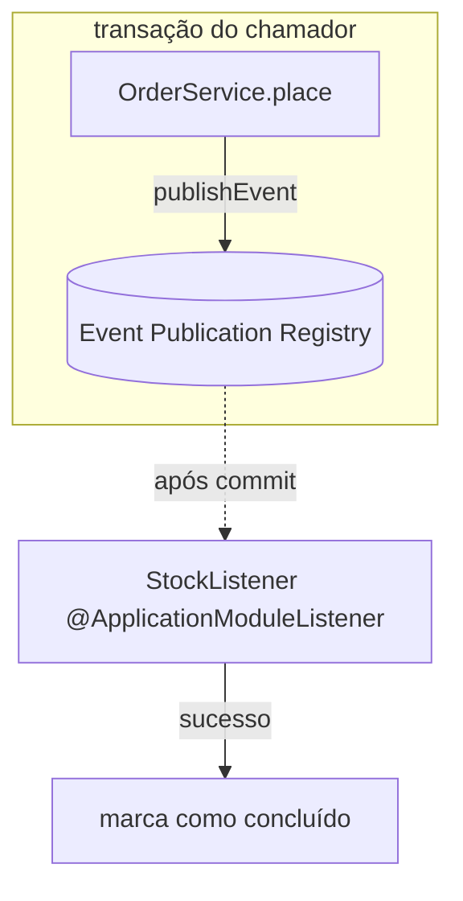

# Spring Modulith

> **Resumo:** ajuda a construir **monólitos modulares**: define módulos pelos pacotes, verifica as dependências entre eles em teste, publica eventos entre módulos com persistência opcional e gera documentação. É a alternativa pragmática a quebrar em microsserviços cedo demais.
> **Pré-requisitos:** [08-eventos-validacao-e-conversao](../02-spring-core/08-eventos-validacao-e-conversao.md), [09-transacoes](../02-spring-core/09-transacoes.md), [10-testes-no-spring-boot](../03-spring-boot/10-testes-no-spring-boot.md).
> **Versões:** Spring Modulith **2.1.2** (BOM próprio `spring-modulith-bom`; não gerenciado pelo Boot), Boot 4.1.2, Java 25. Executado em `/tmp/validacao/s12/b`.

## 1. Definição

Cada **subpacote direto** do pacote da classe `@SpringBootApplication` é um *application module*. Tipos no pacote raiz do módulo são sua **API pública**; subpacotes são internos. O Modulith **verifica** isso (sem ciclos, sem acesso a internos de outro módulo) e oferece integração por **eventos** com garantia de entrega.

## 2. Conceitos fundamentais

- **Módulo:** `com.example.orders.orders`, `com.example.orders.inventory`...
- **Verificação:** `ApplicationModules.of(App.class).verify()` falha o teste se a regra for violada.
- **Eventos entre módulos:** módulo A publica um evento de domínio; B escuta. Desacopla A de B (A não importa B).
- **`@ApplicationModuleListener`:** atalho para `@Async` + `@Transactional(REQUIRES_NEW)` + `@TransactionalEventListener` (pós-commit).
- **Event Publication Registry:** com o módulo `events` e um repositório (JDBC, JPA, Mongo...), o evento é gravado na mesma transação e marcado como concluído após o listener; os incompletos podem ser reenviados (parente do *Outbox*, ver [microsserviços](../06-padroes-de-projeto/07-padroes-de-microsservicos.md)).
- **Testes de módulo:** `@ApplicationModuleTest` sobe só um módulo (e seus mocks/dependências).
- **Documentação:** `Documenter` gera diagramas C4/PlantUML a partir da estrutura.

## 3. Como funciona por dentro



A análise de estrutura usa **ArchUnit** sobre o bytecode (o modelo é `ApplicationModules`). O listener é um `@TransactionalEventListener` com fase `AFTER_COMMIT`: **sem transação ativa na publicação, o evento é descartado**. Isso foi reproduzido: sem `@Transactional` em `place(...)` o listener não rodou (`null`); com `@Transactional` rodou (`ABCx2`).

## 4. Evolução histórica

Nasceu como projeto experimental (Spring Experimental, 2022) e virou projeto oficial na versão 1.0 (2023), alinhado ao Boot 3.x. A série 2.x acompanha o Boot 4 / Framework 7. ⚠️ VERIFICAR datas (de memória).

## 5. Exemplos práticos

Dependências: `spring-modulith-starter-core`, `spring-modulith-events-api` (para `@ApplicationModuleListener`) e `spring-modulith-starter-test`; importe o `spring-modulith-bom`.

```java
// com.example.orders.orders (módulo "orders"): API pública
public record OrderPlaced(String id, String sku, int qty) {}

@Service
public class OrderService {
  private final ApplicationEventPublisher events;
  public OrderService(ApplicationEventPublisher e) { this.events = e; }

  @Transactional   // obrigatório para o listener pós-commit rodar
  public void place(String id, String sku, int q) { events.publishEvent(new OrderPlaced(id, sku, q)); }
}

// com.example.orders.inventory (módulo "inventory"): depende só do evento
@Component
class StockListener {
  @ApplicationModuleListener     // org.springframework.modulith.events
  void on(OrderPlaced e) { /* baixa estoque */ }
}
```

Verificação e relatório (executados): módulos `orders` (sem dependências) e `inventory` (depende de `orders`).

```java
var modules = ApplicationModules.of(App.class);
modules.forEach(m -> System.out.println(m.getIdentifier()));   // orders, inventory
modules.verify();                                                // falha se houver ciclo/acesso indevido
```

Para o registro persistente adicione `spring-modulith-starter-jpa` ou `-jdbc` ⚠️ VERIFICAR nomes; NÃO executado. Externalização de eventos para Kafka/AMQP (`@Externalized`) também NÃO executada.

## 6. Configurações e anotações relevantes

| Item | Para que serve | Exemplo |
|---|---|---|
| `ApplicationModules.of(App.class)` | modelo e `verify()` | em teste |
| `@ApplicationModule` (em `package-info.java`) | declara dependências permitidas | `allowedDependencies = "orders"` |
| `@ApplicationModuleListener` | listener assíncrono pós-commit | acima |
| `@ApplicationModuleTest` | teste de um módulo | — |
| `Documenter` | gera documentação | `new Documenter(modules).writeDocumentation()` |

## 7. Quando usar e quando NÃO usar

- Use: monólito que cresce e precisa de fronteiras reais; preparação para extrair serviços depois (*Monolith First*).
- Não use: aplicação minúscula (estrutura de pacotes por camada basta), nem como substituto de segurança de acesso: a verificação é de **design**, em teste, não em runtime (um `public` ainda é acessível por reflection).

## 8. Erros comuns e boas práticas

- Publicar evento sem transação → listener pós-commit nunca roda (validado).
- Organizar por camada (`controller/service/repository`) na raiz impede módulos: organize **por domínio**.
- Evento com entidade JPA gerenciada: use records imutáveis com ids.
- Listener assíncrono significa consistência **eventual**; trate falhas (reenvio de publicações incompletas) e idempotência.
- Rode `verify()` na CI.

## 9. Perguntas de revisão

1. O que define um módulo?
<details><summary>Resposta</summary>Cada subpacote direto do pacote da aplicação principal; o pacote raiz do módulo é API, os subpacotes são internos.</details>

2. Por que o listener não executou sem `@Transactional`?
<details><summary>Resposta</summary>`@ApplicationModuleListener` é `@TransactionalEventListener` (AFTER_COMMIT); sem transação, o evento não é entregue.</details>

3. O que `verify()` garante e o que não garante?
<details><summary>Resposta</summary>Garante ausência de ciclos e de acesso a internos, em teste. Não impede acesso em runtime.</details>

4. Como o registro de publicações se relaciona ao Outbox?
<details><summary>Resposta</summary>Grava o evento na mesma transação do negócio e reenvia incompletos; é a base do padrão Outbox dentro do monólito.</details>

5. Quando ir para microsserviços?
<details><summary>Resposta</summary>Quando escala, ciclo de deploy ou equipes independentes justificarem o custo operacional; módulos bem separados facilitam a extração.</details>

## 10. Referências oficiais

- Documentação: <https://docs.spring.io/spring-modulith/reference/>
- Projeto: <https://spring.io/projects/spring-modulith>

Anterior: [02-spring-integration](02-spring-integration.md) · Próximo: [04-spring-authorization-server](04-spring-authorization-server.md)
